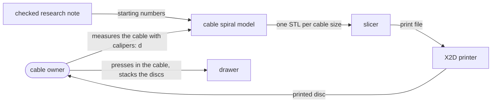
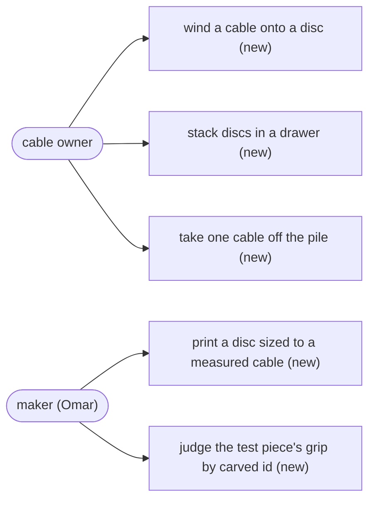
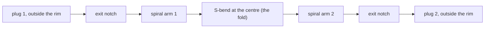

# Cable spiral: a thin disc you press a cable into, and stack

**A cable spiral is a flat printed disc, about the size of a coaster, with an open spiral channel on
top: you fold a charging cable in half, press it down into the channel, and it stays there until you
pull it out. Discs stack, so a drawer of cables becomes a neat pile.**

**Status:** design, 2026-11-11. Nothing here has been printed. Every number is a starting value for
the first test print, called "Suggested" or "a guess to test", not a settled one. The model is
`src/CableSpiral/cable-spiral.scad`.

**The ask** (Omar, 2026-11-11): "i want to create our own top open cable spral that I can wrap a
cable around and it can stay in palce, thin, stackable".

## The problem

Loose charging cables tangle. Anyone who keeps a drawer of phone and laptop cables pulls out one and
gets three. Today we have nothing of our own for this. Two bought designs wait on the
[cables-1](../plates/cables-1.md) plate, which has not been printed: a holder and some clips. Neither
holds a whole cable flat and neither stacks.

A concrete case. Omar has a 1 m USB-C cable, about 4 mm thick, with a plug at each end. He wants to
wind it onto something thin, drop it in a drawer, put the next cable's disc on top, and later lift
one off with the cable still in place. It should not unwind when the disc is tipped or carried.

## Why it matters

- **It is our own design, not a download.** We can size it to each cable we own, and it can join the
  store's range beside the coasters if it works.
- **It is cheap to find out.** The test piece is small strips of channel, a few grams of plastic,
  and it answers the grip question before anyone prints a whole disc.
- **If we get the grip wrong, it fails in a way you notice.** Too loose and the cable falls out when
  the disc tips. Too tight and the channel's thin walls crack after a few weeks of daily use.

## The idea

Think of a vinyl record whose groove is wide enough for a cable, with a slightly narrow top edge. The
cable is pressed down through the narrow top, the edges spring back, and the cable sits in the
groove underneath. The cable is folded in half, so the fold sits in an S-shaped curve at the centre.
The two halves run outward side by side, so **both plugs come out at the edge**, never in the middle.


*The disc for a 4 mm cable, 96.7 mm across and 6.2 mm thick. It holds 1.0 m of cable. The orange
faces are where the two exits are cut through the rim; the preview colors cut faces orange.*

Stacking needs nothing extra. The flat underside of the disc above lies on the tops of the channel
walls of the disc below, so it closes every channel, and a stacked cable cannot lift out at all. A
low ring round the top edge sits in a chamfer[^chamfer] on the bottom edge of the disc above, so the
pile stays lined up.

## Context: who uses it and what it touches



**In the diagram:** cable owner[^owner]; the model[^model]; d[^d]; STL[^stl]; slicer[^slicer]; X2D
printer[^x2d].

The only input that matters is d, the cable's thickness. Everything else follows from it.

## Use cases



**In the diagram:** cable owner[^owner]; carved id[^id].

- **A cable owner winds a cable onto a disc.** Fold it at the middle, lay the fold in the S-bend,
  press each half down into its spiral with a thumb, let the plugs hang out of the two exits.
- **A cable owner stacks discs in a drawer.** Each disc sits on the one below and closes its
  channels. Turn each disc so its exits miss the ones below. A plug head is about 6.3 mm thick,
  thicker than a disc for a small cable, so plugs from neighbouring discs would hit if lined up.
- **A cable owner takes one cable off the pile** and unwinds it by pulling the plugs.
- **The maker prints a disc sized to a measured cable.** One setting, d.
- **The maker judges the test piece** by the ids carved into it (see
  [the first test piece](#the-first-test-piece)).

## The user-facing surface

**No app, page or button.** This is a printed object and one OpenSCAD file. The maker's whole
interface is one setting and two commands:

```
openscad -D 'part="disc"'   -D d=4.0 -o disc.stl   src/CableSpiral/cable-spiral.scad
openscad -D 'part="coupon"' -D d=4.0 -o coupon.stl src/CableSpiral/cable-spiral.scad
```

`cable_length` (1000 mm by default) sets how much cable one disc holds; the disc grows to fit.

## The pieces and where they live

This is one small file in one repo with no other component, so there is no component or data-model
diagram (design-craft C9 does not apply). The file has four parts: `disc` (the product), `coupon`
(the first test piece), and `plan` and `section`, which draw the flat pictures in this doc.

## How it works

### How the cable is held

**In plain words: the channel is a little wider than the cable, and its top edge is a little
narrower.** The cable presses past the narrow top, the walls bend outward a fraction of a
millimetre, then spring back over it.


*A cut across each test bar, with a 4 mm cable drawn on each channel floor. A, C and E differ only
in how narrow the top is. F has no lip at all. G and H are the thin version. J is two channels
sharing one wall. Each letter is the id carved into that bar.*

All sizes in mm; d is the cable's thickness. Worked values are for d = 4.

| Part | Rule | d = 4 | Where it comes from |
|---|---|---|---|
| Channel width | d + 0.4 | 4.4 | A guess to test. 0.2 mm a side is Sovol's starting gap for mating parts, so the walls do not press on the cable all the time; PLA[^pla] creeps under a steady load. |
| Mouth[^mouth] | 0.80 × d | 3.2 | The middle of a 0.70 to 0.85 band seen only in a search snippet for one clip design. That clip flexes along its layers and ours bends across them, so the band carries over only as the range to test. The test piece tries 0.75, 0.80 and 0.85. |
| Lip[^lip] reach, each side | (width − mouth) / 2 | 0.6 | Arithmetic. |
| Lip underside | 45° slope, starting at height d | 0.6 tall | 45° prints with no support (Hubs and Prusa). Starting at height d means a cable lying on the floor never touches it. |
| Lip tip height | d + reach | 4.6 | Arithmetic. |
| Lead-in[^leadin] above the tip | 0.2 × d tall, 30° from upright | 0.8 | The height is geometry: a cable lifted up against the lip tips has its top 0.2 × d above them, so the disc above still closes over it. The 30° is a guess inside Sovol's 25° to 35° starting range. |
| Floor | 0.8 (four layers) | 0.8 | A guess to test. |
| Wall between turns | 0.8 (two lines) | 0.8 | A guess to test. One line, about 0.45, is the least that prints. |
| **Disc thickness** | floor + tip + lead-in = **1.3 × d + 1.0** | **6.2** | Arithmetic. |

**How hard the wall bends.** The cable pushes the top of each wall sideways by (d − mouth)/2, 0.4 mm
for a 4 mm cable. A simple beam sum puts the stretch at the wall's foot at about 2.3%. Fictiv's
snap-fit guide allows PLA 4 to 8%, halved for a part that bends across its layers, so 2 to 4%; Bambu's
sheet gives 7.5% as the point where PLA breaks across layers. Neither source says where its 4 to 8%
comes from, and the beam sum treats the wall as a lone strip when it is one long wall, so **the
figure ranks options; it does not promise the wall survives daily use.** Only the print can say.

### The path the cable takes


*The channel layout from above. The fold sits in the S at the centre, the two halves run outward
between each other, and each ends in an exit cut through the rim.*



**In the diagram:** S-bend[^sbend]; exit notch[^exit].

- **The S-bend** is two half-loops of radius 2.5 × d (10 mm for a 4 mm cable). That radius is a
  guess: no source we found gives how tightly a USB-C cable can bend.
- **The two arms** start at twice that radius and wind outward. Each turn adds d + 1.2 of radius
  (channel plus wall), shared between the two arms.
- **The exits.** At the end of each arm the channel turns outward 60° round a curve no tighter than
  the S-bend, then runs straight off the disc. Leaving along the spiral would cross the rim almost
  flat and leave a thin sliver of rim; turning out first crosses it steeply and ends the rim in a
  square cut. The exit is cut the full channel width with no lip, so the cable near the plug lifts
  out freely.
- **The rim** outside the last turn is 2 mm, a guess.

**Disc size against cable length**, from the model for d = 4: 1 m of cable needs a disc 96.7 mm
across. The research note's table says about 92 mm. The difference is that the note measured to the
middle of the outermost channel and added the rim, while the model adds half a channel width too.
The model's figure is the one that prints. A 2 m cable needs a disc about 130 mm across.

### How the discs stack

- **The bottom edge** has a 0.6 mm 45° chamfer. Hubs and Prusa both advise a chamfer, not a rounded
  edge, where a part meets the bed.
- **The top edge** has a ring 0.4 mm tall with a sloped inner face. It tucks into the chamfer of the
  disc above, 0.2 mm short of filling it, so it never holds the disc above off the channel walls.
  0.2 mm is Prusa's stated accuracy for its own printers; on the X2D it is only a starting guess.
- **No bridges[^bridge] anywhere.** The underside is flat.

## One disc per cable size

A channel drawn for one cable grips cables from about 0.94 × that size up to that size + 0.4 mm. That
range rests on the snippet-only 0.70 to 0.85 band, so it is a guess until the test piece shows it.

| Drawn for (d) | Grips cables of about | Disc thickness |
|---|---|---|
| 3.2 | 3.0 to 3.6 | 5.2 |
| 3.9 | 3.7 to 4.3 | 6.1 |
| 4.6 | 4.3 to 5.0 | 7.0 |

Three sizes cover the USB-C cables we found figures for: 3.0 mm (Apple 1 m) to 4.7 mm (Anker). Earbud
wire, about 2 mm from a snippet, would need its own size. **Omar's own cables need measuring with
calipers before any disc is printed.**

## Alternatives and the decision

Two researchers answered the same question without reading each other, and a checker re-opened the
sources and settled the differences. The table weighs the three real choices.

| Choice | Picked | Rejected | What the rejected one would buy | Why it lost | What each verifies |
|---|---|---|---|---|---|
| **Cable path** | Fold at the middle: S-bend plus two spirals, both plugs at the rim | One spiral from the centre out | A smaller centre, slightly more cable per disc | The inner plug sits in the middle. A plug head is about 6.3 mm thick, as thick as the disc, so it cannot sit inside a stack. No variant keeps one spiral and gets the plug out: a plug pocket needs a thicker disc. | Both are checked only by the test print; the S-bend radius is a guess either way. |
| **Stacking** | Flat underside closes the channels below; a rim ring lines them up | A stub on top and a pocket underneath, at the centre | A stronger lock against sliding | The stub sits exactly where the S-bend goes, and the pocket's roof is a 10.4 mm bridge, past the 5 mm Hubs gives for a clean, unsagging roof. The dominating variant, a ring at the rim, keeps the lining-up and frees the centre. | Coupons L and P test the ring. |
| **Thickness** | Tip high, 1.3 × d + 1.0 (6.2 mm) | Tip low, d + 1.0 (5.0 mm) | 1.2 mm thinner, the "thin" in the ask | A shorter wall bends harder: about 4.2% stretch with a 0.8 wall, over the 2 to 4% band. A 0.45 single-line wall brings it back to 2.3% but is about a sixth as stiff, so it may not grip. | Both go on the test piece (G, H), so the print decides, not the arithmetic. |

**Decided: the fold, the rim-ring stack, and tip high as the first disc, with the thin version on the
test piece beside it.** Thin enough is part of the ask, so if G or H grips as well as C, the disc
moves to the thin version. Ownership is ours either way: there is no third-party part in it.

Both rejected options are still recorded in the two research passes, so nobody needs to re-derive
them.

## The first test piece

**Not a whole disc.** Strips of channel, each 40 mm long, with an id carved on a tab beside each one
and **open at both ends**, so a real cable with plugs lies flat through them. Ids skip B, D, M, N
and O, which look alike when carved small.


| Id | What it is | What it answers |
|---|---|---|
| A, C, E | Mouth 0.75, 0.80, 0.85 × d, tip high, 0.8 wall | Which mouth grips with a thumb press and still lets go |
| F | No lip at all | The control: does any lip matter |
| G | Thin version, tip low, 0.8 wall | Can the disc be 1.2 mm thinner |
| H | Thin version, tip low, 0.45 wall (one line) | Does a softer wall fix the thin version's stretch, and still grip |
| J | Two channels sharing a 1.2 mm wall | A wall with a cable on both sides, as on the disc |
| K | A half-loop at the S-bend radius | The tightest curve: does the cable sit in it |
| L, P | Two small discs with the ring and the chamfer | Does one sit flat on the other and stay lined up |

**After the print, for each bar A to K:**

1. Press the cable in with a thumb. Note if it would not go in.
2. Turn the bar upside down and shake it gently. Note if the cable falls out.
3. Pull the cable up and out. Note if it took a firm pull.
4. Repeat the press and pull 20 times (Sovol's cycle count), then look at the foot of each wall for
   a crack or a white stress mark.

**For L and P:** set L on P. Does it sit flat, and does it slide when pushed sideways?

The test piece can share a bed with the [cables-1](../plates/cables-1.md) holder and clips, so one
print shows the bought designs and ours on the same cable. That plate is the plates session's to
lay out and send.

## Open questions

1. **What does Omar's own cable measure?** Everything scales from d; it is set to 4.0 until then.
2. **Will the stacking ring print?** It is a triangle 0.4 mm wide at its base, so its top layer is
   about 0.2 mm wide, narrower than one 0.4 mm nozzle line. The slicer may leave it out. Slice
   coupon L and look before printing; if it vanishes, widen the ring and the chamfer together.
3. **Is 2.5 × d tight enough for the S-bend, or too tight for a stiff braided cable?** K answers
   this for one cable.
4. **Does the grip last?** PLA creeps; a month in a drawer may loosen it. PETG is the usual fix,
   untested here.

## Glossary

[^chamfer]: **chamfer** — a flat 45° bevel cut along an edge, instead of a sharp corner.
[^owner]: **cable owner** — whoever winds and stores the cables; today, Omar.
[^model]: **the model** — the OpenSCAD file that draws the disc and the test piece. OpenSCAD is a
    free program that builds 3D shapes from a short text description.
[^d]: **d** — the cable's thickness (outside diameter) in mm, measured with calipers. The one
    setting of the model.
[^stl]: **STL** — the common file format for a 3D shape, the input a slicer reads.
[^slicer]: **slicer** — the program that turns a 3D shape into the layer-by-layer moves a 3D
    printer makes. Here, Bambu Studio.
[^x2d]: **X2D printer** — our Bambu Lab X2D 3D printer: 0.4 mm nozzle, 0.2 mm layers, printing PLA.
[^id]: **carved id** — a letter cut into the top of each test part, so a question after the print
    can name the part exactly.
[^pla]: **PLA** — the common plastic we print with. Stiff, a little brittle, and it slowly deforms
    under a load held for a long time (creep).
[^mouth]: **mouth** — the narrowest gap at the top of the channel, between the two lip tips. Narrower
    than the cable, so the cable has to be pressed past it.
[^lip]: **lip** — the small ledge on each side at the top of the channel that narrows it to the
    mouth.
[^leadin]: **lead-in** — the slope above the lip that funnels the cable toward the mouth, so it is
    pressed in rather than caught on a sharp edge.
[^sbend]: **S-bend** — the S-shaped curve at the centre of the disc where the cable's fold sits.
[^exit]: **exit notch** — the cut through the rim where each end of the cable leaves the disc, with
    its plug hanging outside.
[^bridge]: **bridge** — a stretch of plastic printed in mid-air between two supports. Long ones sag.

## Appendix

### Where the numbers came from

- **The research.** Pass A, [PR #1020](https://github.com/omars-lab/3d-models/pull/1020); pass B,
  [PR #1021](https://github.com/omars-lab/3d-models/pull/1021); the checker's consolidated note,
  [PR #1022](https://github.com/omars-lab/3d-models/pull/1022), which is the one this doc follows.
  Each claim there is marked as re-opened (the checker downloaded and read the page), closed (the
  page answered with a bot check and was not read) or snippet (seen only as a search summary).
- **Sources re-opened by the checker:** the Bambu PLA Basic data sheet (break stretch 12.2% along
  layers and 7.5% across; overhang 55°; bridge 30 mm, with no stated angle convention); Fictiv's
  snap-fit guide as republished on Core77 (PLA 4 to 8%, halved across layers, the beam formula
  1.5 · t · Y / L²); Sovol on snap fits (0.20 to 0.40 mm a side, lead-in 25° to 35°, 20 to 30
  cycles, PLA creep); Prusa (45° to 60° overhangs, 0.45 mm line, 0.2 mm accuracy); Hubs (45°
  overhangs, bridges under 5 mm do not sag, chamfer bed edges); StarTech (4.0 mm cable); Apple
  Community (3.0 and 3.5 mm, one user's measurement); Anker (4.7 mm cable, 6.3 mm plug head);
  ChargerLAB (4.6 mm).
- **Prior art.** All three pages that might show a design like this answered with a bot check and
  were not read. A search summary for MakerWorld 3056379 describes a disc with an S-shaped slot and
  both plugs left outside, which matches this layout; it may be closed on top. None of the roughly
  40 sources the two passes read shows an open-topped channel disc that stacks. That is a claim
  about those sources, not about the web.
- **Porting.** Prusa's 0.2 mm accuracy and 0.45 mm line width come from Prusa printers and
  PrusaSlicer. They carry over to the X2D only as starting values, because both printers use a
  0.4 mm nozzle, and the test piece is what checks them.

### Model notes

- Built for OpenSCAD 2021.01. The sloped lip and lead-in are stacked 0.1 mm slabs, half a print
  layer each, so the slicer sees a slope.
- A channel that stops exactly at an outer edge leaves faces of zero thickness that 2021.01 cannot
  close into a solid, so every channel runs 1 mm past the shape it is cut from.
- A repeated point where two path pieces join has no direction and breaks the channel outline; the
  path drops repeated points before it is drawn.
- `-D 'only="K"'` with the coupon part renders one test piece on its own, which is how a render
  error is traced to one piece.
- Pictures: `part="plan"` and `part="section"` draw the two flat views above. The section's cable
  circles are drawn d across, sitting on the channel floor.
