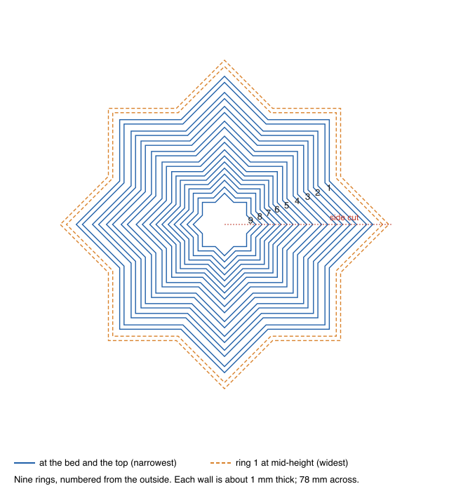
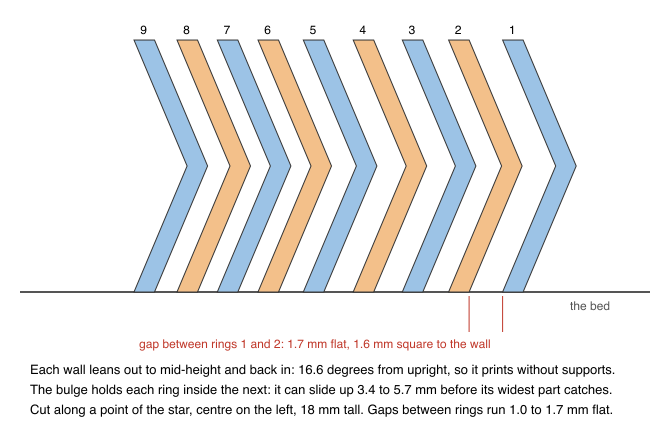
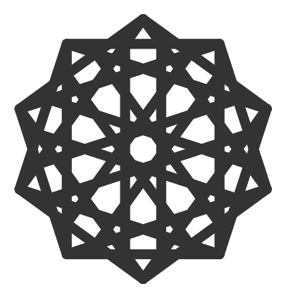
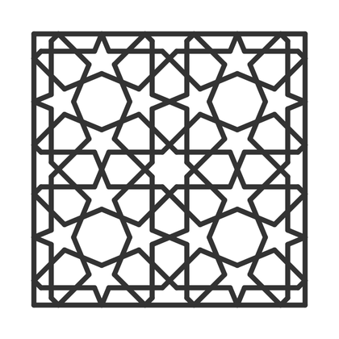
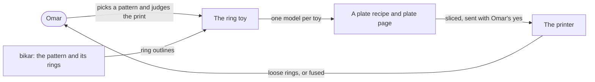
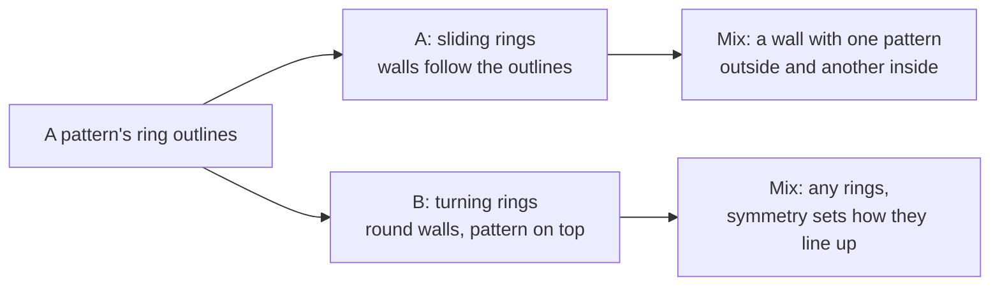
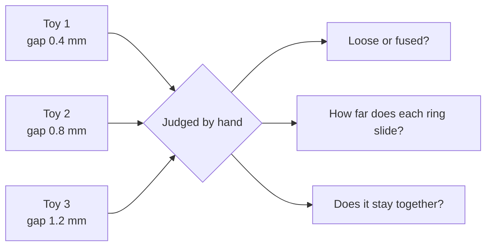

# Fidget toys from our patterns

**A slide-out ring toy, like the fidget star on toys-1, built from the rings of our own rosettes.**

> Draft, 2026-11-08. Nothing here is built or printed. The star on toys-1 has printed but has not
> been judged yet, and that verdict sets the bottom of the gap ladder in the
> [first print](#8-the-first-print-learn-the-gap-not-the-pattern).

**The ask** (Omar, 2026-11-08): "design what it would take to do a similar star fidget toy but with
our other coaster patterns? can we mix and match in this regards?"

## 0. The answer in one screen

**Yes, for sliding rings. The pattern decides each ring's shape, and patterns can be mixed freely.
Turning rings are a different toy and come second.**

1. **The star is nine thin star-shaped walls nested inside each other.** Each wall bulges out at
   mid-height, so each ring is held inside the next one but can slide up a few millimetres. Pull
   the middle and the star stretches into a cone. Nothing turns, and nothing needs supports.
2. **Our patterns give the ring shapes.** Around a rosette's centre, the tiles fall into rings. The
   outline round the first one, two or three rings of tiles is a closed shape. Each such outline
   becomes one wall. That works where a pattern has a clean centre: fully in one of the six patterns
   checked here, for the inner rings of three more, and not at all in two (§4).
3. **Mixing is easy for sliding rings.** A wall only has to match its two neighbours' outlines, gap
   apart. Symmetry does not matter, because nothing turns. A wall whose outer face is one pattern
   and whose inner face is another joins two patterns, as long as it is thick enough everywhere.
4. **The gap is the question we cannot answer from a desk.** Our evidence says 0.4 mm is the least
   gap that prints apart, and that is a bet, not a measurement for walls side by side. A wider gap
   also gives more slide, so the safe choice and the fun choice point the same way.
5. **First print: three small three-ring toys, plain stars, at gaps 0.4, 0.8 and 1.2 mm.** That
   teaches the gap, the slide and the hold on our printer before any pattern work in bikar.

## 1. The problem

We have a growing set of Islamic-pattern constructions, and so far every one of them becomes a
coaster: a flat 4.4 mm disc. On 2026-11-07 Omar printed someone else's toy, an eight-point fidget
star, on the plate [toys-1](../plates/toys-1.md). It is a pile of nested star rings that pull out
into a cone. It looks like one of our rosettes, and it moves.

We cannot make one from our own patterns today. bikar, our pattern engine, can build a coaster, a
split coaster with loose pieces, and a woven orb. It has no way to stand a pattern's outline up as
a thin free wall, bulge it, and nest a set of them with a gap between.

## 2. Why it matters

- **A second product from the same patterns.** A toy is a gift and a desk object, not a coaster.
  The same construction would sell twice.
- **It shows the pattern's structure.** Pulled out, each ring of the rosette stands at its own
  height. That is a way to see how the pattern is built that a flat coaster cannot give.
- **It is cheap to learn.** The rings are thin, so a test toy is a few grams of filament.

## 3. How the star works

*The fidget star from above, drawn from the numbers in its mesh. Blue: each ring's wall where it
meets the bed (the top is the same). Dashed orange: the outer ring at mid-height, where it is
widest. Rings are numbered from the outside.*

*A cut along one point of the star, centre on the left. Each wall is a chevron: it leans out to
mid-height and back in. In this cut through a point the lean looks steeper than it is; square to
the wall's face it is 16.6 degrees from upright.*

Measured from the downloaded mesh (the file stays in Omar's iCloud folder, never in git; this
repo is public):

- **Nine separate bodies, each one ring.** 78 mm across, 18 mm tall. Every ring stands on the bed.
- **Each wall is about 1 mm thick** (1.035 mm in a flat cut, the same at every height).
- **The bulge is a plain stretch.** At mid-height each ring is a scaled-up copy of itself at the
  bed: every corner moves out along its line from the centre, the points by 3.79 mm and the
  valleys by 2.90 mm, the same for all nine rings. The wall stays the same thickness.
- **The gaps between rings run 1.0 to 1.7 mm** in a flat cut (0.96 to 1.63 mm square to the walls).
  They are uneven from ring to ring, which suggests they were not chosen for printing.
- **Each ring is held in by 1.1 to 2.4 mm**: its widest outline is that much wider than the
  narrowest opening of the ring outside it.
- **Each ring slides 3.4 to 5.7 mm** before it catches, about 35 mm for the whole stack. That
  matches *slide ≈ gap ÷ tan(lean)* to within 0.1 mm for every pair (1.695 ÷ tan 16.6° ≈ 5.7;
  1.003 ÷ tan 16.6° ≈ 3.4).
- **The rings do not turn.** A ring touches its neighbour after 4.6 to 11.5 degrees of twist.

Full numbers: [Appendix A](#appendix-a--the-stars-measurements).

**What makes it print in one go.** The walls lean 16.6 degrees from upright, well inside the 45
degrees a printer can build without support. So the whole toy prints in place, every ring at once,
and comes off the bed as nine loose pieces as long as the gaps stay open.

## 4. The idea: one wall per ring of the pattern

A rosette is built in rings round its centre: a middle star, then a ring of tiles round it, then
another. bikar already sorts a pattern's tiles into these rings; its `bands` report lists each
ring's distance from the centre and how many tiles it holds. The outline round the first *k* rings
of tiles is a closed shape. Take that outline for *k* = 1, 2, 3 and each becomes one wall of the
toy, nested the way the star's rings are.

*0ke_GpoBa-s, drawn by bikar. Ten-fold, with one centre: its tiles fall into twelve clean rings of
10 or 20 tiles. The outlines round its middle decagon, round the first ring of tiles and round the
whole rosette are three candidate walls.*

*7apC5Q9QS-8, drawn by bikar. It is full of eight-point stars, but it is a repeating tile, and the
point bikar measures from is only four-fold: three clean rings of 8 tiles, then the rings break up.
A toy from it would use one of its eight-point stars as the centre, not the tile's middle.*

**Which of our patterns have rings to use.** I ran the `bands` report on six constructions (not on
all 34 in the ledger, so this says nothing about the rest):

| Pattern | Symmetry the ledger gives | What the ring report shows round bikar's centre | Usable for a ring toy |
|---|---|---|---|
| 0ke_GpoBa-s | 10 | 12 clean rings of 10 or 20 tiles out to 17.7 mm | Yes, the clearest case |
| GimTvN9hw4U | 6 | 4 rings of 5 to 10 tiles, then mostly 2 or 3 | The inner rings, yes |
| 7apC5Q9QS-8 | 8 | centre only four-fold; 3 clean rings of 8 tiles | The inner rings, from a star centre |
| gBV_JTt3Kxk | 10 | 2 clean rings of 10, then the frame breaks it up | The middle star and one ring |
| rDuxHF3xMOc | 8 | no ring round its centre (one-fold) | Not round this centre |
| n3IidKfXE1I | 12-6-4 | no ring round its centre (rings of 1 or 2 tiles) | Not round this centre |

The last two may still have a usable centre elsewhere in the tile. The report measures from one
point only.

**What is lost.** A wall is one line, so the toy shows each ring's outline, not the crossing straps
inside the ring. Seen from above, the pulled-in toy reads as nested outlines, the way the star does.
That is a real loss for a pattern whose beauty is in its interlace, and it is why the choice of
pattern matters (open question 4).

**Who and what it touches.**

**No app surface.** Nothing changes in the gallery, the Lab or the store. It shows up as a new
bikar declaration, a plate recipe with its page, and the usual page Omar judges the print on.

## 5. Options

| | **A. Sliding rings (recommended first)** | **B. Turning rings** | **C. A coaster-thick toy** |
|---|---|---|---|
| What it is | The star, with our outlines | Flat round bands, each with its ring of the pattern on top; turn them to line the rosette back up | Option A at coaster height, 4.4 mm |
| Pros | Proven by the star; the shape *is* the pattern; prints in one go with no supports | Mixes any patterns; a puzzle as well as a fidget | Fits the coaster line |
| Cons | Shows outlines, not interlace; rings do not turn | A star cannot turn in a star-shaped hole, so the walls must be round and the pattern moves onto the top face; a new toy, nothing to copy | The slide can never pass half the height, 2.2 mm, and is less in practice: not a toy |
| What it commits us to | A new bikar declaration (§7) | The same plus a round-bearing design, close to the [turning middle piece](../coaster/spinner-middle-design.md) | Nothing new, and nothing worth having |
| Verifies | The gap print in §8 | Nothing until A's gap is known | — |

**Option C is out.** The slide comes from the height. A ring is held in only if its bulge is wider
than the gap, and the bulge is the half-height × tan(lean). So the slide, gap ÷ tan(lean), is always
less than half the height. A coaster-thin toy moves under 2.2 mm a ring, so the toy is its own
object, about as tall as the star (18 mm).

**Option B is a second toy, not a variant of A.** A round wall keeps nothing of the star's look; the
pattern has to be cut or raised on each band's top face. It reuses the round undercut worked out for
the [spinner middle piece](../coaster/spinner-middle-design.md). Leave it until A has printed.

## 6. Mixing patterns: what must line up

**For sliding rings (A), only shapes and gaps.**

- Neighbouring walls must follow the same outline, one gap apart, on the faces that meet. The inner
  wall's outer face and the outer wall's inner face are the same shape.
- A wall can have a different outline on its two faces. Its outer face follows pattern X and its
  inner face pattern Y. That wall joins a ring of X outside to a ring of Y inside. Its thinnest
  point must still be a full wall (§7). A round face is a special case, so a round wall joins any
  two patterns.
- **Symmetry does not matter.** Nothing turns, so a ten-fold ring can sit inside an eight-fold one.
- **Size does.** Each pattern is scaled so its outline fits its slot: the next wall out, minus the
  gap.

**For turning rings (B), symmetry decides how it looks.** Rings of *n*-fold and *m*-fold symmetry,
lined up, keep the symmetry they share: gcd(*n*, *m*)-fold. An 8-fold ring in a 12-fold ring still
looks four-fold; a 7 in an 8 looks lopsided, with no turn that maps it onto itself. Pick rings
whose counts share a factor if the lined-up toy should look whole.

## 7. What bikar has, and what it needs

**It has:**

- The `bands` report, which already sorts a pattern's tiles into rings round a centre.
- `coaster … loose`, `split at … hold pocket`, and the `air` gap a piece printed inside its pocket
  keeps.
- The linkage gate, whose L3 check refuses two bodies printed in place closer than the bet
  CAL-CLR-01 (0.4 mm, provisional) — the same check this toy's gap needs.

**It needs:**

1. **The outline round the first *k* rings of tiles**, as one closed shape. New.
2. **A ring-toy declaration**: a height, a wall, a gap and a bulge. Each wall is the outline at the
   bed, the outline pushed out along its lines from the centre at mid-height, and the outline again
   at the top: the star's own construction.
3. **Refusals, each naming where it fails:**
   - an outline that a line from the centre crosses more than once (pushing it out would fold it);
   - a gap under CAL-CLR-01, square to the walls, by the existing L3 check;
   - a wall thinner than the feature floor, including at the thinnest point of a mixing wall;
   - a lean past 45 degrees (the push larger than half the height);
   - a ring not held in (the validator below).
4. **A plate profile with supports off.** The toy needs none, and a support in a gap would weld two
   rings together. toys-1 printed with supports on for the whole plate.

**Default:** wall 1.2 mm, three lines of a 0.4 mm nozzle, from the feature floor bet CAL-FEA-01.
The star's walls are thinner (1.035 mm); ours start at the floor we already trust.

**Starting bulge, not yet a default:** 2.7 mm at mid-height on an 18 mm toy, measured square to
the wall's face. That is the star's own bulge from [toys-1](../plates/toys-1.md) (9 mm × tan 16.6°;
its points move 3.79 mm along their line from the centre, which is the same wall seen at a slant),
so the wall leans 16.6 degrees, as the star's does. It is copied from a toy, not settled by a source
or a bet. The first print holds it fixed, so it stays a starting value until a print varies it.

**Validator:** a ring is held in when its widest outline (the bulge, minus the gap, both square to
the wall) is wider than the opening of the ring outside it at every height it can reach, by at
least one wall line. On the star this rough rule gives 1.05 mm for rings 1–2 and 1.72 mm for rings
7–8, against 1.07 and 1.81 mm measured at the valleys.
PASS: bulge 2.7, gap 0.8: held in by 1.9 mm, more than the 0.42 mm wall line.
FAIL: bulge 1.0, gap 0.8: held in by 0.2 mm, less than one wall line. The printed ring's own
roughness may let it pass through, so the toy falls apart.

## 8. The first print: learn the gap, not the pattern

**Three small toys, each three plain eight-point star rings, at three gaps, side by side on one
plate.** Plain stars, so the print needs no new bikar work: a short script can write them. Whole
rings, not a slice: a slice of a ring falls out sideways, so it could not show whether the ring is
held in.

- **Size:** each toy about 35 mm across and 18 mm tall. A few grams each.
- **Shape:** the star's own outline (point-to-valley ratio 0.766) so the result compares straight
  to the star.
- **Settings:** 0.20 mm layers, 0.4 mm nozzle, PLA Basic, supports off.

**Default:** the smallest gap is 0.4 mm, square to the walls, from CAL-CLR-01. The bet is about two
surfaces printed in place, which is this case. Our only print of it, pkt-1, found that one layer of
air (0.2 mm) fused and two layers (0.4 mm) came out loose. That gap was horizontal, a layer of air
between stacked layers; this one is vertical, between walls side by side in the same layer. It
transfers only as a hint, because the way a gap fills in differs: a horizontal gap fills when a
layer sags, a vertical one when two lines spread into each other. The bet's own wall-pair coupon,
MC-8, has not printed.

The top rung, 1.2 mm, is a test rung, not a default. It sits inside the 0.96 to 1.63 mm of the
star from [toys-1](../plates/toys-1.md) (Appendix A), so one toy matches a geometry we have already
printed.

What each gap should show, worked from *slide ≈ gap ÷ tan(lean)* with the star's 16.6-degree lean
(the same rule matched the star's measured slides to 0.1 mm) and *held in ≈ bulge − gap*:

| Gap | Slide per ring (about) | Pull-out for three rings (about) | Held in by |
|---|---|---|---|
| 0.4 mm | 1.3 mm | 2.7 mm | 2.3 mm |
| 0.8 mm | 2.7 mm | 5.4 mm | 1.9 mm |
| 1.2 mm | 4.0 mm | 8.1 mm | 1.5 mm |

Three rings make two sliding pairs, hence pull-out = two slides. The 0.4 mm toy will barely move
even if it prints loose. That is the point of the ladder: the fun toy is likely to be the wider gap,
and the question is how wide it can go before the rings rattle.

**Validator:** the gap print reads.
PASS: at least one toy comes off loose, every ring in it slides, and none falls out.
FAIL: all three fuse, or the only loose one falls apart. Then the ladder was wrong, and it moves
before any pattern work starts.

**After this:** a pattern toy from 0ke_GpoBa-s, the cleanest rosette in §4, at the gap this print
picks, once bikar can give its ring outlines (§7, item 1).

## 9. Open questions for Omar

1. **How did the toys-1 star come out: free, stiff or stuck?** And did the slicer put supports
   between its rings? That plate printed with supports on everywhere. The answer moves the bottom of
   the gap ladder: if the star's 1.0 mm gaps came out stiff, 0.4 mm is likely too small.
2. **How big should a toy be?** The star is 78 mm across and 18 mm tall. A bigger toy has room for
   more rings and more of the pattern.
3. **Sliding first, or turning?** This doc recommends sliding (A) and leaves turning (B) for later.
4. **Which pattern first?** 0ke_GpoBa-s has the cleanest rings. Is there one you would rather see,
   knowing the toy shows outlines and loses the interlace inside each ring?
5. **Mixing:** one pattern per toy first, or a mixed toy straight away?

## Glossary

- **Ring** — one free, closed wall of the toy, standing on the bed. The star has nine.
- **Bulge** — how far a ring's outline moves out between the bed and mid-height.
- **Gap** — the air between two neighbouring rings, measured square to the walls unless it says
  "flat".
- **Held in** — how much wider a ring's widest outline is than the narrowest opening of the ring
  outside it. Positive means it cannot slide out.
- **Slide** — how far a ring moves up before it catches on the ring outside it.
- **Lean** — how far a wall tilts from upright. Up to 45 degrees prints without supports.
- **Band** — one ring of tiles round a pattern's centre, as bikar's `bands` report lists them.
- **n-fold** — a pattern that looks the same after turning by one *n*-th of a full turn.

## Appendix A — the star's measurements

From the downloaded STL (binary, 1,728 triangles, 9 bodies of 192), with three standard-library
Python scripts written for this doc. Every corner sits at one of three heights: the bed, mid-height
(9 mm up) and the top (18 mm). Radii at the bed, outer face:

| Ring | Point (mm) | Valley (mm) | Scale at mid-height |
|---|---|---|---|
| 1 | 35.22 | 26.96 | 1.108 |
| 2 | 31.36 | 24.00 | 1.121 |
| 3 | 28.06 | 21.47 | 1.135 |
| 4 | 24.55 | 18.79 | 1.154 |
| 5 | 20.99 | 16.06 | 1.181 |
| 6 | 17.75 | 13.58 | 1.214 |
| 7 | 14.84 | 11.36 | 1.255 |
| 8 | 11.96 | 9.15 | 1.317 |
| 9 | 8.90 | 6.81 | 1.426 |

The scale differs by ring, but in every ring the point moves out 3.79 mm and the valley 2.90 mm,
because all nine outlines are the same shape at different sizes. The wall is 1.035 mm in a flat cut
at the bed and at mid-height.

| Rings | Flat gap (mm) | Held in, point / valley (mm) | Slide (mm) |
|---|---|---|---|
| 1–2 | 1.695 | 1.39 / 1.07 | 5.7 |
| 2–3 | 1.301 | 1.95 / 1.49 | 4.4 |
| 3–4 | 1.447 | 1.74 / 1.33 | 4.9 |
| 4–5 | 1.482 | 1.69 / 1.30 | 5.0 |
| 5–6 | 1.255 | 2.01 / 1.54 | 4.25 |
| 6–7 | 1.020 | 2.35 / 1.80 | 3.45 |
| 7–8 | 1.003 | 2.37 / 1.81 | 3.4 |
| 8–9 | 1.132 | 2.19 / 1.67 | 3.85 |

The gap square to the walls is the flat gap × 0.958, checked directly on four pairs (1.63, 1.25,
0.96 and 1.08 mm). The slide was found by moving the inner ring up in 0.05 mm steps until it
touched. Twist before contact: 4.6° (rings 1–2), 7.3° (7–8), 11.5° (8–9).

## Appendix B — sources

- The star: [toys-1](../plates/toys-1.md) and its recipe, which holds the file to its sha256.
- The pocket print: [pkt-1](../../prints/2026-10-09-pkt-1/index.md).
- The bets CAL-CLR-01 and CAL-FEA-01: [the bet registry](../../../.claude/skills/calibrate/bets.md).
- The ring report: bikar's `bands` command at bikar commit fe6b109e, run on the six constructions in
  §4. Pictures: bikar's `render` at the same commit.
- Turning: [the spinner middle piece](../coaster/spinner-middle-design.md).
