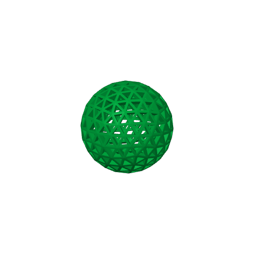
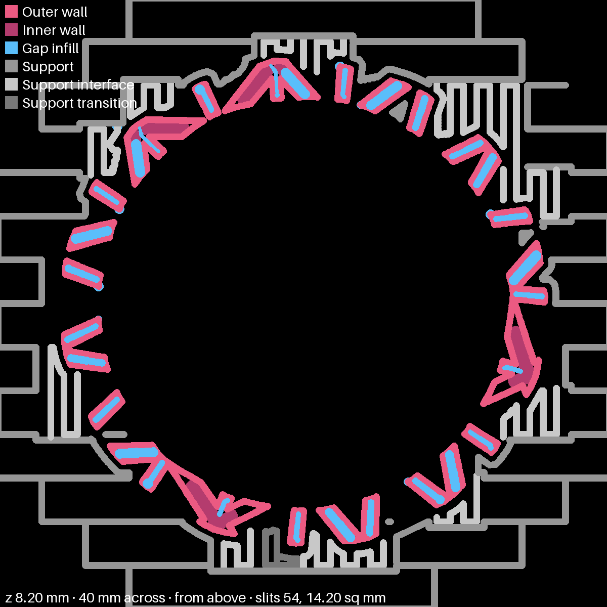
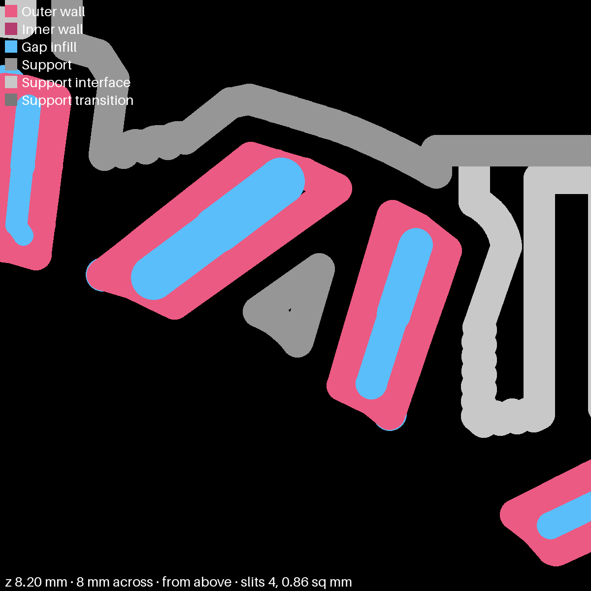

# ball-1 — the ping-pong ball alone, supports only from the bed

**In short.** The airless ping-pong ball from toys-1, alone on the bed. This time the supports may
stand only on the bed, and none may grow inside the ball. toys-1 let the slicer put supports
anywhere, so they filled the ball's open lattice. The plate is [`ball-1.yaml`](ball-1.yaml). One
bed, about 1 h 5 min, about 10 g. You pick the color at the send.

## What it is

- **The airless ping-pong ball.** Downloaded as `airless-ping-pong-ball-20.stl`, at its own size: a
  ball 40 mm across. Its shell is an open lattice of triangles, about 2.4 mm thick, around a hollow.
  The file is not in git (this repo is public and the model is someone else's); it sits in the
  gitignored imports folder that links to your iCloud folder `CloudDesktop/data/3d-models/imports`,
  and the recipe holds it to its hash.
- **Supports from the bed only.** The ball touches the bed at one point, so its lower half needs
  holding up. The process preset turns on Bambu Studio's "on build plate only": a support may not
  start on the ball itself.
- **Nothing inside.** "On build plate only" was not enough by itself: a test slice still grew
  supports up through the windows of the lower half into the hollow. So the recipe also puts a
  **support blocker** in the ball: a sphere 37.2 mm across (radius 18.6 mm) at the ball's own
  centre. Studio builds no support inside a blocker. The plate tool now places it itself
  (`support_blocker: { radius_mm: 18.6 }` on the recipe's item): it finds the ball's centre from the
  mesh, adds the sphere and reads it back from the slice.
- **Plain supports, not tree supports.** With tree supports, branches bent round the blocker and
  still reached inside (621 bits of support in the hollow in a test slice). Plain supports respect it.
- **One color**, picked at the send. Until then it slices on PLA Basic.

**What I assumed, for you to change:**

- One ball, not a bed of them.
- Our standard 0.20 mm layers and walls; a recipe cannot set the maker's own settings on an outside
  model yet.

## Why print it

The ball on toys-1 came out with its hollow full of support. This shows whether the ball can print
the way it is meant to be: hollow and light, with only the outside held up.

## Pictures

The slice: the ball alone on the bed.

| Piece | Size (mm) | Where on the bed (mm from front left) |
|---|---|---|
| PING-PONG BALL | about 40 x 40 x 40 | 138.2, 128 |

**Is there support inside?** I read every support line in the slice's G-code and measured how close
each comes to the ball's centre (`python3 tools/print_review.py supports-inside`). The shell's inner
face sits 17.6 to 18 mm from the centre. Three short bits of support come within 17.8 mm of it, 4.7 mm
of line in all, on three layers between 5.2 and 8.4 mm up. They are not in the hollow. They are small
nubs, about 1 mm across, where the support under the ball pokes up into a window of the shell.

The layer 8.2 mm up, seen from above. Pink and blue are the ball's shell, grey is support. The
middle is empty:

A close-up of one nub, 8 mm across: the grey triangle between two struts is support in a window.

So the check script says FAIL at a 17.8 mm radius, and it is honest: a few nubs touch the
windows. I did not shrink the radius to make it pass. Those nubs come off with the outside support,
or need a pick.

## Cost and risk

One bed, 1 h 5 min, 10.08 g (local slice, 2026-11-08, X2D 0.20 mm Standard preset with supports on
the bed only and plain supports, Bambu PLA Basic, sliced for the Textured PEI plate; the automatic
brim setting added one brim, and the slicer raised no warnings).

**Risk: ok.** The ball stands on one small spot plus the supports, so it could come loose: a waste
of 10 g, not a printer risk. The X2D's own spaghetti check is on.

## After the print

| Pieces | The question | What we expect, and why | What each answer changes |
|---|---|---|---|
| PING-PONG BALL (no carved id; the only piece on the bed) | This checks whether the ball came out hollow, with only the outside held up. The slice keeps support out of the hollow, but a few small nubs touch the shell's windows near the bottom. **Do:** 1. Take the ball off the bed with its supports. 2. Pull the supports off the outside. 3. Hold the ball up to a light and look through the windows into the middle. 4. Look at the windows in the lower half for small bits of support. 5. Bounce it once on a table. **Look for:** a clear hollow or one with support in it; how many windows still hold a nub and whether they pick out; whether it bounces. | A clear hollow, with a few nubs in the lower windows that come off with the support or with a pick | Clear and nubs come out: print it like this again. Clear but nubs stuck: try a slightly larger blocker or a finer support gap. Support in the hollow: the blocker did not work in print; look again before another ball |

## Your call

- [ ] **Approve as it stands** — one ball, one color picked at the send, supports from the bed only, none in the hollow, and the three small support nubs in the lower windows (4.7 mm of line, shown in the close-up above) left as they are
- [ ] **Hold** — say why in the notes

Notes:

## Approvals

Every yes or hold Omar gives this plate, one row each, oldest first (D-096). A tick under Your call, or a yes in chat, becomes a row here through the manage-approvals skill's `plate_approve.py`; a send spends the open approval, and a recipe change resets it.

| Date | Decision | By | Covers | Spent by |
|---|---|---|---|---|
| 2026-11-08 | approved | Omar, in chat: "Send it in green" | iteration 2 @ b893fce4f4 in #00AE42 | |

## Timeline

| Date | What happened | Where it is written |
|---|---|---|
| 2026-11-08 | proposed — the ping-pong ball from toys-1 alone, supports only from the bed | this page |
| 2026-11-08 | sliced — one bed, 1 h 5 min, 10.08 g, a support blocker in the ball, plain supports, no warnings | this page |
