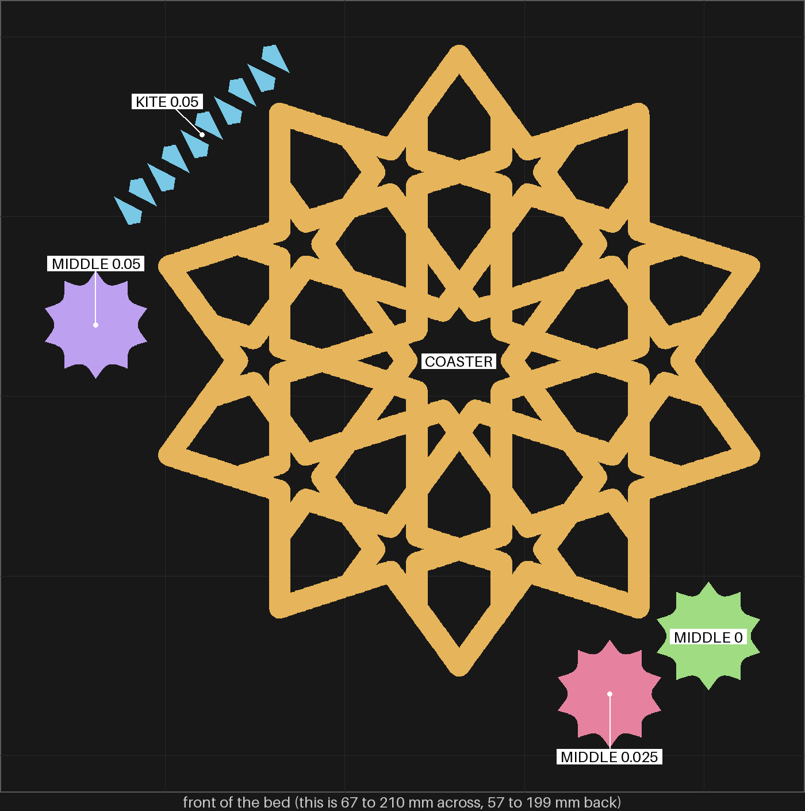
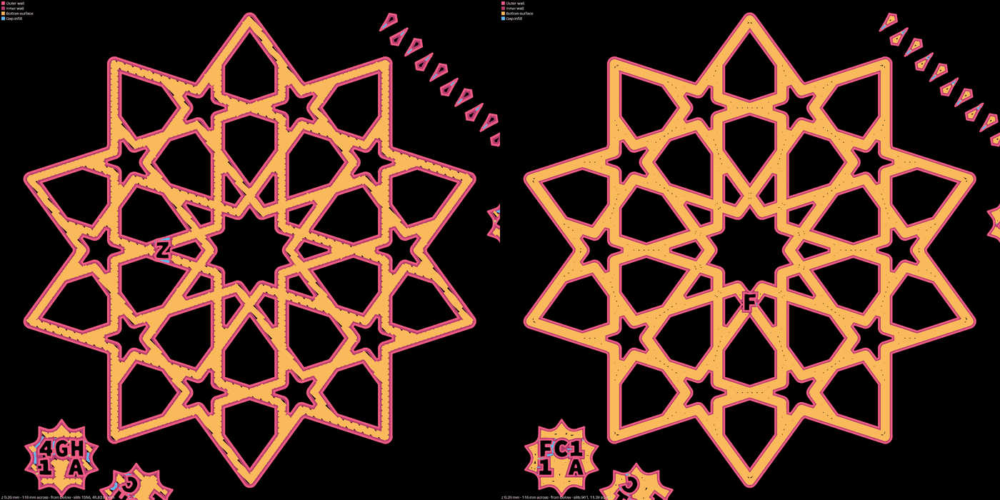
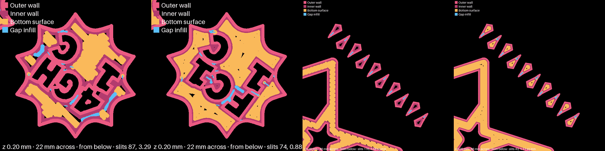

# bedface-1 — sheets-04g-fit2 again, on the house bed-face preset

**In short.** You sent a photo of a pink coaster's underside: "why do i get gaps like this in the
plate touching side". The [bed-face design](../printing/bed-face-slicing-design.md) traced the gaps
to the slicer's first layer and proposed a house preset to close them, checked so far only in the
slicer's plan. Then "send the plate", and of the ways to test it you picked one plate on the new
preset only, in pink. So this is [sheets-04g-fit2](sheets-04g-fit2.md) piece for piece, the same
pink, the same glacier plate, with one thing changed: the slicer settings. fit2's pieces are on
hand, printed on the stock settings the same day, so each piece here is judged beside its fit2 twin.

## What it is

Recipe: [bedface-1.yaml](bedface-1.yaml). The same pieces as fit2, at the same size (112.5 mm
across, 3.75 mm straps, 4.4 mm tall), in the same places on the bed.

- **The settings:** [`tools/bambu/presets/bed-face-0.20.json`](../../../tools/bambu/presets/bed-face-0.20.json)
  in place of the X2D 0.20 mm Standard: the first layer filled with rings that follow the walls
  instead of diagonal lines, the fill pushed 30% into the wall instead of 15%, and the first layer
  drawn 0.42 mm wide instead of 0.5. The slice reads back all three.
- **The coaster:** the gBV minimal coaster, carved `F` on its bottom, not the `Z` that fit's and
  fit2's coasters carry, so the coasters are never mixed up.
- **The middle piece at 0, 0.025 and 0.05 mm per face,** with three, two and one dots on top, as on
  fit2. Carved `FC1 1A`, `FC1 1C` and `FC1 1E` on their bottoms, where fit2's read `4GH 1A`, `1C`, `1E`.
- **Ten kites at 0.05,** as on fit2, although fit2 found them tough to push in: widening them is
  [sheets-04g-fit3](sheets-04g-fit3.md)'s question, and here it would mix a fit change into the
  bed-face comparison. They carry no id and look exactly like fit2's kites, so **keep them in their
  own pile when they come off the bed.**

The design's first plan was one plate in two halves, stock and house. It cannot test the 0.42 line:
Bambu's command line takes the rings and the overlap per piece, but not the first line's width
(the [design, §5.2](../printing/bed-face-slicing-design.md#52-the-coupon)).

## Why print it

- **The question:** are the undersides cleaner than fit2's, with no slits along the coaster's straps
  and no dimple in the middle of a kite, and does every piece fit the way its fit2 twin did?
- **What it lets us decide:** whether every experiment plate moves to the house preset
  ([design §5.3](../printing/bed-face-slicing-design.md#53-how-it-is-rolled-out-once-the-coupon-says-yes)).
- **What it could show against the preset:** a narrower first line squashes less, which may grip
  the bed less or open holes of its own (design §7). Lifted corners on the kites, or a rougher
  underside than fit2's, would say so.
- **No bet moves.** The fit rows check that the fit did not move; CAL-LSE-01's readings stay on fit2
  and fit3.

## After the print

What gets asked when the plate comes off the bed, one row at a time (the review-print skill asks
them, each as a short procedure). Pieces are named by the id cut into their bottoms: `FC1 1A` reads
FC1 over 1 A. The new coaster carries `F`, fit2's coaster `Z`. The kites have no id: keep this
plate's in their own pile.

| Pieces | The question | What we expect, and why | What each answer changes |
|---|---|---|---|
| The `F` coaster (this plate), the `Z` coaster (fit2) | **Do:** Turn both coasters over. Hold them side by side under a lamp. **Look for:** Short dark slits along the straps, where the fill lines meet the edge. Does `F` have fewer than `Z`, the same, or none? | Fewer or none on `F`. In the slicer's plan the bare share drops from 1.10% to 0.26% and the largest bare spot from 0.68 to 0.16 sq mm. The plan is a stand-in for the print: bed covered in the plan is not proof it is covered in the print. | Fewer or none: the rings and overlap work in print, and the preset goes on every experiment plate. The same: the slits come from the print, not the plan (flow, squash, the plate), and the design is reworked. |
| One kite from this plate's pile, one kite from fit2's | **Do:** Turn both kites over. Look at the middle of each bottom, under a lamp. **Look for:** A dent or a rough spot in the middle. Is it on fit2's kite only, on both, or on neither? | On fit2's only. The stock first layer leaves the kite's middle bare (2.25% of the kites' first layer); the 0.42 line fills it (0.33%). | fit2's only: the narrower first line fills the core, as planned. Both: the 0.42 line did not reach the core in print, and the small pieces need another fix. Neither: the core filled on the second layer in both, and the line width does not matter for kites. |
| `FC1 1A`, `FC1 1C`, `FC1 1E` (this plate), `4GH 1A`, `4GH 1C`, `4GH 1E` (fit2) | **Do:** Turn all six over. Put each FC1 piece beside the 4GH piece with the same letter. **Look for:** Gaps or rough patches round the carved letters. Is the FC1 bottom cleaner than its 4GH twin? | Cleaner. The carved letters make the middle piece's first layer the hardest on the plate: on stock about 1.9% of it is bare, with spots up to 0.64 sq mm. The preset brings that to 0.41–0.70%, and two of the three still sit just over the check's bars (`FC1 1A` at 0.70% bare, `FC1 1C` with a 0.202 sq mm spot). | Cleaner and no gaps you can see: the check's bars are too strict for a face with carved letters, and they get loosened for it. Cleaner but gaps round the letters: the letters need their own fix (a wider letter stroke, or one more ring round each). The same: as row 1. |
| `FC1 1A`, `FC1 1C`, `FC1 1E`, the `F` coaster | **Do:** Push `FC1 1A` by hand into the middle hole of the `F` coaster, then take it out. Do the same with `FC1 1C`, then `FC1 1E`. **Look for:** Does each feel as its fit2 twin did: 1A super tight, 1C the best, 1E loose? | The same as fit2. The rings and overlap leave the outer walls where they were, and the 0.42 line moves only the first layer's center line, 0.04 mm in, keeping its outer edge in place. | The same: the preset keeps every fit we have judged. Tighter or looser: the first line moved the bottom edge in print, and every fit is checked again on the new preset before it rolls out. |
| Three kites from this plate's pile, the `F` coaster | **Do:** Push three kites by hand into three kite holes of the `F` coaster. Hold the coaster upside down over the table. **Look for:** Do they go in by hand, as tough as fit2's? Do they stay in? | As fit2's: tough to push in, all stay in. | The same: as row 4. Easier: the first line made the kite's bottom edge smaller; read with fit3's 0.075 kites before picking the kites' gap. |

## Pictures

The slice from above, front of the bed at the bottom, drawn only over the part of the bed the pieces
take. Each piece has its own color and a label. The places are fit2's.

| Where | What | In the picture |
|---|---|---|
| the middle | COASTER (`F`) | amber |
| back left, one diagonal row of kites | KITE 0.05 | blue |
| left | MIDDLE 0.05 (`FC1 1E`) | purple |
| front right, the back one of two | MIDDLE 0 (`FC1 1A`) | green |
| front right, the front one of two | MIDDLE 0.025 (`FC1 1C`) | pink |

The coaster's first layer from below, fit2's stock slice on the left and this plate on the right,
drawn from each slice's G-code (`print_review.py paths`). Black inside a strap is bed left bare. On
the left the diagonal fill turns short of the wall all along each strap; on the right rings follow
the walls and leave a few specks. `Z` and `F` are the carved letters, in different spots.

The 0.025 middle piece and the kites, the same way: fit2's stock slice, then this plate, for each.
The ids read backwards, as from below. The stock kites are two wall loops round a bare middle; on
the house preset the middle is filled.

## What the slice lays down

Each piece's first layer, drawn at 30 px a millimeter from the slice's G-code and measured with the
design's check (`python3 tools/print_review.py paths <png> <plate.3mf> 0.2 <x>,<y>,<side> --below --check`,
fails at 0.6% bare or a 0.2 sq mm spot), on fit2's stock slice and on this plate's. The two plates
put every piece in the same place, so the windows are the same. The coaster's window takes in the
edge of a middle piece and a few kites, on both plates alike. The commands and the per-piece test
behind "What it is" are in [the record](../../research/2026-10-10-bed-face-per-piece-and-bedface-1.md).

| Piece (window) | fit2, stock: bare share / largest spot (sq mm) | bedface-1, house | Check on bedface-1 |
|---|---|---|---|
| Coaster (148.3, 134.4, 118 mm) | 1.10% / 0.677 | 0.26% / 0.160 | PASS |
| Kites (102.5, 174.6, 46 mm) | 2.25% / 0.619 | 0.33% / 0.089 | PASS |
| Middle 0, `A` (192.7, 85.3, 22 mm) | 1.99% / 0.483 | 0.70% / 0.160 | FAIL, share |
| Middle 0.025, `C` (175.1, 75.0, 22 mm) | 1.89% / 0.598 | 0.50% / 0.202 | FAIL, spot by 0.002 |
| Middle 0.05, `E` (83.7, 140.7, 22 mm) | 1.89% / 0.636 | 0.41% / 0.192 | PASS |

All five fail the check on stock. The middle pieces are new to it: the design measured a middle
piece with no carved id (0.21% bare on stock, 0.03% on the house preset), and the letters roughly
ten times that, since every letter is a hole the fill has to turn round. The house preset still
cuts each middle piece's bare area by about two thirds or more, but two of the three stay just over
the bars. The bars were fitted to five pieces with no letters, so this plate also says whether
they are right for a face with letters on it (row 3).

## Cost and risk

One bed, 67 minutes, about 19 g (local slice, 2026-10-10, the house preset and PLA Basic, the
glacier plate sliced as the High Temp Plate, `preset check: PASS`, no slicer warnings, no brim,
support or raft, nothing sent). fit2's slice was 67 minutes and 18.9 g. One color, so no swaps.

**Risk: watch.** Ten kites of about 0.05 cm³ each are small loose pieces, the kind that can lift or
get knocked by the nozzle, and the narrower first line may grip a little less (design §7).
sheets-04g, fit and fit2 printed the same kites at this size without trouble, on the stock line.

## Your call

- [ ] **Approve as it stands**: fit2's pieces on the house preset. Say the color with the yes.
- [ ] **Hold**: say why in the notes.

Notes:

## Approvals

Every yes or hold Omar gives this plate, one row each, oldest first (D-096). A tick under Your call, or a yes in chat, becomes a row here through the manage-approvals skill's `plate_approve.py`; a send spends the open approval, and a recipe change resets it.

| Date | Decision | By | Covers | Spent by |
|---|---|---|---|---|
| 2026-10-10 | approved | Omar, in chat: "send the plate" (of the options: one plate, new preset only; pink) | iteration 1 @ f181ccbe97 in #F5547C | sent 2026-10-10 |

## Timeline

| Date | What happened | Where it is written |
|---|---|---|
| 2026-10-10 | proposed: sheets-04g-fit2's pieces on the house bed-face preset, on Omar's "send the plate" and his pick of one plate on the new preset only, in pink | [the bed-face design](../printing/bed-face-slicing-design.md) |
| 2026-10-10 | sliced: one bed, 67 minutes, 19 g, no slicer warnings; the first layer's bare share down from fit2's stock slice on every piece, the coaster and kites passing the check, two middle pieces just over it | this page |
| 2026-10-10 | sent — by `bambu print send`; spends the approval of 2026-10-10, iteration 1 @ f181ccbe97 in #F5547C | this page |
