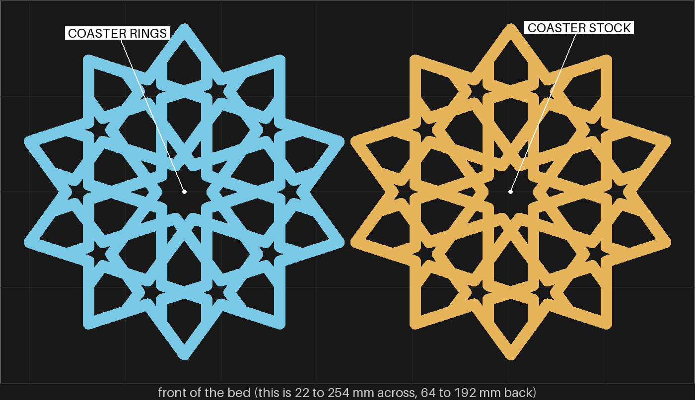
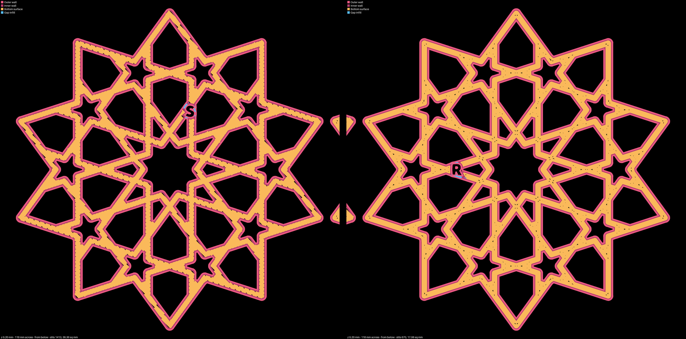
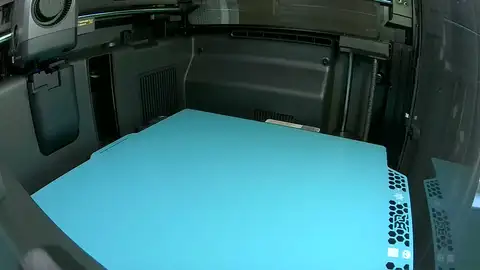
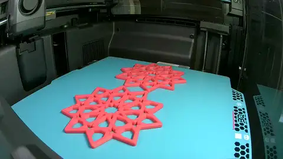
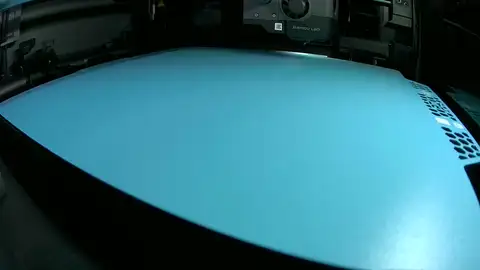
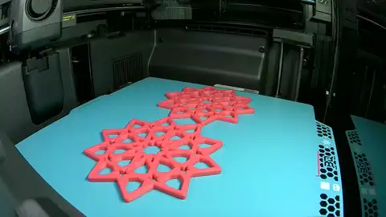

# bedface-2 — two coasters on one bed: stock beside rings, both at the stock first line

**In short.** [bedface-1](bedface-1.md) put rings on the first layer, pushed the fill further into
the wall and drew the first line narrower, all at once, and its coaster's underside came out no
cleaner than stock ([the issue](../../issues/bed-face-preset-failed-in-print.md)). Of the four next
steps, you picked the first on 2026-10-11 ("go A"). So this plate is two of the same coaster side by
side: one on the stock settings, one with rings and the 30% overlap on that coaster alone, and both
at the stock 0.5 mm first line. If the ring coaster's underside is cleaner, the narrow line was what
failed and rings come back without it. If it is not, rings are dropped for good.

## What it is

Recipe: [bedface-2.yaml](bedface-2.yaml). Two of the gBV minimal coaster at bedface-1's size (112.5 mm
across, 3.75 mm straps, 4.4 mm tall), on the X2D 0.20 mm Standard settings, the same as fit2's.

- **`S`, the stock coaster:** nothing changed. Its first layer is diagonal lines, as on fit2's `Z`.
- **`R`, the ring coaster:** its first layer is rings that follow the walls, and its fill is pushed
  30% into the wall instead of 15%. Those two settings are written on this coaster alone; Bambu's
  command line takes them per piece, where it does not take the first line's width
  ([research §1](../../research/2026-10-10-bed-face-per-piece-and-bedface-1.md)). The slice reads
  both back on `R`, and the plate is refused if they are missing.
- **The letters:** `S` and `R` are cut into the bottoms. B, D, M, N and O are left out, and `F` and `Z`
  are taken by bedface-1's and fit2's coasters, so no two coasters you hold are mixed up.
- **Coasters only.** The slits you asked about are on the coaster's underside. The kites' bare middle
  needs the narrow line, which cannot be set per piece, so the kites get their own fix later. The
  middle pieces are left off too: the overlap could move their fit and mix a fit question into this one.

The recipe uses a new `object_settings:` block, added to `bambu slice compose` for this plate. Only
the two settings Studio was seen to honor per piece are allowed, and the first-line width is refused
with the reason. A plate with no such block slices exactly as before: bedface-1's five pieces get the
same ids they carry in [its record](../../prints/2026-10-11-bedface-1/index.md).

## Why print it

- **The question:** with both coasters squashed alike, does the ring coaster's underside have fewer
  slits than the stock one?
- **What it separates:** of the issue's three suspects, this tells "where rings meet" (1) from "the
  narrow line squashed less" (2). The third, the glacier plate's missing 0.02 mm push, is the same
  for both coasters here, so it stays untested.
- **What it could show against rings:** if `R` shows the same dashes down the middle of its straps as
  bedface-1's `F`, the meeting lines open in print whatever the line width, and rings are done.
- **No bet moves.**

## After the print

What gets asked when the plate comes off the bed, one row at a time (the review-print skill asks
them, each as a short procedure). The coasters are named by the letter cut into their bottoms: `S`
(stock) and `R` (rings), both from this plate. `F` is bedface-1's coaster and `Z` is fit2's.

| Pieces | The question | What we expect, and why | What each answer changes |
|---|---|---|---|
| The `S` coaster, the `R` coaster | **Do:** Turn both coasters over. Hold them side by side under a lamp. **Look for:** Short dark slits along the straps and where straps meet. Does `R` have fewer than `S`, the same, or more? | Fewer on `R`, but not sure. In the slicer's plan `R` leaves 0.41% of its bottom bare against 0.93% on `S`, and its largest bare spot is 0.15 sq mm against 0.43. bedface-1's plan said the same kind of thing and its print did not bear it out, so the plan is only a guess at the print. | Fewer: rings close up when squashed like stock, so the narrow line was what failed on bedface-1. Rings and the overlap go on the coasters, and the kites get their own fix. The same or more: the rings' meeting lines open in print at either width. Rings are dropped for good and the coaster stays on stock. |
| The `R` coaster, the `F` coaster (bedface-1) | **Do:** Turn both over. Look down the middle of the straps and where straps cross. **Look for:** Short dark dashes and small triangles. Are they on `F` only, on both, or on neither? | On `F` more than `R`. `F` had them all over; `R` lays down the same rings with a wider, flatter first line, so where the two sides meet they should touch. | On `F` only, or fewer on `R`: the wider line closes the meeting lines (row 1's "fewer"). On both alike: the meeting lines open whatever the line width, the same as row 1's "the same". |
| `FC1 1E` (bedface-1's middle piece at 0.05), the `S` coaster, the `R` coaster | **Do:** Push `FC1 1E` by hand into the middle hole of `S`, then take it out. Do the same with `R`. **Look for:** Does it feel the same in both, or tighter in one? | The same. The overlap pushes the fill into the wall from the inside and leaves the wall where it was. | The same: rings and the overlap keep every fit we have judged. Tighter or looser in `R`: the overlap moves the bottom edge in print, and fits are checked again before rings go on a plate with loose pieces. |

## Pictures

The slice from above, front of the bed at the bottom, drawn only over the part of the bed the
coasters take. The ring coaster is on the left (blue), the stock one on the right (amber).

Each coaster's first layer from below, drawn from the slice's G-code (`print_review.py paths`, then
`print_review.py join`): stock on the left, rings on the right. Black inside a strap is bed that no
line covers. On the left the diagonal fill turns short of the wall all along each strap. On the
right the rings follow the walls and leave small specks where they meet, which is what bedface-1's
coaster showed as dashes in print. The letters read backwards, as from below.

## The print

The print as the chamber camera saw it: 13 pictures from 21:33 to 23:33 UTC, half a second each, the last held. Made by the monitor-print skill's `print_monitor.py --publish`; what the printer said is in the print log.

## The second print

The second print of this plate, on 2026-10-12, as the chamber camera saw it: 13 pictures from 03:00 to 04:59 UTC, half a second each, the last held. Made by the monitor-print skill's `print_monitor.py --publish`; what the printer said is in the print log.

## What the slice lays down

Each coaster's first layer, drawn at 30 px a millimeter from the slice's G-code and measured with the
design's check (`python3 tools/print_review.py paths <png> <plate.3mf> 0.2 <x>,<y>,118 --below --check`,
fails at 0.6% bare or a 0.2 sq mm spot). Each window is 118 mm across, centered on one coaster; it
takes in that coaster and the very tip of the other one.

| Coaster (window center) | Slits | Bare share | Largest spot (sq mm) | Check |
|---|---|---|---|---|
| `S`, stock (192.8, 128.0) | 1413 | 0.93% | 0.429 | FAIL |
| `R`, rings and 30% overlap (83.7, 128.0) | 670 | 0.41% | 0.152 | PASS |

For bedface-1, the same coaster measured 0.26% on the house preset (rings, overlap and the 0.42
line) against 1.10% for fit2's stock slice, in a window that took in other pieces too. So on the
plan, `R` sits between the two, and the plan already ranked bedface-1's coaster cleaner than the
print did. The commands, and why the first slice must slice and not only arrange, are in
[the research, §3](../../research/2026-10-10-bed-face-per-piece-and-bedface-1.md#3-bedface-2-rings-per-piece-at-the-stock-line).

## Cost and risk

One bed, 107 minutes, about 32 g (local slice, 2026-10-11, the X2D 0.20 mm Standard settings and PLA
Basic, the glacier plate sliced as the High Temp Plate, `preset check: PASS` with the prime tower
off for one filament, the per-piece settings read back on `R`, no slicer warnings, no brim, support
or raft, nothing sent). One color, so no swaps.

**Risk: ok.** Two full-size coasters, each the shape fit, fit2 and bedface-1 printed without
trouble on this plate. No small loose pieces.

## Your call

- [ ] **Approve as it stands**: stock beside rings, both at the stock first line. Say the color with the yes.
- [ ] **Hold**: say why in the notes.

Notes:

## Approvals

Every yes or hold Omar gives this plate, one row each, oldest first (D-096). A tick under Your call, or a yes in chat, becomes a row here through the manage-approvals skill's `plate_approve.py`; a send spends the open approval, and a recipe change resets it.

| Date | Decision | By | Covers | Spent by |
|---|---|---|---|---|
| 2026-10-11 | approved | Omar, in chat: "go on print" (pink #F5547C, the color suggested with the ask) | iteration 1 @ 4134bb96ba in #F5547C | sent 2026-10-11 |
| 2026-10-11 | approved | Omar, in chat: "reprint" (pink #F5547C, as the first print) | iteration 1 @ 4134bb96ba in #F5547C | sent 2026-10-11 |

## Timeline

| Date | What happened | Where it is written |
|---|---|---|
| 2026-10-11 | proposed: two gBV coasters, stock beside rings and 30% overlap on one of them, both at the stock first line, on Omar's "go A" of the issue's four next steps | [the issue](../../issues/bed-face-preset-failed-in-print.md) |
| 2026-10-11 | sliced: one bed, 107 minutes, 32 g, no slicer warnings; the ring coaster's first layer 0.41% bare against stock's 0.93%, and it passes the check where stock fails | this page |
| 2026-10-11 | sent — by `bambu print send`; spends the approval of 2026-10-11, iteration 1 @ 4134bb96ba in #F5547C | this page |
| 2026-10-11 | sent — by `bambu print send`; spends the approval of 2026-10-11, iteration 1 @ 4134bb96ba in #F5547C | this page |
| 2026-10-12 | printed — on the X2D, glacier plate, twice from the same slice, 120 minutes each against the slicer's 107, all 22 layers; one pair judged by hand: `R` and `S` "About the same", "both have slits, byt in different places" (on `S` along the strap edges, on `R` down the strap middles and where straps meet). Rings are dropped and the coaster stays on stock; rows 2 and 3 not judged yet | [the record](../../prints/2026-10-12-bedface-2/index.md) |
