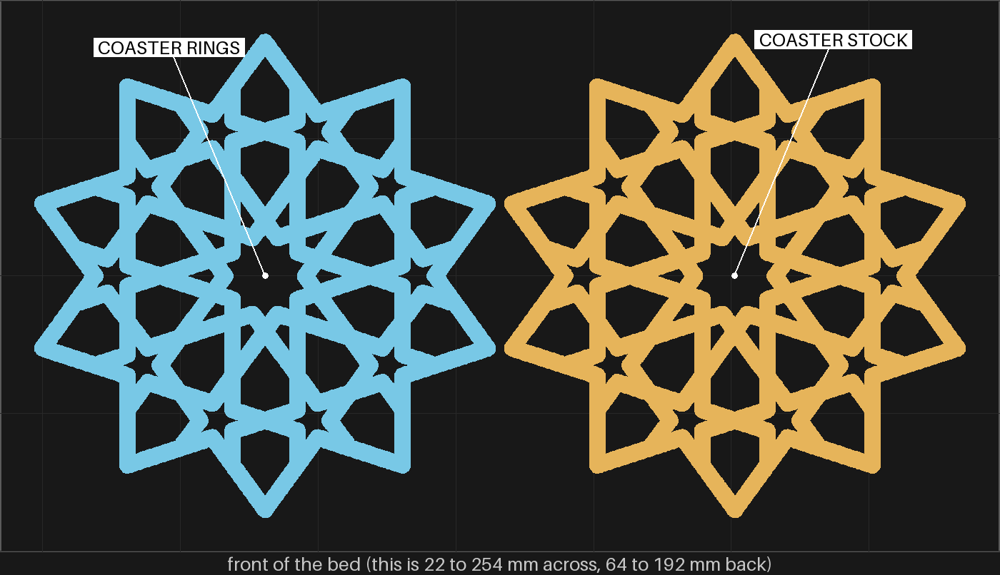
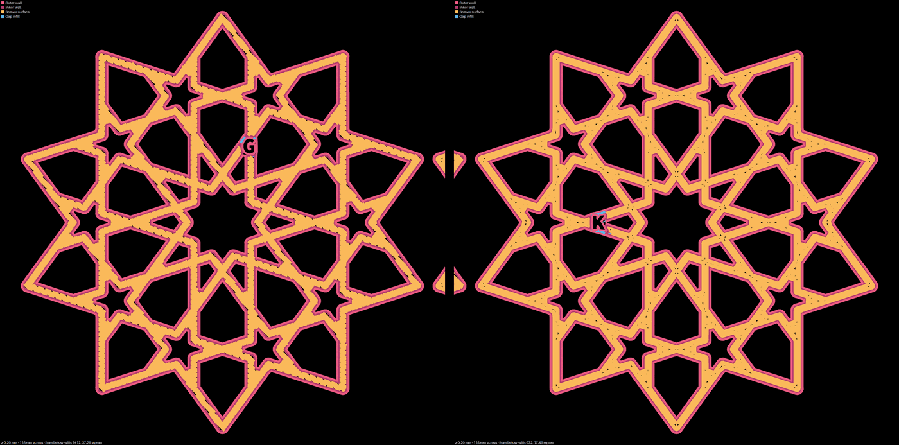

# bedface-3 — bedface-2's two coasters again, on the gold plate

**In short.** The same two coasters as [bedface-2](bedface-2.md), on Bambu's gold plate instead of
the blue glacier plate. Nothing else changes. On the gold plate the printer lowers the nozzle a
little for the first layer, so the first lines come out flatter. If that closes the slits, coasters
print on the gold plate. If not, the plate is ruled out.

You picked this on 2026-10-12: "yes, both on gold in pink"
([D-117](../../working-model/decisions-log.md)). It is option 2 of
[the bottom-slits page](../../working-model/feedback-requests/2026-10-12-bottom-slits.md), with both
coasters on the gold plate at once.

## What it is

Recipe: [bedface-3.yaml](bedface-3.yaml). bedface-2's recipe, unchanged except the letters. Two of
the gBV minimal coaster, 112.5 mm across, 3.75 mm straps, 4.4 mm tall.

- **`G`, the stock coaster:** nothing changed. It matches bedface-2's `S`.
- **`K`, the ring coaster:** rings on the first layer, and the fill pushed 30% into the wall. It
  matches bedface-2's `R`.
- **The letters are new** so you never mix these up with `S` and `R`. B, D, M, N and O are left out.
- **Sliced for the gold plate.** The G-code lowers the nozzle by 0.002 mm at the start, where
  bedface-2's raised it by 0.022 mm: 0.02 mm closer to the bed. That gap is the one thing this plate
  tests.

## Why print it

- **The question:** on the gold plate, do the slits shrink?
- **What it separates:** [the issue](../../issues/bed-face-preset-failed-in-print.md) named three
  possible causes. bedface-2 tested the first two. This tests the third: the 0.02 mm the glacier
  plate misses.
- **The catch:** the gold plate is grainy, so the bottom comes out grainy too. Row 3 asks if that looks right.
- **No bet moves.**

## After the print

What gets asked when the plate comes off the bed, one row at a time. Name each coaster by the letter
cut into its bottom: `G` and `K` from this plate, `S` and `R` from bedface-2.

| Pieces | The question | What we expect, and why | What each answer changes |
|---|---|---|---|
| The `G` coaster, the `S` coaster (bedface-2) | **Do:** Turn both over. Hold them side by side under a lamp. **Look for:** The short dark slits along the edges of the straps. Does `G` have fewer than `S`, the same, or more? | Fewer, but not sure. The slice lays the same lines down on both; only the nozzle height differs, by 0.02 mm. A flatter first line should be wider and close small gaps. | Fewer: the plate was part of the cause, and coasters print on the gold plate. The same or more: the gold plate is ruled out for the stock coaster. |
| The `K` coaster, the `R` coaster (bedface-2) | **Do:** Turn both over. Look down the middle of the straps and where straps meet. **Look for:** Small dark specks. Does `K` have fewer than `R`, the same, or more? | Fewer, but not sure, for the same reason as row 1. | Fewer: rings might come back, on the gold plate only. The same or more: rings stay dropped. |
| The `G` coaster | **Do:** Turn it over and run a finger across the bottom. **Look for:** The grain the gold plate leaves. Is it fine on a coaster, or not? | Fine. It is the look most textured-plate prints have. | Fine: nothing more to decide. Not fine: the gold plate is out even if it closes the slits. |

## Pictures

Each coaster's first layer from below, drawn from the slice (stock `G` on the left, rings `K` on the
right). Black inside a strap is bed that no line covers. They match bedface-2's: on `G` the
diagonal fill stops short of the wall along each strap. On `K` the rings leave small specks where
they meet. The letters read backwards, as seen from below.

## What the slice lays down

Measured the same way as bedface-2
(`python3 tools/print_review.py paths <png> <plate.3mf> 0.2 <x>,<y>,118 --below --check`, fails at
0.6% bare or a 0.2 sq mm spot).

| Coaster (window center) | Slits | Bare share | Largest spot (sq mm) | Check | bedface-2's match |
|---|---|---|---|---|---|
| `G`, stock (192.8, 128.0) | 1412 | 0.91% | 0.429 | FAIL | `S`: 1413, 0.93%, 0.429 |
| `K`, rings and 30% overlap (83.7, 128.0) | 672 | 0.42% | 0.349 | FAIL | `R`: 670, 0.41%, 0.152 |

The lines are the same, so the numbers are nearly the same. `K` fails where `R` passed only on its
largest spot. The letter is the only part of the shape that changed, so that spot is probably beside
it; I have not checked. The nozzle height is not in these drawings at all, and bedface-1 and
bedface-2 both showed the drawing is only a rough guess at the print.

## Cost and risk

One bed, 107 minutes, about 32 g (local slice, 2026-10-12, X2D 0.20 mm Standard and PLA Basic,
sliced for the Textured PEI Plate, `preset check: PASS`, the per-piece settings read back on `K`,
no slicer warnings, nothing sent). One color, pink #F5547C, so no swaps.

**Risk: ok.** The same two coasters printed twice on bedface-2 without trouble. Coasters printed
on the gold plate before the glacier plate came on 2026-10-07.

**Before the send:** the gold plate must be on the bed. The bed photo shows which one is on, since
the printer reports both plates the same way. If the blue plate is in, the send stops for the swap.

## Your call

- [ ] **Approve as it stands**: both coasters on the gold plate. Say the color with the yes.
- [ ] **Hold**: say why in the notes.

Notes:

## Approvals

Every yes or hold Omar gives this plate, one row each, oldest first (D-096). A tick under Your call, or a yes in chat, becomes a row here through the manage-approvals skill's `plate_approve.py`; a send spends the open approval, and a recipe change resets it.

| Date | Decision | By | Covers | Spent by |
|---|---|---|---|---|
| 2026-10-12 | approved | Omar, in chat: "yes, both on gold in pink" | iteration 1 @ 4b79a95a1d in #F5547C | |

## Timeline

| Date | What happened | Where it is written |
|---|---|---|
| 2026-10-12 | proposed: bedface-2's two coasters again, sliced for and printed on the gold plate, on Omar's "yes, both on gold in pink" (D-117) | [the bottom-slits page](../../working-model/feedback-requests/2026-10-12-bottom-slits.md) |
| 2026-10-12 | sliced: one bed, 107 minutes, 32 g, no slicer warnings; `G` 0.91% bare, `K` 0.42%, both nearly bedface-2's | this page |
