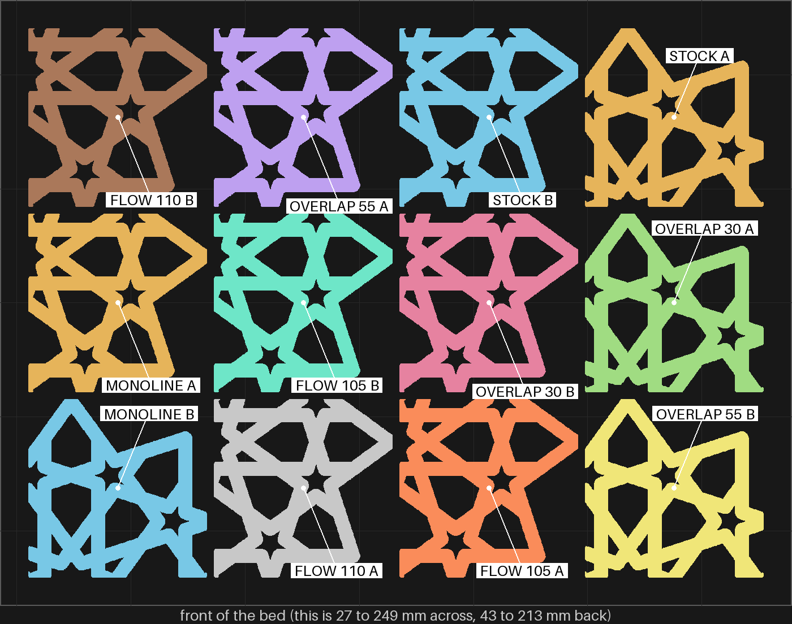
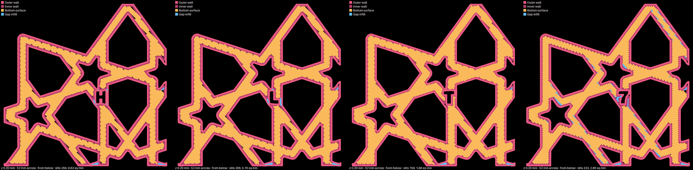
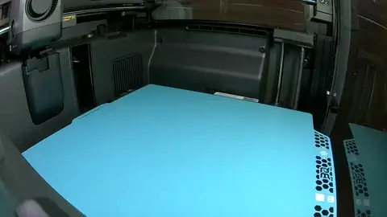
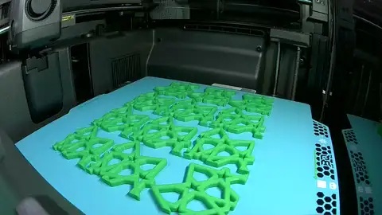

# bedface-4 — the bottom slits, tested on pieces: five settings beside stock

**In short.** Twelve 50 mm squares cut out of the real gBV coaster, at its own size, on the blue
glacier plate. Two are stock. The other ten try five settings, two pieces each. Turned over side by
side, they show which setting closes the slits along the strap edges, in one print instead of five
whole coasters.

This is the first plate of [the checked research plan](../../research/2026-10-12-first-layer-slits-consolidated.md)
(§3). It follows your rule from 2026-10-12: print pieces of a shape to test an idea, not tiny chips
and not whole coasters.

## What it is

Recipe: [bedface-4.yaml](bedface-4.yaml). Each piece is the same 50 mm window of the gBV minimal
coaster (112.5 mm across, 3.75 mm straps, 4.4 mm tall), cut by bikar's `window`. Each holds straps,
a star hole and part of the rim, so its strap edges are the ones that slit on the whole coaster.

| Pieces | What changes | Why it might help |
|---|---|---|
| `H`, `J` | nothing: stock | the control, on the same bed |
| `L`, `P` | the fill pushed 30% into the wall | the lines reach the wall instead of stopping short; bedface-2's `R` closed its strap edges with this, though it had rings too |
| `2`, `T` | the fill pushed 55% into the wall | more of the same; may raise a ridge |
| `U`, `W` | 5% more plastic on the first layer | wider first lines, which may close small gaps |
| `X`, `Y` | 10% more plastic on the first layer | more of the same |
| `4`, `7` | the monotonicline bottom pattern | a different way of turning at the wall |

- **The ids** are cut into each piece's bottom. B, D, M, N, O and V are left out because they
  read alike, and the letters earlier coasters carry are not reused. Q is left out too: with its
  tail it is too tall to fit flat on this piece's bottom, so the first 55% piece carries `2`.
- **The extra plastic is checked in this slice.** On the first layer, `U` and `W` lay 1.05 times
  stock's plastic per millimeter of line, and `X` and `Y` lay 1.10 times. On the second layer
  every piece lays the same as stock (0.0307 per mm, all twelve), so the setting stops at the
  first layer, as meant. Read off the G-code that is sent, with
  `.claude/skills/print-model/scripts/layer_extrusion.py`. The PLA profile already lays 0.98 of
  full flow, so the 5% pieces also show what "use 1.00" would do.
- **Eight pieces are turned a quarter turn.** Studio's arranger turned `J`, `P`, `2`, `U`, `W`,
  `X`, `Y` and `4` to fit the bed, and compose has no way to stop it. The stock pair spans both:
  `H` is not turned, `J` is. In the slice the turn barely matters: `H` has 356 slits and `J` 350,
  both 0.91% of the first layer bare, the same share as the whole stock coaster. That is expected,
  since a quarter turn maps the pattern's straps onto straps at the same angles, so the fill
  meets them the same way. The print may still differ, which row 1 checks.
- **Sliced for the glacier plate**, as bedface-2 was. bedface-3 ruled the gold plate out.

## Why print it

- **The question:** which of the five settings leaves fewer slits than stock?
- **Why pieces:** one bed tries five settings with a control beside them. Whole coasters would take
  five prints. This carries over because the slits are a first-layer thing, and each piece's
  first layer is laid with the coaster's own line width, speed, plate and straps at their real
  width and angles. The slice agrees: the stock piece leaves 0.91% of its first layer bare, the
  same as the whole stock coaster. What does not carry over (warping, the top, cooling) is not
  being judged. Row 1 checks it in print.
- **Two of each:** slits come and go from spot to spot, so one piece could mislead.
- **No bet moves.**

## After the print

What gets asked when the plate comes off the bed, one row at a time. Name each piece by the letter
cut into its bottom. Every row compares against the stock pair, `H` and `J`, at the same spot: the
strap edges, where the diagonal lines stop short of the wall.

| Pieces | The question | What we expect, and why | What each answer changes |
|---|---|---|---|
| `H`, `J` (stock) | **Do:** Turn both over. Hold them side by side under a lamp. **Look for:** The short dark slits along the strap edges. Are there about as many as on bedface-2's `S` coaster, or clearly fewer? And do `H` and `J` look alike? | About as many, and alike. These are stock settings on the glacier plate, as `S` was; a piece of the coaster should slit like the coaster. `J` is turned a quarter turn and `H` is not, and the slice shows the same slits on both. | As many: the pieces stand for the whole coaster, and every row below can be trusted. Clearly fewer: a piece does not slit like the coaster, so this plate cannot rank the settings; say so and print whole coasters again. `H` and `J` differ: the turn matters, so read each piece below against the stock piece turned the same way (`J` for the turned ones). |
| `L`, `P` (overlap 30%) beside `H`, `J` | **Do:** Turn all four over, side by side. **Look for:** The slits along the strap edges. Do `L` and `P` have fewer than `H` and `J`, the same, or more? | Fewer. The fill is pushed 30% into the wall, and bedface-2's `R` closed its strap edges with this, though `R` had rings too. | Fewer: 30% overlap goes on the next whole coaster, after a fit check. The same or more: the overlap alone does not do it. |
| `2`, `T` (overlap 55%) beside `L`, `P` and `H`, `J` | **Do:** Turn them over, side by side. **Look for:** The slits, and a raised ridge where the fill meets the wall. Fewer slits than `L`, `P`? A ridge you can feel? | Fewer slits than 30%, maybe a ridge. More overlap closes more, and too much piles up at the wall. | Fewer and no ridge: 55% beats 30%. A ridge: 30% stays the pick if it closed the slits. |
| `U`, `W` (flow 1.05) and `X`, `Y` (flow 1.10) beside `H`, `J` | **Do:** Turn all six over, side by side. **Look for:** The slits along the strap edges. Do the flow pieces have fewer than stock? Does 1.10 have fewer than 1.05? | About the same as stock. On other Bambu printers, more first-layer flow did not close these gaps (research §1). All four flow pieces are turned, so if `H` and `J` differed in row 1, compare them with `J` only. | Fewer: the first-layer flow goes on the next coaster, and the overlap and flow get one plate together. The same: flow is ruled out. |
| `4`, `7` (monotonicline) beside `H`, `J` | **Do:** Turn all four over. **Look for:** The slits at the strap ends. Fewer than stock, the same, or more? | The same or more. The line turns toward the wall without laying plastic, and the slicer then skips filling the gap beside it. | Fewer: the travel extend at 100% earns a plate. The same or more: the pattern is dropped. |

## Pictures

The first layer the slicer plans, seen from below as the bottom will look, for four pieces that
are not turned: `H` (stock), `L` (30%), `T` (55%) and `7` (monotonicline). Black inside a strap is
bed that no line covers. Along the strap edges of `H` the short black notches are the slits.
They thin out on `L` and nearly vanish on `T`. On `7` the notches are fewer but blue gap fill
runs along the edges instead.

What the slicer plans, per piece (`tools/print_review.py paths … --below --check`, each piece's
own 52 mm square on the first layer):

| Piece | Setting | Slits | First layer bare |
|---|---|---|---|
| `H` | stock | 356 | 0.91% |
| `J` | stock, turned | 350 | 0.91% |
| `L` | overlap 30% | 306 | 0.48% |
| `P` | overlap 30%, turned | 273 | 0.46% |
| `2` | overlap 55%, turned | 101 | 0.12% |
| `T` | overlap 55% | 159 | 0.16% |
| `U` | flow 1.05, turned | 371 | 0.89% |
| `W` | flow 1.05, turned | 371 | 0.78% |
| `X` | flow 1.10, turned | 353 | 0.79% |
| `Y` | flow 1.10, turned | 358 | 0.82% |
| `4` | monotonicline, turned | 246 | 0.24% |
| `7` | monotonicline | 323 | 0.26% |

Two cautions on these numbers:

- **The drawing cannot show the extra plastic.** It draws each line at the width the slicer asks
  for, and the flow setting does not change that width, only how much plastic goes into it. So
  the flow pieces read like stock here; only the print shows whether the wider bead closes the
  slits.
- **The plan is not the print.** bedface-1's plan scored far cleaner than stock and the print
  was no cleaner, because the lines open up where they meet. These numbers say which pieces are
  worth looking at closely, not which one wins.

## The print

The print as the chamber camera saw it: 21 pictures from 23:12 to 02:26 UTC, half a second each, the last held. Made by the monitor-print skill's `print_monitor.py --publish`; what the printer said is in the print log.

## Cost and risk

One bed, 173 minutes (2 h 53 min), about 52 g (local slice, 2026-10-12, X2D 0.20 mm Standard and
PLA Basic, sliced for the glacier plate as a Smooth PEI plate, `preset check: PASS`, each piece's
own settings read back on all ten that have one, no slicer warnings, nothing sent). One color,
picked at the send, so no swaps.

**Risk: ok.** Twelve flat pieces 4.4 mm tall, cut from the same coaster that printed
without trouble on bedface-1, bedface-2 and bedface-3. The 55% pieces may raise a small ridge where the fill meets the wall,
which is cosmetic and one of the things row 3 looks for.

## Your call

- [ ] **Approve as it stands**: all twelve pieces on the glacier plate. Say the color with the yes.
- [ ] **Hold**: say why in the notes.

Notes:

## Approvals

Every yes or hold Omar gives this plate, one row each, oldest first (D-096). A tick under Your call, or a yes in chat, becomes a row here through the manage-approvals skill's `plate_approve.py`; a send spends the open approval, and a recipe change resets it.

| Date | Decision | By | Covers | Spent by |
|---|---|---|---|---|
| 2026-10-12 | approved | Omar, in chat: "lets print it, switching back to galcier plate first", color "green" | iteration 3 @ 6ca4ebdd61 in #00AE42 | sent 2026-10-12 |

## Timeline

| Date | What happened | Where it is written |
|---|---|---|
| 2026-10-12 | proposed: plate 1 of the checked research plan on the bottom slits, as pieces of the coaster, on Omar's "go" for printing pieces of a shape | [the research plan](../../research/2026-10-12-first-layer-slits-consolidated.md) |
| 2026-10-12 | sent — by `bambu print send`; spends the approval of 2026-10-12, iteration 3 @ 6ca4ebdd61 in #00AE42 | this page |
