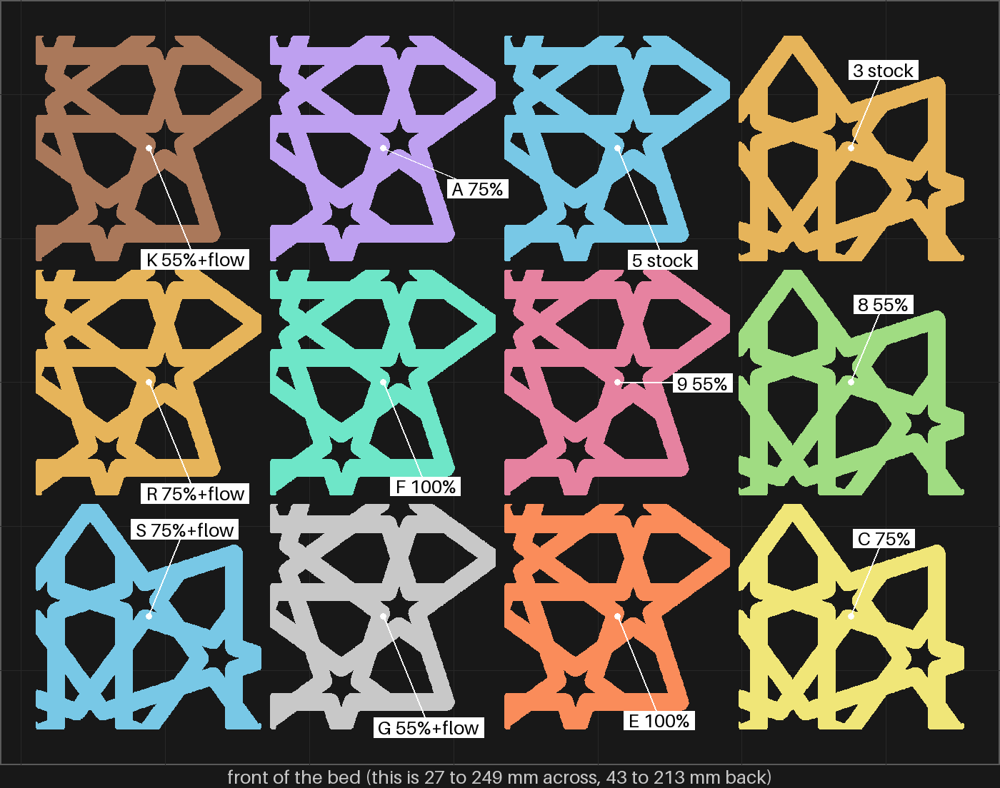
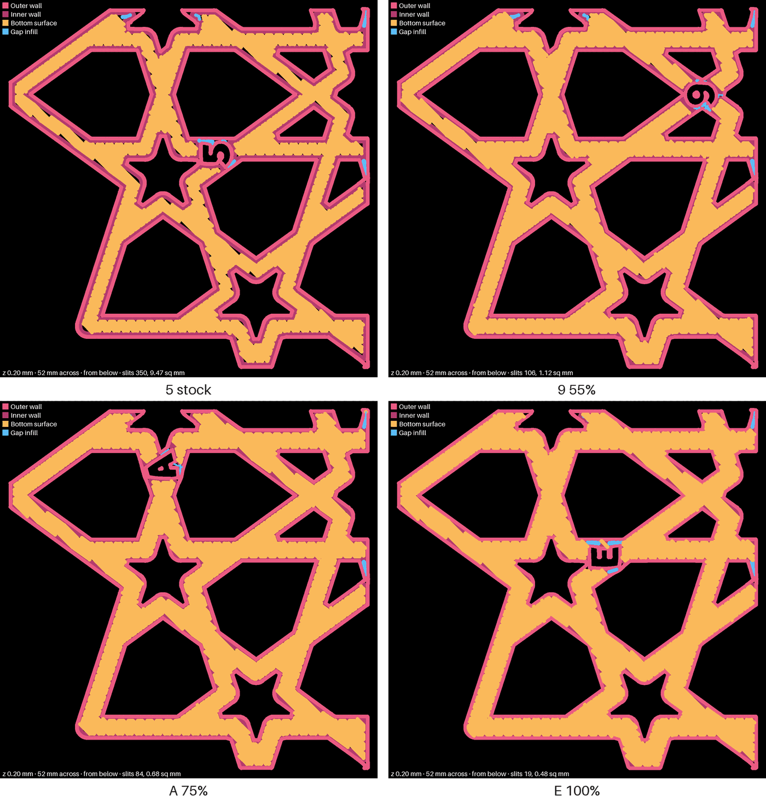

# bedface-5 — the bottom slits, round two on pieces: overlap pushed further, and overlap with flow

**In short.** The same twelve 50 mm squares of the gBV coaster as bedface-4, on the glacier plate, at the normal height. Two are stock. The other ten try five settings, two pieces each: the fill pushed 55%, 75% and 100% into the wall, and 55% and 75% each with 10% more plastic on the first layer.

This is option 1 on [the bottom-slits decision page](../../working-model/feedback-requests/2026-10-13-bottom-slits-next.md), from [the checked research plan](../../research/2026-10-13-bed-face-next-consolidated.md). It builds on [bedface-4](bedface-4.md), where in your words "2 is better than T" (55% beat 30%) and "Y has less than J and X has less than Y" (10% more plastic helped a little), and every piece still slit.

## What we seek to learn

1. **Does pushing the fill further into the wall close the slits?** 55% left fewer than 30%. Do 75% and 100% leave fewer still, and where does a ridge start?
2. **Do the two settings that helped add up?** 55% with flow against 55% alone, and 75% with flow against 75% alone, on the same bed.
3. **Does 55% read the same twice?** It is the one setting on both bedface-4 and this plate. If `8` and `9` look like bedface-4's `2` and `T`, readings carry across prints.

A clean pair goes on a whole coaster next. Slits on every piece point at the first-layer height instead: stock pieces printed 0.02 mm lower is the next plate then.

## What it is

Recipe: [bedface-5.yaml](bedface-5.yaml). Each piece is the same 50 mm window of the gBV minimal coaster as on bedface-4 (112.5 mm across, 3.75 mm straps, 4.4 mm tall), cut by bikar's `window`.

| Pieces | What changes | Why it might help |
|---|---|---|
| `3`, `5` | nothing: stock | the control, on the same bed |
| `8`, `9` | the fill pushed 55% into the wall | bedface-4's best; the link back to `2` and `T` |
| `A`, `C` | the fill pushed 75% into the wall | further than 55%, so the lines reach the wall more often |
| `E`, `F` | the fill pushed 100% into the wall | as far as it goes; the slicer draws the fill over the inner wall, where a ridge may form |
| `G`, `K` | 55% and 10% more plastic on the first layer | each helped alone; together they may close more |
| `R`, `S` | 75% and 10% more plastic on the first layer | the same, one step further |

What changed from bedface-4: 30% overlap, 5% more plastic, and the monotonicline bottom are gone. In your words "W is almost identical to J", monotonicline was "About the same", and 55% beat 30%. 10% more plastic is no longer tried alone, only on top of the overlap.

- **The ids** are cut into each piece's bottom. The letters that are safe to read and not yet used ran out after bedface-4, so this plate reuses the letters bedface-1 to bedface-3 carved on whole coasters (`A`, `C`, `E`, `F`, `G`, `K`, `R`, `S`). Those are full 112.5 mm coasters and these are 50 mm squares, so the two are never mixed up. No id from bedface-4's squares comes back. `Z` is left out (it reads like bedface-4's `2`), and so is `6` (it reads like `9` turned over).

## Why print it

- **Why pieces:** the same reason as bedface-4. The slits are a first-layer thing, and each piece's first layer is laid with the coaster's own line width, speed, plate and straps. bedface-4's stock pair slit like the whole coaster.
- **Two of each:** slits come and go from spot to spot, so one piece could mislead.
- **No bet moves.**

## After the print

What gets asked when the plate comes off the bed, one row at a time. Name each piece by the id cut into its bottom. Every row compares at the strap edges, where the lines stop short of the wall.

| Pieces | The question | What we expect, and why | What each answer changes |
|---|---|---|---|
| `3`, `5` (stock) beside bedface-4's `H`, `J` | **Do:** Turn all four over. Hold them side by side under a lamp. **Look for:** The short dark slits along the strap edges. About as many on the new stock pair as on the old one? | About as many. Same settings, same plate, same piece. | As many: the two prints can be read against each other. Clearly different: something about the plate or printer changed, so read this plate only against `3` and `5`. |
| `8`, `9` (55%) beside `3`, `5`, and bedface-4's `2`, `T` | **Do:** Turn them over, side by side. **Look for:** Fewer slits than `3`, `5`? About as many as `2`, `T`? | Fewer than stock, like `2` and `T`. | Like `2`, `T`: 55% repeats, and it is the base for the rows below. Not like them: 55% is less sure than it looked; weigh the rows below against `3`, `5` only. |
| `A`, `C` (75%) and `E`, `F` (100%) beside `8`, `9` | **Do:** Turn all six over. Run a fingernail across the strap edges, then turn them face up. **Look for:** Fewer slits than 55%? A ridge you can feel on the bottom, or a bump on the top face over the straps? | 75% fewer slits than 55%, no ridge. 100% fewest, maybe a ridge: the slicer draws its fill over the inner wall. | 75% cleaner, no ridge: 75% is the new base. 100% cleaner still and no ridge: 100% is. A ridge: the step before it is the pick. No better than 55%: the overlap has done all it can. |
| `G`, `K` (55% and flow) beside `8`, `9`; `R`, `S` (75% and flow) beside `A`, `C` | **Do:** Turn each pair over beside the pair without flow. **Look for:** Fewer slits with the extra plastic, the same, or more? | A little fewer: each helped a little alone on bedface-4. | Fewer: both settings go on the next whole coaster. The same: the overlap alone goes on it, and flow is dropped. |

## Pictures

The first layer the slicer plans, seen from below, for `5`, `9`, `A` and `E`: one piece of each overlap, all four turned the same way on the bed. Black inside a strap is bed that no line covers. The drawing cannot show the extra plastic, and [bedface-4](bedface-4.md) showed the plan reads cleaner than the print, so these say where to look, not which wins.

The slits the slicer's plan leaves on each piece, counted by `tools/print_review.py paths … --check` on the local slice. The check's bar is under 0.6% bare and no pocket of 0.2 sq mm or more.

| Piece | Setting | Turned on the bed | Slits in the plan | Bare share | Largest pocket (sq mm) |
|---|---|---|---|---|---|
| `3` | stock | no | 374 | 0.93% | 0.45 |
| `5` | stock | yes | 350 | 0.88% | 0.50 |
| `8` | 55% | no | 151 | 0.15% | 0.16 |
| `9` | 55% | yes | 106 | 0.10% | 0.16 |
| `A` | 75% | yes | 84 | 0.06% | 0.16 |
| `C` | 75% | no | 54 | 0.11% | 0.49 |
| `E` | 100% | yes | 19 | 0.04% | 0.15 |
| `F` | 100% | yes | 21 | 0.08% | 0.42 |
| `G` | 55% and flow | yes | 102 | 0.14% | 0.23 |
| `K` | 55% and flow | yes | 117 | 0.13% | 0.16 |
| `R` | 75% and flow | yes | 67 | 0.05% | 0.16 |
| `S` | 75% and flow | no | 55 | 0.06% | 0.18 |

- **Turned pieces.** The slicer's arranger turned eight pieces a quarter turn and left `3`, `8`, `C` and `S` as drawn. Stock, 55%, 75% and 75% with flow each have one piece of each turn. Both 100% pieces and both 55%-with-flow pieces are turned, so read those against `5`, the turned stock piece. In the plan the turn moves the count a little (`3` 374 against `5` 350), not the order.
- **Flow is not in the drawing.** The 10% extra plastic changes how wide each line spreads, which the drawing does not show, so `G`, `K`, `R` and `S` count about the same as the pieces without flow.

## Cost and risk

One bed, about 177 minutes (2 h 57 min) and 52.5 g on the slicer's count. bedface-4 took 194 minutes against its count of 173, so expect a little over three hours. Local slice 2026-10-14 for the glacier plate: preset check PASS, per-piece settings PASS on all ten pieces that have them, no warnings. One color, picked at the send, so no swaps.

**Risk: ok.** The same twelve flat pieces as bedface-4, which printed without trouble. 100% may raise a ridge where the fill runs over the wall, which is cosmetic and one of the things row 3 looks for.

## Your call

- [ ] **Approve as it stands**: all twelve pieces on the glacier plate. Say the color with the yes.
- [ ] **Hold**: say why in the notes.

Notes:

## Approvals

Every yes or hold Omar gives this plate, one row each, oldest first (D-096). A tick under Your call, or a yes in chat, becomes a row here through the manage-approvals skill's `plate_approve.py`; a send spends the open approval, and a recipe change resets it.

| Date | Decision | By | Covers | Spent by |
|---|---|---|---|---|

## Timeline

| Date | What happened | Where it is written |
|---|---|---|
| 2026-10-14 | proposed: option 1 of the bottom-slits decision page, on Omar's "i was expecitng a new set of experimetns to run" | [the decision page](../../working-model/feedback-requests/2026-10-13-bottom-slits-next.md) |
