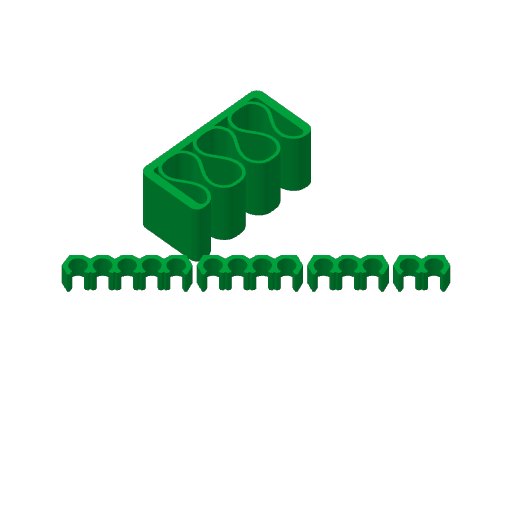

# cables-1 — a cable holder and a row of cable clips, for your desk

**In short.** You asked for "a plat wit hthese": two MakerWorld models for keeping USB-C cables
tidy, ones you press a cable into. This plate is one 3-slot cable holder and one row of cable
clips, each laid out the way its maker prints it. The plate is [`cables-1.yaml`](cables-1.yaml).
It is a desk print, not a coaster question.

## What it is

- **The cable holder.** The Universal Cable Holder by VC_design
  (makerworld.com/en/models/1003508), the 3-slot file you downloaded on 2026-11-10. It is a
  block 34 x 16.75 x 15 mm with three looped slots. You press a cable down into a slot, and the
  block sticks to the desk edge with double-sided tape.
- **The cable clips.** The Cable clips (makerworld.com/en/models/1733675): a row of 13 small
  press-in clips, 79.2 x 5.6 mm on the bed and 5 mm tall.
- **One color, picked at the send.**
- **No supports.** Both makers print them without, and so does this plate.

Neither file is in git: this repo is public and the models are someone else's. They sit in the
gitignored imports folder and the recipe holds each to its hash. Each mesh came out of the
maker's own project file, laid down the way the maker placed it. The clips' bare STL in the
download lies on its side, and the maker's project turns it a quarter turn, so this plate does too.

**What I assumed, for you to change:**

- One holder and one row of clips. More holders are cheap if one is not enough.
- The 3-slot holder you downloaded, not the 4-slot one on the same MakerWorld page.
- Our standard profile: 0.20 mm layers, 2 walls, 15% infill. Both makers use the same values.

## Why print it

You asked for it, to keep USB-C cables tidy on your desk.

## Pictures

The slice: both pieces on the bed.

| Piece | Size (mm) | Where on the bed (mm from front left) |
|---|---|---|
| CABLE HOLDER | 34 x 16.75 x 15 | 150.4, 148.6 |
| CABLE CLIPS | 79.2 x 5.6 x 5 | 138.3, 128.2 |

## Cost and risk

One bed, about 19 minutes, 4.67 g (local slice, 2026-11-10, X2D 0.20 mm Standard preset and
Bambu PLA Basic, sliced for the Textured PEI plate, no supports in the slice). The color you pick
at the send does not change these much.

**Risk: ok.** The slicer gave no warnings. Both pieces sit flat on the bed: the holder on its
34 x 16.75 mm base, and the clips on their 79.2 x 5.6 mm strip. The clips are small, 5 mm tall,
so the one thing to watch is a clip lifting off the bed; the X2D's own spaghetti check is on.

## After the print

| Pieces | The question | What we expect, and why | What each answer changes |
|---|---|---|---|
| CABLE HOLDER and CABLE CLIPS (no carved ids; two pieces that look nothing alike) | 1. Take both pieces off the bed. 2. Press a USB-C cable into one slot of the holder, then into one clip. 3. Pull the cable gently up and out. Does each one take the cable with a press and hold it until you pull? Both hold, one holds, or neither holds | Both hold: the makers sized them for charging cables, and both print with no supports | Both hold: print more as they are. One holds: look at the other maker's sizes. Neither holds: no more until we look at the slot sizes |

## Your call

- [ ] **Approve as it stands** — one cable holder and one row of clips, one color picked at the send
- [ ] **Hold** — say why in the notes

Notes:

## Approvals

Every yes or hold Omar gives this plate, one row each, oldest first (D-096). A tick under Your call, or a yes in chat, becomes a row here through the manage-approvals skill's `plate_approve.py`; a send spends the open approval, and a recipe change resets it.

| Date | Decision | By | Covers | Spent by |
|---|---|---|---|---|

## Timeline

| Date | What happened | Where it is written |
|---|---|---|
| 2026-11-10 | proposed — at Omar's ask: one cable holder and one row of cable clips | this page |
| 2026-11-10 | sliced — local slice fits one bed, about 19 min, 4.67 g, no slicer warnings | this page |
