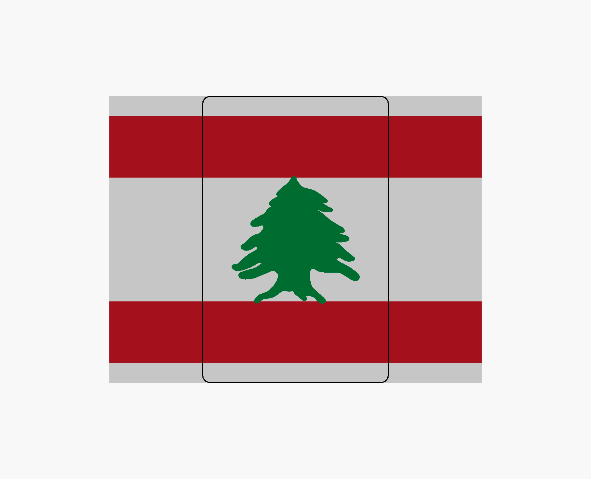
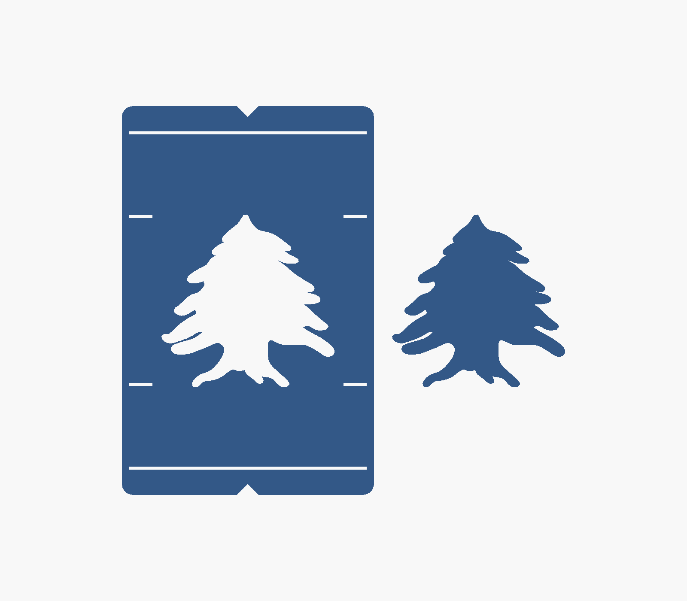
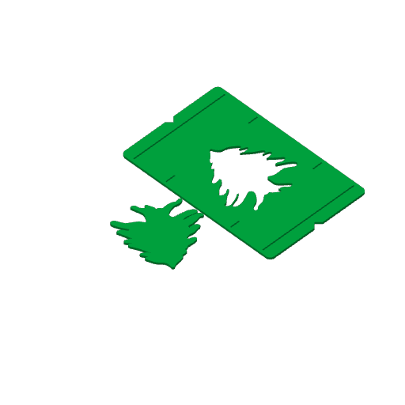

# cedar-stencil-1 — the Lebanon flag's cedar, as a stencil for pre-K

**In short.** You asked for a stencil of the cedar (the arz) to trace when making a landscape
Lebanon flag on ordinary printer paper, for a pre-K class. The flag fills the whole sheet turned
sideways, 11 in wide by 8.5 in tall. The plate prints one thin card, 0.6 mm and bendable, as tall
as the paper, with the cedar cut out. The recipe is [`cedar-stencil-1.yaml`](cedar-stencil-1.yaml)
and the source is [`LebanonCedar.scad`](../../../src/Stencils/LebanonCedar.scad). It needs one bed,
about 30 minutes and 18 g of PLA.

## The flag on the page

The flag is the whole sheet: 279.4 × 215.9 mm (11 × 8.5 in). Each red stripe is a quarter of the
height, 54 mm (2⅛ in), and the white band is half, 108 mm (4¼ in). The cedar opening's tip and
base touch the red stripes, as on the real flag, so it is 108 mm tall and, keeping the cedar's own
shape, 108 mm wide. The outline comes from Wikimedia's flag drawing (public domain),
[kept in the repo](../../../src/Stencils/Flag_of_Lebanon.svg).

This is not the official flag shape. The official flag is 2:3; a sheet is about 1.29:1. On the
official flag the cedar is a third of the flag's width, and here it is a bit more than that (39%),
because it is sized to the taller white band. The first version of this plate drew an official 2:3
flag across the sheet, 186 mm tall, with strips to trim above and below. It was changed after you
asked for a flag that fills the sheet. Setting `flag = "official"` in the source brings it back.

## The card

- **Size.** 140 × 215.9 mm, and 0.6 mm thick (three layers), so it bends like a plastic sheet
  rather than standing stiff. Its top and bottom edges line up with the paper's, so it can only
  sit at the right height. To center it, fold the paper in half side to side and line up the two
  middle notches with the fold. A child traces inside the cedar opening.
- **The side notches** are for the grown-up's pencil. They mark where the stripes start, and a
  ruler joins the marks across the sheet.
- **Only the card prints.** You asked for the bigger piece, not the loose cedar.

The opening is not the exact flag drawing. The exact outline has frond tips 2–3 mm wide, and a
crayon (8–11 mm across) can't get into them. So the opening is 1.5 mm bigger all round. The cedar
is scaled so the opening, the line a child traces, spans the white band exactly.

## Assumptions made

- **The flag fills the sheet**, as you asked, rather than the official 2:3. See above to switch.
- **0.6 mm thick.** "A few layers" read as three. For floppier, set `thick = 0.4`; for a card that
  survives more handling, `thick = 0.8`. The weakest spots are the thin slivers of card, 1–3 mm wide,
  that reach into the opening between neighbouring fronds: a crayon pushed against them could
  bend or tear them long before the rest of the card creases.
- **US Letter paper.** For A4, set `paper = "a4"` in the source and re-render the STL.
- **One card.** A class needs more; at 30 minutes each, several fit one bed side by side if you
  want a batch (`count` in the recipe).
- **No carved id.** It's a classroom tool, and an id cut into the face would show up in the traced
  line.

## On the bed

The slicer finds nothing to warn about. Any one color works.

## After the print

| Pieces | The question | What we expect, and why | What each answer changes |
|---|---|---|---|
| The card | **Do:** Peel the card off the bed and bend it gently end to end. Turn a sheet of Letter paper sideways, fold it in half side to side and open it. Lay the card on it, its top and bottom edges flush with the paper's and its middle notches on the fold. Trace the cedar opening with a crayon, then mark the four side notches with a pencil. Lift the card and measure from the cedar's tip to the top stripe mark, and from its base to the bottom one. **Look for:** Does it bend without creasing, does it lie flat on the paper, does the crayon follow the whole outline, and do the tip and base touch the stripe marks? Do any of the thin slivers between the fronds bend or tear? | It bends and springs back, it lies flat, the crayon follows the outline, and both ends touch, since the card is sized from the paper and the opening spans the white band. | Slivers between the fronds bend or tear: grow the opening more (which fills the narrowest gaps) or go to 0.8 mm. Creases elsewhere: 0.8 mm. Too stiff: 0.4 mm. Crayon catches in the fronds: grow the opening more. Gap at the stripes: check for shrink first. Works: print more cards for the class. |

## Approvals

Every yes or hold Omar gives this plate, one row each, oldest first (D-096). A tick under Your call, or a yes in chat, becomes a row here through the manage-approvals skill's `plate_approve.py`; a send spends the open approval, and a recipe change resets it.

| Date | Decision | By | Covers | Spent by |
|---|---|---|---|---|
| 2026-10-30 | approved | Omar, in chat: "print docs/design/plates/cedar-stencil-1.md in green" | iteration 5 @ e585c10475 in #00AE42 | |

## Timeline

| Date | What happened | Where it is written |
|---|---|---|
| 2026-10-30 | proposed: on Omar's ask for a cedar stencil to trace a landscape Lebanon flag on printer paper, for pre-K; a card and a loose cedar, sliced clean | this page |
| 2026-10-30 | changed: the flag now fills the sheet (11 × 8.5 in), on Omar's question; the cedar is sized to the 108 mm white band, and the loose cedar prints in the card's opening so both fit one bed | this page, the recipe |
| 2026-10-30 | changed: the card only, not the loose cedar, and 0.6 mm thick so it bends, on Omar's asks | this page, the recipe |
