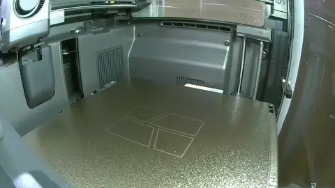
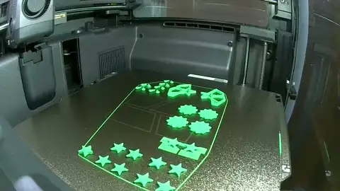

# closeout-1 — one plate to close the flange coaster's open questions

**In short.** You no longer have split-10's or star-3's pieces, and asked on 2026-11-05: "can
we print a combo plate to close out all decisions we need?" The which-questions page that day
sorted the 24 open questions. 18 had been overtaken by later plates, the hexagon ones were
settled by hexfit-2, and what is left comes down to four questions that need pieces in the
hand. This plate prints exactly those pieces, each as it printed before, with the same dots, so
every answer reads straight back onto the plate it came from. It adds one thing: a slice of the
coaster frame, so the kites can be tried without split-07's frame, and star-2's grid star, which you picked to judge the star faces against. And it tries a brim on two of the small
kites, with a skirt round the whole plate, which you asked for on 2026-11-05. 16 pieces, 38
minutes, about 8 g.
The plate is [`closeout-1.yaml`](closeout-1.yaml).

**What it replaces.** These questions close here, and their old pieces need not be found:

- split-10's question 1 (which star face stays flat), question 3 (how many pins the middle takes)
  and question 4 (which kite gap fits the frame);
- star-3's questions 1 and 2 (does the flat star hold on star-2's three pins, and is its bottom
  clean).

Left open elsewhere, and why they are not here:

- split-10's question 2 (the middle's webbed feel): you already called the supported middle best,
  so only its pin count is open, which question 3 asks;
- split-10's question 5 (the hexagon and outer dovetails): closed by hexfit-2, which kept the
  rail at 0.01 mm a side;
- star-1's question (no base, grid supports or a brim): overtaken by star-2;
- the lopsided bigger kites: that needs a photo of the pieces you have, not a print.

## What it tries

| Question | Pieces (how to tell them) | Grams |
|---|---|---|
| Which star face stays flat | STAR-STOCK (3 dots), STAR-SUPPORT (1 dot, printed on supports), STAR-SLOPE (2 dots, a sloped step), STAR-WHOLE (the only star not in halves) | 0.94 |
| The same question: the star to judge them against | STAR-GRID (1 dot on the lower half's bottom, not the cut face): star-2's pick, printed as star-2's TRI-12 was, sloped, on grid supports, three 1.2 mm pins | 0.38 |
| Does the flat star hold on three pins | FLAT-TRI (halves with no dots, three pin holes on a triangle) | 0.26 |
| How many pins the middle takes | MIDDLE-STOCK (1 dot: the centre pin and six round it), MIDDLE-PINS5 (2 dots: the centre and four) | 2.52 |
| Which kite gap fits the frame | KITE-STOCK ×2 (no dots, 0.12 mm a face), KITE-G08 ×2 (1 dot, 0.08 mm), in a frame slice LOWER-36 and UPPER-36 | 2.65 + 0.44 |
| Does a brim help the small kites | KITE-BRIM-12 (1 dot on the bottom, 0.12 mm a face, like KITE-STOCK), KITE-BRIM-08 (1 dot on the cut face and 1 on the bottom, 0.08 mm, like KITE-G08), each with a 2 mm brim | 0.26 |
| Does a skirt help the first pieces start clean | a skirt of 2 lines round the whole plate, not a piece | 0.12 (with the travel between pieces) |
| **The plate** | 16 pieces | **7.57** |

The brim kites are here because you asked, on 2026-11-05, "on small kite (10/11) can we try them
with skirt and brim", and picked brim kites with a skirt round the whole plate, one brim copy of
each gap. Each brim kite is the plain kite of the same gap in everything but the brim and its
bottom dot, so the two can be laid side by side. The brims are 2 mm wide, so the two never meet
in the kites box, where pieces sit 6 mm apart. The skirt is drawn first, before any piece, so the
nozzle is flowing cleanly by the time it reaches the first one.

STAR-GRID is here because you asked, on 2026-11-05, "do we have stars with skirts in this?", and
then picked adding star-2's grid star. It is the star-2 pick, so the other four are judged against
the star we would print today. It sits in a box of its own so its supports never run into a
neighbour's.

The frame slice is a 36° slice of split-07's two frame halves, cut by the same wedge the kites are
cut from, so each kite has its own pocket in it. It also holds a star pocket, a hexagon pocket and
an outer pocket, which are not asked about here. It costs 2.65 g, the most of any group, and is
what lets the kites be judged at all.

Every piece is split-10's piece in everything else: size 112.5 mm, the 0.7 mm wall, and setting 8
(infill and wall overlap 55%).

**Telling the pieces apart.** The dots are sunk into each half's cut face, the face hidden once
the halves close, exactly as on split-10: open the halves and count them. STAR-GRID alone has
its one dot on the lower half's bottom, the face that sits on the table (bikar has no room for
more dots on a cut face with three pins), and it is the only star with support marks. No piece carries a
carved id, because bikar cannot fit one: a one-letter id needs 3.1 by 3.5 mm of flat face with
0.8 mm to every edge, and no star or kite half has it. The pieces with no dots are each the only
one of their kind here: STAR-WHOLE is the only whole star, FLAT-TRI the only star in halves with
no dots, KITE-STOCK the only kite with none. The two brim kites are told apart by a dot on the bottom
face, the one on the table: KITE-BRIM-12 has only that, KITE-BRIM-08 has it plus one on the cut
face. Trim the brim off first; the bottom dot may be hard to see until it is gone. The frame slice's two halves are the only pieces of
their shape. **Keep each piece's two halves together** when you take them off the bed.

## After the print

| Pieces | The question | What we expect, and why | What each answer changes |
|---|---|---|---|
| STAR-STOCK (3 dots), STAR-SUPPORT (1 dot), STAR-SLOPE (2 dots), STAR-WHOLE (whole), against STAR-GRID (1 dot on the bottom) | **Do:** 1. Peel the supports off STAR-SUPPORT and STAR-GRID. 2. Close each cut star's two halves. 3. Lay the five stars face up side by side, STAR-GRID at one end. 4. Look at each from the side, along a point. **Look for:** a face that is flat out to its points, with no curve at the edges, and whether any of the four is flatter than STAR-GRID. | STAR-GRID flat, as star-2's was; STAR-SLOPE or STAR-SUPPORT close to it, since each puts something under the step that sagged. STAR-WHOLE shows whether the cut itself made the curve. | STAR-GRID flattest, or tied: stars stay as star-2 picked, nothing changes. Slope as flat with nothing to pick off: stars print with the slope and no supports. Whole flatter than all: the cut caused it, and stars print whole. All five curve: the cause is something else; say what you see in the notes. |
| FLAT-TRI (halves, no dots), against STAR-STOCK (3 dots) | **Do:** 1. Press FLAT-TRI's two halves together on its three pins. 2. Hold it by its edges and try to twist the halves against each other. 3. Do the same with STAR-STOCK, which has one pin. 4. Turn FLAT-TRI over and look at its bottom, its five tips and the step under each half. **Look for:** halves that close flat and do not turn, where STAR-STOCK can turn round its one pin; and a bottom as clean as STAR-STOCK's. | It holds and does not turn, like star-2's stars on the same 1.2 mm pins; its bottom is as clean, since only the pins changed and they sit inside the halves. Worth deciding only if a flat star wins the row above. | Holds, as clean: the flat star takes the triangle of pins. Too tight to close, or a pin snapped: its pins need a wider gap. Still turns: the triangle is too small, and a wider one is the next plate. Bottom worse: the pins changed how the step prints, and the next plate looks at that. |
| MIDDLE-STOCK (1 dot), MIDDLE-PINS5 (2 dots) | **Do:** 1. Close each middle piece's halves on their pins. 2. Lay each flat and press each end. 3. Pull the halves apart and twist them. **Look for:** halves that close flat and hold without rocking. MIDDLE-STOCK has a centre pin and six round it, MIDDLE-PINS5 a centre pin and four. | Both close and hold: each pin keeps the room the rule asks for to the edge, and the ring is even, so no side is left without a pin as split-07's three uneven pins left it. | Both hold: middles take four round the centre, fewer holes to print. Only six holds: middles take six. Neither holds: the pins need another fit, and your note says which way. |
| KITE-STOCK (no dots) ×2, KITE-G08 (1 dot) ×2, in LOWER-36 and UPPER-36 | **Do:** 1. Lay the frame slice's lower half flat, face down. 2. Put one kite in the small kite pocket at its edge. 3. Close the upper half over it and shake it gently. 4. Take the kite out and do the same with each of the other three. **Look for:** which kites go in without forcing and do not rattle. Both copies should agree. | KITE-G08 snug but may need a push; KITE-STOCK loose, as split-07's were. | 0.08 snug and goes in: kites go to gap 0.08. 0.08 still rattles: the next plate tries below 0.08. 0.08 binds: the next plate tries between 0.08 and 0.12. |
| KITE-BRIM-12 (1 dot on the bottom), KITE-BRIM-08 (1 dot on the cut face, 1 on the bottom), against KITE-STOCK (no dots) and KITE-G08 (1 dot on the cut face) | **Do:** 1. Peel or trim the brim off each brim kite. 2. Lay KITE-BRIM-12 beside a KITE-STOCK, and KITE-BRIM-08 beside a KITE-G08, bottom up. 3. Look at each pair's bottom edge and corners. 4. Put each brim kite in the frame slice's kite pocket as in the row above. 5. Look at the first pieces the nozzle printed after the skirt. **Look for:** a brim kite whose bottom edge is straighter and whose corners are sharper than its plain twin, with no lip left from the brim, and whether it still fits the pocket like its twin. | The brim kites' corners a little sharper, since the brim holds the first layer down at the tips; a small lip where the brim was, which may need a blade. The skirt shows no difference you can see. | Brim cleaner and still fits: small kites print with a brim. No difference: no brim, it only adds trimming. Brim worse, or hard to trim, or the lip stops it fitting: no brim. |

## Pictures

The bed, from above, as the slice lays it out, at the top of this page. Drawn from the sliced
plate by `tools/print_review.py bed --zoom --key`.

## The print

The print as the chamber camera saw it: 21 pictures from 17:20 to 18:04 UTC, half a second each, the last held. Made by the monitor-print skill's `print_monitor.py --publish`; what the printer said is in the print log.

## Cost and risk

**About 38 minutes and 8 g of PLA** (the slice: 38 min 5 s, 7.57 g). One bed, one color, no
prime tower. A skirt of 2 lines runs round the whole plate, and the two brim kites each have a
2 mm brim; no other piece has one. STAR-SUPPORT and STAR-GRID print on supports, as they did on split-10 and
star-2; their supports come off by hand.

**Risk: ok.** Small flat pieces, all printed before on split-10 and split-07 at these settings;
the frame slice is split-07's halves cut smaller.

## Your call

- [ ] **Approve as it stands**: say the color with the yes
- [ ] **Hold**: say why in the notes

Notes:

## Approvals

Every yes or hold Omar gives this plate, one row each, oldest first (D-096). A tick under Your call, or a yes in chat, becomes a row here through the manage-approvals skill's `plate_approve.py`; a send spends the open approval, and a recipe change resets it.

| Date | Decision | By | Covers | Spent by |
|---|---|---|---|---|
| 2026-11-05 | approved | Omar, in chat: "Approve, in green (Recommended)" (iteration 4) | iteration 4 @ 3a378a8c7d in #00AE42 | reset 2026-11-06 |
| 2026-11-06 | approved | Omar, in chat: "Approve and send" (iteration 5) | iteration 5 @ 8c49cd7fa9 in #00AE42 | sent 2026-11-06 |

## Timeline

| Date | What happened | Where it is written |
|---|---|---|
| 2026-11-05 | proposed: Omar no longer has split-10's or star-3's pieces ("Don't have them") and asked for "a combo plate to close out all decisions we need"; 13 pieces for the four questions still open | this page |
| 2026-11-05 | sliced: 34 min, 6.81 g, 13 pieces, no warnings, for the Textured PEI plate | this page |
| 2026-11-05 | changed: Omar asked "do we have stars with skirts in this?" and picked adding star-2's grid star; iteration 3 | this page, [`closeout-1.yaml`](closeout-1.yaml) |
| 2026-11-05 | sliced: 36 min, 7.19 g, 14 pieces, no warnings, for the Textured PEI plate | this page |
| 2026-11-05 | changed: Omar asked "on small kite (10/11) can we try them with skirt and brim" and picked brim kites with a skirt round the whole plate, one brim copy of each gap; iteration 4, the iteration 3 yes no longer covers it | this page, [`closeout-1.yaml`](closeout-1.yaml) |
| 2026-11-05 | sliced: 38 min, 7.57 g, 16 pieces, no warnings, for the Textured PEI plate | this page |
| 2026-11-06 | sent — by `bambu print send`; spends the approval of 2026-11-06, iteration 5 @ 8c49cd7fa9 in #00AE42 | this page |
