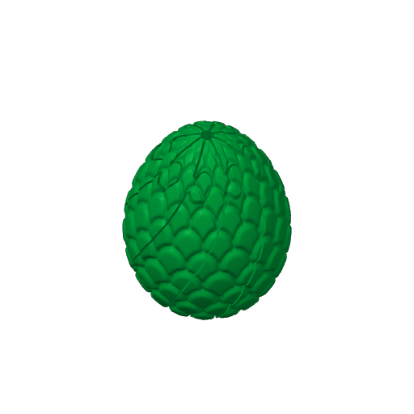
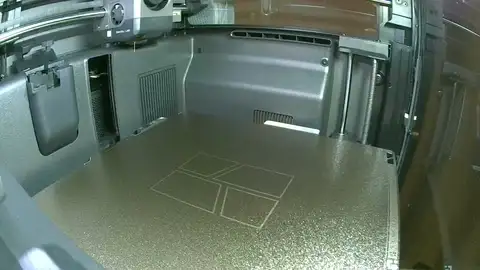
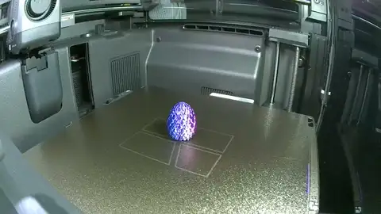

# dragon-egg-1 — one small dragon egg, in silk blue

**In short.** You asked "send a plate to print small dragon egg". This is one Mini Twisted Dragon
Egg from MakerWorld, standing up, in silk blue. The plate is [`dragon-egg-1.yaml`](dragon-egg-1.yaml).
One bed, about 74 minutes, about 16 g. It is a fun print, not a coaster question.

## What it is

- **The egg.** The Mini Twisted Dragon Egg (makerworld.com/en/models/2993035), downloaded on
  2026-09-18, at its own size: about 29.8 x 29.7 x 35.8 mm. It stands on a flat base about 21 mm
  across.
- **One color.** Silk blue (#0047BB), your pick in chat. The plate slices on the PLA Silk profile,
  which runs a little cooler and slower than PLA Basic.
- **No supports.** The maker set it up that way, and so does this plate.

The egg file is not in git: this repo is public and the model is someone else's. It sits in the
gitignored imports folder and the recipe holds it to its hash.

**What I assumed, for you to change:**

- One egg, not a bed of them.
- The "Mini" egg, not the larger twisty fidget egg also in Downloads.
- Our standard walls and 15% infill. The maker's own file sets 2 walls and no infill; a recipe
  cannot set those on an outside model yet, so this egg comes out a little heavier and slower.

## Why print it

You asked for it. It also shows whether an outside model goes through our send path cleanly:
recipe, page, checks, monitor and timelapse.

## Pictures

The slice: the egg standing in the middle of the bed.

| Piece | Size (mm) | Where on the bed (mm from front left) |
|---|---|---|
| DRAGON EGG | about 29.8 x 29.7 x 35.8 | 138.2, 128 |

## The print

The print as the chamber camera saw it: 18 pictures from 02:58 to 04:21 UTC, half a second each, the last held. Made by the monitor-print skill's `print_monitor.py --publish`; what the printer said is in the print log.

## Cost and risk

One bed, 1 h 14 min, 15.60 g of silk blue (local slice, 2026-11-06, X2D 0.20 mm Standard preset
and Bambu PLA Silk, sliced for the Textured PEI plate, no brim, support or raft in the slice).

**Risk: ok.** The slicer warns that the egg has "floating regions": scale tips that start in the
air. That is a looks risk, not a footing or printer risk, since the egg stands on a flat base about
21 mm across. You signed the warning off for this egg only in chat on 2026-11-06 ("Sign it off for
this egg"), and the rule in `.claude/gates/expected-slicer-warnings.json` names this egg's object
and nothing else. The X2D's own spaghetti check is on.

## After the print

| Pieces | The question | What we expect, and why | What each answer changes |
|---|---|---|---|
| DRAGON EGG (no carved id; the only piece on the bed) | 1. Take the egg off the bed. 2. Turn it in your hand and look at the scale tips, most of all on the lower half. Do the scales come out clean, or do some tips droop or string? Clean, rough tips, or failed | Clean, or a few rough tips low down: the maker prints it with no supports, and the warning points at scale tips starting in the air | Clean: print more eggs as they are. Rough tips: try the maker's own file, which raised fewer warnings in September. Failed: no more eggs until we look at supports |

## Judged

Omar's answers to the rows of After the print, word for word, one row each, oldest first. They are written by the review-print skill's `after_print.py answer` (the hub's Judge a print page calls it); the newest answer to a row is the one that counts. A session turns them into the print record with review-print.

| Row | Answer | His words | Date |
|---|---|---|---|
| 1 | Clean | — | 2026-11-09 |

## Your call

- [ ] **Approve as it stands** — one dragon egg, silk blue, no supports
- [ ] **Hold** — say why in the notes

Notes:

## Approvals

Every yes or hold Omar gives this plate, one row each, oldest first (D-096). A tick under Your call, or a yes in chat, becomes a row here through the manage-approvals skill's `plate_approve.py`; a send spends the open approval, and a recipe change resets it.

| Date | Decision | By | Covers | Spent by |
|---|---|---|---|---|
| 2026-11-06 | approved | Omar, in chat: "send a plate to print small dragon egg", color "Silk blue" | iteration 2 @ d811f0eb94 in #0047BB | sent 2026-11-06 |

## Timeline

| Date | What happened | Where it is written |
|---|---|---|
| 2026-11-06 | proposed — at Omar's ask: one small dragon egg | this page |
| 2026-11-06 | sliced — local slice fits one bed, 1 h 14 min, 15.60 g, one by-design slicer warning signed off by Omar | this page |
| 2026-11-06 | sent — by `bambu print send`; spends the approval of 2026-11-06, iteration 2 @ d811f0eb94 in #0047BB | this page |
