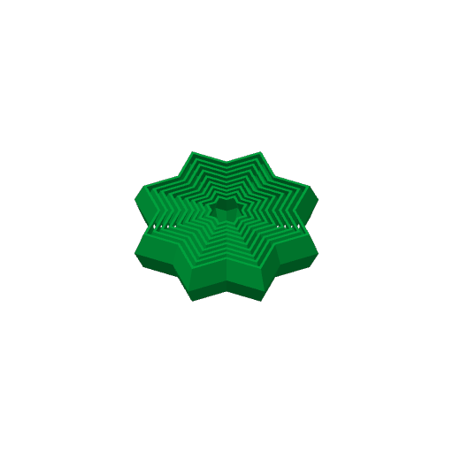

# fidget-star-1 — the 8-point fidget star on a plate of its own

**In short.** You asked for "an individual plate with just the start" from the toys plate. I read
"start" as the star. This is one 8-point fidget star, the same file toys-1 printed, alone on the
bed and with no supports. The plate is [`fidget-star-1.yaml`](fidget-star-1.yaml). One bed, about
58 minutes, about 29 g. It is a fun print, not a coaster question. You pick the color at the send.

## What it is

- **The 8-point fidget star.** Downloaded as `8ptFidgetStar.stl` (made in Blender 2.92; the file
  names no maker), at its own size: about 78 x 78 x 18 mm. It lies flat on a base about 70 mm
  across. It is the same file as toys-1's star, held to the same hash.
- **One color**, picked at the send. Until then it slices on PLA Basic.
- **No supports.** toys-1 turned supports on for its whole bed only because of the ping-pong ball's
  open lattice. The star lies flat and does not need them, and supports caught between its rings
  were toys-1's first suspect if the rings came out stuck.

The star file is not in git: this repo is public and the model is someone else's. It sits in the
gitignored imports folder, which links to your iCloud folder `CloudDesktop/data/3d-models/imports`,
and the recipe holds it to its hash.

**What I assumed, for you to change:**

- "start" means the star.
- One star, not a bed of them.
- No supports, unlike toys-1.
- Our standard walls and 15% infill. A recipe cannot set the maker's own settings on an outside
  model yet.

## Why print it

You asked for it. Beside toys-1's star, which printed with supports, it also shows whether the
star's rings move better without them.

## Pictures

The slice: the star alone on the bed.

| Piece | Size (mm) | Where on the bed (mm from front left) |
|---|---|---|
| FIDGET STAR | about 78.0 x 78.0 x 18.0 | 138.3, 128 |

## Cost and risk

One bed, 58 min, 29.34 g (local slice, 2026-11-08, X2D 0.20 mm Standard preset and Bambu PLA Basic, sliced for the Textured PEI plate; no supports, no raft, the automatic brim setting added none, and the slicer raised no warnings). On toys-1 the star shared the bed with the cube and the ball, 5 h 40 min and 89.48 g in all.

**Risk: ok.** The star lies flat on a wide base, so it holds the bed well. The worst case is rings
fused to each other: a looks and feel risk, not a printer risk. The X2D's own spaghetti check is
on.

## After the print

| Pieces | The question | What we expect, and why | What each answer changes |
|---|---|---|---|
| FIDGET STAR (no carved id; the only piece on the bed) | 1. Take the star off the bed. 2. Try to move its rings and points. 3. If you still have toys-1's star, do the same with it. Do the rings move freely, and better or worse than toys-1's star? Free, stiff, or stuck | Free or a little stiff at first: a fidget toy printed in one piece often needs a twist to break the parts loose, and with no supports nothing sits between the rings | Free or stiff: print more stars like this, with no supports. Stuck: the gaps between the rings are too tight for our profile; look at the maker's settings or a finer layer |

## Your call

- [ ] **Approve as it stands** — one fidget star, one color picked at the send, no supports
- [ ] **Hold** — say why in the notes

Notes:

## Approvals

Every yes or hold Omar gives this plate, one row each, oldest first (D-096). A tick under Your call, or a yes in chat, becomes a row here through the manage-approvals skill's `plate_approve.py`; a send spends the open approval, and a recipe change resets it.

| Date | Decision | By | Covers | Spent by |
|---|---|---|---|---|

## Timeline

| Date | What happened | Where it is written |
|---|---|---|
| 2026-11-08 | proposed — at Omar's ask: the fidget star from toys-1 on a plate of its own | this page |
| 2026-11-08 | sliced — one bed, 58 min, 29.34 g, no supports, no warnings | this page |
