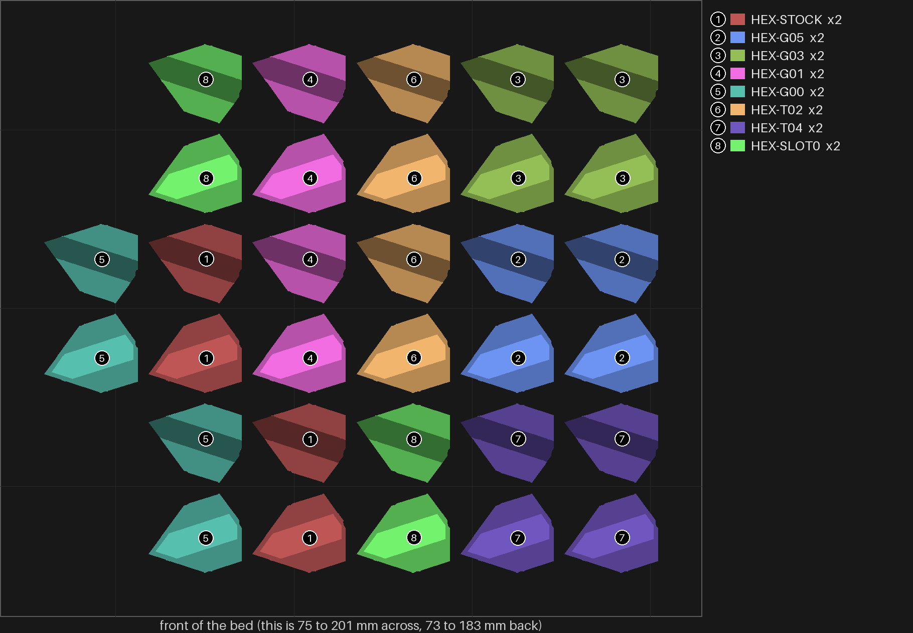
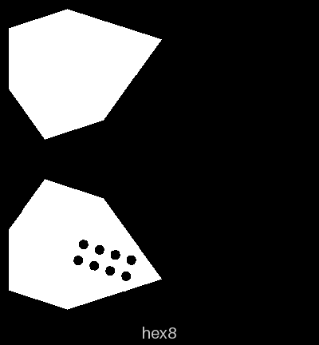

# hexfit-1 — the hexagon dovetail, from stock down past zero

**In short.** On split-10 you said none of the hexagon pieces was tight: even the 0.05 mm
dovetail had play. You picked "Dovetail, past zero", so this bed goes on from there: the
hexagon piece at stock (0.15 mm a side), then 0.05, 0.03, 0.01, exactly zero, and two that are
wider than the slot they go in (0.02 and 0.04 mm too big), which only go on if the plastic
gives. You also said yes to one more: stock fit with the slot exactly as deep as the rail, not
a layer deeper as split-10's was (bikar #352), to see whether the play is up and down rather
than side to side. Two of each, so a result counts only when both copies agree: sixteen pieces.
Nothing else changes from split-10's hexagon. The plate is [`hexfit-1.yaml`](hexfit-1.yaml).

## What it tries

| Version | Dots | Dovetail gap a side | Slot depth | What it tests |
|---|---|---|---|---|
| HEX-STOCK | 1 | 0.15 mm | rail + one layer | The control: split-10's stock hexagon |
| HEX-G05 | 2 | 0.05 mm | rail + one layer | split-10's tightest, again, as the step down from stock |
| HEX-G03 | 3 | 0.03 mm | rail + one layer | Tighter |
| HEX-G01 | 4 | 0.01 mm | rail + one layer | Almost touching |
| HEX-G00 | 5 | 0 | rail + one layer | Rail and slot drawn the same width |
| HEX-T02 | 6 | 0.02 mm too wide | rail + one layer | Past zero: the rail is wider than its slot |
| HEX-T04 | 7 | 0.04 mm too wide | rail + one layer | Further past zero |
| HEX-SLOT0 | 8 | 0.15 mm | the rail's own depth | Whether the play is the slot being a layer too deep |

**Telling the pieces apart (D-121).** Turn each piece over and count the small round dots sunk
into the bottom of its lower half, the face that sits on the table, where you asked for them:
one dot to eight, one count per version. There is no carved id this time. bikar cuts an id on
every half on the bed, and the upper half's bed face is the coaster's top, with no room on it
for even one letter. The upper half carries no mark, so **keep each piece's two halves
together** when you take them off the bed; an upper half that strays has nothing to send it
home.

**Why past zero.** A printed rail comes out a little wider than drawn and a printed slot a
little narrower, so a drawn gap of zero is not a printed gap of zero. split-10's 0.05 mm still
had play, which says this printer's rail and slot meet somewhere below that. The pieces past
zero find the point where they bind.

Every piece is split-10's HEX-STOCK in everything else: size, pins, the 0.7 mm wall, setting 8
(infill and wall overlap 55%).

## After the print

| Pieces | The question | What we expect, and why | What each answer changes |
|---|---|---|---|
| 1 dot (HEX-STOCK), 2 dots (HEX-G05), 3 dots (HEX-G03), 4 dots (HEX-G01), 5 dots (HEX-G00), 6 dots (HEX-T02), 7 dots (HEX-T04) | **Do:** Take each piece's two halves (the lower half has the dots; keep its upper half with it) and slide them together on the dovetail, then hold the lower half and try to wiggle the upper one side to side. Do both copies of each count. **Look for:** The fewest dots, the loosest fit, that slides on and does not wiggle. | Somewhere between 3 dots (0.03) and 6 dots (0.02 too wide): split-10's 0.05 still had play, and the ones past zero should bind. | 2 to 5 dots holds: the dovetail goes to that gap. Only 6 or 7 dots holds: the dovetail goes past zero to that one. All wiggle, even 7 dots: side to side is not the problem; the next answer says if depth is. 3 dots already binds: the next plate tries between 0.03 and 0.05. |
| 1 dot (HEX-STOCK), 8 dots (HEX-SLOT0) | **Do:** Slide each piece's two halves together on the dovetail, then hold the lower half and try to rock the upper one up and down, lifting one edge. **Look for:** Does the 8-dot piece rock less than the 1-dot piece? | 8 dots rocks less, if the play you felt on split-10 is the slot being a layer deeper than the rail. | 8 dots rocks less: slots go to the rail's own depth. Same: depth is not the play, and slots stay as they are. 8 dots will not go on: slots stay a layer deeper. |

## Judged

Omar's answers to the rows of After the print, word for word, one row each, oldest first. They are written by the review-print skill's `after_print.py answer` (the hub's Judge a print page calls it); the newest answer to a row is the one that counts. A session turns them into the print record with review-print.

| Row | Answer | His words | Date |
|---|---|---|---|
| 1 | 2 to 5 dots holds | Omar, in chat 2026-10-29: "4 might have been the best, 1 too loose, 6 too tight" | 2026-10-28 |
| 2 | Same | — | 2026-10-29 |

## Pictures

The bed, from above, as the slice lays it out: one number and color per version, and the list
of versions beside it. Drawn from the sliced plate by `tools/print_review.py bed --zoom --key`,
at the top of this page.

The 8-dot piece from below, drawn from its own model by `tools/print_review.py bottom`: the
dots sit on the lower half only, and the upper half's face is plain.

## Cost and risk

**About 41 minutes and 11 g of PLA** (the slicer's estimate), one bed, no prime tower, one color.

**Risk: ok.** Small flat pieces, no supports.

## Your call

- [ ] **Approve as it stands**: say the color with the yes
- [ ] **Hold**: say why in the notes

Notes:

## Approvals

Every yes or hold Omar gives this plate, one row each, oldest first (D-096). A tick under Your call, or a yes in chat, becomes a row here through the manage-approvals skill's `plate_approve.py`; a send spends the open approval, and a recipe change resets it.

| Date | Decision | By | Covers | Spent by |
|---|---|---|---|---|
| 2026-10-28 | approved | Omar, in chat: "go in green if plate ready" | iteration 3 @ 65814017c0 in #00AE42 | sent 2026-10-28 |

## Timeline

| Date | What happened | Where it is written |
|---|---|---|
| 2026-10-28 | proposed: on Omar's split-10 note that none of the hexagons was tight, and his picks "Dovetail, past zero", "Yes, add one" (the slot as deep as the rail) and "Dots on the bottom"; 16 pieces | this page |
| 2026-10-28 | sent — by `bambu print send`; spends the approval of 2026-10-28, iteration 3 @ 65814017c0 in #00AE42 | this page |
