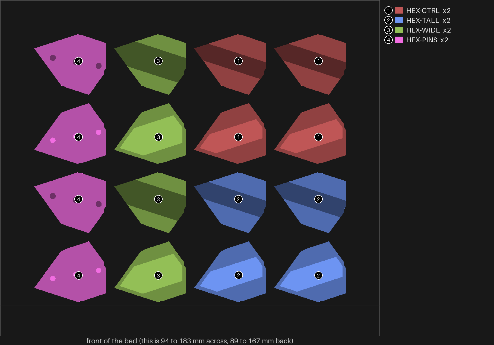
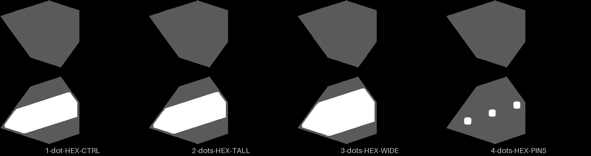
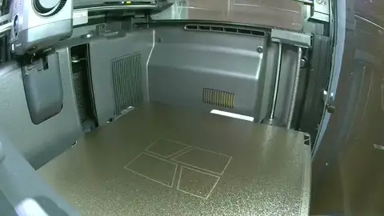
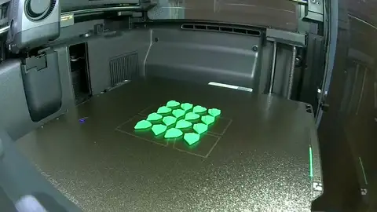

# hexfit-2 — what stops the hexagon halves rocking

**In short.** On hexfit-1 the side-to-side fit was settled: the 4-dot piece, 0.01 mm a side,
held best, and that is now bikar's default. But you said "both rock" of the two pieces you
were asked to rock, and both had the old loose fit (0.15 mm a side). The 4-dot piece was never
asked, and you no longer have it. So this bed puts that piece back as the control and tries
three changes beside it: a taller rail, a wider rail, and pins in place of the rail. Two of
each, so a result counts only when both copies agree: eight pieces. The plate is
[`hexfit-2.yaml`](hexfit-2.yaml).

**What it replaces.** hexfit-1's rocking question (its row 2, answered "Same", with "both rock"
in the comment) was asked of the loose pieces only. This plate asks it again on the tight fit, so
hexfit-1 has nothing left open on rocking.

## What it tries

| Version | Dots | The join | What it tests |
|---|---|---|---|
| HEX-CTRL | 1 | rail 4 mm wide, 0.8 mm tall, 0.01 mm a side | The control: hexfit-1's 4-dot piece. Does the tight fit rock at all? |
| HEX-TALL | 2 | rail 1.0 mm tall, slot as deep as the rail | A taller rail, more flank to hold the upper half down |
| HEX-WIDE | 3 | rail 6 mm wide | A wider rail, a wider footing to rock about |
| HEX-PINS | 4 | three 1.2 mm pins in a row, no rail | Pins in place of the rail |

**Two ideas could not be built as the backlog wrote them.**

- *A taller rail with the slot a layer deeper.* The halves are 1.5 mm thick, and bikar keeps
  0.5 mm of band over the slot's ends, so a 1.0 mm rail with a 1.2 mm slot is refused. HEX-TALL
  cuts its slot exactly as deep as the rail instead; on hexfit-1 that depth rocked no
  differently from a deeper slot.
- *A pin beside the rail.* bikar refuses a piece with both: its halves take one or the other.
  So HEX-PINS tries pins in place of the rail. Pins stop the halves sliding apart but do not
  clamp them, so they may lift. Building a piece with both would be a bikar change, and is
  worth making only if neither rail change stops the rock.

**Telling the pieces apart (D-121).** Turn each piece over and count the dots sunk into the
bottom of its lower half, the face that sits on the table: one to four. The upper half carries
no mark, so **keep each piece's two halves together** when you take them off the bed.

Every piece is hexfit-1's 4-dot piece in everything but its join: size, the 0.7 mm wall, and
setting 8 (infill and wall overlap 55%).

## After the print

| Pieces | The question | What we expect, and why | What each answer changes |
|---|---|---|---|
| 1 dot (HEX-CTRL), 2 dots (HEX-TALL), 3 dots (HEX-WIDE), 4 dots (HEX-PINS) | **Do:** 1. Take one piece's two halves (the lower half has the dots) and put them together: slide them on the rail, or press them onto the pins for 4 dots. 2. Lay the piece flat, lower half down. 3. Press down on one end of the upper half, then the other end. 4. Do the same for both copies of each count. **Look for:** The upper half staying flat when you press each end, with no lift at the other end. | 1 dot rocks a little less than hexfit-1's pieces did, since its fit is tighter; 2 and 3 dots rock less again. 4 dots is the unknown: the pins stop sliding, not lifting. | None rocks, not even 1 dot: the tight fit already fixed it, and the rail stays as it is. Only 2 dots stays flat: rails go to 1.0 mm tall. Only 3 dots stays flat: rails go to 6 mm wide. Both 2 and 3: the next plate tries both together. Only 4 dots: the hexagon goes to pins. All rock: none of these is the cause, and the next step is a piece with a rail and pins both (a bikar change). |
| 2 dots (HEX-TALL), 3 dots (HEX-WIDE) | **Do:** 1. Slide each piece's two halves together on the rail. 2. Hold the lower half and try to slide the upper one side to side, across the rail. **Look for:** Side-to-side play, against hexfit-1's 4-dot piece, which had none. | No play: both keep hexfit-1's 0.01 mm gap a side. | No play: the change keeps the fit. Play on one: that change loosens the fit, and the next plate tightens it before using it. Will not go on: that change binds, and the next plate opens its gap. |

## Pictures

The bed, from above, as the slice lays it out, at the top of this page. Drawn from the sliced
plate by `tools/print_review.py bed --zoom --key`. Each version's join drawn from its own model
by `tools/print_review.py pins`, above.

## The print

The print as the chamber camera saw it: 14 pictures from 21:48 to 22:15 UTC, half a second each, the last held. Made by the monitor-print skill's `print_monitor.py --publish`; what the printer said is in the print log.

## Cost and risk

**About 23 minutes and 6 g of PLA** (the slice: 23 min 13 s, 5.56 g). One bed, one color, no
prime tower, no brim, no supports.

**Risk: ok.** Small flat pieces, no supports, the same pieces as hexfit-1 but for the join.

## Your call

- [ ] **Approve as it stands**: say the color with the yes
- [ ] **Hold**: say why in the notes

Notes:

## Approvals

Every yes or hold Omar gives this plate, one row each, oldest first (D-096). A tick under Your call, or a yes in chat, becomes a row here through the manage-approvals skill's `plate_approve.py`; a send spends the open approval, and a recipe change resets it.

| Date | Decision | By | Covers | Spent by |
|---|---|---|---|---|
| 2026-11-05 | approved | Omar, in chat: "Approve, in green" | iteration 1 @ dd34ba4afc in #00AE42 | sent 2026-11-05 |

## Timeline

| Date | What happened | Where it is written |
|---|---|---|
| 2026-11-05 | proposed: hexfit-1's rocking left open ("both rock" on the two loose pieces), and Omar no longer has its 4-dot piece ("Don't have them"); 8 pieces, four joins | this page |
| 2026-11-05 | sliced: 23 min, 5.56 g, 8 pieces, no warnings, for the Textured PEI plate | this page |
| 2026-11-05 | sent — by `bambu print send`; spends the approval of 2026-11-05, iteration 1 @ dd34ba4afc in #00AE42 | this page |
