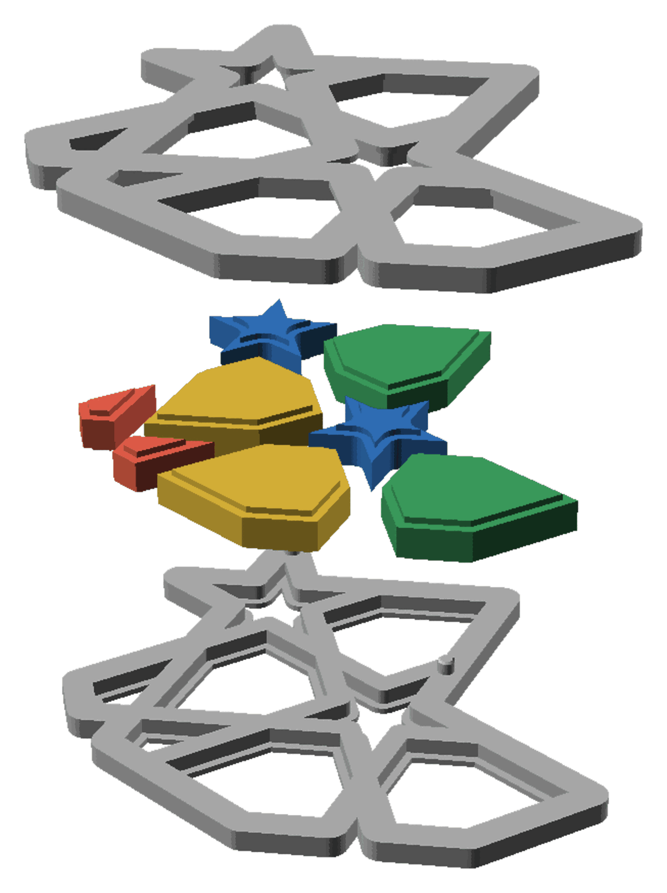
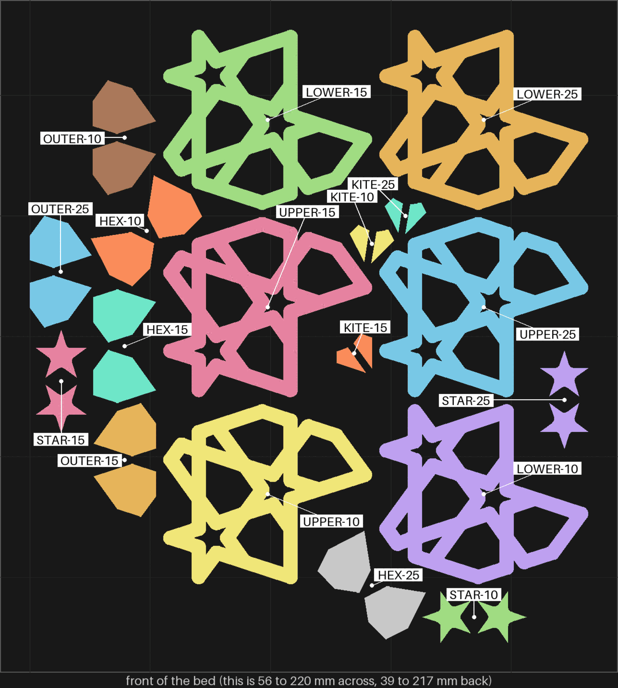

# split-03 — the flange coaster again: pins, halves that close, and three tighter piece gaps

**In short.** You judged [split-02](split-02.md) and every piece came back "adjust": the pieces
rattle, the halves come apart, a space shows between the halves, a margin shows round the stars
and kites, and the 2 mm id does not read. You asked: "the split one didnt' ahve pins and was
loose", "how do we iterate on that one?", "with the 8 that won". This plate tries three fixes at
once, on slices of the coaster rather than three whole ones (your rule of 2026-10-12: print
pieces, not whole shapes). Every piece prints with setting 8, the bed-face setting you picked on
[bedface-5](bedface-5.md). The plate is [`split-03.yaml`](split-03.yaml).

## What it is

Three sets, each the same fifth of the flange coaster: a 72° slice starting at 9°, at the size
split-02 printed (112.5 mm across). Each set is a lower half, an upper half, and the kites,
hexes, stars and outer pieces whose holes sit in that slice. The middle piece is not in the slice.

- **Pins.** Each lower half has 2 pins, 1.7 mm across, and the upper half has a hole for each, with
  0.25 mm of play. split-02 had none, so the halves came apart.
- **Halves that close.** Every piece is 0.2 mm shorter at its band, so the band no longer holds the
  halves apart. That is the guess for the space you saw between them.
- **Three piece gaps, one per set.** The play between a piece and its hole, on each side:

  | Set | Piece gap | Lower half's number | Hex pieces | Outer pieces |
  |---|---|---|---|---|
  | 1 | 0.25 mm (split-02's, to compare against) | 7 | `1E` | `1F` |
  | 2 | 0.15 mm | 8 | `1J` | `1K` |
  | 3 | 0.10 mm | 9 | `1T` | `1U` |

  The halves are the same in every set; only the pieces change. So any upper half closes onto any
  lower half.
- **Setting 8** on every piece: the fill pushed 55% into the wall.

**The color is picked at the send**: say it with the yes ("yes, in pink").

**What I assumed, for you to change:**

- **Pins 1.7 mm, not 2 mm.** Pins only fit where straps meet, and the widest such spot at this
  size has 1.92 mm of room. A 2 mm pin needs 1.93 even with the smallest play, so it does not fit.
  The 0.25 mm play comes from D-116, which was measured on 2 mm pins. This transfers only if a
  thinner pin needs the same play to go in by hand, which nobody has checked. It is the call below.
- **Smaller coasters get no pins.** At 100 mm the most room is 1.62 mm, at 90 it is 1.36, at 80 it
  is 1.10. So this plate stays at 112.5.
- **The pieces 0.2 mm shorter.** A guess at the space between the halves, not a measurement.
- **The id is unchanged.** The number on each lower half is still 2 mm, the size you said does not
  read. Fixing that is still open. Here the number only tells the three sets apart.
- **Keeping the sets apart is fragile.** The three lower halves look alike, their numbers are hard
  to read, and the stars and kites carry no id. If a star or kite is mixed into the wrong set off
  the bed, nothing can sort it back. So the first row below is about keeping each set together.
- **No glue**, as on split-02.

## Why print it

split-02 asked whether a flange coaster works at all. It held the pieces and both faces came out
flush, but it failed on the things this plate changes: pins, the space between the halves, and
the loose pieces. One bed answers all three, and the piece gap is tried at three sizes side by
side, so one print picks the gap instead of three.

## After the print

What gets asked when it comes off the bed, one row at a time (the review-print skill asks them).
Each row names the pieces by the id cut into their bottoms. The lower halves carry 7, 8 or 9 on
their bottom. The upper halves, stars and kites carry none, so they are named by their set.

| Pieces | The question | What we expect, and why | What each answer changes |
|---|---|---|---|
| Every piece, before anything else | **Do:** Take the pieces off the bed one set at a time, from the [bed picture](#pictures): the lower half `7`, the upper half beside it, the `1E` and `1F` pieces and the stars and kites beside them. Put each set in its own pile or bag before starting the next. **Look for:** Did any star or kite get mixed up, so you are not sure which set it came from? | All three sets kept apart. | Kept apart: go on. Mixed up: the rows below are judged only on the pieces with an id (`1E` `1F` `1J` `1K` `1T` `1U`), and the stars and kites are left out. |
| Each set's pieces: `1E` and `1F` (gap 0.25), `1J` and `1K` (0.15), `1T` and `1U` (0.10), and each set's stars and kites | **Do:** Set each piece in its hole in its own set's lower half, band down. **Look for:** Which sets' pieces go in by hand without pressing, and which are too tight to go in? | All go in. At 0.10 some may need a push. | Each gap that goes in stays in the running. A gap too tight to go in is out. |
| Each set, closed, held shut | **Do:** Close each set with its own upper half and pinch the halves together. With a fingertip, push a hex, an outer piece, a star and a kite side to side. Then shake the set. **Look for:** For each set (7, 8, 9): do the pieces move? Does it rattle? Is there still a margin round the stars and kites? | 0.25 rattles, as on split-02. 0.15 less. 0.10 still, with no margin you can see. | The tightest gap that went in and does not rattle becomes the flange coaster's gap. If all three rattle, the next plate tries smaller still. |
| The halves of each set, closed with no pieces in, then with them | **Do:** Close a set with no pieces in and look at the edge where the halves meet. Then put its pieces in and close it again. **Look for:** Is there a space between the halves either way? Does the space come only when the pieces are in? | No space either way: the pieces are 0.2 mm shorter, so they no longer hold the halves apart. | No space: the shorter band stays. A space only with pieces in: the band needs more taken off. A space with no pieces too: the space comes from the halves themselves, not the pieces, and the cut changes. |
| The pins, each set | **Do:** Close each set, pins into their holes. Pick it up by the rim, tip it on its side and turn it over. **Look for:** Do the pins go into their holes by hand? Do the rims line up, with no step? Does it stay closed when turned over, or does a half drop away? | They go in and line the halves up. Whether they hold it closed is the open part: 1.7 mm pins with 0.25 mm play may only line up, not hold. | Hold: 1.7 mm pins at 0.25 play are the flange coaster's pins. Line up but don't hold: less play, or glue (split design call 3). Don't go in: more play. |
| The bands, each set's pieces | **Do:** Hold a piece by its edges and look at the underside of its band, the wider step round its middle. **Look for:** Is it as clean as split-02's, or worse? | The same as split-02: clean, or a slight droop. Setting 8 changes only the bottom face. | Clean: setting 8 stays for split coasters. Worse: setting 8 goes on the halves only, not the pieces. |

## Pictures

Opened up: one set, the lower half at the bottom, the pieces lifted over their holes with the
band showing as a step on each, and the upper half above. One pin shows, the small post on the
lower half's right; the other is hidden behind the pieces. Drawn by bikar and OpenSCAD from the
coaster file (`tools/cookbook_render.py --file`). It is at the top of this page.

The bed, from above, as the slice lays it out, each piece named. The slicer places the pieces to
fit, not by set, so the three sets' stars and kites sit side by side: the two kites marked
KITE-25 and the two marked KITE-10 are neighbours. Take them off by these names (the first row of
After the print).

## Cost and risk

One bed, 75 minutes, about 21 g (local slice, 2026-10-22, X2D preset and PLA Basic, from bikar
main after bikar #341). Sliced for the glacier plate (`--plate-type hot_plate`, Smooth PEI), the
plate setting 8 was picked on. The slicer gave no warnings, and every one of the 18 pieces carries
setting 8. One color, so no swaps.

**Risk: watch.** As on split-02: each band sticks out 0.8 mm with nothing under it and may droop,
which is a look to judge, not a risk to the printer. The kites and stars are small loose pieces
that can lift or get knocked by the nozzle. The pins are thin (1.7 mm) and stand on the lower
half's cut face, so a pin that prints badly breaks off as a look, not a danger to the printer.

## Your call

**The pin size.** Pins only fit where straps meet, and that spot has 1.92 mm of room at this size.
A 2 mm pin needs 1.93. So the choice is between a thinner pin and making room for a thicker one.

| Option | What it buys | What it costs or risks | What it commits to |
|---|---|---|---|
| **1.7 mm pins at 0.25 mm play** (this plate as drawn) | Prints now, with no change to the coaster's look | The 0.25 play was measured on 2 mm pins. A thinner pin may be weaker, or need different play. | If it works, 1.7 mm becomes the flange coaster's pin. It fits only at 112.5 mm; smaller coasters still get none. |
| **A narrower flange so 2 mm fits** | Keeps the pin size we measured | The band holds the pieces by less. A new iteration, and the halves change. | Ties the band width to the pin. The flange's look and hold change. |
| **A thinner wall round the pin hole** | Keeps the 2 mm pin and the band | A thin wall can crack or print badly. Below the 0.9 mm wall we use now, untested. | A new rule for the wall, needs its own test. |
| **Several pin sizes on this plate** (1.5, 1.7, 1.9) | Picks the pin from the pieces in hand, as you asked for joins on 2026-10-08 | Three different pins mean the three sets differ in two ways. Either one more bed, or fewer piece gaps on this one. | Delays the piece gap answer or adds a bed. |

My pick: 1.7 mm as drawn. It fits, it is the cheapest to learn from, and the pins row above says
which way to move if it is wrong.

- [ ] **1.7 mm pins, as drawn**
- [ ] **A narrower flange so 2 mm fits**
- [ ] **A thinner wall round the pin hole**
- [ ] **Several pin sizes on this plate**

Then:

- [ ] **Approve as it stands**: say the color with the yes
- [ ] **Hold**: say why in the notes

Notes:

## Approvals

Every yes or hold Omar gives this plate, one row each, oldest first (D-096). A tick under Your call, or a yes in chat, becomes a row here through the manage-approvals skill's `plate_approve.py`; a send spends the open approval, and a recipe change resets it.

| Date | Decision | By | Covers | Spent by |
|---|---|---|---|---|

## Timeline

| Date | What happened | Where it is written |
|---|---|---|
| 2026-10-22 | proposed: from split-02's record, on Omar's words "the split one didnt' ahve pins and was loose", "how do we iterate on that one?", "with the 8 that won"; pins from bikar #341 | this page |
| 2026-10-22 | sliced — local slice from bikar main after bikar #341, for the glacier plate (Smooth PEI), fits one bed, 75 minutes, 20.9 g, no slicer warnings, setting 8 on all 18 pieces | this page |
