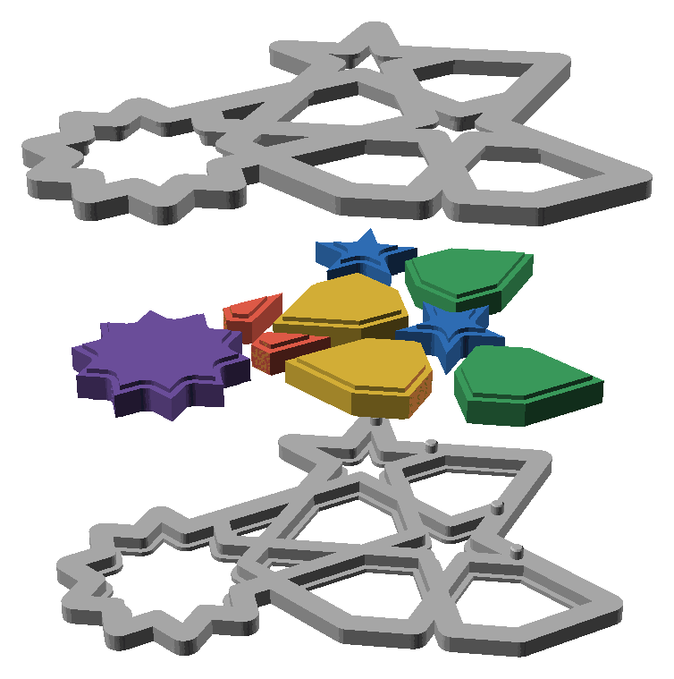

# split-04 — every piece kind in a pinned border, at three piece gaps

**In short.** You asked for a version of split-02 that tests the fit of each kind of piece, the
middle, the kites, the stars and the rest, in a border pinned shut: "if the surorunding border
was pined, would they be sniug fit". You picked "split-03 plus the centre piece", then said "also
add more pins". This plate is that. It replaces [split-03](split-03.md), which never printed. Every
piece prints with setting 8, the bed-face setting you picked on [bedface-5](bedface-5.md). The
plate is [`split-04.yaml`](split-04.yaml).

## What it is

Three sets, each the same fifth of the flange coaster at the size split-02 printed (112.5 mm
across): a 72° slice starting at 9°, now with the middle piece and its opening too. bikar could
not keep the middle in a slice before, because the middle sits on the coaster's centre and no
angle holds it; the new `center 1` on the slice keeps it. Each set is a lower half, an upper
half, and one or two of each piece kind: the middle, two kites, two hexes, two stars and two
outer pieces.

- **More pins: 4 per set, not 2.** Each lower half has 4 pins, 1.7 mm across, and the upper half
  has a hole for each, with 0.25 mm of play. Pins can stand only where straps meet. split-03 kept
  them at least 25 mm apart, which left room for 2. This plate lets them sit 10 mm apart, which
  gives 4. All four are on the slice's outer part. The middle's border has no spot with room for
  a 1.7 mm pin at any spacing tried (6 to 25 mm). So the middle is held only by the pins round it.
- **Halves that close.** Every piece is 0.2 mm shorter at its band, so the band no longer holds the
  halves apart.
- **Three piece gaps, one per set.** The play between a piece and its hole, on each side:

  | Set (the lower half's number) | Piece gap | Middle | Hex pieces | Outer pieces |
  |---|---|---|---|---|
  | 7 | 0.25 mm (split-02's, to compare against) | `2A` | `2E` | `2F` |
  | 8 | 0.15 mm | `2C` | `2J` | `2K` |
  | 9 | 0.10 mm | `2L` | `2T` | `2U` |

  The halves are the same in every set; only the pieces change. So any upper half closes onto any
  lower half.
- **Setting 8** on every piece: the fill pushed 55% into the wall.
- **Each set in its own block on the bed.** On split-03 the slicer packed the pieces wherever they
  fit, so the three sets' stars and kites sat mixed together. You asked: "can we group related
  pieces into a rectangle and organize the rectangles". Now each set's seven pieces sit together,
  and the three blocks stand side by side, 14 mm apart: set 7 on the left, 8 in the middle, 9 on
  the right. The bed picture draws a box round each block and names it.

**The color is picked at the send**: say it with the yes ("yes, in pink").

**What I assumed, for you to change:**

- **Pins 1.7 mm, 10 mm apart.** A 2 mm pin does not fit at this size: the widest spot where
  straps meet has 1.92 mm of room. The 0.25 mm play comes from D-116, which was measured on 2 mm
  pins. It carries over only if a thinner pin needs the same play to go in by hand, which nobody
  has checked. Smaller pins fit in more spots: 1.5 mm gives 5 per set, 1.2 mm gives 6. That is the
  call below.
- **The pieces 0.2 mm shorter.** A guess at the space between the halves, not a measurement.
- **The id is unchanged.** The number on each lower half is still 2 mm, the size you said does not
  read. Here it only tells the three sets apart.
- **The blocks keep the sets apart only on the bed.** The stars and kites carry no id. Once off
  the bed, a star in the wrong pile cannot be sorted back. So the first row below takes each block
  off on its own. The 14 mm between blocks and 6 mm between pieces are guesses, not measured.
- **No glue**, as on split-02.

## Why print it

The question is how each kind of piece fits its hole when the border round it is pinned shut.
One slice holds every kind, the middle included, so a slice answers for the whole coaster: the
rest of the coaster is the same kinds again, turned. Three slices side by side try three piece
gaps on one bed, so one print picks the gap for each kind instead of three whole coasters.

## After the print

What gets asked when it comes off the bed, one row at a time (the review-print skill asks them).
Each row names the pieces by the id cut into their bottoms. The lower halves carry 7, 8 or 9 on
their bottom. The upper halves, stars and kites carry none, so they are named by their set.

| Pieces | The question | What we expect, and why | What each answer changes |
|---|---|---|---|
| Every piece, before anything else | **Do:** Take the pieces off the bed one block at a time, from the [bed picture](#pictures): the left block is set 7, the middle one set 8, the right one set 9. Put each block's seven pieces in their own pile or bag before starting the next. **Look for:** Did any star or kite get mixed up, so you are not sure which set it came from? | All three sets kept apart. | Kept apart: go on. Mixed up: the rows below are judged only on the pieces with an id (`2A` `2E` `2F` `2C` `2J` `2K` `2L` `2T` `2U`), and the stars and kites are left out. |
| Each set's pieces: `2A` `2E` `2F` (gap 0.25), `2C` `2J` `2K` (0.15), `2L` `2T` `2U` (0.10), and each set's stars and kites | **Do:** Set each piece in its hole in its own set's lower half, band down. **Look for:** For each set, which pieces go in by hand without pressing, and which are too tight to go in? Name the kind: middle, kite, hex, star or outer. | All go in. At 0.10 some may need a push, the kites and stars first, since their sharp tips leave least room. | Each gap and kind that goes in stays in the running. A kind too tight at a gap is out at that gap. |
| Each set, closed and held shut: does each kind wiggle? | **Do:** Close each set with its own upper half and pinch the halves together. With a fingertip, push each kind of piece side to side: the middle, a kite, a hex, a star and an outer piece. Then shake the set. **Look for:** For each set (7, 8, 9) and each kind: does it wiggle or rattle? Is there a margin you can see round it? | 0.25 rattles, as on split-02. 0.15 less. 0.10 still, with no margin you can see. The middle may move more than the rest, since no pin stands in its border. | The tightest gap that went in and does not wiggle becomes that kind's gap. If one gap suits every kind, it is the flange coaster's gap. If the kinds differ, the next coaster sets the gap per kind. If all three rattle, the next plate tries smaller still. |
| The halves of each set, closed with no pieces in, then with them | **Do:** Close a set with no pieces in and look at the edge where the halves meet. Then put its pieces in and close it again. **Look for:** Is there a space between the halves either way? Does the space come only when the pieces are in? | No space either way: the pieces are 0.2 mm shorter, so they no longer hold the halves apart. | No space: the shorter band stays. A space only with pieces in: the band needs more taken off. A space with no pieces too: the space comes from the halves themselves, and the cut changes. |
| The pins, each set | **Do:** Close each set, all four pins into their holes. Pick it up by the rim, tip it on its side and turn it over. Then press on the middle piece's border from above. **Look for:** Do the pins go in by hand? Do the rims line up, with no step? Does it stay closed when turned over? Does the border round the middle lift or flex, with no pin there? | They go in and line the halves up. With four pins it is more likely to stay shut than split-03's two. The middle's border may flex. | Hold: 4 pins of 1.7 mm at 0.25 play are the flange coaster's pins. Line up but don't hold: less play, smaller pins in more spots, or glue (split design call 3). Don't go in: more play. The middle's border flexes: it needs a pin of its own, so a smaller pin or a different border. |
| The bands, each set's pieces | **Do:** Hold a piece by its edges and look at the underside of its band, the wider step round its middle. **Look for:** Is it as clean as split-02's, or worse? | The same as split-02: clean, or a slight droop. Setting 8 changes only the bottom face. | Clean: setting 8 stays for split coasters. Worse: setting 8 goes on the halves only, not the pieces. |

## Pictures

Opened up: one set, the lower half at the bottom, the pieces lifted over their holes with the
band showing as a step on each, and the upper half above. The purple piece on the left is the
middle. Three of the four pins show, the small posts on the lower half's right; the fourth is
hidden behind the pieces. Drawn by bikar and OpenSCAD from the coaster file
(`tools/cookbook_render.py --file`). It is at the top of this page.

The bed, from above, as the slice lays it out, each piece named. Each set is a block of its own,
boxed in yellow with its name on top: set 7 (gap 0.25) on the left, set 8 (0.15) in the middle,
set 9 (0.10) on the right. In each block the small pieces sit at the back, the upper half in the
middle and the lower half at the front. Take each block off on its own (the first row of After
the print). Drawn from the sliced plate by `tools/print_review.py bed`.

## Cost and risk

One bed, 95 minutes, about 27 g (local slice, 2026-10-22, X2D preset and PLA Basic, from bikar
main after bikar #342). Sliced for the glacier plate (`--plate-type hot_plate`, Smooth PEI), the
plate setting 8 was picked on. The slicer gave no warnings, and every one of the 21 pieces carries
setting 8. One color, so no swaps.

**Risk: watch.** As on split-02: each band sticks out 0.8 mm with nothing under it and may droop,
which is a look to judge, not a risk to the printer. The kites and stars are small loose pieces
that can lift or get knocked by the nozzle. The pins are thin (1.7 mm) and stand on the lower
half's cut face, so a pin that prints badly breaks off as a look, not a danger to the printer.

## Your call

**The pin size.** More, smaller pins hold in more spots; fewer, thicker ones are stronger each.
Counted on one slice with the middle in, pins at least 10 mm apart:

| Option | Pins per set | What it buys | What it costs or risks | What it commits to |
|---|---|---|---|---|
| **1.7 mm pins, as drawn** | 4 | Prints now. The thickest pin that fits at this size. | The 0.25 play was measured on 2 mm pins. None in the middle's border. | If it holds, 1.7 mm and 10 mm spacing become the flange coaster's pins. Fits only at 112.5 mm. |
| **1.5 mm pins** | 5 | One more pin per slice | Thinner, so weaker each, and the play is a guess too | A new iteration; the halves change. Still none in the middle's border. |
| **1.2 mm pins** | 6 | The most spots held | The thinnest pin; may snap off or print badly at 1.2 mm | A new iteration. A pin this thin is untested on this printer. |
| **Two pin sizes on this plate** | 4 and 6 | Picks the pin from the pieces in hand, as you asked for joins on 2026-10-08 | The sets would differ in two ways at once, so either one more bed or fewer piece gaps | Delays the piece gap answer or adds a bed. |

My pick: 1.7 mm as drawn. It is the strongest pin that fits, it doubles split-03's pins, and the
pins row above says which way to move if it is wrong.

- [ ] **1.7 mm pins, as drawn**
- [ ] **1.5 mm pins**
- [ ] **1.2 mm pins**
- [ ] **Two pin sizes on this plate**

Then:

- [ ] **Approve as it stands**: say the color with the yes
- [ ] **Hold**: say why in the notes

Notes:

## Approvals

Every yes or hold Omar gives this plate, one row each, oldest first (D-096). A tick under Your call, or a yes in chat, becomes a row here through the manage-approvals skill's `plate_approve.py`; a send spends the open approval, and a recipe change resets it.

| Date | Decision | By | Covers | Spent by |
|---|---|---|---|---|
| 2026-10-22 | approved | Omar, in chat: "approve, send it"; color "Green, slot 3" | iteration 2 @ 980086e355 in #00AE42 | |

## Timeline

| Date | What happened | Where it is written |
|---|---|---|
| 2026-10-22 | proposed: in place of split-03, on Omar's words "test the fit of mini pieces with border - start, kite, center, etc", his pick "split-03 plus the centre piece" and "also add more pins"; the middle piece from bikar #342; each set laid out in a block of its own | this page |
