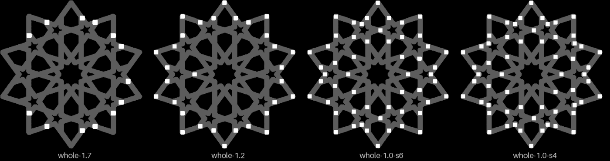
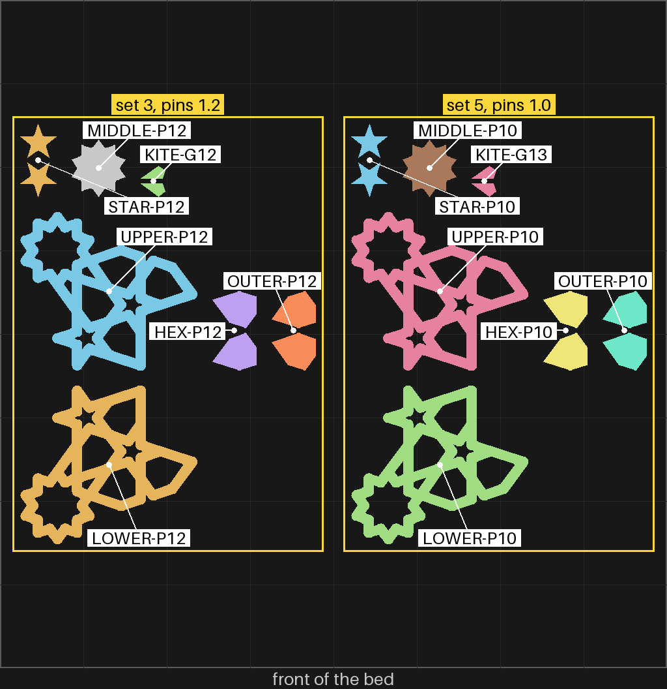

# split-05 — smaller pins all round the border, at the snug piece gap

**In short.** On [split-04](split-04.md) you said: "we need more pints all the way around border
... the border sides with pins are flush, without are not". Set 9, at a 0.10 mm piece gap, went
"in by hand, all snug, but some peices were tight (small kite)", with "no shaking". You then
picked "1.2 and 1.0, side by side" for the pins. This plate is that: split-04's set 9 twice, once
with each pin size, and the kite a little looser. Every piece prints with setting 8. The plate is
[`split-05.yaml`](split-05.yaml).

## What it is

Two sets, each the same fifth of the flange coaster as split-04 (112.5 mm across, a 72° slice
from 9°, the middle piece in). Each set is a lower half, an upper half, and one of each piece
kind: the middle, a kite, a hex, a star and an outer piece.

- **Smaller pins, so they fit in more places.** A pin can stand only where the strap has room for
  it plus a 0.9 mm wall round its hole in the upper half. A smaller pin needs less room, so it
  fits on narrower straps. The picture at the top shows where they land on this slice:

  | Set (the lower half's number) | Pin | Pins in the slice | On a whole coaster | Where |
  |---|---|---|---|---|
  | 3 | 1.2 mm | 6 | 31 | every outer edge and point |
  | 5 | 1.0 mm | 11 | 54 | the outer edge and the inner straps |

  split-04 had 4 pins of 1.7 mm in a slice (13 on a whole coaster). The play round each pin stays
  0.25 mm, as on split-04, whose pinned sides closed flush.
- **The ring round the middle piece still gets no pin**, at either size. No spot there has the
  room. So the middle's border is held only by the pins round it.
- **Piece gap 0.10 mm**, split-04's snug set, for the middle, hex, star and outer pieces.
- **The kite a little looser.** It was tight at 0.10. Set 3's kite has 0.12 mm, set 5's 0.13 mm.
  The halves do not change with the piece gap, so you can try either kite in either set.
- **Each set in its own block on the bed**, as on split-04: set 3 on the left, set 5 on the right.
- **Setting 8** on every piece: the fill pushed 55% into the wall.

The carved ids:

| Set | Pins | Middle | Hex | Outer |
|---|---|---|---|---|
| 3 | 1.2 mm | `1A` | `1E` | `1F` |
| 5 | 1.0 mm | `1C` | `1J` | `1K` |

**The color is picked at the send**: say it with the yes ("yes, in green").

**What I assumed, for you to change:**

- **Pins at least 6 mm apart.** Closer than that adds no pin at 1.2 mm and few at 1.0 mm.
- **0.25 mm of play round each pin**, carried from split-04's 1.7 mm pins. It was flush there; a
  thinner pin may need less play, which this plate does not test.
- **A 1.0 mm pin is two and a half nozzle widths across.** It may print weak or snap. That is part
  of what this plate shows; a broken pin is a look, not a danger to the printer.
- **0.12 and 0.13 mm for the kite** are guesses between 0.10 (tight) and 0.15 (a little wiggle).
- **No glue**, as on split-04.

## Why print it

split-04 found the piece gap (0.10 mm) and showed the halves close flush only where a pin is. The
open question is the pin: can enough pins stand round the border to close it all the way, and do
pins that small hold. Two slices side by side, the same in all but the pin, answer it from the
pieces in hand.

## After the print

What gets asked when it comes off the bed, one row at a time (the review-print skill asks them).
The lower halves carry 3 or 5 on their bottom. The upper halves, stars and kites carry none, so
they are named by their set.

| Pieces | The question | What we expect, and why | What each answer changes |
|---|---|---|---|
| Every piece, before anything else | **Do:** Take the pieces off the bed one block at a time, from the [bed picture](#pictures): the left block is set 3, the right one set 5. Put each block's seven pieces in their own pile before starting the next. **Look for:** Did any star or kite get mixed up, so you are not sure which set it came from? | Both sets kept apart. | Kept apart: go on. Mixed up: the kite row is judged on whichever kite you can tell apart, and the star is left out. |
| The pins, each set | **Do:** Look at the pins standing on each lower half before closing anything. **Look for:** Did every pin print whole, or did any come out broken, bent or missing? Which set? | 1.2 mm all whole. 1.0 mm mostly whole; a few may be weak. | Whole: that size stays in the running. Broken: that size is out. |
| The halves of each set, closed with no pieces in | **Do:** Close each set with its own upper half, every pin in its hole, and pinch. Look all the way round the edge where the halves meet. **Look for:** Is it flush all the way round, or is there a space anywhere? Where: the outer edge, the inner straps, or round the middle piece? | Set 3 flush round the outside, maybe a space inside. Set 5 flush in more places. Both may show a space round the middle, where no pin is. | Flush all round: that pin size is the coaster's. A space only round the middle: the middle needs its own hold (a pin needs a wider strap there, or glue). A space elsewhere: more pins or less play. |
| The pins hold, each set | **Do:** Close each set. Pick it up by the rim, tip it on its side and turn it over. **Look for:** Do the pins go in by hand? Does it stay closed when turned over? | It goes in by hand and stays closed; more pins hold better. | Holds: that pin size is the coaster's. Falls open: less play round the pins, or glue. Will not go in: more play. |
| Each set's pieces: `1A` `1E` `1F` (set 3), `1C` `1J` `1K` (set 5), each set's star | **Do:** Put each piece in its hole in its own set, close it and shake it, then push each piece side to side with a fingertip. **Look for:** Snug and still, as split-04's set 9? Any tight or wiggling? | Snug and still, as split-04's set 9. | Snug: 0.10 mm stays the gap. Different from set 9: the pins change how the halves sit, and the gap is looked at again. |
| The kites: set 3's (0.12 mm) and set 5's (0.13 mm) | **Do:** Put each kite in its hole by hand, in either set, close it and shake it. **Look for:** Does each go in without pressing? Does either wiggle? | Both go in. 0.12 snug, 0.13 maybe a touch loose. | The tightest that goes in by hand and does not wiggle becomes the kite's gap. Both tight: try 0.14. Both loose: 0.11. |

## Pictures

Where the pins stand, from above, at the top of this page: each slice's lower half in grey, each
pin a white square. 1.2 mm on the left, 1.0 mm on the right. Drawn from the coaster file at the
plate's settings by `tools/print_review.py pins`.

The same on a whole coaster, for comparison: split-04's 1.7 mm pins, then 1.2 mm, 1.0 mm, and
1.0 mm packed closer.

The bed, from above, as the slice lays it out, each piece named, each set boxed with its name:
set 3 (pins 1.2) on the left, set 5 (pins 1.0) on the right. Drawn from the sliced plate by
`tools/print_review.py bed`.

## Cost and risk

One bed, 67 minutes, about 18 g (local slice, 2026-10-23, X2D preset and PLA Basic, from bikar main). Sliced for the glacier plate (`--plate-type hot_plate`, Smooth PEI), as split-04. The slicer gave no warnings, and every one of the 14 pieces carries setting 8. One color, so no swaps.

**Risk: watch.** As on split-04: each band sticks out 0.8 mm with nothing under it and may droop,
a look to judge. The kites and stars are small loose pieces that can lift or get knocked. The
pins are thin, 1.0 and 1.2 mm, and stand on the lower half's cut face, so a pin that prints badly
breaks off as a look, not a danger to the printer.

## Your call

- [ ] **Approve as it stands**: say the color with the yes
- [ ] **Hold**: say why in the notes

Notes:

## Approvals

Every yes or hold Omar gives this plate, one row each, oldest first (D-096). A tick under Your call, or a yes in chat, becomes a row here through the manage-approvals skill's `plate_approve.py`; a send spends the open approval, and a recipe change resets it.

| Date | Decision | By | Covers | Spent by |
|---|---|---|---|---|

## Timeline

| Date | What happened | Where it is written |
|---|---|---|
| 2026-10-23 | proposed: after split-04's print, on Omar's words "we need more pints all the way around border ... the border sides with pins are flush, without are not" and his pick "1.2 and 1.0, side by side" for the pins; split-04's 0.10 mm gap, the kite at 0.12 and 0.13 | this page |
