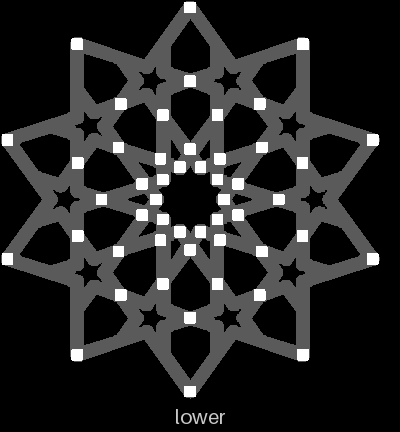
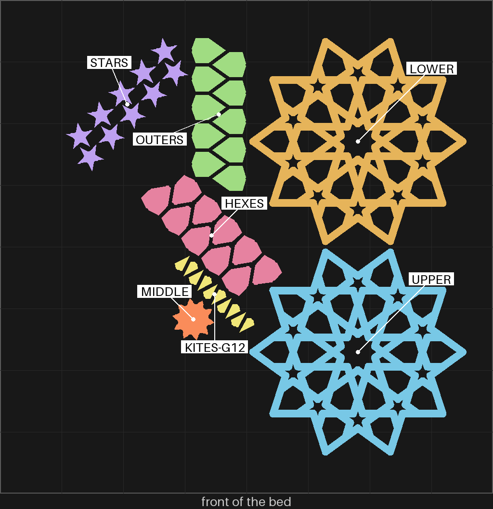

# split-06 — the whole flange coaster, set 3's settings, no labels

**In short.** On [split-05](split-05.md) you said "both are good", "2a one probably better", "2c
one shakes a bit", then: "lets send a 2a print with the whole patterh, no labels, a production
piece". This plate is that: the whole coaster at set 3's settings, with nothing carved into any
piece. The plate is [`split-06.yaml`](split-06.yaml).

**What changed in this version (2026-10-23).** On the pins picture you wrote: "I was expecting
another set of pins on the same radius / circle as the small kites, inbetween each two adjacent
kits, sme for the first layer of bigger kites, and stars". So there are three more rings of ten,
and you can see all five above:

- **Between the small kites**: on the kites' own circle, 14.3 mm out, one between each two kites.
- **Between the bigger kites**: on their circle, 25.1 mm out, one between each two.
- **Between the stars**: 33.5 mm out, 1.8 mm inside the stars' own circle. On that circle the
  stars come too close to each other to leave room for a pin; 33.5 mm is the nearest spot on the
  line halfway between two stars that has room.

Every ring is now exactly even: each pin stands on its circle at the same angle in every repeat.
Before, the program nudged each pin to the roomiest spot nearby, and the nudges came out different
in different repeats; it now only nudges a pin that has no room where its ring puts it (bikar
#344). That also moves the outer ring out to 54.4 mm, the outer points, from about 53.5 mm.

**Earlier (iteration 2).** You said "i want more pins around central star" and "too many pins
around border", then marked the pins picture: "remove redC add blue". That gave the ring round
the middle star (your blue ring) and the ring on the outer points, and took away the twenty pins at
the small stars' notches (your red marks) and one stray pin at the left.

## What it is

The whole flange coaster at 112.5 mm across: a lower half, an upper half, and every loose piece,
the middle, the kites, the hexes, the stars and the outer pieces.

- **50 pins of 1.2 mm, in five rings of ten**: 9.6 mm out from the centre, in the middle star's
  inner corners; 14.3 mm, between the small kites; 25.1 mm, between the bigger kites; 33.5 mm,
  between the stars; and 54.4 mm, on the outer points. The play round each pin stays 0.25 mm, as set 3.
- **Each pin stands on a filled disc.** The loose pieces' rims sit in a groove cut into the strap,
  and round the middle star that groove left room for a pin under 0.75 mm. So the groove is filled in
  a small disc round each pin, in both halves, and each loose piece's rim has a matching round notch
  there so it still drops in. You picked this ("Fill the hidden groove at each pin").
- **Piece gap 0.10 mm** for the middle, hexes, stars and outer pieces; **0.12 mm for the kites**,
  set 3's kite.
- **No labels**: no carved ids, and no number on the lower half's bottom.
- **Setting 8** on every piece, as every split plate since split-03.
- **No glue.**

**The color is picked at the send**: say it with the yes ("yes, in green").

**What I assumed, for you to change:**

- **The kites at 0.12 mm.** Set 3's kite, but the two kites on split-05 were never compared on
  their own.
- **One coaster, on one bed.** If you would rather print two and keep the better, say so.
- **Sliced for the gold Textured PEI plate**, which was on the bed after split-05. It is sliced again
  at the send if another plate is on.

## Why print it

The slices settled the pin (1.2 mm) and the piece gap (0.10 mm). What is left only a whole coaster
can show: whether the ring round the middle closes flush on its new pins, whether the notched
pieces still sit, whether fifty pins close the halves flush everywhere or make them hard to press
together, whether the halves stay
flat across the full 112.5 mm, and how it goes together with every piece in. If you keep it as it
comes off the bed, it is the first production plate of this coaster (D-098), and it can be printed
again with no new yes (D-095).

## After the print

What gets asked when it comes off the bed. One question first, in your own words; the rest only if
the answer does not cover them.

| Pieces | The question | What we expect, and why | What each answer changes |
|---|---|---|---|
| The whole coaster, put together | **Do:** Put every piece in the lower half, close the upper half on its pins and pinch it all the way round. Look at the edge and round the middle piece, and shake it. **Look for:** Is it a coaster you would keep as it is? If not, what is wrong? | Flush round the outside, as set 3. Round the middle, maybe a space. No shake. | Keep: it becomes the production plate. Not kept: what is wrong decides the next change. |
| The ring round the middle piece | **Do:** Pinch the closed coaster round the middle piece. **Look for:** Flush, or a space? | Flush: ten pins hold it now. | Flush: the ring stays. A space: the pins there need a tighter play, or glue. |
| Between the kites and the stars | **Do:** Pinch the closed coaster between each two small kites, each two bigger kites and each two stars. **Look for:** Flush, or a space? | Flush: a pin now stands between each two. | Flush: the three new rings stay. A space: that ring's pins need a tighter play. |
| Closing it | **Do:** Close the upper half on the lower and press it down. **Look for:** Does it go on with an even press, or do some pins fight it? | An even press: 50 pins at 0.25 mm play each. | Even: nothing to do. Hard to close: drop a ring, or loosen the play to 0.30. |
| The outer edge | **Do:** Pinch the closed coaster between each pair of outer points. **Look for:** Flush, or a space? | Flush: a pin on every outer point. | Flush: ten is enough. A space: add a ring between the points. |
| The middle piece and the stars, by the round notches | **Do:** Look at the rim of the middle piece and of each piece next to a pin, where a round notch is cut. Press each down. **Look for:** Does it sit flat and flush, or rock or stand proud? | Flat and flush: the notch is the disc's size plus the piece gap. | Flush: the bosses stay. Proud or rocking: the notch needs more room. |
| The halves, laid flat | **Do:** Put the closed coaster on a table and press each side. **Look for:** Does it rock? | Flat. | Flat: nothing to do. Rocks: the halves bow over the full width; look at the bed face and the cooling. |
| The kites | **Do:** Push each kite side to side with a fingertip. **Look for:** Snug, tight or wiggling? | Snug. | Snug: 0.12 stays. Tight: 0.13. Wiggles: 0.11. |

## Pictures

Where the pins stand on the whole lower half, from above, at the top of this page: the half in grey,
each 1.2 mm pin a white square, in five rings of ten. Drawn from the coaster file at the plate's settings by
`tools/print_review.py pins`.

The bed, from above, as the slice lays it out, each piece named. Drawn from the sliced plate by
`tools/print_review.py bed`.

## Cost and risk

One bed, 119 minutes, about 31 g (local slice, 2026-10-24, X2D preset and PLA Basic, from bikar #344, the five pin rings), sliced for the gold Textured PEI plate (`--plate-type textured_plate`). The slicer gave no warnings, and all 7 items carry setting 8. One color, so no swaps.

**Risk: watch.** As on split-05: each band sticks out 0.8 mm with nothing under it and may droop,
a look to judge. The kites and stars are small loose pieces that can lift or get knocked. The pins
are 1.2 mm and stand on the lower half's cut face, so a pin that prints badly breaks off as a look,
not a danger to the printer. The pin discs notch the rims of the pieces next to a pin, which no print has tried yet, so a
notched piece might sit a little proud. New on this version: 50 pins where there were 20, so the
halves may take a firmer press to close; the ring between the stars stands 1.8 mm inside the
stars' circle, where there was room.

## Your call

- [ ] **Approve as it stands**: say the color with the yes
- [ ] **Hold**: say why in the notes

Notes:

## Approvals

Every yes or hold Omar gives this plate, one row each, oldest first (D-096). A tick under Your call, or a yes in chat, becomes a row here through the manage-approvals skill's `plate_approve.py`; a send spends the open approval, and a recipe change resets it.

| Date | Decision | By | Covers | Spent by |
|---|---|---|---|---|

## Timeline

| Date | What happened | Where it is written |
|---|---|---|
| 2026-10-23 | proposed: after split-05's print, on Omar's words "lets send a 2a print with the whole patterh, no labels, a production piece"; set 3's 1.2 mm pins, the 0.10 mm piece gap, the kite at 0.12 | this page |
| 2026-10-24 | sliced: iteration 2, 20 pins in two rings with a filled groove at each (bikar #343), on Omar's "remove redC add blue"; 112 minutes, about 32 g, no warnings | this page |
| 2026-10-24 | sliced: iteration 3, 50 pins in five rings, three more between the small kites, the bigger kites and the stars (bikar #344), on Omar's comment on the pins picture; 119 minutes, about 31 g, no warnings | this page |
