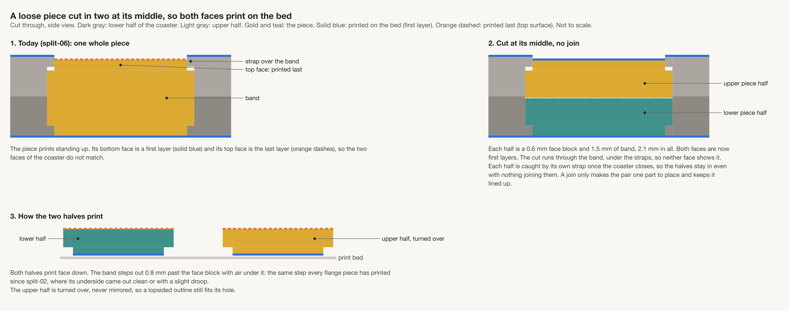
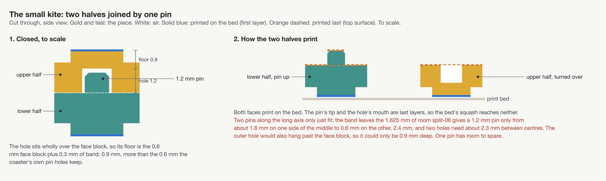
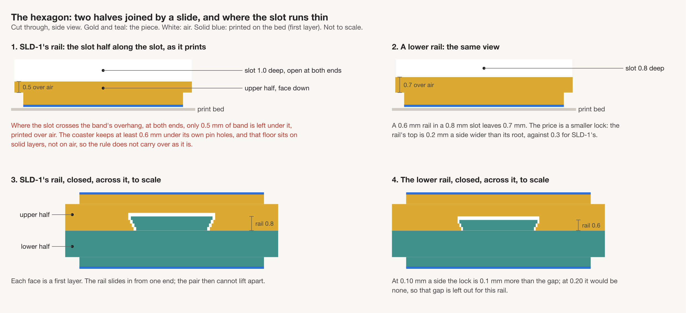
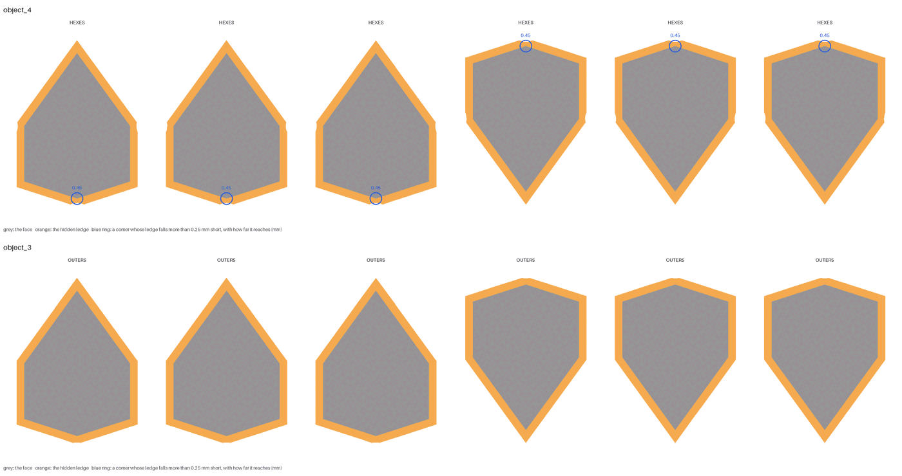
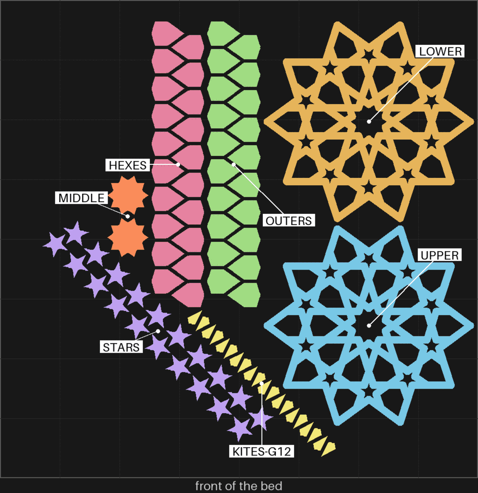

# split-07 — the whole flange coaster, every loose piece cut in two and joined

**In short.** You picked "Cut them, wait for the slide"
([D-120](../../working-model/decisions-log.md#d-120--cut-pieces-the-cut-and-the-joins-on-one-plate)).
So every loose piece on this plate is cut in two at its middle, and each half prints face down.
Both faces of every piece are then bed faces, the smooth side, with no last layer on show. The
two halves join back into one piece: with pins on the kites, stars and middle piece, and with a
slide (a dovetail rail that slides into a slot) on the hexagons and outer pieces. The coaster
round them is the one you picked on [split-08](split-08.md): a 0.7 mm wall round each pin socket
([D-119](../../working-model/decisions-log.md#d-119--the-flange-coasters-socket-wall-is-07-mm)).
The plate is [`split-07.yaml`](split-07.yaml).

## What it is

The whole flange coaster at 112.5 mm: a lower half, an upper half, and every loose piece, each
loose piece now in two halves.

| | split-06 | split-07 |
|---|---|---|
| Loose pieces | whole, 4.4 mm tall, one bed face | **cut in two, 2.2 mm halves, both printed face down** |
| Joins between the halves | none | **pins on the kites, stars and middle; a slide on the hexagons and outer pieces** |
| Wall round each pin socket | 0.9 mm | **0.7 mm** |
| Pins between the coaster's halves | 40, 1.2 mm, 0.25 mm play, in four rings | the same, the inner ring at 13.0 mm, not 14.3 |
| Piece gap | 0.10 mm, kites 0.12 | the same |
| Labels | none | none |

How each piece kind is joined, as the [joins design](../coaster/cut-pieces-joins-design.md#42-plate-two-the-joins)
lays them out:

| Pieces | Join | Why this one |
|---|---|---|
| The middle piece | three 1.2 mm pins, 0.25 mm play | its outline turns inward, so the slide will not run on it |
| Each kite | one 1.2 mm pin, a little toward its blunt end | too narrow for a slide, and only one pin fits |
| Each star | one 1.2 mm pin, at its middle | its arms turn inward, so no slide |
| Each hexagon and outer piece | a 4 mm dovetail rail on one half, a slot in the other, 0.15 mm a side, 0.8 mm tall | wide and straight enough for SLD-1's rail, the slide you printed on sld-1 |

- **One coaster's worth, one join per piece kind.** The design's extra rows (a second pin play
  of 0.30 mm, a lower 0.6 mm rail, the other slide gaps) are not on this bed: you picked one
  plate, and this is the coaster as it would be kept.
- **The pins between the coaster's halves stand where split-06's stand, but for the inner ring**:
  rings at 13.0, 25.1, 33.5 and 54.4 mm, ten in each. At 14.3 mm the disc round each pin sat on
  a hex piece's point, and bikar refuses to cut a piece there, because a point is too thin to
  lose its ledge. At 13.0 mm it is clear with 0.3 mm to spare.
- Setting 8 on every piece, room 0.2, bosses on: all as split-06.

**The color is picked at the send**: say it with the yes.

**What I assumed, for you to change:**

- **The slide gap is 0.15 mm a side.** On sld-1 you said 0.10, 0.15 and 0.20 all worked, and
  named none as best, so this takes the middle one. Say if one felt better.
- **One join per piece kind, not the design's comparison rows.** If a join fails here, the next
  plate tries the other settings on just that piece.
- **0.7 mm socket wall, not 0.45.** The 0.45 set did not shake either, but you picked 0.7.
- **Sliced for the gold Textured PEI plate**, the one Bambu Studio is set to. It is sliced again
  at the send if another plate is on.

## How much the wall bites

Measured on the sliced plate by `.claude/skills/place-pins/scripts/ledge_check.py`: how far each
half's hidden ledge reaches past its face at each corner, where a whole ledge reaches 0.80 mm.
Each half's face is grey, its hidden ledge orange, and each corner whose ledge reaches less than
0.55 mm is ringed blue with how far it reaches. Cutting the pieces did not change it.

| Pieces | What the check found |
|---|---|
| The 20 hexagon halves | the blunt end reaches 0.45 mm; the point and the sides the whole 0.80 |
| The 20 outer halves | 0.80 mm all round |
| The star, kite and middle halves | 0.77 to 0.80 mm all round |

The picture shows three halves of each way round: hexagon halves on top, outer halves below.

## Why print it

Every face a customer sees today is half bed face, half last layer, and the last layer is the
rougher one. Cutting the pieces makes both faces bed faces, but only if the halves join back
flush and stay together. The pins have printed before (between the coaster's halves on split-06 and split-08) and so
has the slide (sld-1, on test hexagons), but neither on a piece this small, and never inside this
coaster. One print answers all of it on the coaster we would sell. If it holds, this is the
production layout. If a join fails, the next plate tries that piece's other settings.

## After the print

What gets asked when it comes off the bed. One question first, in your own words; the rest only if
the answer does not cover them.

| Pieces | The question | What we expect, and why | What each answer changes |
|---|---|---|---|
| The whole coaster, put together | **Do:** Join each pair of halves, put every piece in the lower half, close the upper half on its pins and pinch it all the way round, then shake it. **Look for:** Is it a coaster you would keep as it is? If not, what is wrong? | Flush round the outside, no shake: each join holds its pair as one piece, and split-08's 0.7 mm set did not shake. | Keep: it becomes the production plate. Not kept: what is wrong decides the next change. |
| Every piece, both faces | **Do:** Turn a joined hexagon, star and kite over in the light. **Look for:** Do both faces look the same, smooth like the bottom of split-06's pieces? Any seam or step round the edge? | Both smooth: each half's face printed on the bed. A thin line at the cut is likely, no step. | Same: cut pieces stay. A step or a rough face: a photo, and the cut moves or the halves change. |
| The kites, stars and middle (pins) | **Do:** Press each pair together, hold it by one half and shake it. **Look for:** Does it go together by hand, and does the other half stay on? Did any pin break? | Joins by hand and stays on: 0.25 mm play holds the coaster's own halves on split-06 and split-08. | Holds: 0.25 stays. Too tight to close or a pin snaps: 0.30 on that piece. Falls apart: a tighter play, or a second pin where one fits. |
| The hexagons and outer pieces (slide) | **Do:** Slide each rail into its slot from the side, then shake the pair. Look at the slot's ends on the upper half first. **Look for:** Does it slide in without a tool and stay on? Has a slot end sagged or closed up? | Slides in and holds, as on sld-1 at 0.15. Each slot end has 0.5 mm of band printed over air, so a small droop there is the likeliest fault. | Holds: the slide stays. Sticks at an end: the lower 0.6 mm rail. Loose: 0.10. Comes apart: pins on these too. |
| The joined pieces in the coaster | **Do:** Push each joined piece side to side with a fingertip in the closed coaster. **Look for:** Snug, or do some wiggle? Which ones? | Snug, the same as a whole piece would be: the cut changes nothing round the outside. | Snug: nothing to change. Tighter or looser than split-06's: the halves are not sitting flat, a photo of the edge. |
| The bigger kites | **Do:** Lay two joined bigger kites side by side, and look at each against its neighbours in the closed coaster. **Look for:** Do they match? If one is lopsided, which side? | They match: as drawn the pieces are mirror-symmetric. | Match: nothing to change. Lopsided: a photo with the side marked, to find where the print differs from the drawing. |
| The sockets, pressed | **Do:** Press hard over each ring of pins, then pull the coaster's halves apart. **Look for:** Does each pin stay in its socket and the halves stay shut? Any crack in a socket wall? | All hold and no cracks, as on split-08's 0.7 mm set. | All hold: 0.7 mm stays. A socket lets go or cracks: back to 0.9 at that ring, or move the pins. |
| The kites | **Do:** Push each joined kite side to side with a fingertip. **Look for:** Snug, tight or wiggling? | Snug. | Snug: 0.12 stays. Tight: 0.13. Wiggles: 0.11. |

## Pictures

Where the coaster's pins stand on the whole lower half, from above, at the top of this page. Drawn
from the coaster file at the plate's settings by `tools/print_review.py pins`. The side views of
the cut, the pin and the slide come from the [joins design](../coaster/cut-pieces-joins-design.md).

The bed, from above, as the slice lays it out, each group named: two of every loose piece now,
one per half. Drawn from the sliced plate by `tools/print_review.py bed`.

## Cost and risk

**About 137 minutes and 36 g of PLA** (the slicer's estimate, 8231 s and 36.49 g), one bed, no
prime tower, one color. That is 24 minutes and 5 g more than the whole pieces, for twice as many
small parts.

**Risk: watch.** Twice as many small loose parts as split-06: 82 halves, each 2.2 mm tall, which
can lift or get knocked. The slots' ends print 0.5 mm of band over air and may droop, a look to
judge. The pins are 1.2 mm and stand on cut faces, so a pin that prints badly breaks off as a
look, not a danger to the printer. Forty sockets with a 0.7 mm wall, which only one slice has
tried.

## Your call

- [ ] **Approve as it stands**: say the color with the yes
- [ ] **Hold**: say why in the notes

Notes:

## Approvals

Every yes or hold Omar gives this plate, one row each, oldest first (D-096). A tick under Your call, or a yes in chat, becomes a row here through the manage-approvals skill's `plate_approve.py`; a send spends the open approval, and a recipe change resets it.

| Date | Decision | By | Covers | Spent by |
|---|---|---|---|---|

## Timeline

| Date | What happened | Where it is written |
|---|---|---|
| 2026-10-25 | proposed: after split-08's print, on Omar's verdicts ("the middle one was the best one, 1c i think", "left ond did (1a shook)") and his "go"; split-06 with a 0.7 mm socket wall (D-119) | this page |
| 2026-10-25 | sliced — for the gold Textured PEI plate, 7 objects, no slicer warnings: 6987 s and 31.45 g | this page |
| 2026-10-25 | changed (iteration 2): the inner ring of pins moved from 14.3 to 13.0 mm, off the hex pieces' points, so the cut pieces (D-120) can be built to fit this coaster; the yes not yet given, so none to reset | [`split-07.yaml`](split-07.yaml) |
| 2026-10-25 | sliced — for the gold Textured PEI plate, 7 objects, no slicer warnings: 6801 s and 31.44 g; the hex points' ledges whole, the blunt end 0.45 mm | this page |
| 2026-10-25 | changed (iteration 3): every loose piece cut in two and joined, pins on the kites, stars and middle, a slide on the hexagons and outer pieces (D-120, Omar: "Cut them, wait for the slide"); the yes not yet given, so none to reset | [`split-07.yaml`](split-07.yaml) |
| 2026-10-25 | sliced — for the gold Textured PEI plate, 7 objects, 82 loose halves, no slicer warnings: 8231 s and 36.49 g; the ledges as before, the hexagons' blunt end 0.45 mm | this page |
