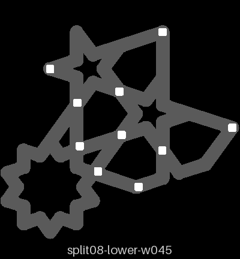
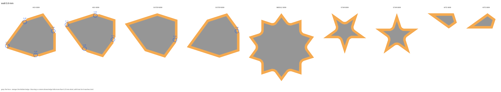

# split-08 — split-06's pins with a thinner wall round each socket

**In short.** On [split-06](split-06.md) the disc round each pin bit the hidden ledge of the hex
piece, and the hex pieces wiggled. You chose to try a thinner wall round each pin's socket before
moving the pins ("Wait for the wall test", [D-118](../../working-model/decisions-log.md#d-118--the-bitten-ledges-on-split-06-test-a-thinner-socket-wall-before-moving-the-pins)).
This plate is that test: three slices of the coaster on one bed, the same in every way except the
wall, 0.9 mm (what split-06 printed), 0.7 mm and 0.45 mm. [split-07 (see split-06's write-up)](split-06.md#what-you-saw-off-the-bed-2026-10-24)
waits on what this plate shows. The plate is [`split-08.yaml`](split-08.yaml).

## What it is

Three sets, each one 72° slice of the flange coaster at 112.5 mm (split-05's slice, from 9°, with
the middle piece): a lower half, an upper half, the middle piece, and two each of the kite, the hex
piece, the star and the outer piece, every loose piece the slice cuts whole. Each set closes and
presses like the whole coaster.

| Set | Wall round each socket | Disc round each pin (radius) | Id on the lower half's bottom | Carved ids: middle, hex pieces, outer pieces |
|---|---|---|---|---|
| Control, as split-06 | 0.9 mm, two lines | 1.625 mm | 9 | 1A, 1E, 1F |
| Thinner | 0.7 mm | 1.425 mm | 7 | 1C, 1H, 1J |
| Thinnest | 0.45 mm, just over one 0.4 mm line | 1.175 mm | 5 | 1K, 1L, 1P |

- **The pins stand where split-06's stand**: the slice holds its rings at 14.3, 25.1, 33.5 and
  54.4 mm, ten pins in all, every one that bit split-06's hex piece. The pin is 1.2 mm with
  0.25 mm play, as split-06.
- **The disc is the pin's half width, half its play and the wall.** The wall is now a setting in
  bikar (`studs … wall <mm>`, bikar [PR #345](https://github.com/NaqshCoffee/bikar/pull/345)); it refuses a wall under one 0.4 mm line, since the
  slicer cannot lay a thinner one.
- **Piece gap 0.10 mm**, the kites 0.12 mm, room 0.2, bosses on, setting 8 on every piece: all as
  split-06.
- Kites and stars have no room for an id, so each stays with the set it came off the bed beside;
  each set is its own block on the bed.

**The color is picked at the send**: say it with the yes.

**What I assumed, for you to change:**

- **0.7 and 0.45.** One step between, and the thinnest bikar allows with a little margin. If you
  would rather try 0.6 and 0.5, say so.
- **A slice, not the whole coaster** ("print pieces, not whole shapes"): the slice holds the hex
  piece, its neighbours and every pin that bit it, in both halves.
- **Sliced for the gold Textured PEI plate**, the one Bambu Studio is set to. It is sliced again
  at the send if another plate is on.

## How much each wall bites

Measured on the sliced plate by `.claude/skills/place-pins/scripts/ledge_check.py`: how far each
piece's hidden ledge reaches past its face at each corner, where a whole ledge reaches 0.80 mm.
The check flags a corner whose ledge reaches less than 0.55 mm (the 0.80 mm ledge less its 0.25 mm
tolerance); a corner at 0.55 or more is counted whole. The kites, stars and middle piece keep
their whole ledge (0.77 to 0.80 mm) on all three sets, so only the hex and outer pieces are listed.

| Set | Hex piece's point | Hex piece's blunt end | Hex piece's shoulders | Outer piece's blunt end | Flagged corners |
|---|---|---|---|---|---|
| 0.9 mm, the control | 0.17 mm | 0.25 mm | 0.46 mm | 0.46 mm | 4 kinds, on both hex and both outer pieces: split-06's numbers exactly |
| 0.7 mm | 0.37 mm | 0.45 mm | 0.55 or more | 0.55 or more | 2 kinds, on both hex pieces only |
| 0.45 mm | 0.55 or more | 0.55 or more | 0.55 or more | 0.55 or more | none |

So the 0.7 mm wall halves the bite at the hex piece's point and clears the outer piece; the 0.45 mm
wall clears every piece. The 0.45 picture still shows small nicks at the hex points, each within
0.25 mm of the whole ledge.

One picture per set: each piece's face grey, its hidden ledge orange, and each flagged corner ringed
blue with how far its ledge reaches. Drawn from the sliced plate by `ledge_check.py --draw`.

## Why print it

The numbers say how much ledge each wall leaves; only a print can say whether a socket that thin
still holds the pin. If the 0.45 or 0.7 mm wall holds and the hex piece stops wiggling, split-07
keeps its pins where they are and takes that wall. If the thin walls crack, or the hex piece still
wiggles, split-07 moves the pins off the points instead (D-118's reversal).

## After the print

What gets asked when it comes off the bed. One question first, in your own words; the rest only if
the answer does not cover them. Do each one on all three sets, the lower half with the id 9, 7 and
5 on its bottom.

| Pieces | The question | What we expect, and why | What each answer changes |
|---|---|---|---|
| All three sets, put together | **Do:** Put each set's pieces in its lower half, close its upper half and press it. Push each hex piece (1E, 1H, 1L) with a fingertip. **Look for:** Which set would you keep, and why? | The 0.45 set keeps the most ledge, so its hex pieces 1L wiggle least. | Picks the wall split-07 takes, or says to move the pins instead. |
| The sockets, pressed | **Do:** Close each set and press hard over each pin, then pull the halves apart. **Look for:** Does each pin stay in its socket and the halves stay shut, on each set? | All hold: the pin's play is 0.25 mm on every set, only the wall round it changes. | All hold: the thinnest that holds goes on split-07. A thin set lets go: that wall is too thin; split-07 takes the next one up. |
| Round each socket | **Do:** Look at the strap round each socket on the 0.7 and 0.45 sets, before and after pressing, against the light. **Look for:** Any split, crack or gap in the wall, or a wall that broke off? | Whole on 0.7. On 0.45 the wall is one line wide, so a gap or a crack is possible. | Whole: that wall stands. Cracked: that wall is out, and if both are, split-07 moves the pins (D-118). |
| The hex pieces | **Do:** Put each hex piece in its closed set and push it side to side, 1E (0.9), 1H (0.7), 1L (0.45). **Look for:** Snug, or wiggling? Is one better than another? | 1E wiggles as on split-06. 1H less, 1L least. | 1L or 1H snug: that wall fixes the bite. All wiggle: the wall is not enough, split-07 moves the pins. |
| Closing it | **Do:** Close each upper half on its lower and press it down. **Look for:** Flush all round, and does it go on with an even press? | Flush and even on all three: the pins and play are the same. | Flush: nothing to change. A thin set not flush: its sockets lean; that wall is out. |
| The outer pieces | **Do:** Push each outer piece (1F, 1J, 1P) side to side in its closed set. **Look for:** Snug, or wiggling? | Snug on all three: its blunt end was bitten less on split-06, and not at all on the 0.7 and 0.45 sets. | Snug: nothing to change. One wiggles: note which wall. |

## Pictures

Where the pins stand on one set's lower half, from above, at the top of this page. Drawn from the
coaster file at the plate's settings by `tools/print_review.py pins`.

The bed, from above, as the slice lays it out, each piece named. Drawn from the sliced plate by
`tools/print_review.py bed`.

## Cost and risk

**About 99 minutes and 27 g of PLA** (the slicer's estimate, 5927 s and 26.94 g), one bed, no
prime tower, one color.

**Risk: watch.** The 0.45 mm wall is one line wide round each socket; it may print thin or
broken, a look to judge, not a danger to the printer. As on split-06, each band sticks out 0.8 mm
with nothing under it and may droop, and the kites and stars are small loose pieces that can lift
or get knocked. The pins are 1.2 mm and stand on the lower half's cut face, so a pin that prints
badly breaks off as a look.

## Your call

- [ ] **Approve as it stands**: say the color with the yes
- [ ] **Hold**: say why in the notes

Notes:

## Approvals

Every yes or hold Omar gives this plate, one row each, oldest first (D-096). A tick under Your call, or a yes in chat, becomes a row here through the manage-approvals skill's `plate_approve.py`; a send spends the open approval, and a recipe change resets it.

| Date | Decision | By | Covers | Spent by |
|---|---|---|---|---|

## Timeline

| Date | What happened | Where it is written |
|---|---|---|
| 2026-10-24 | proposed: on D-118, Omar's "Wait for the wall test" for split-06's bitten ledges, and "yes want to test 329"; three walls on one bed, split-06's pins | this page |
