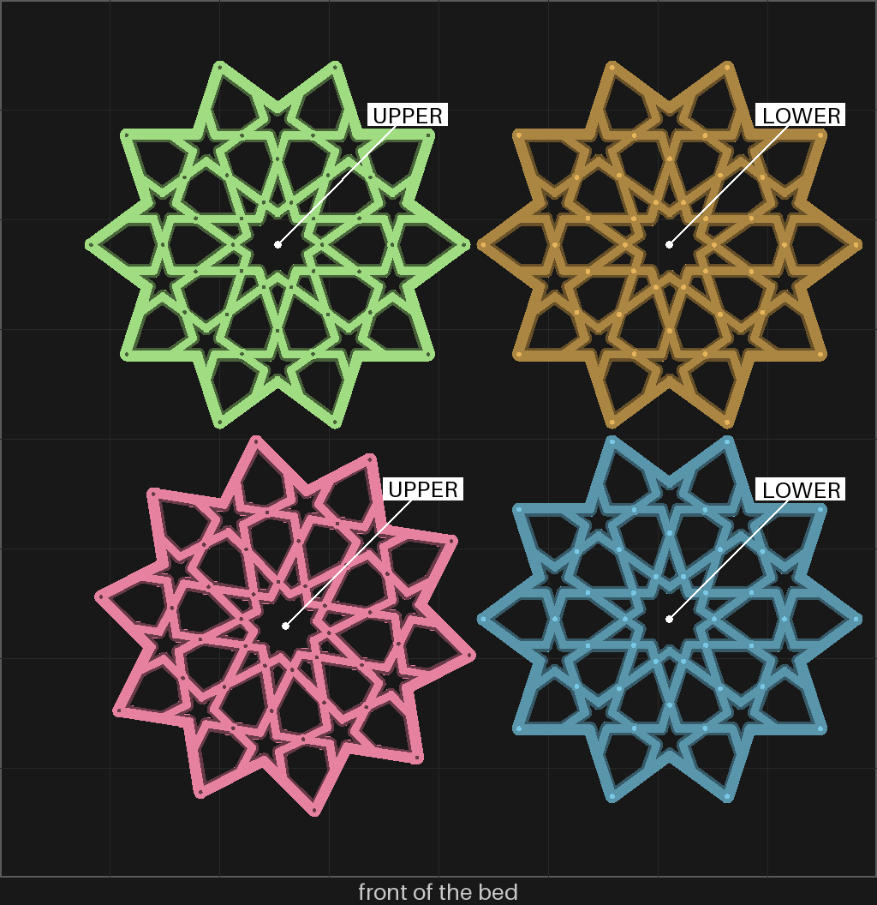

# split-09 — the flange coaster's two halves, as many as fit on one bed

**In short.** You said split-07's two big patterns came out real nice, and asked for a production
plate with just those, no infill, as many halves as fit. This is it: the flange coaster's lower
and upper halves, two of each, so two whole coasters' frames per bed. No loose pieces. Each half
is the exact mesh split-07 printed (the slicer named the same two meshes, `it-b3f9797bf2e3` and
`it-2e7fa82b808f`). The plate is [`split-09.yaml`](split-09.yaml).

## What it is

| | split-07 | split-09 |
|---|---|---|
| Lower halves | 1 | **2** |
| Upper halves | 1 | **2** |
| Loose pieces | every one, cut in two | **none** |
| The halves themselves | 112.5 mm, 0.7 mm wall round each pin socket, setting 8 (infill and wall overlap 55%) | the same meshes and the same setting |
| Labels | none | none |

**Why four, not more.** The X2D's bed is 256 mm square and each half is about 112.5 mm across
its points. The slicer's own arrange put two across each row, centred at about 81 mm and 195 mm,
so a row runs from about 25 mm to about 251 mm. That leaves about 30 mm in a row, front to back
the same, and a fifth half needs about 112 mm. The arrange turned one upper half a little so its
points clear its neighbours' points.

## Production, and how it gets there

You asked for a production plate. A production plate goes out again with no new yes each time,
but only once one run of its exact layout has been kept
([D-098](../../working-model/decisions-log.md), [D-095](../../working-model/decisions-log.md)).
The halves have printed well, but only one of each, alone with the loose pieces. Four big
halves on one bed have not printed together yet. So this plate starts as an experiment, needs
one yes for its first send, and becomes production when you keep that run (the first row
below). After that it goes out on its standing approval.

## After the print

| Pieces | The question | What we expect, and why | What each answer changes |
|---|---|---|---|
| All four halves | **Do:** Close each upper half on a lower half, pinch it all the way round, and look at it from the side and from above. **Look for:** Are both coasters as good as split-07's? Would you keep this run as it is? | Both as good as split-07's: the same meshes and the same setting, only more of them on the bed. | Keep: this plate becomes the production plate (D-098). Not kept: what is wrong decides the change, and it stays an experiment. |
| The four halves, bottom and edges | **Do:** Turn each half over and look along its outer points. **Look for:** Did any point lift off the bed or curl up, or is any half rougher than the others? | Flat and the same: the same halves stayed flat on split-07. The right-hand points come within a few millimetres of the bed's edge, the likeliest place for a lift. | Flat: nothing to change. A point lifted: a photo of it, and that half gets a brim or moves inward. |

## Pictures

The bed, from above, as the slice lays it out, each half named. Drawn from the sliced plate by
`tools/print_review.py bed`, at the top of this page.

## Cost and risk

**About 137 minutes and 36 g of PLA** (the slicer's estimate, 8232 s and 35.66 g), one bed, no
prime tower, one color. That is about 69 minutes and 18 g per coaster frame.

**Risk: ok.** The halves are split-07's, which printed through in 2 h 38 min with no fault. Four
large flat pieces are the easy kind for the printer: no small loose pieces to knock or lift.

## Your call

- [ ] **Approve as it stands**: say the color with the yes
- [ ] **Hold**: say why in the notes

Notes:

## Approvals

Every yes or hold Omar gives this plate, one row each, oldest first (D-096). A tick under Your call, or a yes in chat, becomes a row here through the manage-approvals skill's `plate_approve.py`; a send spends the open approval, and a recipe change resets it.

| Date | Decision | By | Covers | Spent by |
|---|---|---|---|---|

## Timeline

| Date | What happened | Where it is written |
|---|---|---|
| 2026-10-27 | proposed: on Omar's "the two primary big patterns came out real nice, i want a production plate with just those, no infill"; split-07's halves, two of each, the most one bed holds | this page |
