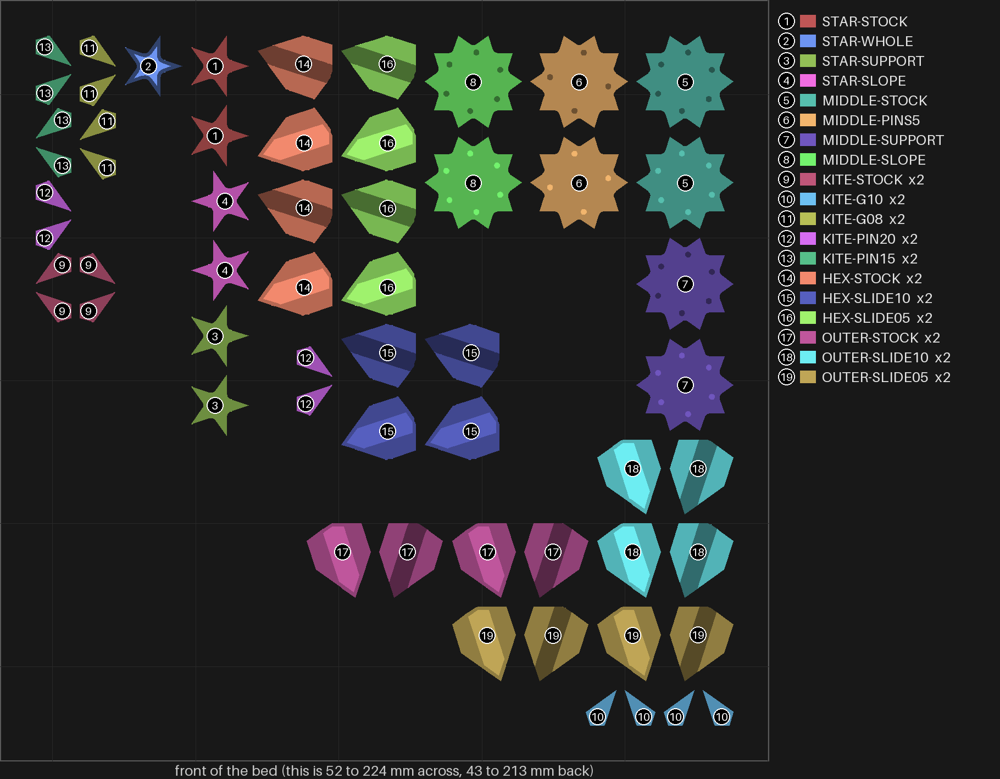

# split-10 — the flange coaster's loose pieces, each fit bracketed, two of each

**In short.** split-07's frame came out well, but you found four things wrong with its loose
pieces: the stars' faces curve at the edges, the middle piece has a "webbed duck feel", the
"dovetail kites are really loose", and you want to experiment on them. This bed is those pieces
only, no frame, about 55 minutes. You asked for as much testing as one print can hold
("Everything, slope included"), so each kind has a stock piece, exactly as split-07 printed it,
and each fit is tried on both sides of stock: a little looser and a little tighter. The fit
pieces come two of each, so a result counts only when both copies agree. The stars and the middle
also try a new slope under the step each half prints over (bikar #349). You try everything in
the split-07 frame you already have. Every middle piece now holds its halves with a pin in the
centre and an even ring of pins near the edge, as you asked, not split-07's three uneven pins.
The plate is [`split-10.yaml`](split-10.yaml).

## What it tries

| Piece | Stock (as split-07) | Changed | What the change tests |
|---|---|---|---|
| Five-point star | STAR-STOCK | **STAR-WHOLE**: printed in one piece, not cut in two | Whether cutting the star caused the curve |
| | | **STAR-SUPPORT**: cut, with supports under the step | Whether the curve is the step drooping over air |
| | | **STAR-SLOPE**: cut, with a 45° slope under the step in the model | The same, fixed in the shape itself, with nothing to pick off |
| Ten-point middle | MIDDLE-STOCK | **MIDDLE-SUPPORT**: supports under the same step | Whether the webbed feel is the same droop |
| | | **MIDDLE-SLOPE**: the slope under the step | The same, fixed in the shape |
| | | **MIDDLE-PINS5**: a centre pin and four round it, where every other middle has a centre pin and six | Whether four pins round the centre hold as well as six |
| Kite, two of each | KITE-STOCK (0.12 mm gap a face, pin hole 0.25 mm wider than the pin) | **KITE-G10**, **KITE-G08**: gap 0.10 and 0.08 mm | How snug a kite can sit in its hole and still go in |
| | | **KITE-PIN20**, **KITE-PIN15**: pin hole 0.20 and 0.15 mm wider | How tight the two halves can hold and still close |
| Hexagon piece, two of each | HEX-STOCK (dovetail 0.15 mm a side) | **HEX-SLIDE10**, **HEX-SLIDE05**: 0.10 and 0.05 mm a side | How tight the dovetail can be and still slide on |
| Outer piece, two of each | OUTER-STOCK (dovetail 0.15 mm a side) | **OUTER-SLIDE10**, **OUTER-SLIDE05**: 0.10 and 0.05 mm a side | The same, on the other piece that has one |

**Why the stars curve, we think.** Each cut half prints face down. Its first 0.6 mm is the face;
above that, the band that sits under the frame's lip steps out 0.8 mm with nothing under it. At
the star's sharp points that overhang sags, and the face edge flares with it. The supports put
something under that step for two layers. The slope does it in the model: the step is cut into
stairs 0.2 mm out for each 0.2 mm up, so each layer sits mostly on the one below. A sloped half
weighs a little less than a stock one, and it fits the frame the same, since only the underside
of the band changes. The slope cannot go on a piece joined by the dovetail, so the star and the
middle are the only pieces that try it.

**"Dovetail kites".** The kites are joined by a pin, and the hexagon and outer pieces by the
dovetail. Both are on this bed, so the answers below settle which you meant.

**Telling the pieces apart.** No piece carries a label: both faces of a cut piece show in use,
and an id may only go on a face that hides (D-114). In the picture above every half carries its
kind's number, and the list beside the bed gives each number's name and how many copies there
are. Take them off the bed one kind at a time, and keep each kind in its own pile or bag with
its name.

Every piece is split-07's in everything that touches the frame: size, pin rings, the 0.2 mm room,
setting 8 (infill and wall overlap 55%). Only the one setting named above changes.

## After the print

| Pieces | The question | What we expect, and why | What each answer changes |
|---|---|---|---|
| STAR-STOCK, STAR-WHOLE, STAR-SUPPORT, STAR-SLOPE | **Do:** Close each cut star's two halves, then lay the four stars face up side by side and look at each from the side, along a point. **Look for:** Which star's face is flat out to its points, with no curve at the edges? | STAR-SLOPE or STAR-SUPPORT flattest: each puts something under the step that sagged. STAR-WHOLE shows whether the cut itself made the curve. | Slope best: stars print with the slope, nothing to pick off. Support best and slope not: stars print with supports, and the slope gets another look. Whole best: the cut caused it, and stars print whole. All four curve: the cause is something else; say what you see in the notes. |
| MIDDLE-STOCK, MIDDLE-SUPPORT, MIDDLE-SLOPE | **Do:** Close each middle piece's halves and run a finger round its edge, then set each in the split-07 frame's middle hole. **Look for:** Does MIDDLE-SLOPE or MIDDLE-SUPPORT lose the webbed feel MIDDLE-STOCK has? Say in the notes what "webbed duck feel" means. | MIDDLE-SLOPE and MIDDLE-SUPPORT smoother at the edge, if the webbed feel is the same sag as the stars'. | Slope fixes it: the middle prints with the slope. Only support fixes it: the middle prints with supports. Neither: the feel is something else, and your note says what to change. |
| MIDDLE-STOCK, MIDDLE-PINS5 | **Do:** Close each of the two middle pieces' halves on their pins, then pull them apart and twist them. **Look for:** Do both close flat and hold without rocking? MIDDLE-STOCK has a centre pin and six round it, MIDDLE-PINS5 a centre pin and four. | Both close and hold: each pin keeps at least the room the rule asks for to the edge, and the ring is even, so no side is left without a pin as split-07's three uneven pins left it. | Both hold: middles take four round the centre, fewer holes to print. Only six holds: middles take six. Neither holds: the pins need another fit, and your note says which way. |
| KITE-STOCK, KITE-G10, KITE-G08 | **Do:** Put each of the six kites in a kite hole of the split-07 frame, close the frame and shake it gently. **Look for:** Which kites go in without forcing and do not rattle? Both copies should agree. | KITE-G10 snug and still easy in; KITE-G08 snug but may need a push. | 0.10 snug: kites go to gap 0.10. Only 0.08 snug: kites go to gap 0.08. 0.08 still rattles: the next plate tries below 0.08. 0.10 already binds: kites stay at 0.12, and the looseness is in the pin. |
| KITE-STOCK, KITE-PIN20, KITE-PIN15 | **Do:** Close each kite's two halves on its pin, then pull them apart. **Look for:** Which kites' halves close fully and hold together? Both copies should agree. | KITE-PIN20 holds better than stock and closes easily; KITE-PIN15 holds best but may not close all the way. | 0.20 holds: pin holes go to 0.20 wider. Only 0.15 holds: they go to 0.15. 0.15 will not close: no tighter than 0.20. None hold: the halves need another way to hold. |
| HEX-STOCK, HEX-SLIDE10, HEX-SLIDE05, OUTER-STOCK, OUTER-SLIDE10, OUTER-SLIDE05 | **Do:** Slide each piece's two halves together on their dovetail, then try to wiggle them apart. **Look for:** Which slide on without forcing and hold without play? Both copies should agree. | The 0.10 mm ones hold tighter and still slide on: sld-1's rails slid and held at 0.10, 0.15 and 0.20. The 0.05 mm ones may jam. | 0.10 best: dovetails go to 0.10 a side. 0.05 slides and holds best: they go to 0.05. Even 0.05 has play: the dovetail itself needs to change. 0.10 already jams: they stay at 0.15. |

## Pictures

The bed, from above, as the slice lays it out: one number and color per kind, the number on
every half, and the list of kinds beside it. Drawn from the sliced plate by
`tools/print_review.py bed --zoom --key`, at the top of this page.

## Cost and risk

**About 55 minutes and 15 g of PLA** (the slicer's estimate), one bed, no prime tower, one color.

**Risk: ok.** Small flat pieces. The two support pieces carry two thin layers of support to pick
off. The slice check read the supports back on those two pieces only.

## Your call

- [ ] **Approve as it stands**: say the color with the yes
- [ ] **Hold**: say why in the notes

Notes:

## Approvals

Every yes or hold Omar gives this plate, one row each, oldest first (D-096). A tick under Your call, or a yes in chat, becomes a row here through the manage-approvals skill's `plate_approve.py`; a send spends the open approval, and a recipe change resets it.

| Date | Decision | By | Covers | Spent by |
|---|---|---|---|---|

## Timeline

| Date | What happened | Where it is written |
|---|---|---|
| 2026-10-27 | proposed: on Omar's split-07 notes ("stars faces are just bad", "webbed duck feel", "dovetail kites are really loose", "i want to run experiments on these infill pieces"); one piece per setting, stock beside each | this page |
| 2026-10-27 | changed: on Omar's "does this maximize the testing we can do to reduce prints?" and his pick, "Everything, slope included": each fit bracketed both ways, two of each fit piece, a sloped star and middle (bikar #349); 29 pieces, about 54 minutes | this page, [`split-10.yaml`](split-10.yaml) |
| 2026-10-27 | changed: on Omar's "the middle peice had 3 asymetric pins ... should have been 1 in middel and 4 or 6 radially around the middle near the edges with enough room": every middle takes a centre pin and six round it, and MIDDLE-PINS5 a centre pin and four (bikar #350); 30 pieces, about 55 minutes | this page, [`split-10.yaml`](split-10.yaml) |
