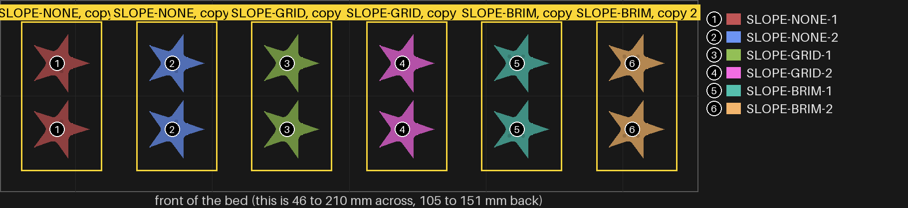
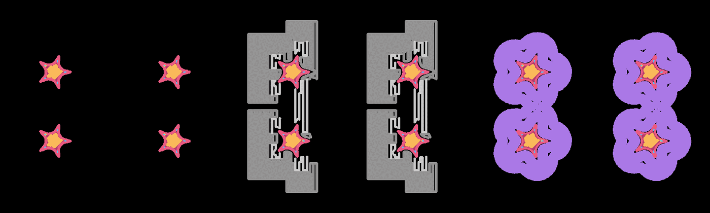

# star-1 — the sloped star, on a base two ways, beside one on none

**In short.** On split-10's middle piece 7 you wrote "I want to see a star printed with a base
like 7". The base under 7 was supports: the slicer's tree supports met the middle piece's wide
overhanging rim and laid a ring a few mm wide on the bed round it. The star with supports on got
almost none, only a few twigs, because a star's step out is narrow and tree supports wait for a
wide overhang. So this bed gives the sloped star (the one your comment sat on) a base in the two
ways that do not wait: grid supports, and a brim round its outside. Each sits beside a star with
no base. Two of each, so a result counts only when both copies agree: six stars, twelve halves.
The plate is [`star-1.yaml`](star-1.yaml).

Two things are left out, and why:

- **The stock star.** A star half's cut face has room for at most three dots, so one plate can
  tell only three versions apart. The stock star takes this plate's answer, or gets its own plate
  after.
- **A raft.** A raft prints under the whole piece, so the star's bottom would be the raft's top,
  not the bed. The bottom is the face this plate judges.

What the slicer lays on the bed's first layer, from the slice itself (supports grey, brim purple):

## What it tries

| Version | Dots | Base on the bed |
|---|---|---|
| SLOPE-NONE | 1 | none: the control |
| SLOPE-GRID | 2 | grid supports (normal, not tree), under any overhang |
| SLOPE-BRIM | 3 | a brim, 5 mm wide, round the outside |

**Telling the pieces apart.** Count the small round dots on each half's cut face, as on
split-10: one, two or three. They are hidden once the two halves close. The dots stay off the
bottom, since the bottom is what this plate judges. A star half has no room for a carved id, so
**keep each star's two halves together** when you take them off the bed.

Every star is split-10's sloped star in everything else: size, pins, the 0.7 mm wall, the slope
under the step, infill and wall overlap 55%.

## After the print

| Pieces | The question | What we expect, and why | What each answer changes |
|---|---|---|---|
| 1 dot (SLOPE-NONE), 2 dots (SLOPE-GRID), 3 dots (SLOPE-BRIM) | **Do:** Peel off any base (the supports, the brim), then turn each star over and look at its bottom, its five tips and the sloped step under the rim, beside the 1-dot star. Do both copies. **Look for:** The cleanest bottom and step, and the sharpest, flattest tips. | The brim gives the sharpest tips: it holds the thin tips to the bed so they do not curl up. Grid supports help the sloped step more than the tips. | 1 dot is as good: stars get no base. 2 dots is better: stars get grid supports from now on. 3 dots is better: stars get a brim from now on. A base that will not peel clean: that one is out, whatever its tips look like. |

## Pictures

The bed, from above, as the slice lays it out: one number and color per version, and the list
of versions beside it. Drawn from the sliced plate by `tools/print_review.py bed --zoom --key`,
at the top of this page. The bed drawing shows the pieces only, not the supports or brim, so the
first-layer drawing above (`tools/print_review.py paths` at 0.2 mm) shows those.

## Cost and risk

**About 17 minutes and 1.9 g of PLA** (the slicer's estimate), one bed, no prime tower, one color.

**Risk: ok.** Small flat pieces; grid supports and a brim are the slicer's own, and each star sits
14 mm from the next so no base runs into a neighbour's.

## Your call

- [ ] **Approve as it stands**: say the color with the yes
- [ ] **Hold**: say why in the notes

Notes:

## Approvals

Every yes or hold Omar gives this plate, one row each, oldest first (D-096). A tick under Your call, or a yes in chat, becomes a row here through the manage-approvals skill's `plate_approve.py`; a send spends the open approval, and a recipe change resets it.

| Date | Decision | By | Covers | Spent by |
|---|---|---|---|---|
| 2026-10-31 | approved | Omar, in chat: "go star 1 in green" | iteration 5 @ c4106309d3 in #00AE42 | |

## Timeline

| Date | What happened | Where it is written |
|---|---|---|
| 2026-10-28 | proposed: on Omar's comment on split-10's middle piece 7, "I want to see a star printed with a base like 7"; the sloped star three ways, six stars | this page |
