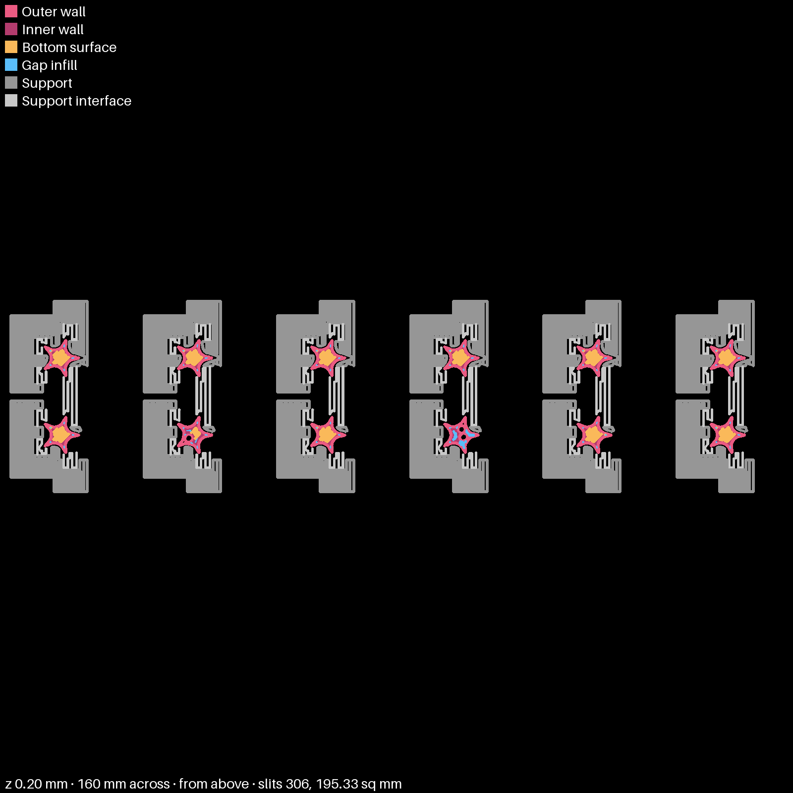
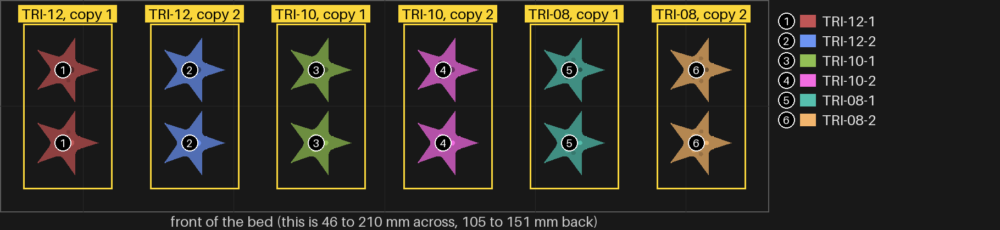
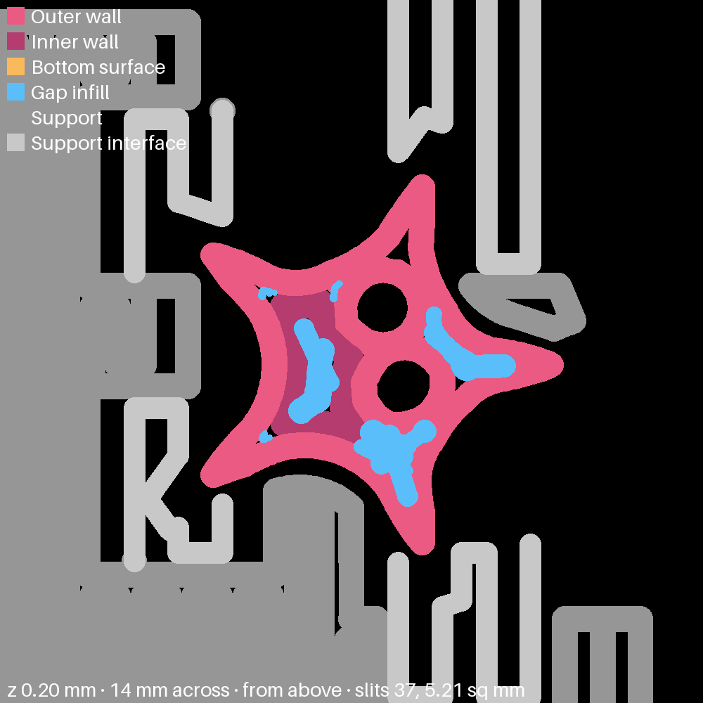

# star-2 — the sloped star with three pins on a triangle, at three pin sizes

**In short.** On star-1 you wrote that every star should move to "a 3 pin model in an equilateral
triangle", with the triangle's middle on the star's middle. You also wrote that the brim stars
were hard to take off and the grid-support stars might have been best. So every star here is
star-1's grid-support star, with its one middle pin swapped for three pins on a triangle centred
on the star. The brim is gone. What changes from star to star is the pin size: a smaller pin lets
the triangle sit wider apart. There are two copies of each, so six stars and twelve halves. The
plate is [`star-2.yaml`](star-2.yaml).

bikar did not have a three-pins-on-a-triangle option, so this plate comes with a new one
(`pins 3 ring 1`, bikar's change for star-2). Without it, three pins meant one in the middle and
two beside it in a line, which split-07 and split-09 still use.

Two things are left out, and why:

- **A one-pin star.** star-1's two grid-support stars (the 2-dot ones) already have one 1.2 mm
  pin in the middle, printed the same way. They are the control: hold a star from this plate
  beside one of them.
- **The stock star (no slope).** Each star half takes only a few dots, and the six pieces here
  use up the counts that fit. The stock star gets the triangle once this plate picks a pin size.

## What it tries

| Version | Pin | Band round each hole | Triangle side | Copy 1 | Copy 2 |
|---|---|---|---|---|---|
| TRI-12 | 1.2 mm | 0.9 mm | 2.37 mm | 1 dot on the cut face | 1 dot on the bottom |
| TRI-10 | 1.0 mm | 0.6 mm | 2.80 mm | 2 dots on the cut face | 2 dots on the bottom |
| TRI-08 | 0.8 mm | 0.6 mm | 3.23 mm | 3 dots on the cut face | 4 dots on the cut face |

The triangle sides are bikar's, measured on this star: it places the pins as far apart as the
star leaves room for. The 1.2 mm pin and its 0.9 mm band are what split-06, hexfit-1 and star-1
printed. The 1.0 and 0.8 mm pins and the 0.6 mm band are new here. They carry over only if a pin
two or three lines across still prints round and does not snap when the halves are pressed
together. That is part of what this plate finds out.

**Telling the pieces apart.** By the small round dots, as the table says. The cut face is the
flat face where the two halves meet, the one with the pins or the holes. The bottom is the
lower half's face that sits on the table. No star half has room for a carved id: bikar refuses
even one letter, which needs about 3 × 3.5 mm of flat face. So **keep each star's two halves
together** when you take them off the bed. The bottom-dot copies have no dots on their upper
half.

Everything else is star-1's grid-support star: size, the slope under the step, the 0.7 mm wall,
infill and wall overlap 55%, grid supports (normal, not tree).

## After the print

| Pieces | The question | What we expect, and why | What each answer changes |
|---|---|---|---|
| All six stars, by their dots: 1 dot (TRI-12), 2 dots (TRI-10), 3 and 4 dots (TRI-08) | **Do:** 1. Peel off the supports. 2. Press each star's two halves together. 3. Hold the star by its edges. 4. Try to twist the halves against each other. 5. Do the same with one of star-1's 2-dot stars. **Look for:** halves that close flat and do not turn, beside star-1's star, which can turn round its one pin. | All three triangles stop the turning that one middle pin allows. The 1.2 mm pins close the tightest, and the 0.8 mm pins may be loose or snap. | All hold, none turn: stars take the 1.2 mm triangle, the proven pin. Only the 1.0 or 0.8 mm hold: stars take that size. A pin snapped or would not close: that size is out. They still turn: the triangle needs to sit wider, so a smaller star wall or a bigger star is the next plate. |
| All six stars, bottoms up | **Do:** 1. Turn each star over. 2. Look at its bottom and five tips. **Look for:** a bottom as clean as star-1's 2-dot stars, and whether the bottom dots on the copy-2 stars show grey support inside them. | As clean as star-1's grid stars: only the pins changed. | As clean: the bottom is settled and the next plate is about the join only. Support stuck in the bottom dots: bottom dots and grid supports do not mix, so later plates keep dots on the cut face. |

## Pictures

The first layer from above, from the slice itself (`tools/print_review.py paths` at 0.2 mm): the
grey blocks are the grid supports, at the top of this page. The bed from above, one number and
color per piece with the list beside it (`tools/print_review.py bed --zoom --key`):

The supports stay out of the bottom dots. This is TRI-10 copy 2's lower half on the first layer, 14 mm across: the two dots are the round black holes, and the grey support lines stop at the star's edge.

## Cost and risk

**About 20 minutes and 2.3 g of PLA** (the slicer's estimate), one bed, no prime tower, one color.

**Risk: ok.** Small flat pieces on the slicer's own grid supports. Each star sits in its own block
so no support runs into a neighbour's.

## Your call

- [ ] **Approve as it stands**: say the color with the yes
- [ ] **Hold**: say why in the notes

Notes:

## Approvals

Every yes or hold Omar gives this plate, one row each, oldest first (D-096). A tick under Your call, or a yes in chat, becomes a row here through the manage-approvals skill's `plate_approve.py`; a send spends the open approval, and a recipe change resets it.

| Date | Decision | By | Covers | Spent by |
|---|---|---|---|---|
| 2026-11-01 | approved | Omar, in chat: "yes in green" | iteration 2 @ 0f2e32e976 in #00AE42 | |

## Timeline

| Date | What happened | Where it is written |
|---|---|---|
| 2026-11-01 | proposed: on Omar's star-1 comments, "shift to a 3 pin model in an equilateral triangle" and "3 and 4 might have been best"; three pin sizes on a triangle, all on grid supports, six stars | this page |
