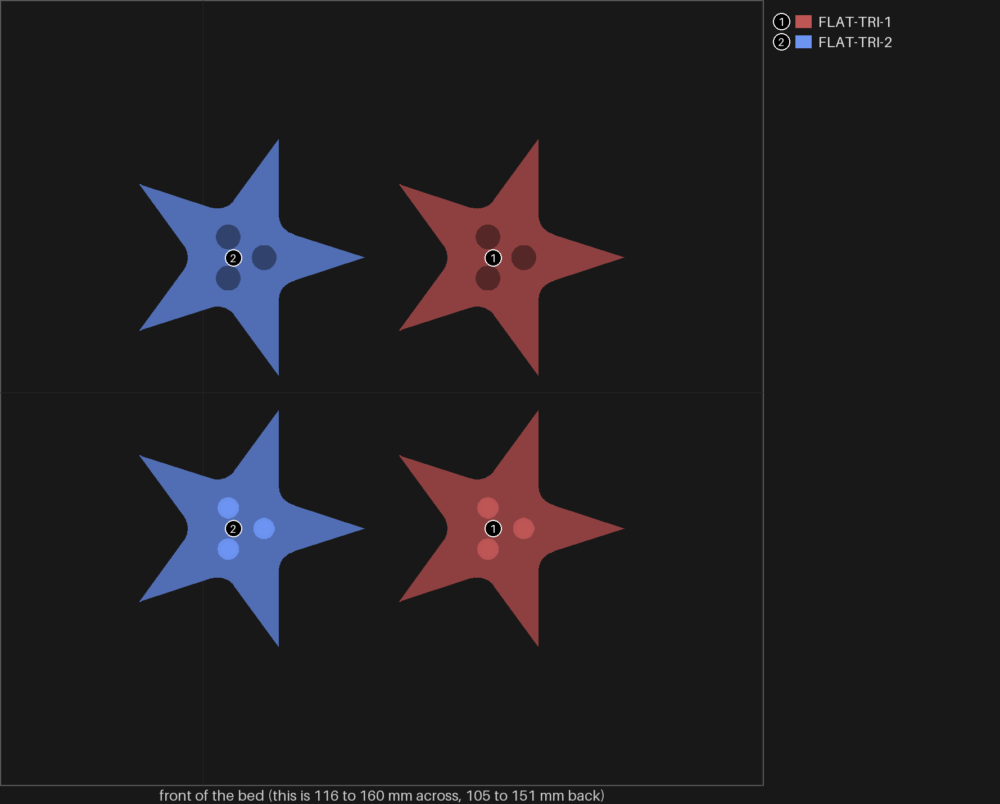
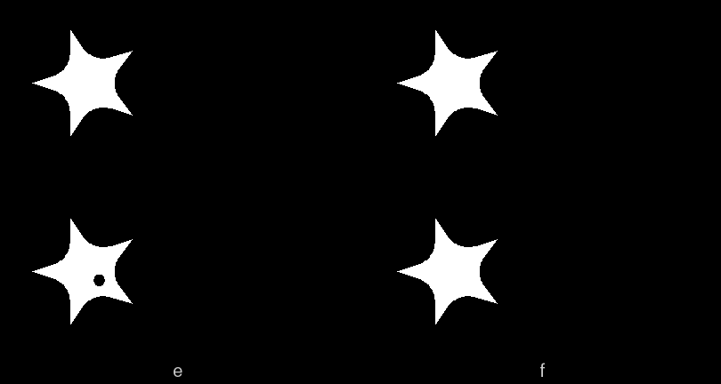
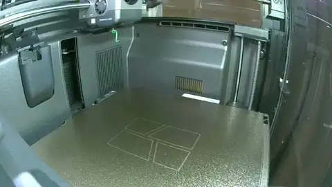
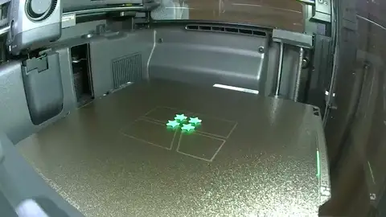

# star-3 — the flat star with star-2's three 1.2 mm pins

**In short.** On star-2 the sloped star with three 1.2 mm pins on a triangle came out best: "left
most was best", and "the right two's pins broke and turned" (the 1.0 and 0.8 mm ones). So three
1.2 mm pins on a triangle are now the star's default in bikar. star-2 left the flat star out (the
one with no slope under its step), because its faces had no room for more dots. This plate gives
the flat star the same triangle: two copies, four halves. The plate is
[`star-3.yaml`](star-3.yaml).

Only the pins change. Everything else is split-10's flat star (STAR-STOCK): halves, no slope, no
supports, the 0.7 mm wall, the 0.1 mm gap round the piece, wall overlap 55%. So this plate asks one
thing: does the triangle hold the flat star's halves? It does not ask which star is best.

Left off, and why:

- **Supports or a slope under the step.** split-10 printed those beside its flat star, and you
  have not judged them yet. Changing them here as well would mix two questions.
- **The 1.0 mm triangle.** Your star-2 answers did not name it, so it stays untried rather than
  out.

## What it tries

| Version | Pin | Band round each hole | Copy 1 | Copy 2 |
|---|---|---|---|---|
| FLAT-TRI | 1.2 mm | 0.9 mm | 1 dot on the bottom | no dots |

The pins and band are star-2's TRI-12, the ones you kept. bikar places the three pins as far apart
as the star leaves room for.

**Telling the pieces apart.** The flat star has room for one dot only: bikar refuses a second
one on the cut face by 0.07 mm. Copy 1 has a dot on its bottom, the lower half's face that sits
on the table. Copy 2 has no dots. No star half has room for a carved id, so **keep each star's two
halves together** when you take them off the bed.

The bed from above, one number and color per star (`tools/print_review.py bed --zoom --key`), is
at the top of this page. The bright circles are the pins on each lower half; the dark ones are the
holes in each upper half.

**Telling them from earlier stars.** star-2's 1.2 mm stars have the same pins, but each half has
a 45° ramp under its step; these have a flat step. split-10's flat star (3 dots) has the same
shape but one pin in the middle, not three.

## After the print

| Pieces | The question | What we expect, and why | What each answer changes |
|---|---|---|---|
| Both stars here: 1 dot on the bottom (copy 1) and no dots (copy 2) | **Do:** 1. Press each star's two halves together. 2. Hold the star by its edges. 3. Try to twist the halves against each other. 4. Do the same with star-2's 1-dot star (same pins, sloped) and split-10's 3-dot flat star (same shape, one pin). **Look for:** halves that close flat and do not turn, like star-2's 1-dot star, while split-10's flat star can turn round its one pin. | They hold like star-2's 1.2 mm stars: the pins and band are the same, only the step under them is flat. | Both hold, neither turns: the flat star takes the triangle, and every star in the coaster has it. Too tight to close, or a pin snapped: the flat star's pins need a wider gap than the sloped star's. They still turn: the triangle is too small on this star, so a wider one is the next plate. |
| Both stars here, bottoms up | **Do:** 1. Turn each star over. 2. Look at its bottom, its five tips and the step under each half. **Look for:** a bottom and step as clean as split-10's 3-dot flat star. | As clean: only the pins changed, and they sit inside the halves. | As clean: the flat star is settled apart from its join. Worse than split-10's: the pins changed how the step prints, so the next plate looks at that. |

## Cost and risk

**About 9 minutes and 0.5 g of PLA** (the slicer's estimate), one bed, no prime tower, one color.

**Risk: ok.** Small flat pieces, no supports, as split-10's flat star printed.

## The print

The print as the chamber camera saw it: 6 pictures from 23:16 to 23:26 UTC, half a second each, the last held. Made by the monitor-print skill's `print_monitor.py --publish`; what the printer said is in the print log.

## Your call

- [ ] **Approve as it stands**: say the color with the yes
- [ ] **Hold**: say why in the notes

Notes:

## Approvals

Every yes or hold Omar gives this plate, one row each, oldest first (D-096). A tick under Your call, or a yes in chat, becomes a row here through the manage-approvals skill's `plate_approve.py`; a send spends the open approval, and a recipe change resets it.

| Date | Decision | By | Covers | Spent by |
|---|---|---|---|---|
| 2026-11-03 | approved | Omar, in chat: "Yes, in green (Recommended)" | iteration 1 @ e516ba6d94 in #00AE42 | sent 2026-11-03 |

## Timeline

| Date | What happened | Where it is written |
|---|---|---|
| 2026-11-03 | proposed: on star-2's answers ("left most was best"), the flat star with three 1.2 mm pins on a triangle, two copies | this page |
| 2026-11-03 | sent — by `bambu print send`; spends the approval of 2026-11-03, iteration 1 @ e516ba6d94 in #00AE42 | this page |
