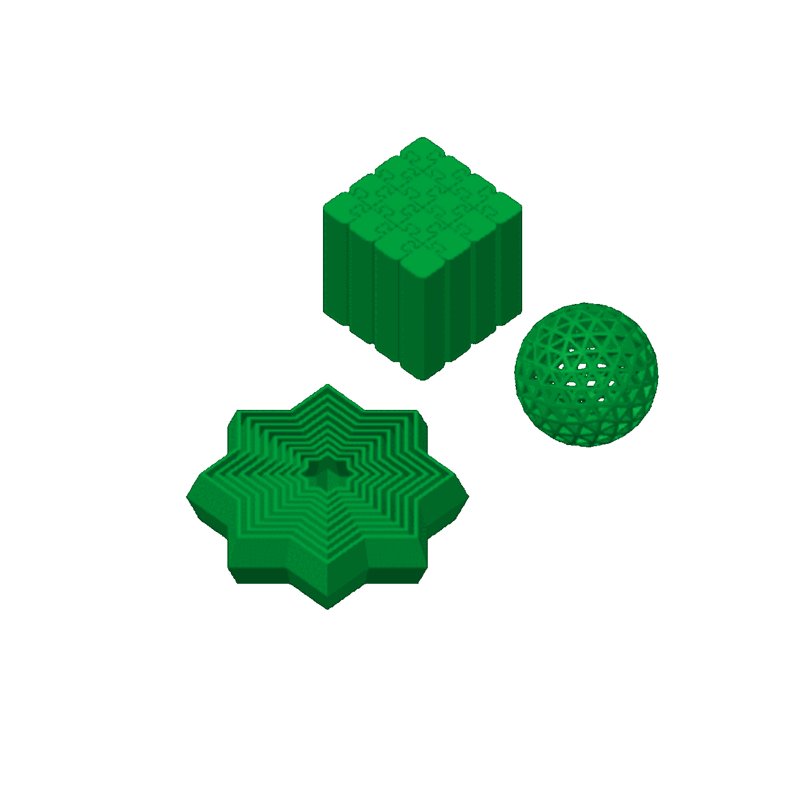

# toys-1 — a magic cube, an airless ping-pong ball and an 8-point fidget star

**In short.** You asked "i want a plat with the cube and ball", then to add the fidget star. This
is one magic cube, one airless ping-pong ball and one 8-point fidget star on one bed, each on its
own flat base, with supports on. The plate is
[`toys-1.yaml`](toys-1.yaml). One bed, about 5 h 40 min and 89 g. It is a fun print, not a
coaster question. You pick the color at the send.

## What it is

- **The magic cube.** Downloaded as `Magic Cube.stl`, at its own size: 40 x 40 x 40 mm. It sits on
  a full 40 x 40 mm face. The file names no maker or source.
- **The airless ping-pong ball.** From MakerWorld (the file's header names model 376496),
  downloaded as `airlesspingpongball20.stl`, at its own size: about 40.0 x 39.9 x 39.3 mm. It
  stands on a flat spot about 6 mm across at its bottom.
- **The 8-point fidget star.** Downloaded as `8ptFidgetStar.stl` (made in Blender 2.92; the file
  names no maker), at its own size: about 78 x 78 x 18 mm. It lies flat on a base about 70 mm
  across.
- **One color**, picked at the send. Until then it slices on PLA Basic.
- **Supports on, for the whole plate.** The first slice warned that the ball's open lattice has
  "floating regions", spots that start in the air. You picked supports over signing that off
  (2026-11-07). A recipe can only give its own settings to a piece we design, so the supports are
  on for all three: the slicer adds them wherever it sees an overhang, which may include the star's
  rings and the inside of the ball. The plate uses a new preset, `tools/bambu/presets/supports-0.20.json`:
  our 0.20 mm Standard with supports on.

None of the files is in git: this repo is public and the models are someone else's. They sit in the
gitignored imports folder, which links to your iCloud folder
`CloudDesktop/data/3d-models/imports`, and the recipe holds each to its hash.

**What I assumed, for you to change:**

- One of each, not a bed of them.
- All in one color. More colors would mean filament swaps, so one color it is unless you say
  otherwise.
- Our standard walls and 15% infill. A recipe cannot set the makers' own settings on an outside
  model yet.

## Why print it

You asked for it. It also shows how a ball on a 6 mm foot holds on our bed.

## Pictures

The slice: the cube, the ball and the star together on the bed.

| Piece | Size (mm) | Where on the bed (mm from front left) |
|---|---|---|
| MAGIC CUBE | 40.0 x 40.0 x 40.0 | 185.9, 159.7 |
| PING-PONG BALL | about 40.0 x 39.9 x 39.3 | 186.1, 96 |
| FIDGET STAR | about 78.0 x 78.0 x 18.0 | 109.6, 120.4 |

## Cost and risk

One bed, 5 h 40 min, 89.48 g (local slice, 2026-11-07, X2D 0.20 mm Standard preset with supports
on and Bambu PLA Basic, sliced for the Textured PEI plate; the slicer added its automatic brim and
supports, no raft, and raised no warnings). Without supports it was 5 h 19 min and 85.12 g.

**Risk: ok.** The ball stands on a small foot about 6 mm across and grows to 40 mm wide above it.
If it lets go of the bed partway up, the nozzle pushes a loose ball around: a failed print, not a
printer risk. Supports inside the ball's lattice or between the star's rings may be hard to pull
out: a looks risk, also not a printer risk. The X2D's own spaghetti check is on.

## After the print

| Pieces | The question | What we expect, and why | What each answer changes |
|---|---|---|---|
| MAGIC CUBE (no carved id; the square one) | 1. Take the cube off the bed. 2. If it has moving parts, try to move them. Does it come out clean and, if it is meant to move, does it move? Clean, rough, or stuck | Clean: it sits on a full flat face | Clean: print more as they are. Rough or stuck: look at the maker's own settings before another |
| PING-PONG BALL (no carved id; the round one) | 1. Take the ball off the bed. 2. Pull off any support, inside and out, and look at its bottom, where it stood. 3. Squeeze it gently. Did it print round all the way up, did the supports come out, and does it bounce? Clean, supports stuck inside, rough, or failed | Clean once the supports are out, maybe a little rough near the foot | Clean: print more as they are, with supports. Supports stuck inside: next time try without, signing the warning off. Failed: it let go of the bed; try a brim |
| FIDGET STAR (no carved id; the flat star) | 1. Take the star off the bed. 2. Pull off any support. 3. Try to move its rings and points. Do they move freely, or are any stuck to each other? Free, stiff, or stuck | Free or a little stiff at first: a fidget toy printed in one piece often needs a twist to break the parts loose | Free or stiff: print more as they are. Stuck: supports between the rings are the first suspect; next time print the star on a plate without supports |

## Your call

- [ ] **Approve as it stands** — one cube, one ball and one star, one color picked at the send, supports on
- [ ] **Hold** — say why in the notes

Notes:

## Approvals

Every yes or hold Omar gives this plate, one row each, oldest first (D-096). A tick under Your call, or a yes in chat, becomes a row here through the manage-approvals skill's `plate_approve.py`; a send spends the open approval, and a recipe change resets it.

| Date | Decision | By | Covers | Spent by |
|---|---|---|---|---|
| 2026-11-07 | approved | Omar, in chat: "yes, all in Silk blue" | iteration 3 @ f08bbbc482 in #0047BB | |

## Timeline

| Date | What happened | Where it is written |
|---|---|---|
| 2026-11-07 | proposed — at Omar's ask: a magic cube, a ping-pong ball and an 8-point fidget star on one plate | this page |
| 2026-11-07 | sliced — the first slice warned of floating regions on the ball; Omar picked supports on for the plate; the slice with supports fits one bed, 5 h 40 min, 89.48 g, no warnings | this page |
