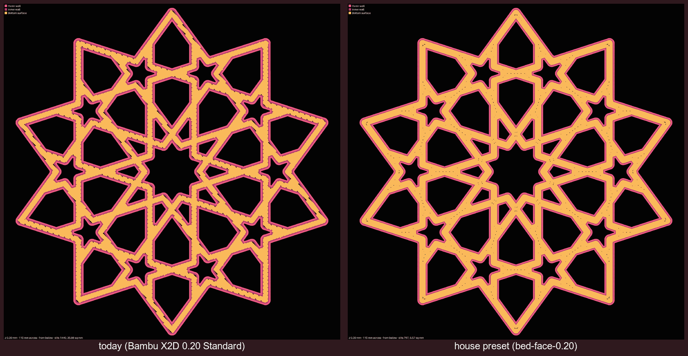
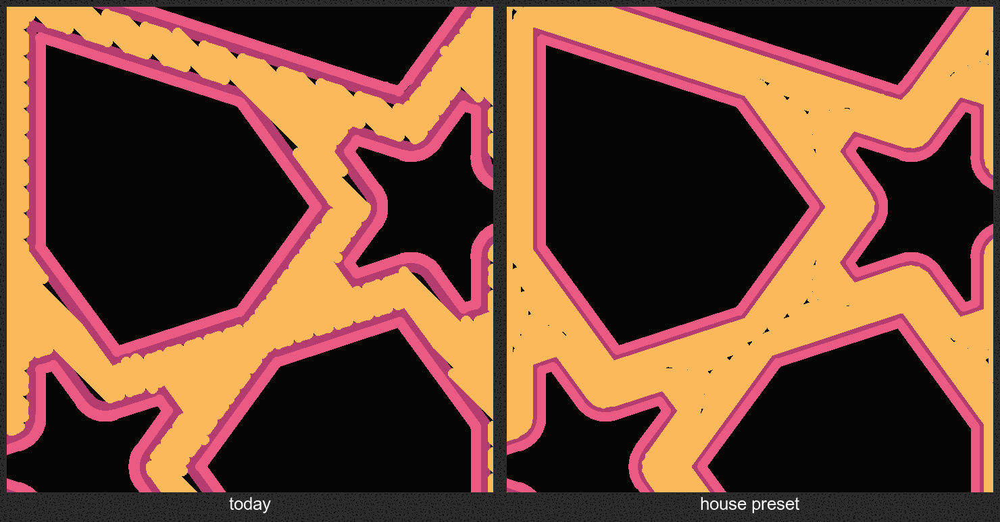
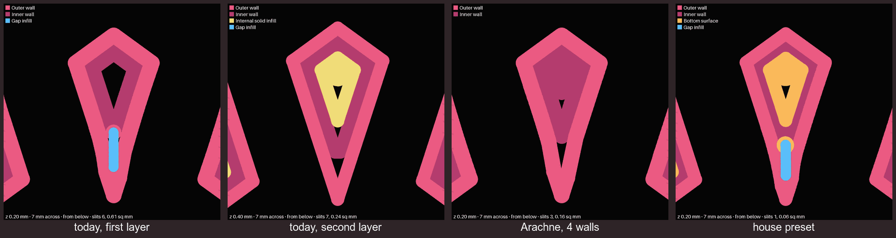
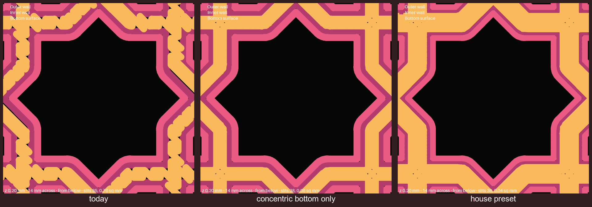
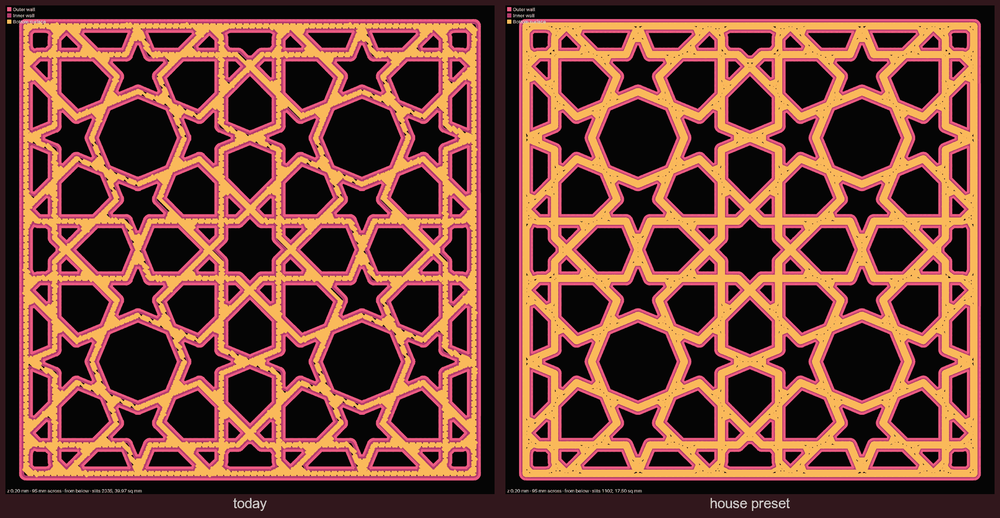
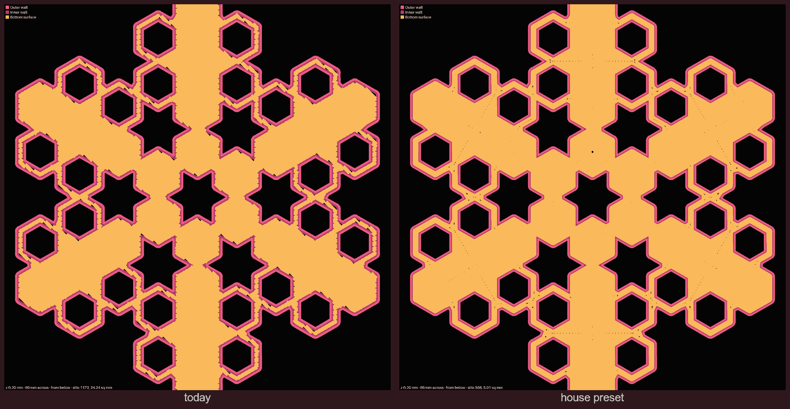
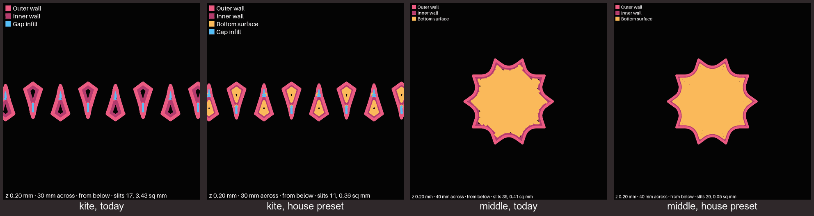

# The bed face: slits, a bare core, and the slicer settings that close them

**Status:** proposed 2026-10-10; **the house preset failed in print on 2026-10-11 and does not
roll out.** [bedface-1](../plates/bedface-1.md) came out no cleaner than stock on the coaster's
bottom, with dashes where the rings meet, and every fit one rung tighter; only the kites' core
filled, as planned. **On 2026-10-12 rings were dropped:** [bedface-2](../plates/bedface-2.md)
printed rings beside stock, both at the stock 0.5 mm first line, and Omar found them about the same,
"both have slits, byt in different places": along the strap edges on stock, where the rings meet on
the ring coaster ([the record](../../prints/2026-10-12-bedface-2/index.md)). What was tried and what comes next:
[the issue](../../issues/bed-face-preset-failed-in-print.md). The sections below are the plan as
written before the print. Every number comes from slicing
five pieces with the installed Bambu Studio and drawing the sliced G-code; the record, with the
commands, is [`../../research/2026-10-10-bed-face-slits.md`](../../research/2026-10-10-bed-face-slits.md)
(cited below as "the research"). §9 adds a sweep over all four X2D nozzles and seven pieces, with
its own record, [`../../research/2026-10-10-bed-face-sweep.md`](../../research/2026-10-10-bed-face-sweep.md)
("the sweep"). No decision id is taken here.

**The question.** Omar, 2026-10-10, with a photo of a pink coaster's underside: "why do i get gaps
like this in the plate touching side". The photo shows short dark slits along the straps, a
five-pointed star-shaped hole, and scalloped edges where the fill lines turn. Then: "create a
deaign.md on our approach to fix this rohbustly across all coaster and pieces".

## 1. The short answer

1. **The slits are where the fill lines turn around at the wall.** The first layer is drawn as two
   wall loops round each shape and diagonal lines filling the inside. Each diagonal line stops at
   the inner wall, turns, and comes back. The turn is round, so a thin sliver of bed between the
   turn and the wall gets no plastic. On the underside that sliver is a dark slit. A strap is
   narrow, so it has many turns and many slits.
2. **Small pieces have a second cause: a bare core.** In a small kite, the two wall loops (each
   0.5 mm wide on the first layer) leave a middle too thin for the slicer to fill at all. That
   middle is bare on the first layer and filled one layer up, so it shows as a dimple.
3. **The fix is three slicer settings**, kept in one checked-in preset,
   [`tools/bambu/presets/bed-face-0.20.json`](../../../tools/bambu/presets/bed-face-0.20.json):
   fill the first layer with rings that follow the walls instead of diagonal lines
   (`bottom_surface_pattern` concentric), push the fill further into the wall (`infill_wall_overlap`
   30%, from 15%), and draw the first layer 0.42 mm wide instead of 0.5 (`initial_layer_line_width`),
   which is what fills the kite's core. In the slicer's plan this cuts the bare bed on the first
   layer by 56% to 90% across the five pieces sliced (§4).
4. **It is a plan, not a print.** The pictures show what the slicer asks for at the line width it
   asks for. A narrower first line squashes less, which an older write-up lists as a cause of
   holes on the underside (§7). So the preset is printed on one test plate,
   [bedface-1](../plates/bedface-1.md), judged beside the same pieces printed on stock, before any
   other plate uses it (§5).

## 2. What the first layer is made of

The slicer plans each layer as moves of a nozzle, each a line of plastic of a set width.
`tools/print_review.py paths` draws every move on one layer at that width, colored by what it is:
pink for the outer wall, dark pink for the inner wall, orange for the bottom surface, blue for gap
fill. Black inside the piece is bed that no line covers. With `--below` the drawing is mirrored, so
it reads like the underside held up in the hand.

The stock settings, read from a slice of the X2D 0.20 mm Standard preset
([`fdm_process_dual_0.20_nozzle_0.4.json`](https://github.com/bambulab/BambuStudio/blob/master/resources/profiles/BBL/process/fdm_process_dual_0.20_nozzle_0.4.json)):
two wall loops with classic walls, the first layer 0.5 mm wide, the bottom surface in straight
diagonal lines (monotonic), and the fill reaching 15% of a line width into the wall.

## 3. The causes

### 3.1 Slits where the lines turn at the wall

A diagonal fill line meets the inner wall at an angle, turns in a half-circle, and runs back. The
gap between the round turn and the straight wall is the slit. Overlap pushes the turn into the wall
and narrows the slit; rings that run along the wall have no turns there at all.

In the crop, today's straps are edged with dark dashes on both sides. With the house preset the
edges are closed; what is left is a thin row of specks down the middle of some straps, where two
rings meet (§3.3).

### 3.2 A bare core in thin pieces

The small kite is narrow. Two wall loops on each side, each 0.5 mm wide on the first layer, take up
most of its width, and the middle left is too thin for a line. The slicer leaves it bare on the first layer and fills it with
internal solid infill on the second (0.24 sq mm still bare there in a 7 mm square, the research).
Rings and overlap do nothing here, because there is no room for a line to begin with. What helps
is room: a narrower first-layer line (0.42) leaves a middle wide enough for one, and Arachne walls
(which vary their width) fill it with wall instead.

### 3.3 What rings bring with them

Rings are not free. Where a ring closes on itself, or where the rings of two straps meet at a
crossing, the slicer leaves a speck, and at the star's center a few four-pointed pinholes. In a
wide flat band the rings shrink to a point and leave a round dot: the largest bare pocket in the
house radial coaster is one such dot, about 0.45 mm across (0.164 sq mm), above the center star.
These are far smaller and fewer than the slits they replace, but they are there, and the coupon
must show whether they show in the print.

**In print they showed** (bedface-1, 2026-10-11): down the middle of the straps and at the
junctions they read as short dark dashes and small triangles, and Omar found the coaster's bottom
"About the same" as stock, then "F has a lot of slits" ([the record](../../prints/2026-10-11-bedface-1/index.md)).

### 3.4 The glacier plate (a hedge)

The pink coaster in the photo was most likely printed on the glacier plate, which is sliced as a
Smooth PEI plate (the [plate research](../../research/2026-10-07-third-party-plates.md)). The X2D
lowers the nozzle a further 0.02 mm on the first layer for the Textured PEI plate only, so on the
glacier the first layer is squashed less, and a slit the slicer plans is less likely to be closed by
squash. This is likely, not shown: no print here compared the two plates.

## 4. Before and after, piece by piece

Five pieces were sliced, each with the stock preset and with the house preset, on the glacier's
slice (`--plate-type hot_plate`), and drawn at 30 px a millimeter (the research, §"Bare share and
largest pocket"). "Bare share" is the share of the first layer left bare; "largest pocket" is the
biggest single bare spot.

| Piece | Bare share today | House preset | Largest pocket today (sq mm) | House preset |
|---|---|---|---|---|
| Star coaster, 90 mm | 0.88% | 0.38% | 0.684 | 0.108 |
| Radial coaster, 90 mm | 0.54% | 0.11% | 0.390 | 0.164 |
| gBV coaster, 112.5 mm | 0.88% | 0.21% | 0.429 | 0.081 |
| Small kites (a row) | 4.98% | 0.51% | 0.587 | 0.049 |
| Middle piece | 0.21% | 0.03% | 0.050 | 0.004 |

The middle piece is not broken today: its share and largest pocket are both small, and it passes
the check in §6 with the stock settings. Of the five, the small kites gain the most, because only
the narrower line reaches their core.

**The fit carries over** for the rings and the overlap: the outer walls are the same lines as
today, at every layer checked. The narrower first line moves the first layer's outer wall center in
by about 0.04 mm (half the width change), so its planned outer edge stays where it was, and the
layers above are unchanged. Whether a narrower first line also changes the elephant foot in print
is not known; the coupon's fit pieces measure it. **In print the fit did not carry over** on
bedface-1: every piece came out about one 0.025 mm rung tighter than fit2's, though coasters also
move by about that much from print to print, so one plate cannot say how much was the preset.
Arachne moves the outer walls by 0.017 to 0.028 mm
at every layer, the size of one 0.025 mm fit step, so every fit we have measured would have to be
measured again (the research, "Do the outer walls move?").

## 5. What we change

### 5.1 The options

Bare first-layer area, whole piece, in sq mm (the research): star / radial / gBV coaster / kites /
middle.

| Option | Bare area | Pros | Cons | Implications | What it verifies |
|---|---|---|---|---|---|
| **Stock** (do nothing) | 40.0 / 24.2 / 36.0 / 3.4 / 0.4 | No change, no reprint of any fit. | Slits on every strap; the kites' core stays bare. | Every plate keeps the faces Omar asked about. | Nothing. |
| **Rings only** | 14.3 / 5.5 / 10.7 / 3.4 / 0.2 | The edge slits go; walls unchanged. | Kites unchanged; specks at crossings. | Fixes coasters, not small pieces. | The drawing; the kites' bare area alone (share about 5%) fails `--check`. |
| **Overlap 30% only** | 19.0 / 12.2 / 19.8 / 3.4 / 0.2 | Smallest change; walls unchanged. | Halves the slits, does not remove them; kites unchanged. | A half-step that leaves both defects visible. | The drawing; fails `--check` on the kites. |
| **Rings and overlap** | 15.5 / 5.2 / 16.9 / 3.4 / 0.1 | Cleanest at the star's center (0.027 sq mm bare in a 14 mm close-up, against 0.762 today). | Kites unchanged; more bare than rings alone on the gBV coaster (16.9 against 10.7), not looked into. | As rings only. | The drawing; fails `--check` on the kites. |
| **House preset: rings, overlap, 0.42 first line** (recommended, coupon first) | 17.5 / 5.0 / 8.6 / 0.4 / 0.1 | The only option that fills the kites' core and closes the edges; outer walls planned in the same place. | A narrower first line squashes less, which may cost grip on the bed and may open holes of its own (§7); ring specks stay. | Every experiment recipe changes its settings line, which resets each yes (D-097); fits are kept unless the coupon shows the elephant foot moved. | The drawing and `--check` on all five pieces; the bed face and fit only by the coupon. |
| **Arachne, 4 walls** | 26.3 / 13.3 / 25.6 / 0.9 / 0.7 | Fills most of the kites' core with wall. | Leaves more bare on coasters than the rings; moves every outer wall by about one fit step. | A one-way door: every fit gap we have printed and judged would have to be measured again. | The drawing; the kites' share (over 1%) still fails `--check`; nothing about fit until reprinted. |
| **Rings, overlap, 3 walls** | 13.6 / 5.8 / 10.6 / 3.4 / 0.1 | Lowest bare area on two coasters. | Kites unchanged; more wall on thin straps. | Wall position not checked. | The drawing; fails `--check` on the kites. |

**Recommended: the house preset, printed on a coupon first**, because it is the only option that
fixes both causes and keeps the outer walls where the fits were measured. It is not chosen here:
the coupon is Omar's to approve and judge.

### 5.2 The coupon

**First plan: one plate in two halves**, stock on one and house on the other. It cannot test the
whole preset. Bambu's command line takes per-piece settings from the plate file, so a test slice
gave a middle piece and a kite row all three house settings on a stock plate. The middle piece took
the rings and the 30% overlap (bare share 0.29% to 0.09%, largest spot 0.072 to 0.011 sq mm). But
the per-piece first-line width was ignored: the kites given 0.42 sliced at 0.5, unchanged at 4.44%
bare and a 0.584 sq mm spot. The 0.42 line, the one setting that fills the kites' core, can only be
set for the whole plate ([the record](../../research/2026-10-10-bed-face-per-piece-and-bedface-1.md#1-which-of-the-three-settings-bambu-takes-per-piece)).

**What prints instead: [bedface-1](../plates/bedface-1.md)**, one plate on the house preset only,
which Omar picked on 2026-10-10 ("send the plate"; of the options, "One plate, new preset only", in
pink). It is [sheets-04g-fit2](../plates/sheets-04g-fit2.md) piece for piece: the gBV coaster, ten
small kites and three middle pieces with carved ids, in the same pink on the same glacier plate,
sliced as Smooth PEI, in the same places on the bed. fit2 printed on the stock preset the same day
and its pieces are on hand, so each piece is judged beside its fit2 twin: the undersides, and the
fit in each plate's own coaster. The star coaster of the first plan is left out; the gBV coaster's
straps carry the same slits.

In the plan, every piece's first layer is barer on fit2's stock slice than on bedface-1's (the plate
page has the table, and [the record](../../research/2026-10-10-bed-face-per-piece-and-bedface-1.md#2-bedface-1-against-sheets-04g-fit2)
the commands). The coaster and the kites pass §6's check; two of the three middle pieces sit
just over a bar. Their carved letters make a face this doc had not measured, which bedface-1 also
answers (§6). What it cannot separate: a fit change from the 0.42 line against one from the rings,
since both are on every piece. If the fit moves, a second plate splits them.

### 5.3 How it is rolled out, once the coupon says yes

**Default:** until the coupon has printed and been judged, every plate keeps the X2D 0.20 mm
Standard chain unchanged, as
[`fdm_process_dual_0.20_nozzle_0.4.json`](https://github.com/bambulab/BambuStudio/blob/master/resources/profiles/BBL/process/fdm_process_dual_0.20_nozzle_0.4.json)
sets it. This holds because it is the vendor's preset for this printer, nozzle and layer height,
and the house preset has only been checked in the slicer's plan.

If the coupon favors the house preset:

- **Recipes.** An experiment plate's recipe names the preset after the machine:
  `settings: "Bambu Lab X2D 0.4 nozzle;tools/bambu/presets/bed-face-0.20.json"`. The CLI reads that
  path from its own checkout, so a worktree's slice reads the worktree's preset, never the vault's.
  Each changed recipe resets that plate's yes (D-097). Today that costs almost nothing: fit3 is
  waiting on a yes anyway, and split-01, stud-1 and split-02 need a new one before they go.
- **Production plates are left alone.** phones-02 is frozen (D-095); a change to it is a new
  experiment.
- **The tools that write recipes change too**, or the next plate goes back to the stock preset:
  `tools/bambu/src/commands/coaster.ts`, `tools/bambu/src/by-color.ts`, and the skill scripts that
  name the stock preset (`.claude/skills/color-themes/scripts/swatch.py` and the print-model
  scripts). A grep for `0.20mm Standard @BBL X2D` lists them.

[D-095 and D-097](../../working-model/decisions-log.md) are in the decisions log.

## 6. The check

**Validator:** `python3 tools/print_review.py paths <out.png> <plate.3mf> 0.2 <x>,<y>,<side> --below --check`
over each whole piece. It draws the first layer at 30 px a millimeter and fails when the bare share
is 0.6% or more, or the largest bare pocket is 0.2 sq mm or more. Both bars are fitted to the ten
slices in §4, so they are a bet on five pieces, not a rule for every shape; the simulator (§9) is
what widens the set.
PASS: the house preset on all five pieces, including the two closest to a bar: the radial coaster's
ring dot (largest pocket 0.164) and the small kites (share 0.51%). The stock middle piece passes too.
FAIL: the stock radial coaster, which fails on its largest pocket alone (0.390) while its share
(0.54%) is under the bar, and the stock star, gBV coaster and small kites, which fail on both.

What this check can and cannot say: the drawing is the slicer's plan at the width it asks for.
Bed left bare in the plan is very likely bare in the print, since nothing is laid there. Bed
covered in the plan is not proof the print is covered: flow, squash and the plate decide that. So a
PASS means "the slicer is not planning slits", never "the underside will be clean". bedface-1 is
the case: its coaster passed at 0.26% bare against stock's 1.10%, and in the hand the two read the
same.

## 7. What this does not settle

- **The narrower first line against the older holes table.** The
  [print-quality design](print-quality-design.md#2-tiny-holes) lists "Thin first layer — 0.4 mm
  first-layer line instead of 0.5, and a 45 °C bed instead of 55" as a cause of holes on the
  underside, from minis-04, which printed on Studio's fallback settings. The house preset asks for
  0.42 at the stock 55 °C bed, so the two are not the same case, but the worry carries: a thinner
  line is squashed less and may grip less. Only the coupon settles which wins.
- **Ring specks in print.** Whether the specks and the 0.45 mm dot close up under squash is not
  known.
- **Other nozzles, other sizes, other plates.** §4 to §6 are one nozzle (0.4), one filament
  (Bambu PLA Basic), one layer height (0.2), one plate type (Smooth PEI) and five pieces. §9 widens
  that to four nozzles and seven pieces, in the plan only: no nozzle but the 0.4 is fitted, and the
  bars in §6 were fitted at the 0.4. Other filaments and plates are still unchecked.
- **Walls 3 and overlap alone** were not checked for wall movement.

## 8. What comes next

1. The coupon (§5.2): [bedface-1](../plates/bedface-1.md), printed 2026-10-11. It did not favor
   the preset.
2. The recipes stay on stock (§5.3 is not done). The next step is Omar's, from the options in
   [the issue](../../issues/bed-face-preset-failed-in-print.md#what-replaced-it).
3. A simulator, which Omar asked for on 2026-10-10 ("can we also build a simulator ehere we can
   play with nozzle size and shape size to dind ideal settings"): the same slice-and-draw run over
   nozzle sizes, strap widths and piece sizes, each scored by the check in §6, so the settings can
   be chosen per piece size rather than from five examples. Built: §9.
4. The bars for other nozzles. Before a 0.2 or 0.6 nozzle is bought for the bed face, a coupon at
   that nozzle, so its PASS and FAIL rest on a print and not on bars fitted at the 0.4.

## 9. The simulator: every nozzle, three sizes of piece

`tools/bed_face_sweep.py run` slices seven pieces at each of the X2D's four nozzles, with the
nozzle's stock preset and with the house preset (§5) written for that nozzle, and scores each
first layer with the check in §6. 56 slices take about 10 minutes. `page` builds a page to play with:
pick the piece, strap and nozzle, see the drawing from below with the slits marked, the numbers and
PASS or FAIL, and the best setting per piece. Published:
[Bed-face simulator](https://claude.ai/artifact/VktCoMbqRt3pNCRtUnv6bV) (private to Omar's
account). Every number below is from the sweep's table, and every one is the slicer's plan, not a
print.

The pieces are the star coaster at strap 2, 3 and 4, the radial coaster at strap 3, and a row of
gBV small kites cut from a 90, 112.5 and 125 mm coaster. Besides the check, a slice is marked when
it drops a piece, or when it leaves a wide bare spot the 0.4 stock slice of the same piece does not
have (a middle no line reached). The best setting is the slice that passes, is unmarked, and has the
least bare share.

| Piece | 0.2 nozzle | 0.4 nozzle | 0.6 nozzle | 0.8 nozzle | Best |
|---|---|---|---|---|---|
| star, strap 2 | house, PASS 0.12% | house, PASS 0.14% | FAIL 0.54% | FAIL, bare middles | 0.2 house |
| star, strap 3 | house, PASS 0.16% | house, PASS 0.37% | house, PASS 0.16% | FAIL, bare middles | 0.2 house |
| star, strap 4 | house, PASS 0.14% | house, PASS 0.39% | house, PASS 0.10% | house, PASS 0.12% | 0.6 house |
| radial, strap 3 | house, PASS 0.05% | house, PASS 0.11% | FAIL, largest slit 0.555 sq mm | house, PASS, but 5 bare middles | 0.2 house |
| kites from 90 | FAIL 0.79% | FAIL 3.28% | FAIL 2.72% | FAIL 8.65% | none passes |
| kites from 112.5 | house, PASS 0.36% | house, PASS 0.52% | FAIL 0.69% | FAIL 3.98% | 0.2 house |
| kites from 125 | FAIL 0.76% | house, PASS 0.49% | FAIL 5.37% | FAIL 3.67% | 0.4 house |

What it says, inside those hedges:

- **The 0.4 nozzle with the house preset is the one setting that passes nearly everything**: six of
  the seven pieces, all but the kites from a 90 mm coaster. Stock at the 0.4 passes none of them.
- **The 0.2 nozzle is a little cleaner and about four times slower on a coaster.** The house preset there passes five of
  seven with the lowest share on four, but the slicer's estimate for a star coaster is 241 to 290
  minutes against 52 to 72 at the 0.4.
- **At the 0.6 and 0.8 nozzles the house preset mostly changes nothing.** The stock first line
  already equals the line, and on narrow straps and kites the first layer is all walls, with no
  bottom surface for the pattern or the overlap to act on: nine of the fourteen house slices there
  score the same as stock.
- **At the 0.8, thin straps get bare middles.** At strap 2 and 3 the walls close in 54 and 158 small
  bare spots that the 0.4 slice fills, mostly where straps cross. Only strap 4 comes out clean.
- **The kites from a 90 mm coaster fail at every setting.** It is the smallest piece in the sweep,
  and its least bad slice (0.2, house) still leaves 0.79% bare. A kite that small wants a bigger
  coaster or a different first layer than any tried here.
- **A narrower line is not a dropped piece.** The printed area moves with the line width (the kites
  from a 90 mm coaster print 0.83 to 0.85 of the 0.4 stock area at the 0.2 and with the 0.4 house
  preset, all ten kites there), so the sweep counts pieces instead of comparing area. The count cannot see a strap dropped inside a one-piece coaster.

The "best" column carries the same gap as the check: on bedface-1 the 0.4 house setting it ranks
best printed no cleaner than stock (the issue linked in the status line).

The bars are the weak point: they were fitted at the 0.4, and at the 0.8 the line is wider than a
0.5 mm slit, so some of the 0.8 failures may close under squash. Item 4 of §8 is how that gets
settled.
