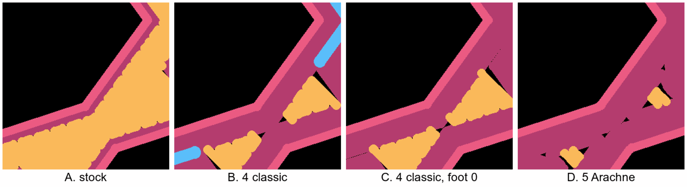

# No slits: why the bottom slits keep coming back, and an experiment program aimed at zero

**Status:** proposed 2026-10-14. Nothing here is decided, and nothing in it has been printed yet. It sits beside [the bed-face design](bed-face-slicing-design.md) and [the issue](../../issues/bed-face-preset-failed-in-print.md), which hold what was tried. bedface-5 ([the plate](../plates/bedface-5.md)) is built and not yet printed; this doc does not change it.

**The question.** Omar, in chat after bedface-5 was built, with every piece printed so far still slit: "what will it take to truly experiement and try new things that get us to no slits? whats the fundamental issue?"

**How to read the labels.** Each claim carries one of four tags:

- **Measured:** read from a slice's settings or G-code, or from Omar's words on a print. Cited.
- **Research:** from a source a research file here records as checked. Cited.
- **Plan:** from the slicer's drawing of the first layer (`tools/print_review.py paths`). A plan is not a print (§2).
- **Theory, not yet tested:** my own reasoning. No slice and no print has tested it.

## 1. The short answer

The slits are not a setting gone wrong. They come from the shape of the plan itself. A strap 3.75 mm wide is not a whole number of 0.5 mm lines, so on the first layer something has to give, and it gives as small bare spots. On stock that is where each short fill line meets the wall: about one line end every 0.65 mm along each strap edge, and each one leaves a notch. **Theory, not yet tested,** built on the measured widths below.

Every lever tried so far (rings, overlap, first-layer flow, the gold plate's lower start) pushes more plastic into those notches. None of them removes a line end, so each one makes the notches smaller and fewer, never none. That matches the prints: every piece on bedface-4 slit, and the best one, 55% overlap, had "Fewer, no ridge" (Omar, [the record](../../prints/2026-10-13-bedface-4/index.md)). **Measured** for the prints; the reason is **theory, not yet tested.**

Zero needs a plan with no line ends along the straps at all, and something that fills the strap crossings. Of the five variants sliced for this doc, one does the first part: walls only, in a strap filled edge to edge by walls of varying width (Arachne, 5 walls). It still leaves slivers at the crossings (§4). **Plan.** Whether it prints clean is the first experiment (§5).

## 2. Why the plan is not the print

The drawing has misranked the print three times. **Measured:**

| Plate | What the plan said | What the print did |
|---|---|---|
| [bedface-1](../plates/bedface-1.md) | The house preset 0.26% bare against stock's 1.10% | No cleaner than stock; dashes where the rings meet ([the issue](../../issues/bed-face-preset-failed-in-print.md)) |
| [bedface-2](../plates/bedface-2.md) | Rings 0.41% against stock's 0.93% | "both have slits, byt in different places" ([the record](../../prints/2026-10-12-bedface-2/index.md)) |
| [bedface-4](../plates/bedface-4.md) | `L` (30% overlap) 306 slits against `H`'s 356 | `L` had many notches, more than `P`; the record says "The print did not follow it" ([the record](../../prints/2026-10-13-bedface-4/index.md)) |

**What the drawing cannot see.** It draws each move as a bead of its line width with round ends, exactly where the G-code puts it (`paths_picture` in `tools/print_review.py`). So it cannot see, **theory, not yet tested** for each:

- How far the plastic spreads sideways when it is squashed. That depends on the real nozzle height over the plate, the flow, the temperature and the speed. A hairline the plan draws may close in print; a line the plan draws may fall short.
- What happens at the start and end of a line. The nozzle's pressure lags, so a line can start thin and end in a blob. The slits sit exactly at line ends.
- The plate's real height from spot to spot, and the start code's height trim per plate (the 0.02 mm the gold plate gets; [the issue](../../issues/bed-face-preset-failed-in-print.md)).
- How the bead's edge looks from below. A notch the plan draws 0.1 mm wide may show as a dark slit or not, depending on the color and the light.

**The plan's two numbers can disagree with each other, too.** In this doc's slices, 4 classic walls halved the slit count against stock (182 against 355) while the bare area rose (10.17 against 9.51 sq mm) and the largest pocket grew (0.68 against 0.45 sq mm). Another variant raised the count to 463 because one hairline seam was counted in pieces ([the slices](../../research/2026-10-14-no-slits-slices.md)). **Measured** (plan). The slit count also counts single-pixel specks ([the 2026-10-10 research](../../research/2026-10-10-bed-face-slits.md)). So this doc ranks plans by bare share and largest pocket, not by slit count, and ranks neither above the print.

**What measuring the print would take.** Today the print is judged by eye from a photo, piece against piece. That can rank two pieces side by side, but it cannot say "zero", and it cannot compare across plates shot in different light. A measured print needs the same picture every time:

- A flatbed scan of the bottoms, or a phone on a fixed stand with one low lamp from the side, at a fixed distance and exposure. A flatbed at 1200 dots an inch is about 0.02 mm a pixel, finer than a slit (**theory, not yet tested**: no scan has been made).
- The piece outline from the slice, lined up on the picture, so only the inside of the strap is read.
- A dark-pixel threshold set once on a stock piece, then kept.

**Validator:** for a pair of pieces sharing one setting, scanned as above, count the dark runs inside the strap outline that are longer than a threshold length set on a stock piece of the same plate. The threshold is not set here; it is the first thing a scan sets.
PASS: both pieces of the pair show no run over the threshold anywhere along their strap edges or crossings.
FAIL: any run over the threshold on either piece, even one. A pair that is "much better than stock" with one slit left fails; that is the case the check exists for.

## 3. The fundamental issue, worked through

### 3.1 What the first layer is made of

**Measured,** from the stock slice ([the 2026-10-10 research](../../research/2026-10-10-bed-face-slits.md) and [the slices](../../research/2026-10-14-no-slits-slices.md)):

- Every wall and fill line on the first layer is 0.5 mm wide. The stock G-code writes `LINE_WIDTH: 0.5` for the first wall and nothing else before the inner wall.
- Two walls round each hole (`wall_loops` 2, the classic wall generator).
- The bottom fill is `monotonic`: parallel diagonal lines that turn at the wall.
- The fill is pushed 15% into the wall (`infill_wall_overlap`).
- The first layer is 0.2 mm high.
- Elephant-foot compensation is 0.15 mm.
- On `H`, the stock piece, the first-layer bottom fill is 730 moves, 1.75 mm long on average, with 27 wipes ([the 2026-10-13 research](../../research/2026-10-13-bed-face-next-consolidated.md)).

**Research:** elephant-foot compensation shrinks the first layer's outline before the walls and fill are made, so walls and fill shrink together ([the 2026-10-13 research](../../research/2026-10-13-bed-face-next-consolidated.md), row on elephant-foot compensation). Each hole grows by 0.15 mm, so a 3.75 mm strap is 3.45 mm wide on the first layer. That last step is my arithmetic from the code reading, not measured on the G-code; the pictures in §4 agree with it.

### 3.2 How much room the fill gets

**Theory, not yet tested** (arithmetic). Two 0.5 mm beads laid side by side at 0.2 mm high sit about 0.46 mm apart, center to center: a bead is a flattened oval, so neighbors overlap a little. The 2026-10-13 research uses the same 0.46 mm for the overlap's reach.

| Item | Width on the first layer |
|---|---|
| The strap, after the elephant-foot shrink | 3.45 mm |
| Two walls on each side (one 0.5 bead, then one more at 0.46) | about 0.96 mm a side, 1.91 mm both |
| Left for fill | about 1.54 mm |
| In line spacings | about 3.4 lines, not a whole number |

So each strap gets a narrow channel of fill. The fill lines cross it at an angle, each one only about 2 mm long, and each one has two ends at the walls. At 45° to the strap, there is a line end about every 0.65 mm along each strap edge (0.46 mm divided by the sine of 45°). That matches the measured short moves on `H`.

### 3.3 What happens at a line end

**Theory, not yet tested,** except where cited.

- **Where two ends join.** The slicer joins two neighboring line ends by a short run along the wall only when that run is at most three line spacings. Past that, it lifts and starts a new line (**Research:** [the 2026-10-13 research](../../research/2026-10-13-bed-face-next-consolidated.md), row on joining line ends, from the code). The run is three spacings or less whenever the strap is more than about 19.5° off the fill direction, so on most straps the lines zig-zag, turning at the wall.
- **What a turn leaves.** A turn is a round corner, and a round corner cannot fill the sharp corner between a diagonal line and a straight wall. A small triangle of bed is left bare at each turn. That is the notch, and the notches along a strap edge are the scalloped line of slits in Omar's photos.
- **The second source: the leftover.** The channel is 3.4 lines wide, not 3 or 4. The leftover sliver has to go somewhere. On stock it is spread across the turns. On rings, it is the seam where two rings meet down the middle of the strap; bedface-1 and bedface-2 printed dashes there (**Measured,** [the issue](../../issues/bed-face-preset-failed-in-print.md)). At a crossing of two straps, the shape is a four-sided patch whose width is a different fraction in each direction, so no line spacing fits it whole.

So there are two separate sources of bare bed. One is the angle at which a line meets a wall. The other is the leftover fraction of a line spacing. Rings (all lines parallel to the walls) remove the first and keep the second, which is why bedface-2's rings slit "in different places" rather than not at all.

### 3.4 Why every lever so far only shrinks the slits

**Theory, not yet tested,** with the prints as the evidence it has to explain:

- **Overlap** moves the fill's edge into the wall (55% reaches about 0.25 mm, 100% about 0.46 mm: **Research,** the 2026-10-13 research). The turn's corner moves closer to the wall, so the notch is smaller. It is still a round corner against a straight wall.
- **First-layer flow** makes every bead wider, so neighbors squash into the notch more. Only a small part of the extra plastic lands in a notch; the rest goes into the bead's width and height.
- **A lower first layer** spreads every bead wider, the same way. bedface-3's gold plate (0.02 mm lower) had fewer slits (**Measured,** [the issue](../../issues/bed-face-preset-failed-in-print.md)).
- **Rings** remove the turns and move the leftover to the middle seam (above).

None of them removes a line end or the leftover fraction. To close the last notch by pushing plastic, the whole layer has to carry enough extra to fill the largest notch, and that much extra shows up as a ridge or a flared bottom edge. bedface-5 asks exactly where the ridge starts. Even in the plan, its 100% pieces keep 19 to 21 slits against stock's 350 to 374 (**Plan,** [bedface-5](../plates/bedface-5.md)).

## 4. A cheap test of the theory: straps made only of walls

If the theory holds, a strap filled with walls that run along it should have no line ends along its edges. I sliced the bedface-4 piece four ways beside stock, each set for the whole plate through a scratch preset (compose takes none of these keys per piece today). Every number is **Plan**, none was printed, and the record with the commands is [the slices](../../research/2026-10-14-no-slits-slices.md).

| Variant | Bare share | Largest pocket (sq mm) | What the picture shows |
|---|---|---|---|
| A, stock | 0.87% | 0.45 | Diagonal fill turning at the inner wall, notches along every strap edge |
| B, 4 classic walls | 0.94% | 0.68 | Only three walls fit a side; a gap-fill line runs down the middle in dashes |
| B′, the same at strap 3.70 | 0.84% | 0.67 | The same as B |
| C, 4 classic walls, elephant foot 0 | 0.87% | 0.56 | Four walls fit a side; a hairline seam down the middle |
| D, 5 Arachne walls | 0.65% | 0.34 | Straps filled by walls edge to edge; slivers at the crossings |

What this says, with the plan's limits:

- **The leftover is real and it moves.** B and B′ are what the arithmetic in §3.2 predicts once the 0.15 mm shrink is counted: eight lines need about 3.70 mm and the strap is 3.45, so the leftover becomes a gap-fill line. Narrowing the strap to 3.70 did nothing, because it was the shrink, not the strap, that left the room short. I had first guessed 3.70 would fit; it was the guess that was wrong, not the slicer.
- **A near-whole fit leaves a hairline.** With no shrink (C), the strap is 3.75 mm and eight lines take about 3.70, so the leftover is about 0.05 mm, drawn as a hairline seam. Whether a 0.05 mm seam closes when the beads squash is exactly what the plan cannot see (§2).
- **Varying-width walls take up the leftover.** Arachne (D) makes each wall as wide as it needs, so the strap comes out whole in the plan. It is the only variant here with no line ends and no seam along the straps.
- **The crossings are the next wall.** D still leaves 7.03 of stock's 9.51 sq mm bare, about three quarters, and the close-ups put it at the crossings, where loops from different straps meet at an angle. So walls-only straps remove the slits Omar has been pointing at (along the edges) and leave a different defect at the crossings. Both have to go for zero.

Two earlier results agree. Arachne with 4 walls was worse than 30% overlap on the whole coaster in the 2026-10-10 slices ([the research](../../research/2026-10-10-bed-face-slits.md)). That fits: with 4 walls, the strap is not filled by walls, so fill and line ends remain. And one forum user whose first layer got better changed several things at once, Arachne among them (**Research,** [the 2026-10-13 research](../../research/2026-10-13-bed-face-next-consolidated.md), the P2S row). Neither isolates walls-only straps.

**What walls-only straps cost, theory, not yet tested.** `wall_loops` sets the walls on every layer, not only the first. So the straps would be walls all the way up, and the top face would show lines running along the straps instead of the top fill's pattern. That changes the look of both faces. It may look better (lines that follow the pattern) or worse; only a print can say. It also changes how the piece is built inside, which may change its stiffness slightly.

## 5. The experiment program

### 5.1 The levers, grouped by what they attack

"Per piece today" means compose sets it on one item now (`OBJECT_SETTINGS` in `tools/bambu/src/commands/compose.ts`: `bottom_surface_pattern`, `infill_wall_overlap`, `initial_layer_flow_ratio`). "New key" means the code allows it per piece but compose needs the key added, which compose's own rule says needs a slice showing it held. Which settings are per piece in the code is from the [2026-10-13 research](../../research/2026-10-13-bed-face-next-consolidated.md) (the row on per-piece and whole-plate groups).

**(a) Remove the line ends near the walls**

| Lever | What it attacks | Per piece? | Risk | Source |
|---|---|---|---|---|
| Walls-only straps, Arachne, 5 walls | Every line end along a strap; the leftover, by varying width | New keys `wall_generator`, `wall_loops` | Changes both faces' look; crossings still bare | Plan (§4); theory |
| Walls-only straps, classic, 4 walls, with no elephant-foot shrink | The same, with fixed-width walls | New keys `wall_loops`, `elefant_foot_compensation` | Leaves a 0.05 mm seam; no shrink means the bottom edge may flare and fits move | Plan (§4); theory |
| Rings (concentric bottom) | The turns | Per piece today | Tried twice: slits moved to the ring seams | Measured (bedface-1, bedface-2) |
| Fill angle along one strap direction | Line ends on the straps it lines up with | New key `infill_direction` | gBV's straps run in five directions 36° apart. Fill along one leaves a 6 sq mm gap beside it, and no angle beat stock's 45° by more than the plan's noise ([the fill-angle sweep](../../research/2026-10-14-fill-angle-sweep.md)) | Plan; measured directions |

**(b) Close the gap at each line end**

| Lever | What it attacks | Per piece? | Risk | Source |
|---|---|---|---|---|
| Overlap 55% to 100% | The notch's size | Per piece today | A ridge on the bottom, a bump on top; bedface-5 tests it | Measured (bedface-4); research |
| First-layer flow 1.05 to 1.10 | The notch's size | Per piece today | A flare at the bottom edge | Measured (bedface-4) |
| A lower first layer, −0.02 then −0.04 mm | Every bead's spread | Whole plate only | Flare and fits on every piece; the plate is one setting, so no stock pair can sit beside it | Research; measured hint (bedface-3) |
| No elephant-foot shrink | Wider strap on the first layer | New key `elefant_foot_compensation` | Flare at the bottom edge, fits | Research (shrink happens before walls and fill) |
| Pressure advance, speed, temperature | Thin line starts, blobs at line ends | Whole plate only | Weak support so far | Research (ranked low in the 2026-10-13 research) |

**(c) Hide or move the face**

| Lever | What it attacks | Per piece? | Risk | Source |
|---|---|---|---|---|
| The gold textured plate | Makes slits hard to see | Whole plate (the plate itself) | Omar does not want its grain | Measured (bedface-3) |
| Print upside down and iron the face that shows | Moves the slits to the face that matters less; ironing smooths a top face | Ironing is a top-face setting; whether compose can set it per piece is not checked here | Changes which face is the "good" one; ironing adds time | Theory, not yet tested |

**(d) Change the design**

| Lever | What it attacks | Per piece? | Risk | Source |
|---|---|---|---|---|
| A strap width that is a whole number of lines on the first layer | The leftover | Per piece today: it is the bkr param `strap` | Changes the coaster's look and every fit; needs the shrink counted (about 4.0 mm for eight 0.5 mm lines with the stock shrink) | Plan (§4); theory |
| A thin solid floor under the lattice | Line ends inside the straps: the fill ends only at the outer rim | A new design, not a setting | The see-through look goes; more plastic | Theory, not yet tested |
| Shapes at the crossings that the walls can follow | The crossing slivers | A bikar change to the construction | Not designed; may change the pattern's look | Theory, not yet tested |

The 4.0 mm figure is arithmetic: eight beads take 0.5 + 7 × 0.46 ≈ 3.70 mm, plus 0.30 mm for the shrink on both sides. It is not sliced.

### 5.2 Which new compose keys unlock the most

1. **`wall_generator` and `wall_loops`, together.** They unlock walls-only straps, the only lever sliced here that removes line ends along the straps in the plan. Without them, the test needs a whole-plate preset, which puts every piece on the plate on it, so no stock pair can sit beside it.
2. **`elefant_foot_compensation`.** It unlocks the classic-walls version and the "no shrink" lever on its own, and it is the key that decides whether a strap width is a whole number of lines on the first layer.
3. **`infill_direction`.** Cheap to add, but the fill-angle sweep found no angle clearly better than stock in the plan ([the sweep](../../research/2026-10-14-fill-angle-sweep.md)). Its use would be a print test of whether a fill halfway between two strap directions does better than the plan says.

Each key needs its own small change to compose and a slice showing it held per piece. That is a tool change, not part of this doc.

### 5.3 What a real experimental plate looks like

Pieces, not whole coasters: the same 50 mm window of the gBV coaster as bedface-4 and bedface-5, two of each setting, with a stock pair on the same bed as the control. Once the two keys in §5.2 exist, a first plate could hold six pairs:

| Pair | Setting | What it tells us |
|---|---|---|
| 1 | Stock | The control, read against bedface-4 and bedface-5's stock pairs |
| 2 | 5 Arachne walls | Do walls-only straps print without edge slits? Where are the crossing slivers, and do they show? |
| 3 | 5 Arachne walls, with bedface-5's best overlap and flow | Do the crossings close when the leftover fill there gets more plastic? |
| 4 | 4 classic walls, elephant foot 0 | Does a 0.05 mm seam close by itself when the beads squash? |
| 5 | 4 classic walls, elephant foot 0, flow 1.10 | Does a little more plastic close that seam? |
| 6 | Stock with elephant foot 0 alone | How much of pair 4's change is the shrink, not the walls; and does the edge flare? |

Each pair is turned on the bed the same way, so the turn is not a second change. On bedface-4, four pairs had one piece turned a quarter turn and one not. In the two overlap pairs the turned piece looked cleaner ("P has fewer, l has more"; "2 is better than T"). The straps run in five directions 36° apart (**measured**, [the fill-angle sweep](../../research/2026-10-14-fill-angle-sweep.md); [research pass A](../../research/2026-10-13-bed-face-next-a.md) had assumed ten). A quarter turn moves them 18° and leaves the fill meeting them at the same five angles, mirrored, so the angle does not explain the turn. What does is not known, and turning every piece the same way keeps it out of the way.

Each pair is judged with the scan in §2 if Omar wants it, so "zero" can be said, not only "fewer".

## 6. What this does not settle

- None of this is printed. The whole program rests on whether the plan's walls-only straps print without edge slits.
- The crossing slivers in D are not measured per spot, only looked at. A close look at more crossings, or a print, would say whether they are as big as the edge notches or smaller.
- The look of walls-only straps on the top face is unknown.
- Fits: no elephant-foot shrink and more walls may change how loose pieces fit. Not checked.
- Whether the fixed set of keys is enough. Bambu Studio has more first-layer and gap-fill settings than this doc names; it does not claim the list above is complete.

## 7. Open calls for Omar

None of these is decided. My lean is given after each table, in one line.

**Call 1: which way the next plate after bedface-5 goes.**

| Option | What it verifies | Pros | Cons | Implications |
|---|---|---|---|---|
| **Walls-only straps (§5.3's plate)** | Whether removing line ends removes the edge slits in print | Attacks the cause, not the size; the plan already shows the edge notches gone | Needs two or three compose keys first (a tool change); changes the look of both faces | A clean result moves the fight to the crossings; a slit result says the plan's "whole" walls still leave gaps in print |
| **Keep closing the gaps: a lower first layer next** | Whether a closer start closes what overlap leaves | No tool change; the gold plate already hinted it helps | Whole plate only, so no stock pair beside it; flare and fits on every piece | At best "fewer"; zero only if the squash alone reaches the worst notch |
| **Both, one after the other** | Each in turn | Covers both paths | Two plates and a tool change before an answer | Longer before anything goes on a coaster |

Lean: walls-only straps, because it is the only option that removes a cause in the plan.

**Call 2: is a change in look on the table?**

| Option | What it verifies | Pros | Cons | Implications |
|---|---|---|---|---|
| **Yes, both faces may change** | Nothing by itself; it opens §5.1 (a) and (d) | Opens the levers most likely to reach zero | Lines along the straps on top and bottom; maybe a wider strap | The coaster's look is judged again |
| **The top face stays as it is** | Nothing by itself | The look you already like stays | Rules out walls-only straps through `wall_loops`, which sets every layer | The program falls back to (b) and (c): fewer, maybe not zero |
| **Only the bottom face may change** | Nothing by itself | Keeps the top | Needs a way to set walls on the first layers only, which compose cannot do and Studio may not offer per layer | A tool question to answer first |

Lean: yes, both may change, judged from a print, because a print is the only way to see if the new look is better.

**Call 3: how a print is measured.**

| Option | What it verifies | Pros | Cons | Implications |
|---|---|---|---|---|
| **A flatbed scan of every bottom** | Zero, against a fixed bar | The same picture every time; fine enough to see a slit | Needs a scanner; a threshold set once | Plates can be compared across days |
| **A phone on a fixed stand, one side lamp** | Close to the same | No new hardware | Light and focus drift | Comparable within a plate, roughly across plates |
| **Keep judging by eye from photos** | Fewer, not zero | No change | Cannot say zero | The program can rank, not finish |

Lean: a flatbed scan if one is at hand, otherwise the fixed stand.
