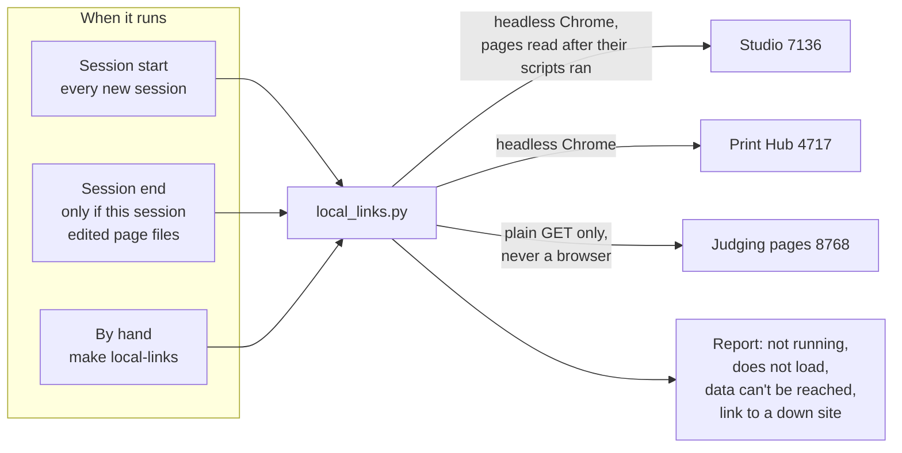

# Local link check: open the pages Omar opens, and count what is broken

**Status:** built (2026-11-13). The script is
`.claude/skills/check-local-links/scripts/local_links.py`, described in
[the skill page](../../../.claude/skills/check-local-links/SKILL.md). It runs at session start and,
after a session that changed page files, at session end, both wired in `.claude/settings.json`.
`make local-links` runs it by hand.

**Premise.** A small check that opens the local web pages Omar uses on this Mac, follows every
link between them, and counts the pages that are broken, so a broken page is found by the check
and not by Omar clicking it.

## 1. The problem

Omar works from three local web sites on his Mac:

- the **Studio** at `127.0.0.1:7136`, the always-on app that holds the design and print pages[^studio];
- the **Print Hub** at `127.0.0.1:4717`, the older pages for plates and judging prints[^hub];
- the **judging pages** at `127.0.0.1:8768`, the same Print Hub pages behind a comment server, where
  the links Omar is sent to judge a print point.

On 2026-11-13 he wrote: "lots of the links on pressing cant be reached (example
http://127.0.0.1:7136/judge) do we have a hook to go through and see how many broken links we have
at session end". The Studio's print pages had loaded, but each said "The print data can't be
reached from here", because the address behind them (`/api/print/...`) did not answer.

Every link check this repo had at the time reads files: the docs gate checks that a relative link
in a markdown file resolves on disk, and the pointer gate checks backticked paths. None of them
opens a running page. A page that is fine on disk and dead in the running app passed all of them,
and Omar found it by hand.

## 2. Why it matters now

The print pages are moving from the Print Hub into the Studio, one slice at a time. Each slice
adds pages that only work when two local servers talk to each other. Every move is a chance for a
link to point at a page that no longer answers, and the person who finds out is Omar, mid-task.

## 3. The idea

Do what Omar does, but for every link: start at each site's front page, open it the way a browser
would, collect its links, open those, and so on, up to a limit. Count three kinds of broken page,
and report a site that is not running once, not as one broken link per page.

## 4. Which sites it opens, and when

There is no user-facing page. The output is text: at session start it goes into the session, and
tells Claude to ask Omar whether to fix the problem this session or not; at session end it stops
the session once, with the count.

## 5. What it counts

| Kind | What the page did | Example |
|---|---|---|
| Does not load | answered 4xx or 5xx, or the connection failed | `/lab` answers 404 |
| Data can't be reached | loaded, but shows bikar's sentence "The print data can't be reached from here" | `/judge` on 2026-11-13 |
| Link to a down site | a link on a running site that points into one of the three sites while it is down | a hub page linking to `127.0.0.1:7136/judge` with the Studio off |

A site with nothing listening is reported once as "not running".

## 6. How it works

1. **Is each site running?** One GET to each front page. A refused connection marks the site as not
   running.
2. **Read each page.** Every page is fetched with a GET first, for its status. For the Studio and
   the Print Hub, an HTML page is then loaded in headless Chrome[^headless] and read after its
   scripts ran, because both draw their pages in the browser and a plain fetch sees only an empty
   shell. The judging pages are read from the plain GET only (see §8 for why).
3. **Follow the links.** Every `<a href>` on the read page that points at `127.0.0.1` or
   `localhost` is queued. The part after `#` is kept, because the Studio and the hub show a
   different plate for each one. Links to other local ports are checked once for status.
4. **Stop at the limit.** Each site stops at 300 pages by default (40 at session start, 80 at
   session end, to keep the hooks quick), and the report says when it stopped there.
5. **Log as it goes.** Every page, render and broken link is one `ev=` line with a UTC time and the
   process id, in `$TMPDIR/local-links/run.log`.

**Only GETs, nothing clicked.** On the Print Hub every write sits behind a button
(the files judge.ts and main.ts in 3d-model-hub's web/src folder, checked 2026-11-13), so loading a page
writes nothing.

**Session end only after a page edit.** The Stop hook reads the session's transcript and runs only
when an Edit or Write since its last run touched a file under bikar's `packages/web` or
`packages/lab`, or the hub's `web/`. It remembers how far it read, so the same edit does not stop
the session twice.

## 7. What it verifies

**Validator:** after a session start or a page edit, every link reachable from the three front
pages either loads without the "can't be reached" sentence, or is counted and shown.

- PASS: on 2026-11-13 the Print Hub (4717) and the judging pages (8768) were checked across 300
  hub pages and 5 judging pages, and every link loaded clean: 0 broken links.
- FAIL: the same day, the built Studio was served on 7136 without its print data, as on the day
  Omar found it. The check reported 13 broken links, among them the five print pages (`/judge`,
  `/plates`, `/printer`, `/printed`, `/words`) as "data can't be reached". The case that slipped
  past every file check is the one this run fails on.

The weak spot is the sentence itself. The check matches its first words ("can't be reached from
here"), so the second half can change, but a rewording of those words would turn the FAIL above
into a PASS while the pages stay broken. Repeat the FAIL run after any change to bikar
`packages/web/src/print/api.ts`.

The self-test (`--self-test`, run by `make local-links`) checks the link reader and the
transcript reader against fixtures. It does not start a server.

## 8. What it misses

- **The judging pages' drawn content.** The comment bar on 8768 writes each comment's found-or-lost
  state back to the repo when a page loads. A crawler that ran it in a browser would write, so 8768
  is read without running scripts, and only links in its raw HTML are followed. Most of its pages
  are the same pages the hub run reads in full.
- Links that appear only after a click, a typed value or a sign-in.
- Pictures, scripts and data calls. Only `<a href>` links are followed. A failed data call shows up
  only when the page turns it into the "can't be reached" sentence.
- Any other error a page shows in its own words.
- Pages past the limit a site.
- Links into other local servers (for example the Lab dev server) are checked for status only and
  counted as "does not load" when that server is off, which can be noise.

## 9. Alternatives

| Option | What it verifies | Cost | Why not chosen |
|---|---|---|---|
| Plain fetch of each route, plus a fetch of each `/api/print` address the page reads | that the routes and data addresses answer | fast, no browser | the list of data addresses a page reads lives in bikar's code and would be a second copy that drifts; it would not see what the page shows |
| **Headless Chrome for the Studio and hub, plain GET for 8768 (chosen)** | what the page actually shows after it ran | about 0.3 s a page, Chrome on the Mac | — |
| A browser driver (Playwright or similar) | the same, plus clicks | a new dependency to install and keep working | clicks are not needed for today's case; Chrome is already on the Mac |

## Glossary

[^studio]: The Studio is bikar's web app. bikar is the sibling repo that holds the pattern
    language and its engine.
[^hub]: The Print Hub is a small local web app in the 3d-model-hub repo, used to look at plates
    and judge finished prints.
[^headless]: Headless Chrome is Chrome run without a window. Asked to "dump the DOM", it loads a
    page, lets its scripts run for a few seconds, and prints the page as it then stands.
