# Who uses what, and one app for designing and printing

This doc says, for the whole 3D-printed coaster business, who the users are, which page or tool each one
uses, and what each one can and cannot do there. Since 2026-11-11 it also says how the pages for
designing patterns[^pattern] and printing them become **one application**: one address, one top bar, one
list of everything waiting on Omar (the owner, who designs, sells and prints), and a button for
every answer he gives.

> **Status:** draft, rewritten 2026-11-11. Two kinds of line sit side by side. **Today** lines
> say how things work now; most of them are built and in use, and the rows re-checked on
> 2026-11-11 say so. **Decided** lines say what Omar chose on 2026-11-11
> ([D-130](../../working-model/decisions-log.md#d-130--one-app-for-designing-and-printing-pages-in-bikar-every-answer-given-in-the-app)[^decision]),
> and none of that is built yet. The doc changes nothing by itself. Open calls for Omar are in
> [§12](#12-open-calls-for-omar).

## 1. The problem: pages that do not know about each other

**Two questions, a month apart, have the same root.** On 2026-10-08, deciding where the order
pages[^orderpages] should live, Omar asked "whats the difference between coaster lab and hub?" and "who is the
main user of the hub?". On 2026-11-11 he said the pages feel like "a disconnected system of
pages", and asked how to "unify into a single proper UX with use cases".

The first question was about **who each place is for**. Two partial answers existed. The
[order design](../coaster/order-driven-lab-design.md#5-context-who-uses-it-and-what-it-touches)
draws a customer, an owner and a print operator, but only for orders. The
[store design](../storefront/shopify-storefront-design.md#7-use-cases) draws a buyer and Omar, but
only for selling. They disagree on one point: the order design gives the Coaster Lab[^lab] an "Add
to order" button, and the store design an "Add to cart" button in a public build of the Lab.

The second question is about **how the pages hang together**. A survey of every page on
2026-11-11 ([research](../../research/one-app-page-survey-2026-11-11.md)) found:

- **Five front pages, joined only by the launcher[^launcher].** The Print Hub[^hub] home, the
  public gallery[^gallery], the docs vault's[^vault] README, bikar[^bikar]'s Studio[^studio] landing page
  and the Lab's own index page do not link to each other.
- **Designing and printing live in two codebases with two looks.** The pattern editor and the
  Coaster, Orb and Lego Labs[^labs] are in bikar. Plates, judging a print[^judge], the printed gallery and the
  print vocabulary are in the Print Hub repo.
- **Omar answers in two tools and three places.** He judges a print with buttons on the Print
  Hub. He says yes to a plate[^plate] by ticking a box on its page in Obsidian (the note-taking app the docs vault opens in). He answers design
  questions on other Obsidian pages. 28 plates waited for that yes on 2026-11-11 (how
  they were counted: [Appendix A](#appendix-a-what-was-read)), and the Print Hub could only tell
  him to go elsewhere to give it.
- **The judge page is a dead end.** Its only link is "Back to the Print Hub".
- **bikar keeps two page lists by hand,** and Coaster Lab and the print history are missing from
  the Studio site.
- **The use-case map[^ucmap] had no row** for judging a plate, saying yes to one, or answering a design
  question, though those are what Omar does most days.

## 2. Why now

- **Omar asked for it** on 2026-11-11, and chose the shape the same day (D-130).
- **The judging page just grew.** Omar can now leave a comment on each numbered piece in a plate's
  bed[^bed] picture (a change to the Print Hub opened 2026-11-11). It is the page he uses most, and it still leads nowhere.
- **The yes is the slowest step.** A plate cannot print without its yes
  ([D-093](../../working-model/decisions-log.md#d-093--omars-yes-to-a-send-lives-on-the-plate-page-one-per-send)),
  and the yes is the one answer with no button anywhere.
- **The store exists and is closed to buyers** (created 2026-10-05,
  [D-102](../../working-model/decisions-log.md#d-102--the-stores-first-setup-basic-plan-priced-by-finish-set-and-colors-etsy-later)).
  Before it opens, every person who can reach each page should be written down. That was the
  first reason for this doc, and it still holds.

## 3. The idea: a shop front, a back office and a workshop, with one app in the back office

Think of a small shop. **The shop front** is open to anyone: the store, the public Coaster Lab and
the gallery. **The back office** is Omar's alone: the pages he designs and decides in, and the
tools. **The workshop** is the printer, on his home network. Things cross between rooms only
through a few fixed doors:

1. **A share link[^sharelink]** carries a design from the shop front to the back office. It holds
   the pattern, its settings and its colors, and nothing about the person.
2. **The back office pulls; nothing pushes into it.** The back office fetches new store orders.
   No page on the internet can call it.
3. **Nothing reaches the workshop without Omar's yes for that send[^send].** A Claude session[^session] can
   run every step up to the send, and the send itself only on his word.

**What changes on 2026-11-11 is the back office.** Today it is a pile of separate places. Decided:
it becomes **one app**[^app], like a workbench with drawers. The top bar is the same on every page:

> Home · Design · Print · Learn ↗ · Check ↗ · **Waiting on you (n)**

- **Home** opens on the **Waiting list**[^waiting]: everything that needs Omar's answer, each row
  with the button to give it right there.
- **Design** holds the pattern editor and the Labs.
- **Print** holds the printer, the plates, judging and the printed record.
- **Learn** and **Check** are links out to the video study pages (the youtube repo) and the
  pattern checking pages (qiyas[^qiyas]), which stay where they are.

Two rules carry the idea:

1. **bikar holds all the pages.** The Print Hub keeps only its server: printer state, plates and
   the queue, saving answers, opening pull requests[^pr].
2. **Every answer is given in the app.** Judging, saying yes to a plate and answering a design
   question are all buttons. Each answer is saved word for word into the same markdown pages as
   today, through a pull request. Obsidian becomes a place to read.

Four kinds of user move through the rooms: the **customer**, the **owner**, the **print
operator**, and a **Claude session** doing work for the owner. Today the owner and the print
operator are the same person, Omar. They are drawn apart because they act at different times, and
because a helper at the printer would take one role and not the other.

### A worked example: one order

A buyer wants four gBV coasters[^gbv] in the Ice to navy theme[^theme], with a gold middle piece.

1. **Customer, shop front.** They open the Lab from the store's product page, make the middle piece
   gold, and press Add to cart. Shopify takes the payment. *(Decided 2026-10-08, not built: the
   store is closed and the Lab's store version, which hides its developer controls, does not exist
   yet.)*
2. **Owner, back office.** The order is pulled, its colors checked against the ones we sell, and
   an order file written into Omar's private iCloud folder. Omar opens it and sees the plates, the
   minutes and the filament[^spool]. *(The planning command is built. The order pages and the store pull
   are not. Where the order pages live is [call 3](#call-3-where-do-the-order-pages-go).)*
3. **Claude session, back office.** It ranks the order's plates beside the experiments waiting,
   writes each plate's page, and asks Omar for a yes on each one. *(Built for experiment plates[^grade].
   Today Omar ticks a box in Obsidian; decided: he presses Yes on the plate's row in the Waiting
   list.)*
4. **Print operator, workshop.** Omar puts the plate on the bed and loads the spools. The session
   looks at the bed photo, matches the gold to a loaded spool and asks about any color that does
   not match, then sends on his go. *(The send and the bed look are built. Matching colors at print
   time is decided and not built.)*
5. **Session, then operator.** The session watches the print and reports a pause or a stall.
   Resuming or stopping is Omar's alone. When it ends, the plate shows up in the Waiting list to
   judge, Omar judges the pieces, and the session writes the print record[^record]. *(Judging is
   built on the Print Hub's judge page; decided: the same page, moved into the app.)*

### A worked example: one sitting

Omar opens the app on his phone. The count at the end of the top bar says **Waiting on you (5)**.

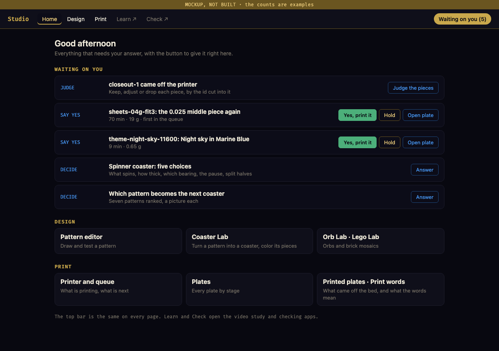

*Mockup, not built. Drawn with bikar's real colors and fonts. The plate names are real plates from
the queue on 2026-11-11; the count and the times are examples.*

He judges the plate named closeout-1 piece by piece, presses **Yes, print it** on a second plate,
and leaves a design question about a spinning coaster for later. Each answer opens a pull request that writes it into the page
it belongs to. A Claude session picks the yes up from there, as it picks up a ticked box today.

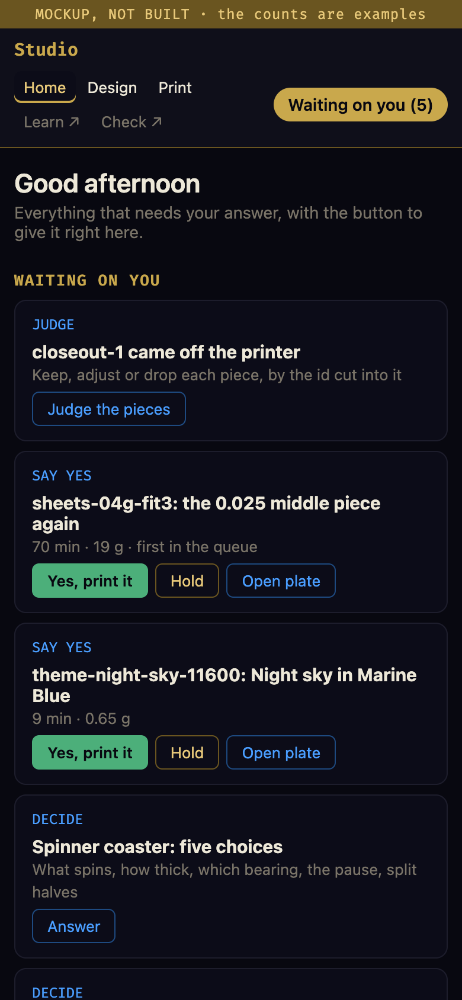

## 4. The people

| Role | Who, today | What they do | What they never do |
|---|---|---|---|
| **Customer** (buyer) | Anyone on the internet | Design a coaster in the Lab, buy in the store, send a share link for a quote | Reach the app, the docs vault or the printer; see a price setting or another buyer |
| **Owner** | Omar | Designs patterns and sells; decides open calls; says yes or hold to each plate; plans and prices orders | The owner can do anything; the rules below are what he set for the others |
| **Print operator** | Omar | Loads spools and plates, watches the printer, resumes or stops it, judges the pieces | Send a plate without a yes for that send |
| **Claude session** | A Claude Code session on Omar's machine | Runs the skills[^skill] and tools: ranks plates, writes pages, slices[^slicing] them, sends on his go, watches prints, writes records, changes the tools through pull requests | Write a yes Omar did not give; press a button in the app for him; resume, stop, pause or swap a print; change any printer setting except the two plate switches; put anything private in this public repo |

The Claude session's limits are written rules, not habits. Each send needs its own yes, recorded
on the plate page (D-093). The two plate switches (the printer's checks for a stray object on
the bed and for the plate's type, turned off for a plate that is not Bambu's own[^x2d]) are the one printer setting it may change without asking, and
only to fit the plate the bed photo shows
([D-108](../../working-model/decisions-log.md#d-108--the-two-plate-switches-follow-the-bed-photo-set-by-claude-at-the-sends-bed-look)).
Resuming, stopping, pausing and swapping are Omar's
([monitor-print](../../../.claude/skills/monitor-print/SKILL.md)).

**A written rule is not a lock.** Decided: the Yes button lives on a server with no login of its
own. Any program on Omar's machine that can reach that server could post a yes, a Claude session
included. "A session never writes a yes Omar did not give" stays the rule, and the button adds
guards (it names the plate, its version and its color, asks for a second press, and is refused if
the page changed since). Whether it should also need Touch ID is
[call 2](#call-2-should-the-yes-button-need-touch-id).

The order design also names a **developer**, who runs the made-up test orders before a change
merges. Today that is a Claude session or Omar, so it is not a separate row here.

## 5. The rooms and what crosses between them

The context diagram: the one app in the middle of the back office, with everything it talks to.

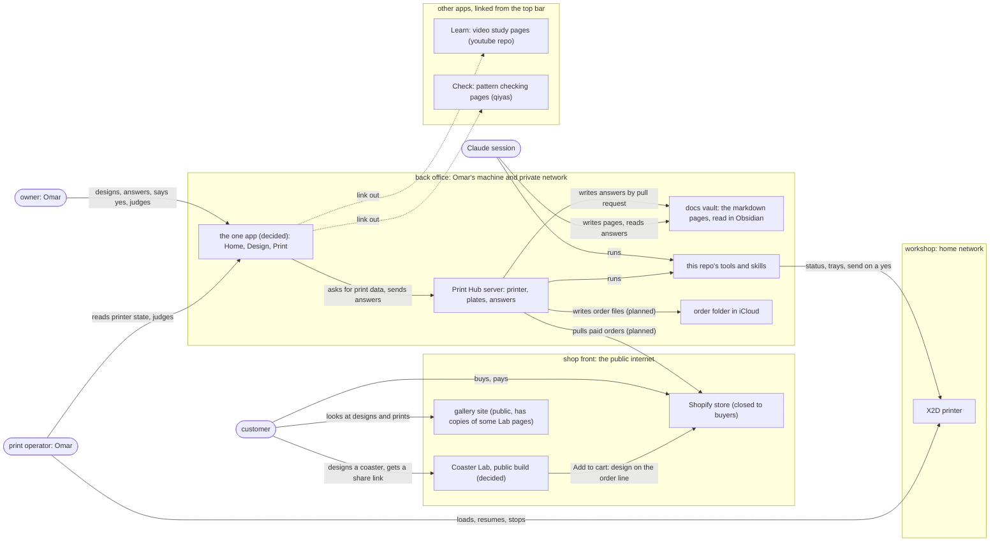

**In the diagram:** the one app[^app]; Print Hub server[^hub]; Coaster Lab[^lab]; share
link[^sharelink]; gallery[^gallery]; docs vault[^vault]; skill[^skill]; X2D[^x2d]; send[^send].

Read it left to right as rooms. Nothing in the shop front has an arrow into the back office: the
back office pulls from the store, never the other way. The only arrow into the workshop comes from
the tools, and a send down it needs Omar's yes. **The app has no arrow to the printer.** It talks
only to the Print Hub server, and the server has no send route.

**Today, before any of this is built,** the back office has two web apps instead of one: bikar's
Studio for designing (behind the team login on bikar's hosts, and on this Mac in dev), and the
Print Hub, on Omar's private network, for printing. Omar ticks yes and answers design
questions in Obsidian.

## 6. Use cases

"Built" means it works today. "Decided" means Omar chose it and it is not built yet. "Planned"
means a design describes it and nothing is decided or built.

### 6.1 Omar's journeys through the one app

These are the journeys the app is built around. Each becomes a row in the
[use-case map](../../../.claude/skills/maintain-use-cases/use-cases.md) when it ships; judging is
already shipped, so it is in the map now as UC35.

| # | Journey | Pages, in order | Where the answer is kept | Today |
|---|---|---|---|---|
| 1 | Draw a pattern | Home → pattern editor | the pattern store[^store] | Built, in bikar's Studio |
| 2 | Work a pattern back from a photo | the photo tracing pages[^tracing] | the tracing folder | Built, in bikar's Studio |
| 3 | Design a coaster | Coaster Lab | the share link | Built; not on the Studio site |
| 4 | Explore an orb or a brick mosaic | Orb Lab, Lego Lab, the breakdown page[^breakdown] | the link | Built |
| 5 | See what waits on me | Home | — | Partly: the Print Hub's plates page has a "Waiting on you" box for plates only |
| 6 | Decide which plate prints next and say yes | Waiting → Plates → one plate | an Approvals row on the plate page, by pull request | A tick box in Obsidian |
| 7 | Judge a finished plate | Waiting → Judge | the Judged table on the plate page, by pull request | Built, on the Print Hub's judge page |
| 8 | Answer a design question | Waiting → Design questions | the tick and notes on the question page, by pull request; the session writes the decisions log | Tick boxes in Obsidian |
| 9 | Check the printer | Printer and queue | — | Built, on the Print Hub |
| 10 | Look back at prints | Printed plates, print history | — | Built, in two places |
| 11 | Look up a print word | Print words | — | Built, on the Print Hub |
| 12 | Study a tutorial or check a pattern | Learn ↗, Check ↗ | in those apps | Built, as separate apps |

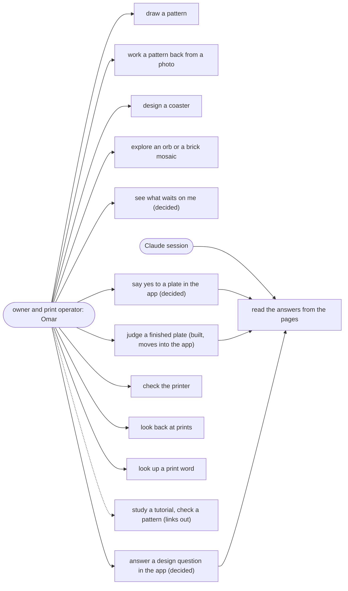

**In the diagram:** plate[^plate]; Waiting list[^waiting]. A dotted line is a link out of the app.

### 6.2 The customer

| Use case | Where | State |
|---|---|---|
| Design a coaster and get a share link | Coaster Lab (the gallery copy today) | Built |
| Look at designs and past prints | Gallery | Built |
| Buy a color theme from a product page | Shopify store | Decided, store closed |
| Design a custom coloring and add it to the cart | Coaster Lab in the store's product page | Decided, not built |
| Send a share link for a quote or a large order | By message to the owner, then a Shopify draft order[^draft] | Planned ([call 1](#call-1-once-the-store-opens-can-a-customer-still-order-by-sending-a-link)) |
| Get order, shipped and tracking emails | Shopify | Decided, store closed |

None of these change with the one app: the customer never sees it.

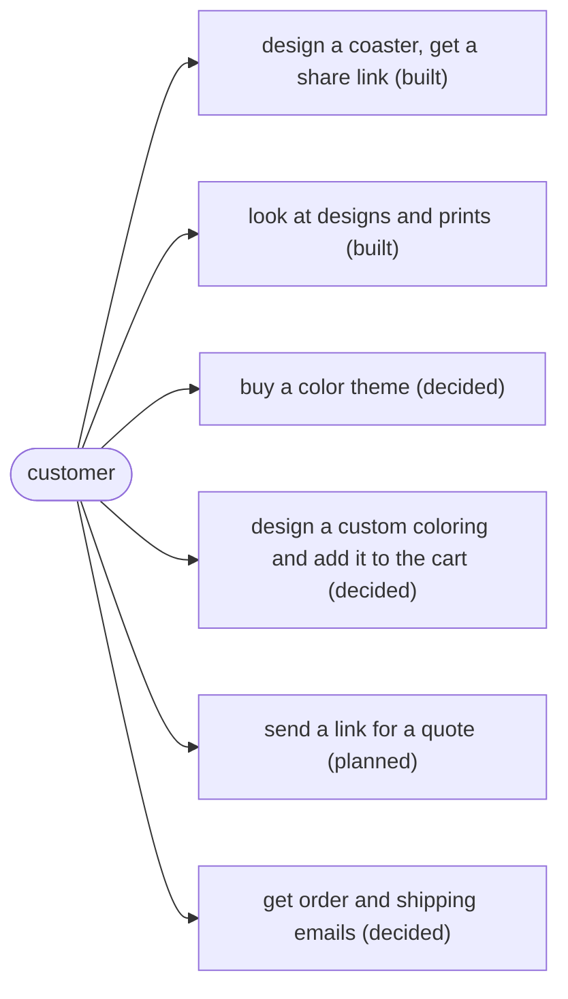

**In the diagram:** share link[^sharelink]; color theme[^theme].

### 6.3 The owner

| Use case | Where today | Where, decided 2026-11-11 | State |
|---|---|---|---|
| Decide open calls | Ticks and notes on a calls page in the docs vault | The Design questions page in the app | Today built; the app page decided |
| Say yes or hold to a plate | A tick box on the plate page in Obsidian, or in chat | Yes and Hold buttons in the app; chat still counts ([call 6](#call-6-does-a-yes-said-in-chat-still-count)) | Today built; buttons decided |
| Pick color themes for a coaster | Theme pages in the docs vault | Unchanged for now | Built |
| Plan an order: plates, minutes, filament by color | `bambu order plan`[^bambu] | Order pages, place still open ([call 3](#call-3-where-do-the-order-pages-go)) | Command built |
| Price an order | `bambu order price` | Same | Command built with every price setting empty |
| Check filament on hand and get a buy list | `bambu shelf show` | Same | Command built |
| Add a design to an order by its share link | — | Same | Planned |
| See paid store orders, with their colors | — | Same | Planned |
| Set store prices and retire a theme | Shopify admin | — | Planned |

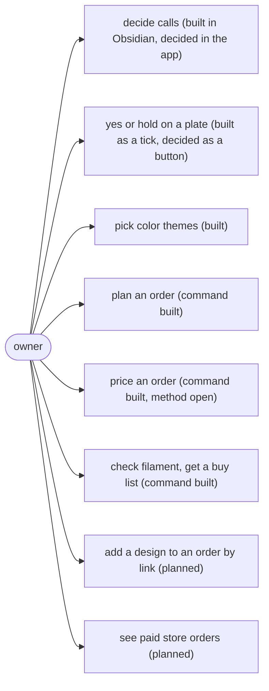

**In the diagram:** plate[^plate]; color theme[^theme].

### 6.4 The print operator

| Use case | Where | State |
|---|---|---|
| See the printer's state and the list of past prints | Print Hub today; Print in the app, decided | Built |
| Put a plate on the bed and load the spools | At the printer | Built |
| Pick the plate's color at the send | The send, by the session, on the operator's word | The send is built. "Always at the send" was decided 2026-10-08; a single-color plate can still carry its color in its recipe[^recipe] |
| Resume, stop, pause or swap a print | At the printer, or on his word in chat | Built, and his alone |
| Judge the pieces: keep, adjust or drop, with a note, and a comment on any numbered piece in the bed picture | The Print Hub's judge page today (comments per piece: a Print Hub change opened 2026-11-11); the judge page in the app, decided | Built |
| Answer a plate's after-print questions, one at a time | The judge page, which shows each question beside the pieces it asks about | Built since 2026-10-22 (re-checked 2026-11-11: the judge-page skill opens them) |

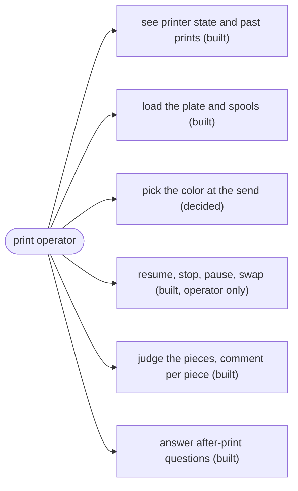

**In the diagram:** send[^send]; plate[^plate].

### 6.5 The Claude session

This is the print loop, in the order a plate moves through it, plus the work around it.

| Use case | Skill | State |
|---|---|---|
| Rank the plates waiting and keep each plate's page current | [prioritize-prints](../../../.claude/skills/prioritize-prints/SKILL.md) | Built |
| Put open calls on a page with pictures and tick boxes, and read the ticks back | [request-feedback](../../../.claude/skills/request-feedback/SKILL.md) | Built. Decided: the same pages, answered from the app |
| Record a yes or hold Omar gave; reset it when the recipe changes | [manage-approvals](../../../.claude/skills/manage-approvals/SKILL.md) | Built. Decided: the button runs the same script |
| Check the yes, slice it, check the printer is idle, look at the bed photo, set the two plate switches, send | [send-plate](../../../.claude/skills/send-plate/SKILL.md) | Built |
| Match a design's colors to the loaded spools at print time | send-plate, with a read-only printer service | Decided 2026-10-08, not built |
| Watch the print, a picture every 10 minutes, report a pause or a stall | [monitor-print](../../../.claude/skills/monitor-print/SKILL.md) | Built |
| Get a finished plate ready to judge and give Omar the link | [judge-page](../../../.claude/skills/judge-page/SKILL.md) | Built |
| Write the print record, a verdict per piece | [review-print](../../../.claude/skills/review-print/SKILL.md) | Built |
| Grade the plate: experiment, repeatable or production | [grade-plate](../../../.claude/skills/grade-plate/SKILL.md) | Built |
| Change the tools, run the checks, open pull requests | — | Built |

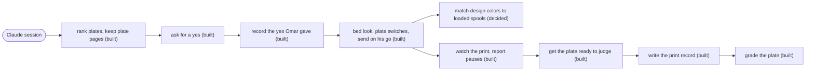

**In the diagram:** skill[^skill]; plate[^plate]; send[^send]; print record[^record].

## 7. What Omar sees: the app's pages

This is the user-facing surface. **The app** is bikar's Studio[^studio], grown to hold every page
below, at one address on this Mac (and on his phone over his private network). "Studio"
afterwards means only the whole app.

**New:** the top bar on every page, the Home page's Waiting list, Yes and Hold buttons on a plate,
and a Design questions page. **Moved:** every Print Hub page. **Removed:** the Lab's own index page,
the Print Hub's own pages (its server stays), and the tick boxes on plate pages once the button
works.

| Page | Where it is today | In the app (decided) |
|---|---|---|
| Home, the Waiting list on top | bikar's Studio landing page, with no Waiting list | `/`, the first thing on it |
| Pattern editor and the Studio's other pattern pages[^studiopages] | bikar's Studio | Unchanged, under Design |
| Orb Lab, Lego Lab and the Lab's notes pages | bikar's Lab, copied into the Studio site | Unchanged, under Design |
| Coaster Lab, print history | bikar's Lab, not copied in | Added, under Design and Print |
| Printer and queue, Plates, One plate, Judge a print, Printed plates, Print words | The Print Hub | Under Print, with the same file names so links and comment threads keep working |
| Design questions | Obsidian pages in [feedback-requests](../../working-model/feedback-requests/) | A new page under Design |
| The video study pages, the checking pages | The youtube repo and qiyas | Not moved: Learn ↗ and Check ↗ in the top bar, each with a link back |

**The Waiting list** is one part of the page, used on Home and as the count in the top bar. Its
rows: plates to judge, plates waiting for a yes, open design questions, and comments where a
session asked Omar something. Each row opens a page with the buttons, or carries them itself.

**The surfaces outside the app** stay as they are:

| Surface | Runs where | Who can reach it | What it is for | What it never does | State |
|---|---|---|---|---|---|
| **Coaster Lab** | In the browser; served from bikar's hosts | Team login on bikar's hosts. A copy is public on the gallery. A public store build is decided | Design a coaster: pattern, knobs, piece colors; the share link | Send to the printer. The printer picker's choice stays in the browser and is never put in a share link | Built. The store build, with a store mode that hides the code, the file downloads, the printer picker and the print history, is decided and not built |
| **Gallery** | This repo's public site | Anyone | Show the designs, the print history, and copies of some Lab pages | Hold a secret or an order; show a print page | Built. It links the Lab's index page today (re-checked 2026-11-11), which changes when that page goes |
| **Shopify store** | Shopify | Anyone, once open | Product pages, cart, checkout, order emails | Know the plates or the printer | Created 2026-10-05, closed to buyers; the [launch checklist](../../../.claude/skills/launch-store/checklist.md) tracks what is left |
| **Print Hub server** | Omar's own computer, served on his private network | Devices on his private network. It has no login of its own | Printer state, plates and the queue, saving answers by pull request. Decided: nothing else, once its pages move | Answer the internet; send a plate | Built, with its own pages today |
| **Docs vault** | This repo's docs, opened in Obsidian | Omar and Claude sessions on his machine; the files are public on GitHub | Today: calls pages with tick boxes, plate pages with their Approvals table, comments on any doc. Decided: the same pages, answered from the app, read in Obsidian | Hold anything private: the repo is public | Built |
| **Tools and skills** | A terminal on Omar's machine | Omar and Claude sessions | The `bambu` command (status, trays, slice, send, watch, order plan, order price, shelf), the plate tools, and the skills that string them together | Run from a web page, except the approval script the Yes button runs (decided) | Built |
| **X2D printer** | Omar's home network | The tools, with a pinned certificate and an access code; Omar at the machine | Print | — | Built |
| **The launcher** | Omar's machine | Omar | One page listing every repo's pages, across all his projects | — | Built. **Not touched by this design**, by Omar's word |

## 8. The pieces and where they live

### 8.1 Who owns what

The app (bikar) owns every page. The Print Hub repo owns the server and nothing a person looks at.
This repo owns the pages answers are written into, and the scripts that write them. Learn and Check
stay in their own repos and are not drawn.

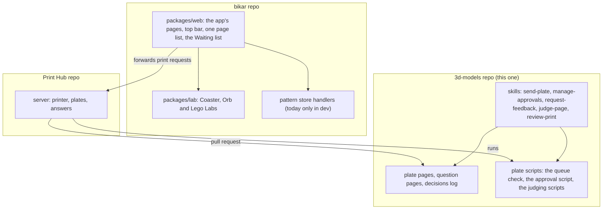

**In the diagram:** Print Hub server[^hub]; Waiting list[^waiting]; pull request[^pr]; skill[^skill].

### 8.2 The data an answer touches

Nothing new is stored. Every answer lands in a markdown page that already exists; the app only
gives it a button.

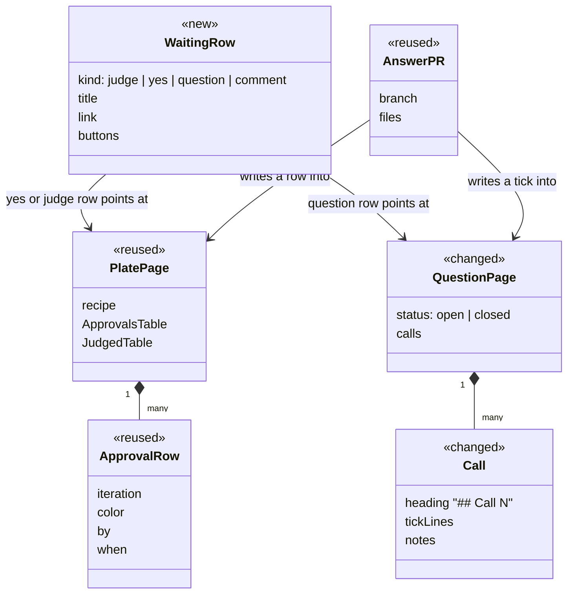

**In the diagram:** WaitingRow is one row of the Waiting list[^waiting]; PlatePage is a plate's[^plate]
page; ApprovalRow is one yes for one send; QuestionPage is a page of design questions, and a Call is
one question on it; AnswerPR is the pull request[^pr] an answer opens. The tag on each box says
whether it is new, changed or reused as it is.

| Type in the diagram | New, changed or reused | Why |
|---|---|---|
| WaitingRow | New | One shape for every kind of waiting item, so the list and the count in the top bar share it |
| PlatePage (its JudgedTable field included) | Reused | The judge page already writes the Judged table; nothing about the page changes |
| ApprovalRow | Reused (D-093, D-096, D-097) | The button writes the same row the script writes today |
| QuestionPage | Changed | Gains an open or closed status, so the app can list only the open ones |
| Call | Changed | One fixed shape for every question, so the app and Obsidian read the same thing (exact shape in Appendix B, slice 5) |
| AnswerPR | Reused | Judging already saves this way |

## 9. How it works

### 9.1 Where the app runs

The app runs on Omar's Mac all the time, and he can reach it from his phone over his private
network. The public sites never get the print pages. In detail:

| Where | Pages | Pattern store | Print data |
|---|---|---|---|
| This Mac, always on | bikar's built pages | files on this Mac, read by the same server code bikar uses while developing | passed on to the Print Hub server |
| This Mac, while developing | bikar's development server | the same files and code | passed on to the Print Hub server |
| Phone, on the private network | the always-on address, shared to the private network | same | same |
| bikar's hosted site, behind the team login | bikar's web host (Cloudflare) | the host's server code over bikar's online database | not reachable: the print pages say so and name the address that works |
| The public gallery | only the Lab pages this repo's build copies in | none | none, and a test fails the build if a print page or a private address leaks in |

**Why bikar serves the app and not the Print Hub:** served from the Print Hub, the pattern editor
would look as if it works and silently lose every save. The reason (re-checked 2026-11-11): the
editor asks the pattern store for its list when it opens. When that fails it keeps the built-in
starter patterns and says nothing on the page, and a failed save is only a console warning. The
Print Hub has no pattern store to give it. ([research, "Checked by hand" item 2](../../research/one-app-page-survey-2026-11-11.md#checked-by-hand-afterwards-2026-11-11).)

### 9.2 How one yes travels

A Yes press goes through the same script a Claude session uses to record a yes today, and it only
counts once its pull request is merged.

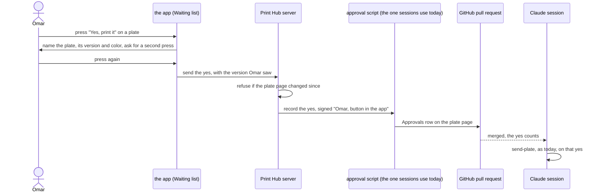

**In the diagram:** the app[^app]; Waiting list[^waiting]; Print Hub server[^hub]; pull
request[^pr]. A yes counts only once its pull request is merged; who merges it is
[call 4](#call-4-who-merges-a-yes-and-do-yeses-go-in-one-batch).

Judging already travels this way today, from the Print Hub's judge page. A design question
answer travels the same way, into its question page, and the session then writes the decisions log
as it does now.

### 9.3 One order, end to end

The order example from §3 as a sequence, with each step's room. The store path is drawn. A design
that comes in by message instead joins at the "add to order" step.

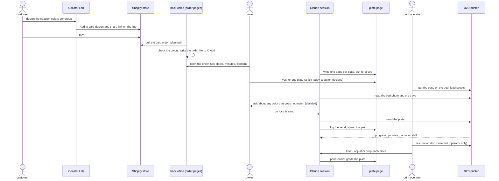

**In the diagram:** Coaster Lab[^lab]; share link[^sharelink]; plate[^plate]; send[^send]; print
record[^record].

### 9.4 Judging keeps working throughout

Until the judge page moves, nothing Omar uses moves. When it moves, the old Print Hub addresses
redirect to the new one, so a link in an old message still lands on the right plate. If bikar's
build is missing or stale, the always-on app says so on the page; it never shows a blank one.

## 10. Where secrets and private data live

The repo this doc sits in is public, and so is the gallery. Everything private sits in the back
office or with Shopify. The one app changes none of this: it holds no secret, and the print data
it shows comes from the Print Hub server on the private network.

| What | Where it lives | Who can read it |
|---|---|---|
| The printer's access code | On Omar's machine, in this repo's encrypted settings file, which is never committed. The `bambu` tools decrypt it. The Print Hub's README says both that it holds the code server-side and that it holds no secret of its own because the tools decrypt this repo's file; either way it stays on Omar's machine and never reaches a browser | The tools, run by Omar, a session or the Print Hub server |
| Store keys and the order-event secret | coffee-house-storefront's encrypted settings | The store's tools |
| The Coaster Lab and the app's pages | No secret at all: they run in the browser | Anyone they are served to |
| bikar Studio's keys | bikar's encrypted settings | The team |
| Orders and the reference to each customer | An iCloud folder outside every repo ([D-101](../../working-model/decisions-log.md#d-101--orders-never-go-in-this-repo-they-live-in-an-icloud-folder)) | Omar's devices |
| Labor rate, markup, quotes | The back office | Omar |
| Pattern sources | bikar, a private repo | The team |
| Plate recipes, print records, calls and decisions, this doc | This repo | Anyone |

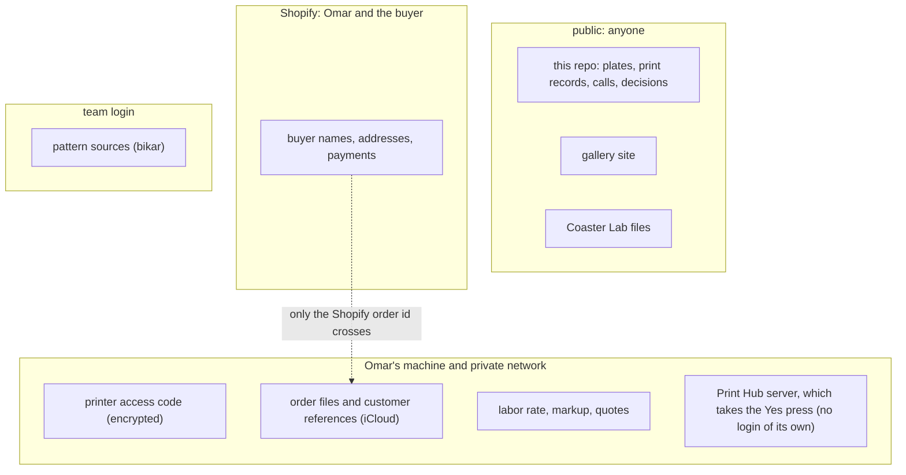

**In the diagram:** Coaster Lab[^lab]; gallery[^gallery]; Print Hub server[^hub].

The one dotted arrow is the only thing about a person that leaves Shopify: the store design keeps
just Shopify's order id, and reads no name or address in the back office.

**The private network is the only lock on the app.** The Print Hub server and the app have no login
of their own, so anyone signed in to Omar's private network can judge, answer, and press Yes. Today
that network is his own devices. A second person at the printer would need a login first. The Yes
button sharpens this, which is why [call 2](#call-2-should-the-yes-button-need-touch-id) asks
about Touch ID.

## 11. The options, and why pages in bikar

Four ways to join the pages were weighed on 2026-11-11. Each is scored on the five questions in
the [design standard](../../../.claude/skills/design-craft.md#evaluating-options).

| | **Pages in bikar, the Print Hub keeps its server (chosen)** | Pages served from the Print Hub | One shared shell around both apps | Links only |
|---|---|---|---|---|
| **Is there a better version of it?** | This is the better version of "move everything": it moves the pages and keeps the server where the printer code already is | Its better version is this one: the Print Hub cannot serve the pattern store, so the pages have to come from bikar | Its better version is the launcher, which already exists; Omar ruled out changing it now | Its better version adds a top bar to both apps, which is half of the chosen one without the Waiting list |
| **Pros** | One codebase, one look, one page list; answers become buttons; the editor keeps its pattern store | Print pages stay next to their server | Neither repo's pages move | Almost nothing to build |
| **Cons** | Six slices[^slice] of work across three repos; the plates-and-feedback session's daily pages move under it | The editor would silently lose every save (§9.1) | Two looks, two page lists, one more process to keep up; Omar said no to a shared shell across domains (2026-11-04) | Still two looks, two lists, and answers still in Obsidian |
| **This quarter** | Slice 2 moves the judge page, the one Omar uses most; old addresses must redirect | The editor's lost saves show up on the first day | A new process to build and keep running, against the launcher's 2026-11-04 ruling | Nothing blocks, and the yes stays a tick box in Obsidian |
| **Long term: what we own** | We own the app in one place; the Print Hub becomes a small server | Two places to fix every page | A third thing to own | Nothing joins; the next survey finds the same gaps |
| **What it verifies** | Each answer is written by the same script the session uses today, so its checks still run; every slice has a browser check at 1280 and 390 px and a test that no print page leaks onto the public gallery | That the pages load; nothing about saving a pattern | That the shell loads | Nothing: it is named here as the do-little option, not offered as the default |

**Recommendation, as Omar chose:** pages in bikar, because it is the only option that both keeps
the editor working and gives every answer a button.

### Older decisions this touches

| Decision | What happens to it |
|---|---|
| bikar, 2026-08-07: the Lab keeps its own index page as a separate way in | Reversed. One page list; the Lab index is deleted |
| The Print Hub's own plate-hub design: plates read on the hub, a Yes button on the hub (its slice 5, never built) | Replaced. The pages and the Yes button are built in bikar; the server half stays |
| [D-067](../../working-model/decisions-log.md): Coaster Lab lives in bikar, the hub is the plate builder | The first half stands. The plate pages move to bikar; the server stays in the Print Hub repo |
| [D-112](../../working-model/decisions-log.md#d-112--the-order-pages-live-in-the-hub): order pages (Plan, Price, Stock) go in the hub | Open, as [call 3](#call-3-where-do-the-order-pages-go) |
| D-093, D-096, D-097: one yes per send, recorded as a row on the plate page, reset by an edit | Stand. Only the way the row gets written changes: a button, not a tick |
| The launcher's own decision, 2026-11-04: no single process hosting every repo's pages | Untouched. This joins two repos' pages by moving them into one codebase, not by a shared shell |

## 12. Open calls for Omar

None of these block the first slice (one page list and one top bar). Each is asked again, with
pictures, before the slice it touches.

### Call 1: once the store opens, can a customer still order by sending a link?

*Open since 2026-10-08, unchanged by the one app.*

The store design gives the public Lab an Add to cart button. The order design gives the owner's
own Lab an Add to order button, for designs that arrive by message. Both can be true at once, or
the store can be the only door.

| | **Both: the store for buyers, a link by message for quotes (recommended)** | The store only | Links by message only, until the store opens |
|---|---|---|---|
| Pros | Large and unusual orders, which the store design already prices as Shopify draft orders, have a way in; a friend or a café can still send a link | One door, one checkout, one set of order emails | Nothing to build in the store before an order can come in |
| Cons | Two ways in to keep in step; an Add to order page has to exist as well as the store pull | A quote or a two-dozen order has to fit a product page | Payment and the address are chased by hand |
| Implications | The order pages take orders from both, and an order from a link carries no Shopify id until its draft order is made | The Lab's Add to order button and the owner-side order entry are dropped from the order design | The store pull waits; the order pages are fed by hand first |
| What it verifies | Each order, either way in, is checked against the colors we sell | The same check, through one way in | Nothing about the customer's colors until Omar retypes them |

**Pick both**, because the store design already plans quotes as draft orders made from the
pricer, and that needs a way for a design to reach the back office without a cart.

- [ ] Both: the store for buyers, a link by message for quotes (recommended)
- [ ] The store only
- [ ] Links by message only, until the store opens
- Notes:

### Call 2: should the Yes button need Touch ID?

The server has no login, so a program on this Mac could post a yes (§4, §10). **Suggested:** ship
the guards in slice 4 (names the plate, version and color; a second press; refused if the page
changed), and ask this as a real question with pictures before slice 4 starts. Touch ID would make
the yes something only Omar's finger can give, at the cost of a step on every yes and no yes from
the phone without its own check.

### Call 3: where do the order pages go?

D-112 put Plan, Price and Stock in the Print Hub. With its pages moving, **suggested:** pages in the
app under Print, their data from the same server. D-112's reason (private, on the private network,
reading the iCloud folder) still holds that way, since the server stays where it is.

### Call 4: who merges a yes, and do yeses go in one batch?

A yes counts only once its pull request is merged. **Suggested:** one pull request per sitting, all
the yeses pressed together, merged by the session that owns plates, as judging answers are today.

### Call 5: does the launcher's health check for the Print Hub change?

The launcher checks the Print Hub is up by calling one of its addresses. When the Print Hub's
addresses move (slice 2), that check must move in the same change, or the launcher shows it as
down. The file that says so belongs to the Print Hub repo, not to the launcher (the detail is in
slice 2 of [Appendix B](#appendix-b-build-order)), so the suggestion is to change it in slice 2. Adding or removing a launcher card stays held until Omar says so.

### Call 6: does a yes said in chat still count?

**Suggested:** yes, written by the same script into the same row, as it is today.

### Call 7: the 2026-10-06 calls page has 23 ticks and no decided line

**Suggested:** read it back with `request-feedback` before slice 5 (design questions in the app),
then close it, so the first Design questions page does not open on a backlog.

## 13. What this doc is not

It names who uses what, and the shape of the one app. How each part works is in its own doc:

- **Orders, the shelf and the price:** [order design](../coaster/order-driven-lab-design.md).
- **The store:** [store design](../storefront/shopify-storefront-design.md), and
  coffee-house-storefront's own design, which hosts the public Lab.
- **Piece colors and plates by color:** [piece colors design](../coaster/infill-color-ux-design.md).
  Matching design colors to loaded spools at print time is in the
  [print-time color map design](../coaster/print-time-color-map-design.md).
- **The print loop:** the skills in [§6.5](#65-the-claude-session), and the plate pages in
  [docs/design/plates](../plates/).
- **Each slice of the one app:** its own pull request, with its own checks, in the order in the
  [appendix](#appendix-b-build-order).

## Glossary

[^app]: **the one app** — bikar's Studio, grown to hold every page for designing and printing,
    with one top bar and one address on Omar's machine. Decided 2026-11-11, not built.
[^waiting]: **Waiting list** — the list of everything that needs Omar's answer (plates to judge,
    plates waiting for a yes, design questions, comments asking him something), at the top of the
    app's Home page and counted in the top bar.
[^lab]: **Coaster Lab** — the web page, built in bikar, where a coaster is designed: pick a
    pattern, change its settings (size, spacing, thickness, called knobs), color its pieces, and see it in 3D. It runs entirely in the browser.
[^sharelink]: **share link** — the Coaster Lab's address for one design: the pattern, every knob
    changed from its default, and the colors. It never carries the printer choice.
[^hub]: **Print Hub** — the 3d-model-hub repo: a small server on Omar's own computer, reached only
    from devices on his private network (Tailscale, a service that links one person's devices). It
    knows the printer, the plates and the queue, and saves answers by opening pull requests. Today
    it also has its own pages; decided, those move into the app and it keeps only the server.
[^launcher]: **launcher** — one page on Omar's machine that lists the pages of every repo he works
    in, each from that repo's `hub.yaml`. This design does not change it.
[^gallery]: **gallery** — this repo's public website: the designs, the print history and copies of
    some Lab pages.
[^studio]: **Studio** — bikar's web app for writing and testing patterns, behind a team login on
    bikar's hosts. Decided: it becomes the one app, and the name means only that.
[^vault]: **docs vault** — this repo's `docs/` folder opened in Obsidian, a note-taking app. Calls
    pages, plate pages and comments live there. Decided: read there, answered in the app.
[^pr]: **pull request** — a proposed change to a repo on GitHub, merged by a person or session
    before it counts. Answers given in the app are saved this way, as judging answers already are.
[^skill]: **skill** — a written procedure a Claude session follows for one job, kept in this
    repo's `.claude/skills/`, with its own scripts.
[^x2d]: **X2D** — the Bambu Lab printer these coasters print on. Bambu Lab makes it, and its own
    build plates are called Bambu plates.
[^bed]: **bed** — the flat plate inside the printer that pieces are printed onto.
[^pattern]: **pattern** — a geometric tile design, drawn in code, that is cut or printed into a
    coaster.
[^tracing]: **photo tracing pages** — bikar pages (named "sessions" in its code) where a pattern
    is worked back step by step from a photo of a real design; each attempt is saved in a folder.
[^breakdown]: **breakdown page** — a bikar page that shows an orb's pattern built up step by step,
    from flat drawing to ball.
[^bambu]: **bambu** — this repo's command-line tool that talks to the printer and plans and
    prices orders. Named after the printer's maker.
[^judge]: **judging a print** — after a plate prints, Omar looks at each piece and marks it keep,
    adjust or drop, with a note; the verdicts are saved to the plate's page.
[^slicing]: **slicing** — turning a 3D shape into the layer-by-layer instructions the printer
    follows; done just before a send.
[^store]: **pattern store** — where the pattern editor saves and lists patterns; on this Mac, files
    read by server code that only bikar runs.
[^recipe]: **recipe** — a plate's settings file: which pieces, where on the bed, which print
    settings and color. Editing it resets the yes.
[^grade]: **experiment, repeatable, production** — how proven a plate is: a one-off test, a plate
    that has printed well more than once, or one kept as it is for selling.
[^draft]: **draft order** — an order the owner writes up in Shopify (the store's platform) and
    sends the buyer to pay; used for quotes.
[^spool]: **filament, spool, tray** — filament is the plastic thread the printer melts; it comes
    wound on a spool; the printer holds several spools in trays, one color each.
[^studiopages]: **the Studio's other pattern pages** — tools for drawing, splitting and checking a
    pattern, and for writing posts about one; none of them changes in this design.
[^bikar]: **bikar** — our private code repo for the pattern language and its geometry engine,
    and for the web pages built on it: the Studio and the Labs. Decided: the one app lives there.
[^labs]: **Orb Lab, Lego Lab** — two more design pages in bikar, beside the Coaster Lab: one
    shapes a patterned ball, one turns a pattern into a brick mosaic.
[^qiyas]: **qiyas** — our repo that checks a rendered pattern against the drawing it came from,
    with its own pages.
[^decision]: **D-nnn** — an entry in this repo's decisions log, numbered in order, saying what
    Omar chose, from which options, and what would reverse it.
[^orderpages]: **order pages** — planned back-office pages for a customer order: the plates it
    needs (Plan), its price (Price) and the filament on hand (Stock).
[^ucmap]: **use-case map** — this repo's list of who does what with the system, each row (UC1,
    UC2 …) pinned to the code that delivers it and checked on every commit.
[^session]: **Claude session** — one run of Claude Code on Omar's machine, doing work he asked
    for under written limits (§4). Several run at once, each with its own job, such as the
    plates-and-feedback session that keeps the print pages and judging records.
[^slice]: **slice** — one step of building the one app, shipped as its own pull request, in the
    order in Appendix B. (A different word from slicing a plate for the printer.)
[^send]: **send** — handing one sliced plate to the printer to start. Each one needs Omar's yes.
[^plate]: **plate** — one bed's worth of pieces, printed in one go, with its own page and recipe.
[^record]: **print record** — what came off one print: when it ran, how long it took, and a
    verdict per piece.
[^gbv]: **gBV coaster** — the flagship coaster: a frame with 41 loose pieces in five groups.
[^theme]: **color theme** — a named set of filament colors, one for the frame and one per group of
    pieces, such as Ice to navy.

## Appendix A: what was read

For the 2026-11-11 rewrite:

- The page survey of 2026-11-11, three reports and four facts checked by hand:
  [research](../../research/one-app-page-survey-2026-11-11.md). It covers every page in this repo,
  the Print Hub, bikar, qiyas and youtube, and the hand-offs between them.
- bikar's Studio stylesheet (packages/web/src/styles.css) for the mockup's colors and fonts.
- `python3 .claude/gates/plates_gate.py --rank --json` on 2026-11-11: 28 plates, 26 waiting and 2
  proposed, none with a yes. The mockup's plate names come from its top two.
- Omar's answers in chat on 2026-11-11: bikar holds all pages; every answer in the app; Design and
  Print now, Learn and Check linked; the launcher left alone.

For the 2026-10-08 draft:

- The Print Hub's README (private repo, read 2026-10-08): runs from a launch agent on Omar's
  machine, served through Tailscale Serve and never Funnel, no login of its own, verdicts open a
  pull request here, the plate queue is read-only, and the two statements about the access code
  quoted in §10.
- coffee-house-storefront's DESIGN.md §3 (read 2026-10-08): the Lab in a frame on the product page,
  hosted on its own static site; the store mode bikar needs first; the back office asks Shopify for
  orders.
- The store design §3, §4, §7, §8 and §13, and the order design §5, §6 and §9.4, in this repo.
- bikar's packages/web/public-surface.json at main: the Studio hosts are behind the team login.
- The `bambu` command's `order plan`, `order price`, `shelf show` and `plates by-color`
  subcommands, in `tools/bambu/src/commands/`.
- Omar's answers in chat on 2026-10-08 to calls 18, 19 and 20 of the
  [2026-10-06 calls page](../../working-model/feedback-requests/2026-10-06-open-calls.md#orders-and-pricing-calls-20-to-22).

## Appendix B: build order

Each slice is its own pull request. Slices 2 to 5 rewrite pages and skills the plates-and-feedback
session uses every day, so they start only after this doc is merged and that session has been told
through its plan file. Nothing here sends anything to the printer.

| # | Slice | Where | What changes | What is deleted | How it is checked |
|---|---|---|---|---|---|
| 0a | Two broken links | 3d-models, Print Hub | The judge-page skill and its script use comment port 8768, not 8766; the Print Hub's plate links point at `docs/design/plates/` | — | Run the script; click a plate link. Done: 3d-models #1017, Print Hub #37 |
| 0b | This doc | 3d-models | This rewrite, D-130, the use-case map's Owner actor and judging row | The plan file it came from | Docs gate, use-case hook, `make validate` |
| 1 | One page list, one bar, one look | bikar, with a paired 3d-models PR | bikar's page list becomes the only one, with section, use cases, what the page needs, public or not. A shared top bar and one file of style tokens. Coaster Lab and print history copied in. Learn and Check links. Here: the Makefile's `LAB_PAGES` and the use-case map's pointer | The Lab's own page list and index page; hard-coded header links | Both page-list tests on the one list; the public-gallery leak test; the no-boot-error test; a look at 1280 and 390 px |
| 2 | The always-on app; Judge and Waiting move | bikar, Print Hub, 3d-models | bikar: a served mode with the dev handlers and the forward to the Print Hub server on 4717 (dev stays on 7120; the always-on port comes from the launcher's free-port pair; today's judge page is on 8768), a launch agent, the judge page and the Waiting list. Print Hub: routes move under `/api/print/`; old page addresses redirect. Every caller changes in the same slice (the judge-page skill and script, maintain-vocabulary, the Print Hub's Makefile, its `hub.yaml` health check, which calls `/api/plates` today and must call the moved address, the page-comments settings) | The Print Hub's judge page and its Waiting box | A browser test against recorded replies from a real plate; a dry run with saving off; then Omar's next real judging followed to its pull request |
| 3 | The other Print pages | bikar, Print Hub | Printer, plates, one plate, printed plates, print words | The Print Hub's whole page folder | A no-boot test per page; old comment threads still show; 1280 and 390 px |
| 4 | Yes and Hold buttons | Print Hub, 3d-models, bikar | The server runs the existing `plate_approve.py <plate> --approved --by "Omar, button in the app, <time>"` (and `--color` where needed) and opens a pull request. The guards in §4. send-plate, manage-approvals and prioritize-prints change in the same slice | The tick path: the "Your call" boxes on plate pages and the code that reads them in `plates_gate.py` and `plate_approve.py`, after checking every other file that names it | Both scripts' self-tests; the send gate's tests; a real Hold on a real plate |
| 5 | Design questions in the app | 3d-models, Print Hub, bikar | A new tool that lists open questions and writes an answer; question pages get one fixed shape (`## Call N: …` headings, tick lines, a notes line, and `status:` open or closed in the front matter); the request-feedback skill and its template; the CLAUDE.md line about pages "looked at in Obsidian" | The "open in Obsidian" steps | One real answer end to end on the spinner coaster page |
| 6 | Launcher cards, back links | bikar, Print Hub, youtube, qiyas | Each repo's own `hub.yaml`; a link back from Learn and Check | Held for Omar's word: any card added or removed | The launcher's own check, per repo |

**Who does what.** The monitor-print-watcher session writes slices 0a, 0b and 1. Each later slice
is a pull request merged by the manager session.
