# Prints

A **print** is the one event this repository records nowhere else: a physical
plate came off a machine, taught something, and that lesson belongs to the exact
geometry-and-process that produced it. This page is the reader for those records.
It records nothing of its own — each print is a checked-in directory, and its
format and gate are defined in [the prints-tab design doc](design/printing/prints-tab-design.md)
§4 and [`prints_gate.py`](../.claude/gates/prints_gate.py). Why one register and
not two: [D-046](working-model/decisions-log.md).

The reader is deliberately plain markdown at this rung (S6). The gallery-facing
`prints.html` surface — the styled version a visitor lands on — is a later rung
(S7); see the design doc §8–§9. Nothing here waits on that.

## Lessons — what the prints taught

<!-- lessons:start -->

One line per print, written by `python3 .claude/skills/review-print/scripts/prints_page.py --write` from each record's `feedback.lesson`.

- The flange holds a loose piece flush on both faces, and its 0.8 mm band prints with at most a slight droop underneath; but at 0.25 mm all round the pieces are loose in their holes and rattle when the coaster is shaken, with a margin Omar could see round the stars and kites. With no studs and no glue the two halves come apart, with a space between them, and a 2 mm id under the undercut strip does not read (0.4 mm nozzle, 0.20 mm layers, sliced as a Smooth PEI / High Temp plate). ([2026-10-15-split-02](prints/2026-10-15-split-02/index.md))
- On pieces of the gBV coaster on the smooth glacier plate, Omar picked the 55% overlap piece 8 as the bottom he would sell. Pushing the fill 75% or 100% into the wall left fewer slits than 55%, but those bottoms "look like we fileld in blanks", and 8 and 9 look cleaner: fewer slits is not the same as a better-looking bottom. 10% more first-layer plastic on top of 55% or 75% changed nothing he could see. Stock repeated bedface-4 ("As many"), so the two prints read against each other; but this plate's 55% pair slit more than bedface-4's 55% pair ("2, T were better, less slits"), so 55% did not fully repeat (0.4 mm nozzle, 0.5 mm first line, 0.20 mm layers, sliced as a Smooth PEI / High Temp plate). ([2026-10-14-bedface-5](prints/2026-10-14-bedface-5/index.md))
- On pieces of the gBV coaster on the smooth glacier plate, pushing the fill 55% into the wall left fewer slits along the strap edges than 30%, with no ridge, and 2 did better than T. 55% and the flow pieces were not set side by side; of the twelve photos 2 looks the cleanest to me (Claude). 10% more plastic on the first layer helped a little, against what the research expected (X fewer than Y, Y fewer than J), but every flow piece still slit. 30% overlap split (P fewer, L more). The monotonicline bottom only moved the slits. The stock pieces slit a little less than bedface-2's whole stock coaster, which I (Claude) read as nearer "about as many" than "clearly fewer": the pieces stand in for the coaster (0.4 mm nozzle, 0.5 mm first line, 0.20 mm layers, sliced as a Smooth PEI plate). ([2026-10-13-bedface-4](prints/2026-10-13-bedface-4/index.md))
- Starting the first layer on the gold plate, 0.02 mm closer to the bed than on the glacier plate, left fewer slits on both coasters: Omar found G better than bedface-2's S, with one corner still slit, and K better than R, though still with a good amount. But the gold plate's grain is not fine on a coaster, so the gold plate is out. What carries forward is the squish, not the plate (0.4 mm nozzle, 0.5 mm first line, 0.20 mm layers, sliced as the Textured PEI plate, which lowers the nozzle 0.02 mm for the first layer). ([2026-10-12-bedface-3](prints/2026-10-12-bedface-3/index.md))
- Rings did not clean the coaster's bottom at the stock 0.5 mm first line either: Omar found the ring coaster and the stock coaster about the same, "both have slits, but in different places". On stock the slits run along the strap edges; with rings they move to the strap middles and to where straps meet, where the rings from the two sides come together. So bedface-1's dashes were not the narrow line's doing, and rings are dropped (0.4 mm nozzle, 0.5 mm first line, 0.42 mm outer and 0.45 mm inner wall lines, 0.20 mm layers, glacier plate sliced as Smooth PEI). ([2026-10-12-bedface-2](prints/2026-10-12-bedface-2/index.md))
- The house bed-face preset did not clean the coaster's bottom in print: the rings closed the slits at the strap edges but left dashes and small triangles down the middle of each strap and at the junctions, and Omar found as many slits as on the stock coaster, or more, though the slicer's plan had the bare share falling from 1.10% to 0.26%. The 0.42 mm first line did fill the small kites' core. And every fit came out about one 0.025 mm rung tighter than fit2's (0.4 mm nozzle, 0.42 mm first line and 0.42 mm outer and 0.45 mm inner wall lines, 0.20 mm layers, glacier plate sliced as Smooth PEI). ([2026-10-11-bedface-1](prints/2026-10-11-bedface-1/index.md))
- Halfway worked: printed beside its own coaster, the middle piece at 0.025 mm sat between gap 0 (super tight) and 0.05 (loose) and was the one Omar picked, so the slicer does keep a 0.025 mm step apart in feel. The kites at 0.05 went the other way from sheets-04g-fit: they fit that plate's coaster well and were tough to push into this one, though they hold once in. A coaster's holes move from print to print by about a 0.05 mm rung, now seen on three coasters, so a gap is judged in a coaster from the same bed. ([2026-10-10-sheets-04g-fit2](prints/2026-10-10-sheets-04g-fit2/index.md))
- In the fresh Z coaster, printed on the same bed, the kites fit at 0.05 mm and every looser rung was too small, and the middle piece sits between 4A (gap 0, too tight) and 4B (0.05, good but comes out a little too easily). In the older sheets-04g coaster the same pieces sat about one 0.05 mm rung looser: 4A fit but came out easily, 4B and every kite were loose. So the coaster's holes came out about one rung larger on that print than on this one. One pair of coasters: a first reading, not a rule. ([2026-10-10-sheets-04g-fit](prints/2026-10-10-sheets-04g-fit/index.md))
- A 2 mm stud went in by hand at every gap from 0.15 to 0.40 mm and held from 0.15 to 0.25, though spl-1 needed a hammer at 0.15; and at 0.25 one pair held (1E) while its twin fell apart (1F). So the fit moves about 0.05 to 0.10 mm from print to print (0.4 mm nozzle, 0.42 mm outer and 0.45 mm inner wall lines, 0.20 mm layers). And carved B and D, M and N, look alike at this size. ([2026-10-09-spl-2](prints/2026-10-09-spl-2/index.md))
- Every stud gap from -0.10 to 0.15 mm needed a hammer while the slice kept each gap as drawn, so the printer runs tight (0.4 mm nozzle, 0.42 mm outer and 0.45 mm inner wall lines, 0.20 mm layers); and an id on the upper's cut face is hidden once the pair closes. ([2026-10-09-spl-1](prints/2026-10-09-spl-1/index.md))
- A piece printed in its pocket comes out loose with two layers of air (0.4 mm); with one layer (0.2 mm) both pairs fused (0.4 mm nozzle, 0.42 mm outer and 0.45 mm inner wall lines, 0.20 mm layers). ([2026-10-09-pkt-1](prints/2026-10-09-pkt-1/index.md))
- All three dovetail gaps, 0.10, 0.15 and 0.20 mm a side, worked (0.4 mm nozzle, 0.42 mm outer and 0.45 mm inner wall lines, 0.20 mm layers); which felt best is not said yet. On the glacier plate the printer stopped twice before the first layer, and ran on the gold plate. ([2026-10-07-sld-1](prints/2026-10-07-sld-1/index.md))
- A piece cut with sharp inward corners rattles where the strap rounds its hole, and the thinnest, sharpest pieces (the kites) bind first (0.4 mm nozzle, 0.42 mm outer and 0.45 mm inner wall lines, 0.20 mm layers). ([2026-10-04-sheets-04g](prints/2026-10-04-sheets-04g/index.md))
- One color per plate: the same phones took about 13 minutes in one color against phones-01's 62 in two, and the plate became the first production plate. ([2026-10-04-phones-02](prints/2026-10-04-phones-02/index.md))
- A coaster with no floor holds a loose piece only by friction, so every piece smaller than its hole fell through, at every gap from 0.05 to 0.20 mm (0.4 mm nozzle, 0.42 mm outer and 0.45 mm inner wall lines, 0.20 mm layers). ([2026-10-02-sheets-04](prints/2026-10-02-sheets-04/index.md))
- A slice must carry the whole X2D preset: Studio's command line ignores `inherits`, and its built-in settings fit the tiny holes and the tight pegs. ([2026-09-26-minis-04](prints/2026-09-26-minis-04/index.md))
- At 40 mm a mini is too small to show its pattern, and the dovetail's fixed 5.7 mm frame takes over a quarter of the piece. ([2026-09-26-minis-03](prints/2026-09-26-minis-03/index.md))

<!-- lessons:end -->

## Records — what has actually printed

Each record names its run, its plate, a verdict per piece in Omar's words, and its feedback:
what happened, why, and what it changed. The prints gate checks every record, and
`make validate-prints` fails when this list and the lessons above are not what the records give. When
a print comes back, its record and this page ship in the same PR (the
[review-print skill](../.claude/skills/review-print/SKILL.md#when-a-print-comes-back)).

<!-- records:start -->

Written by `python3 .claude/skills/review-print/scripts/prints_page.py --write` from the records; newest first.

### [2026-10-15-split-02](prints/2026-10-15-split-02/index.md)

- **Plate:** [split-02](design/plates/split-02.md) — the split gBV coaster whose loose pieces carry a flange (option C), 112.5 mm, no studs
- **Lesson:** The flange holds a loose piece flush on both faces, and its 0.8 mm band prints with at most a slight droop underneath; but at 0.25 mm all round the pieces are loose in their holes and rattle when the coaster is shaken, with a margin Omar could see round the stars and kites. With no studs and no glue the two halves come apart, with a space between them, and a 2 mm id under the undercut strip does not read (0.4 mm nozzle, 0.20 mm layers, sliced as a Smooth PEI / High Temp plate).
- **Nozzle:** 0.4 mm, left nozzle, type HS01
- **Pieces:** 7 (7 adjust)
- **What happened:** The bands' undersides: clean or a slight droop. The pieces: flush on both faces, but loose, rattling when shaken, a visible margin round the stars and kites. The halves: come apart on their own, a space between them. The lower half's 2: not readable.
- **Why:** Not measured. The page expected a little play from the 0.25 mm gap and doubted friction alone would hold the halves; both came out worse than a little. Why there is a space between the halves (a piece standing taller than its pocket, or the cut faces not flat) is not known: Omar said the faces are flush, and nobody measured the gap.
- **What it changed:** Every piece adjust: a smaller gap round the pieces, as a new iteration, as the page set "Loose" to mean. Both halves adjust: the page set "Come apart" to mean the flange needs glue (split design call 3), which counts against the flange in D-100, Omar's call with split-01. The id moves off the lower half's bottom before the next iteration. What prints next is Omar's call.
- **Photos of the print:** none. Rendered pictures from the plate page: [opened](design/plates/split-02-media/opened.png), [how-it-holds](design/plates/split-02-media/how-it-holds.png), [bed](design/plates/split-02-media/bed.png), [ids](design/plates/split-02-media/ids.png), [ids-hex](design/plates/split-02-media/ids-hex.png), [ids-outer](design/plates/split-02-media/ids-outer.png)

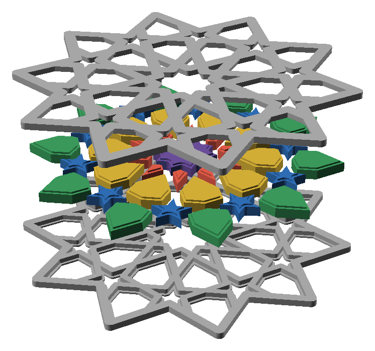

### [2026-10-14-bedface-5](prints/2026-10-14-bedface-5/index.md)

- **Plate:** [bedface-5](design/plates/bedface-5.md) — twelve 50 mm pieces of the gBV coaster on the glacier plate: stock beside the fill pushed 55%, 75% and 100% into the wall, and 55% and 75% with 10% more first-layer plastic, two pieces each
- **Lesson:** On pieces of the gBV coaster on the smooth glacier plate, Omar picked the 55% overlap piece 8 as the bottom he would sell. Pushing the fill 75% or 100% into the wall left fewer slits than 55%, but those bottoms "look like we fileld in blanks", and 8 and 9 look cleaner: fewer slits is not the same as a better-looking bottom. 10% more first-layer plastic on top of 55% or 75% changed nothing he could see. Stock repeated bedface-4 ("As many"), so the two prints read against each other; but this plate's 55% pair slit more than bedface-4's 55% pair ("2, T were better, less slits"), so 55% did not fully repeat (0.4 mm nozzle, 0.5 mm first line, 0.20 mm layers, sliced as a Smooth PEI / High Temp plate).
- **Nozzle:** 0.4 mm, left nozzle, type hardened steel (the slice's setting)
- **Pieces:** 12 (2 keep, 2 adjust, 8 drop)
- **What happened:** Stock 3 and 5: as many slits as bedface-4's stock. 55% (8, 9): more than bedface-4's 2 and T, but the cleanest-looking bottoms here. 75% and 100% (A, C, E, F): fewer slits than 55%, filled-in look. 55% and 75% with flow: the same as without.
- **Why:** Lines that stop short of the strap wall on the first layer. Pushing the fill further into the wall covers the gaps but lays plastic over them, which Omar saw as filled-in. My (Claude's) reading of his words, not his.
- **What it changed:** Verdicts by one rule: keep the setting Omar picked to sell (55%: 8, 9); drop the settings that lost to it, whatever their slit count (75%, 100%), and the flow pieces, which were the same as without flow (G, K, R, S); adjust the stock pair, whose setup is what changes. The page set the favorite to mean its setting goes on the next whole coaster. Whether any piece flared at the bed was asked and not answered. What prints next is Omar's call.
- **Photos of the print:** none. Rendered pictures from the plate page: [bed](design/plates/bedface-5-media/bed.png), [first-layer](design/plates/bedface-5-media/first-layer.png)

### [2026-10-13-bedface-4](prints/2026-10-13-bedface-4/index.md)

- **Plate:** [bedface-4](design/plates/bedface-4.md) — twelve 50 mm pieces of the gBV coaster on the glacier plate: stock beside five first-layer settings, two pieces each
- **Lesson:** On pieces of the gBV coaster on the smooth glacier plate, pushing the fill 55% into the wall left fewer slits along the strap edges than 30%, with no ridge, and 2 did better than T. 55% and the flow pieces were not set side by side; of the twelve photos 2 looks the cleanest to me (Claude). 10% more plastic on the first layer helped a little, against what the research expected (X fewer than Y, Y fewer than J), but every flow piece still slit. 30% overlap split (P fewer, L more). The monotonicline bottom only moved the slits. The stock pieces slit a little less than bedface-2's whole stock coaster, which I (Claude) read as nearer "about as many" than "clearly fewer": the pieces stand in for the coaster (0.4 mm nozzle, 0.5 mm first line, 0.20 mm layers, sliced as a Smooth PEI plate).
- **Nozzle:** 0.4 mm, left nozzle, type HS01
- **Pieces:** 12 (4 keep, 4 adjust, 4 drop)
- **What happened:** Stock H and J: short notches along the strap edges, a little fewer than the whole S coaster. 55%: very few on 2, more on T. 1.10 flow: fewer than stock, still some. 1.05: U a bit fewer, W the same. 30%: P fewer, L more. Monotonicline: about as many, in other places.
- **Why:** Lines that stop short of the strap wall on the first layer, as the slice drawings show. Pushing the fill into the wall closes them; more plastic widens the lines a little. The turn may matter for the overlap pieces: in both pairs the turned piece did better (P over L, 2 over T), as the slice ranked them, but two pairs are too few to say. My (Claude's) reading, not Omar's.
- **What it changed:** Verdicts by one rule: keep where a setting left fewer slits than stock and no stronger version of the same setting did better (2, T, X, Y); adjust where it left fewer but a stronger version of it did better (P, U), and for the stock pair, whose setup is what changes; drop where it left the same or more (L, W, 4, 7). What prints next with 55% overlap, 10% flow or both, and on a whole coaster or more pieces, is Omar's call.
- **Photos of the print:** [the bottom of the piece carved H (stock), whole: short dark notches along the strap edges](prints/2026-10-13-bedface-4/photos/piece-h-bed-face.jpg), [the bottom of the piece carved J (stock, turned), whole: short dark notches along the strap edges, like H's](prints/2026-10-13-bedface-4/photos/piece-j-bed-face.jpg), [the bottom of the piece carved L (overlap 30%), whole: dark notches all along the strap edges](prints/2026-10-13-bedface-4/photos/piece-l-bed-face.jpg), [the bottom of the piece carved P (overlap 30%, turned), whole: smoother strap edges, few notches; the id reads P to me (Claude), not certain](prints/2026-10-13-bedface-4/photos/piece-p-bed-face.jpg), [the bottom of the piece carved 2 (overlap 55%, turned), whole: smooth strap edges, very few notches](prints/2026-10-13-bedface-4/photos/piece-2-bed-face.jpg), [the bottom of the piece carved T (overlap 55%), whole: more notches than 2, most on the left side](prints/2026-10-13-bedface-4/photos/piece-t-bed-face.jpg), [the bottom of the piece carved U (flow 1.05, turned), whole: strap edges smoother than J's](prints/2026-10-13-bedface-4/photos/piece-u-bed-face.jpg), [the bottom of a flow 1.05 piece, whole, its carved id hard to read; W by elimination, since Omar sent it with U's photo: notches along the left straps, like J's](prints/2026-10-13-bedface-4/photos/piece-w-bed-face.jpg), [the bottom of the piece carved X (flow 1.10, turned), whole: fairly smooth strap edges; the id reads X to me (Claude), not certain](prints/2026-10-13-bedface-4/photos/piece-x-bed-face.jpg), [the bottom of the piece carved Y (flow 1.10, turned), whole: a few notches on the left straps; the id reads Y to me (Claude), not certain](prints/2026-10-13-bedface-4/photos/piece-y-bed-face.jpg), [the bottom of the piece carved 4 (monotonicline, turned), whole: dashes along the lower-right straps and the bottom strap; the id reads 4 to me (Claude), not certain](prints/2026-10-13-bedface-4/photos/piece-4-bed-face.jpg), [the bottom of the piece carved 7 (monotonicline), whole: dashes along the top-right and right-hand straps, and a small pink smear near the top-left corner](prints/2026-10-13-bedface-4/photos/piece-7-bed-face.jpg)

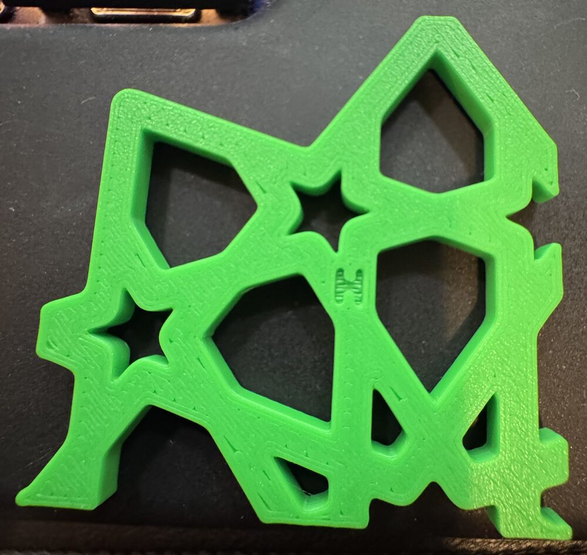

### [2026-10-12-bedface-3](prints/2026-10-12-bedface-3/index.md)

- **Plate:** [bedface-3](design/plates/bedface-3.md) — bedface-2's two gBV coasters again, stock beside rings and a 30% overlap, on the gold Textured PEI plate
- **Lesson:** Starting the first layer on the gold plate, 0.02 mm closer to the bed than on the glacier plate, left fewer slits on both coasters: Omar found G better than bedface-2's S, with one corner still slit, and K better than R, though still with a good amount. But the gold plate's grain is not fine on a coaster, so the gold plate is out. What carries forward is the squish, not the plate (0.4 mm nozzle, 0.5 mm first line, 0.20 mm layers, sliced as the Textured PEI plate, which lowers the nozzle 0.02 mm for the first layer).
- **Nozzle:** 0.4 mm, left nozzle, type HS01
- **Pieces:** 2 (1 adjust, 1 drop)
- **What happened:** G: slits along the inside of the outer edge in one star point, fewer than S. K: dashes down the strap middles and where straps meet, fewer than R. Both bottoms grainy from the plate.
- **Why:** The plate was the only change from bedface-2, and both coasters had fewer slits, so the glacier plate's missing 0.02 mm push (the issue's third suspect) is part of the cause. Not the whole: G still has a slit corner and K a good amount. Changing the plate also changed the surface the first layer lands on, so the 0.02 mm and the texture are not told apart by this print.
- **What it changed:** The gold plate is out (row 3) and rings stay dropped (row 2 depends on the gold plate). Whether to get the same closer first layer on the smooth glacier plate, and how, is Omar's call from the issue (docs/issues/bed-face-preset-failed-in-print.md).
- **Photos of the print:** [one star point of the G coaster's bottom, close up: the gold plate's grain over the whole face, and short dark slits along the inside of the outer edge](prints/2026-10-12-bedface-3/photos/g-coaster-bed-face.jpg), [the K coaster's bottom, most of it, the carved K left of center: grain all over, with short dark dashes down the strap middles and where straps meet](prints/2026-10-12-bedface-3/photos/k-coaster-bed-face.jpg), [the G coaster on the gold plate during the print, from above, after the first layers: the walls and the diagonal fill inside each strap, the carved G near the top](prints/2026-10-12-bedface-3/photos/g-layer2-on-the-bed.jpg), [the K coaster on the gold plate during the print, from above, after the first layers: the walls and fill inside each strap, the carved K near the top](prints/2026-10-12-bedface-3/photos/k-layer2-on-the-bed.jpg)

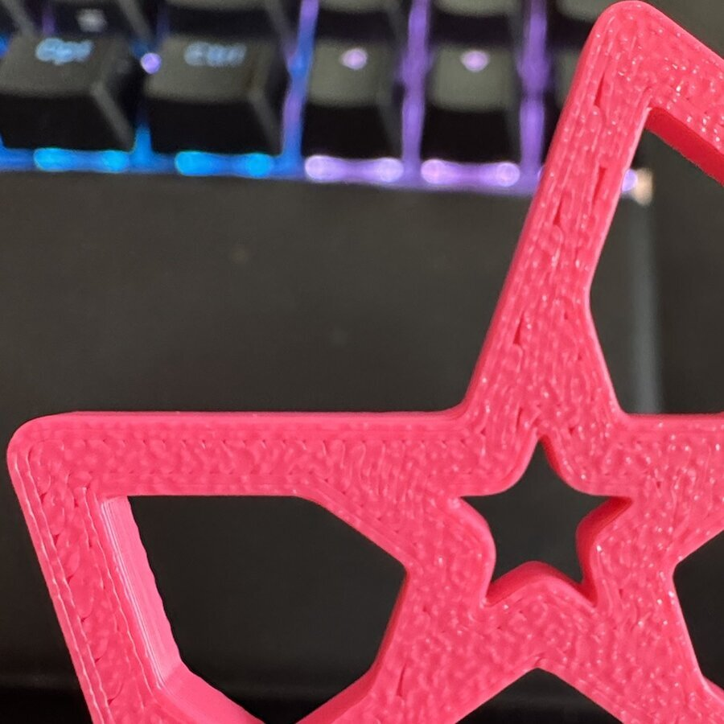

### [2026-10-12-bedface-2](prints/2026-10-12-bedface-2/index.md)

- **Plate:** [bedface-2](design/plates/bedface-2.md) — two gBV coasters on one bed, stock beside rings and a 30% overlap, both at the stock 0.5 mm first line
- **Lesson:** Rings did not clean the coaster's bottom at the stock 0.5 mm first line either: Omar found the ring coaster and the stock coaster about the same, "both have slits, but in different places". On stock the slits run along the strap edges; with rings they move to the strap middles and to where straps meet, where the rings from the two sides come together. So bedface-1's dashes were not the narrow line's doing, and rings are dropped (0.4 mm nozzle, 0.5 mm first line, 0.42 mm outer and 0.45 mm inner wall lines, 0.20 mm layers, glacier plate sliced as Smooth PEI).
- **Nozzle:** 0.4 mm, left nozzle, type HS01
- **Pieces:** 2 (1 keep, 1 drop)
- **What happened:** S: slits along the strap edges. R: specks and small triangles down the strap middles and at the junctions. About the same amount on each, in different places.
- **Why:** Rings leave a meeting line down the middle of each strap and at each junction, and it opens in print at the 0.5 mm line as it did at 0.42, so the narrower line (the issue's second suspect) is cleared of bedface-1's dashes and where rings meet (the first) is what stands. The slicer's plan had R at 0.41% bare against S's 0.93%, so for the second plate running the plan ranked the ring bottom cleaner than the print. The glacier plate's missing 0.02 mm push (the third suspect) was the same for both coasters, so it is still untested.
- **What it changed:** Rings and the 30% overlap are not used; every plate stays on the X2D 0.20 mm Standard, as the page's row 1 said for this answer. Whether to keep chasing the stock slits, and how, is Omar's call from the issue's remaining options (docs/issues/bed-face-preset-failed-in-print.md).
- **Photos of the print:** [the S coaster's bottom, close up: short dark slits along each strap, a line or two in from the edges, where the diagonal fill meets the wall loops](prints/2026-10-12-bedface-2/photos/s-coaster-bed-face.jpg), [the R coaster's bottom, close up, the carved R near the bottom: rings along every strap, with small dark specks and triangles down the strap middles and where straps meet](prints/2026-10-12-bedface-2/photos/r-coaster-bed-face.jpg)

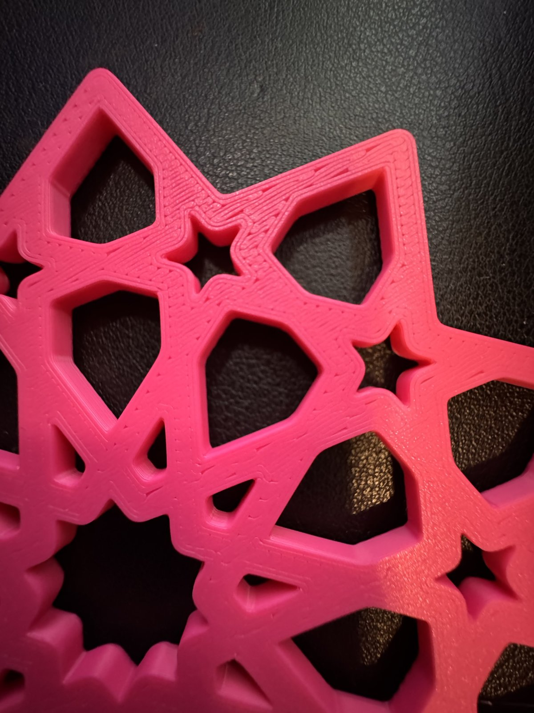

### [2026-10-11-bedface-1](prints/2026-10-11-bedface-1/index.md)

- **Plate:** [bedface-1](design/plates/bedface-1.md) — sheets-04g-fit2's pieces again, on the house bed-face preset (rings on the first layer, 30% overlap, a 0.42 mm first line)
- **Lesson:** The house bed-face preset did not clean the coaster's bottom in print: the rings closed the slits at the strap edges but left dashes and small triangles down the middle of each strap and at the junctions, and Omar found as many slits as on the stock coaster, or more, though the slicer's plan had the bare share falling from 1.10% to 0.26%. The 0.42 mm first line did fill the small kites' core. And every fit came out about one 0.025 mm rung tighter than fit2's (0.4 mm nozzle, 0.42 mm first line and 0.42 mm outer and 0.45 mm inner wall lines, 0.20 mm layers, glacier plate sliced as Smooth PEI).
- **Nozzle:** 0.4 mm, left nozzle, type HS01
- **Pieces:** 5 (1 keep, 2 adjust, 2 not-judged)
- **What happened:** F coaster: slits about the same as fit2's Z coaster, or more (the photo: dashes and triangles down the strap middles and at the junctions). Kites: no dent in the middle, but too tight in the F coaster. Middle piece: FC1 1E (0.05) the winner, where fit2's winner was 4GH 1C (0.025) and its 0.05 piece was loose.
- **Why:** Not separated by this plate; three suspects. The rings: where the rings from two sides of a strap meet, the slicer leaves specks, which the design's §3.3 drew and counted as small; in print they show as dashes. The narrower first line: 0.42 mm squashes less than 0.5, so the specks the plan leaves are not closed by squash (design §7). The glacier plate: sliced as Smooth PEI, it gets no extra 0.02 mm push on the first layer (design §3.4). The tighter fit: the plan kept the outer edge in place, so a wider first layer in print would have to come from the overlap or the narrower line, not measured; and coasters already move by about one rung from print to print (fit2's record), so one plate cannot say how much of the shift is the preset.
- **What it changed:** The house preset does not roll out; every plate stays on the X2D 0.20 mm Standard. The slit fix is reworked, and the slicer's plan is no longer taken as proof of a clean bottom (docs/issues/bed-face-preset-failed-in-print.md). The fit shift is read again with fit3 before any gap changes.
- **Photos of the print:** [the F coaster's bottom, held up in the hand: rings along every strap, with dark dashes and small triangles down the strap middles and at the junctions](prints/2026-10-11-bedface-1/photos/f-coaster-bed-face.jpg)

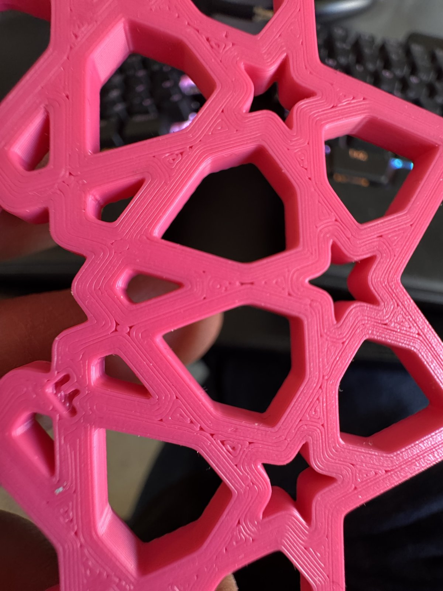

### [2026-10-10-sheets-04g-fit2](prints/2026-10-10-sheets-04g-fit2/index.md)

- **Plate:** [sheets-04g-fit2](design/plates/sheets-04g-fit2.md) — the middle piece at 0.025 mm, halfway between sheets-04g-fit's A and B, with both as controls, the kites at 0.05 and a fresh coaster
- **Lesson:** Halfway worked: printed beside its own coaster, the middle piece at 0.025 mm sat between gap 0 (super tight) and 0.05 (loose) and was the one Omar picked, so the slicer does keep a 0.025 mm step apart in feel. The kites at 0.05 went the other way from sheets-04g-fit: they fit that plate's coaster well and were tough to push into this one, though they hold once in. A coaster's holes move from print to print by about a 0.05 mm rung, now seen on three coasters, so a gap is judged in a coaster from the same bed.
- **Nozzle:** 0.4 mm, left nozzle, type HS01
- **Pieces:** 5 (1 keep, 1 adjust, 2 drop, 1 not-judged)
- **What happened:** Z coaster: 4GH 1A super tight, 4GH 1C the winner, 4GH 1E loose; the 0.05 kites tough to push in but all stay in upside down.
- **Why:** Not measured on the pieces (no calipers reading). The kites tighter and 4GH 1A tighter than on sheets-04g-fit, but 4GH 1E looser than that plate's 0.05 piece: not one shift of the whole coaster, and not explained. Nothing on this plate separates the coaster's holes from the pieces.
- **What it changed:** The middle piece's gap is 0.025 mm on the next sheets-04g iteration. The kites want a little more gap than 0.05; sheets-04g-fit found 0.10 too small, so the next kite step sits between the two. How big a step is Omar's call.
- **Photos of the print:** none. Rendered pictures from the plate page: [bed](design/plates/sheets-04g-fit2-media/bed.png), [ids](design/plates/sheets-04g-fit2-media/ids.png)

### [2026-10-10-sheets-04g-fit](prints/2026-10-10-sheets-04g-fit/index.md)

- **Plate:** [sheets-04g-fit](design/plates/sheets-04g-fit.md) — the kites and the middle piece at a ladder of gaps, with a fresh coaster to press them into
- **Lesson:** In the fresh Z coaster, printed on the same bed, the kites fit at 0.05 mm and every looser rung was too small, and the middle piece sits between 4A (gap 0, too tight) and 4B (0.05, good but comes out a little too easily). In the older sheets-04g coaster the same pieces sat about one 0.05 mm rung looser: 4A fit but came out easily, 4B and every kite were loose. So the coaster's holes came out about one rung larger on that print than on this one. One pair of coasters: a first reading, not a rule.
- **Nozzle:** 0.4 mm, left nozzle, type HS01
- **Pieces:** 10 (1 keep, 2 adjust, 4 drop, 3 not-judged)
- **What happened:** Z coaster: the 0.05 kites fit well, the 0.10 to 0.25 kites were too small; 4GF 4A fit but too tight, 4GF 4B good but came out a little too easily; 4GF 4C and 4D not judged. Older sheets-04g coaster: 4A fit but came out easily, 4B loose, all kites loose.
- **Why:** Not measured on the pieces (no calipers reading). The older coaster printed on 2026-10-04 in green from another spool; the coaster's source gained two knobs since (hole-point round and weld), both left at 0, which should leave the holes as they were, though the two meshes were not compared. Why its holes come out larger is not known. spl-2 found the stud fit moving 0.05 to 0.10 mm from print to print too.
- **What it changed:** Kites stay at 0.05 mm. Omar asked for a midway between 4A and 4B: a middle piece at 0.025 mm. Because the holes move about one rung between prints, that plate prints its own fresh coaster beside the middle pieces, and the pieces are judged in it.
- **Photos of the print:** none. Rendered pictures from the plate page: [bed](design/plates/sheets-04g-fit-media/bed.png), [ids](design/plates/sheets-04g-fit-media/ids.png), [ids-coaster](design/plates/sheets-04g-fit-media/ids-coaster.png)

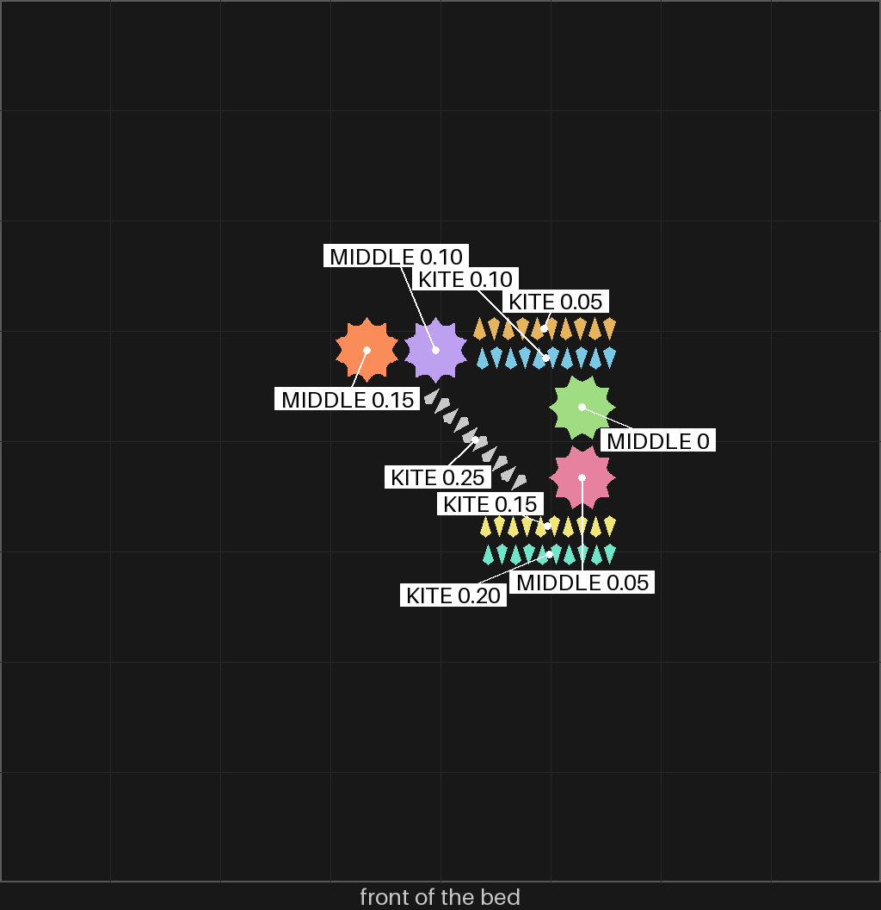

### [2026-10-09-spl-2](prints/2026-10-09-spl-2/index.md)

- **Plate:** [spl-2](design/plates/spl-2.md) — the split coupon again, looser: at what gap does a stud go in by hand
- **Lesson:** A 2 mm stud went in by hand at every gap from 0.15 to 0.40 mm and held from 0.15 to 0.25, though spl-1 needed a hammer at 0.15; and at 0.25 one pair held (1E) while its twin fell apart (1F). So the fit moves about 0.05 to 0.10 mm from print to print (0.4 mm nozzle, 0.42 mm outer and 0.45 mm inner wall lines, 0.20 mm layers). And carved B and D, M and N, look alike at this size.
- **Nozzle:** 0.4 mm, left nozzle, type HS01
- **Pieces:** 24 (10 keep, 14 drop)
- **What happened:** Every pair closed by hand. SL2 1A to 1E (0.15 to 0.25 mm) held when shaken; SL2 1F to 1L (0.25 to 0.40 mm) were very loose and fell apart. None broke when pulled. 1D may have clicked in. All the uppers' ids on their top faces read.
- **Why:** Not measured on the pieces (no calipers reading). The same 0.15 mm gap needed a hammer on spl-1, printed earlier the same day with the same nozzle, preset and spool, so the printer varies from print to print by about as much as one or two rungs of the ladder. Why it varies (chamber warmth, the plate, the spool's moisture) is not known.
- **What it changed:** The stud gap on split-01, stud-1 and pkt-2 is 0.25 mm, Omar's pick (D-116), the loosest gap that held here; 1F at the same gap fell apart, so a whole coaster at 0.25 may come out loose. split-01 and stud-1 set it in their recipes; pkt-2's pocket coaster has no stud-gap knob yet, so it waits on a bikar change. Coupon uppers keep their id on top (D-115 stands). Piece letters skip B, D, M, N and O.
- **Decided from it:** [D-116](working-model/decisions-log.md#d-116--a-split-coasters-stud-gap-is-025-mm) (A split coaster's stud gap is 0.25 mm)
- **Photos of the print:** none. Rendered pictures from the plate page: [bed](design/plates/spl-2-media/bed.png), [ids-lowers](design/plates/spl-2-media/ids-lowers.png), [ids-uppers](design/plates/spl-2-media/ids-uppers.png)

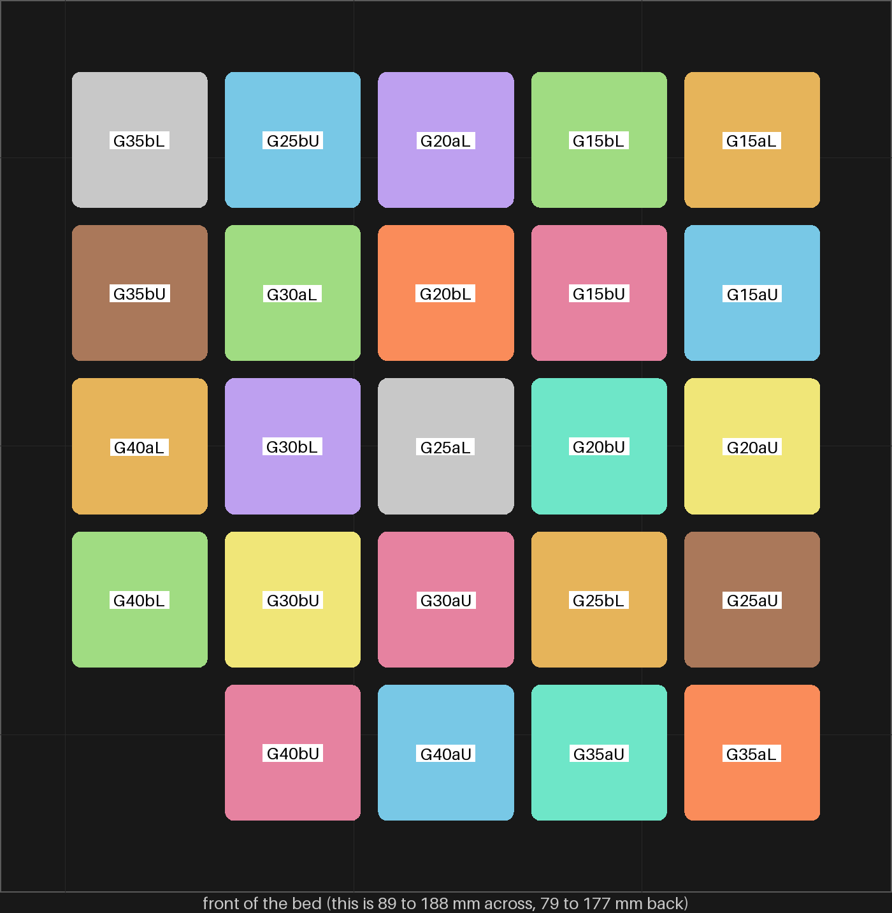

### [2026-10-09-spl-1](prints/2026-10-09-spl-1/index.md)

- **Plate:** [spl-1](design/plates/spl-1.md) — the split coupon: how tight a stud, how thick a floor, does a lip hold a piece
- **Lesson:** Every stud gap from -0.10 to 0.15 mm needed a hammer while the slice kept each gap as drawn, so the printer runs tight (0.4 mm nozzle, 0.42 mm outer and 0.45 mm inner wall lines, 0.20 mm layers); and an id on the upper's cut face is hidden once the pair closes.
- **Nozzle:** 0.4 mm, left nozzle, type not recorded
- **Pieces:** 30 (1 keep, 16 adjust, 13 drop)
- **What happened:** Every stud pair needed a hammer to close, from gap -0.10 to 0.15 mm and at 1.5, 2 and 3 mm; only SL1 4F (2 mm, 0.15) went in by hand, and it needed a hammer to sit flush. Nothing snapped.
- **Why:** Not the slice. tools/fit_gap.py studs read the sliced wall paths: every pair's gap came out as drawn, to within 0.005 mm (4A -0.098 for -0.10, 4F +0.155 for 0.15), and the upper prints with its socket opening upward, so first-layer squish cannot narrow the mouth. What is left is the printer: printed holes running smaller than drawn, studs larger, or both. Not measured on the pieces themselves (no calipers reading), and the ladder never went loose enough to find the fit.
- **What it changed:** A looser stud ladder, above 0.15 mm, before any studded coaster (split-01, stud-1, pkt-2, all cut at 0.05) is sent. The 0.6 mm floor stays. Lips hold a loose piece, and room 0 is the room. The upper's letter goes on its outer face, not its cut face, so it can still be read once the pair is closed.
- **Decided from it:** [D-115](working-model/decisions-log.md#d-115--on-a-coupon-the-upper-halfs-id-goes-on-its-outer-face) (On a coupon, the upper half's id goes on its outer face)
- **Photos of the print:** none. Rendered pictures from the plate page: [bed](design/plates/spl-1-media/bed.png), [slice](design/plates/spl-1-media/slice.png), [ids-a-f](design/plates/spl-1-media/ids-a-f.png), [ids-g-l](design/plates/spl-1-media/ids-g-l.png), [ids-trap](design/plates/spl-1-media/ids-trap.png)

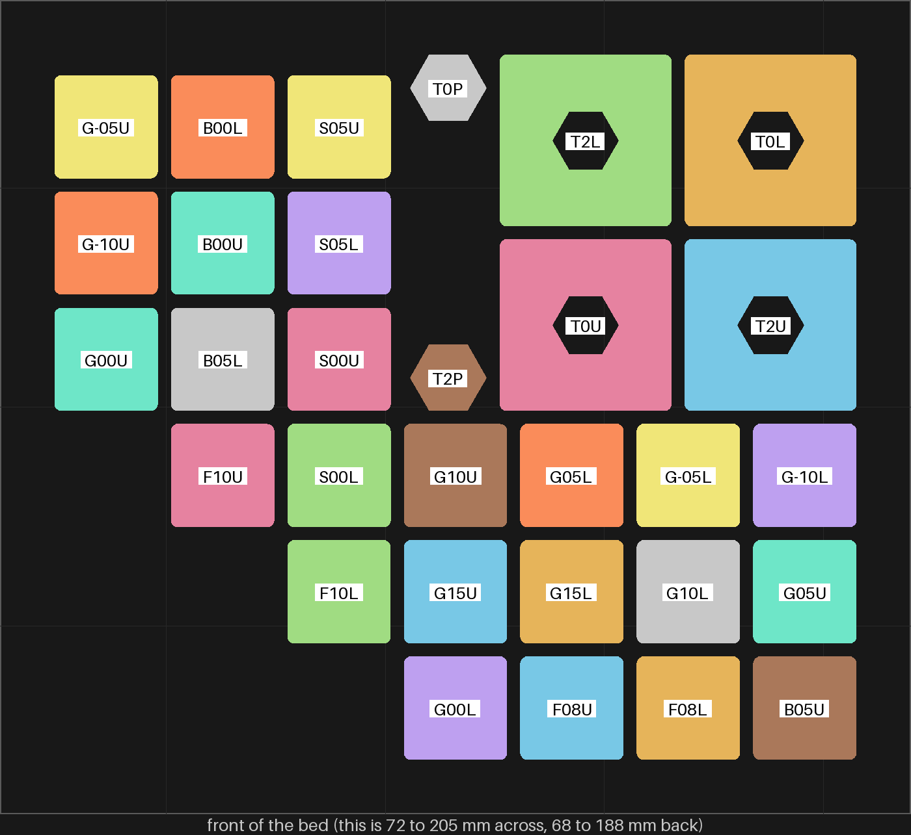

### [2026-10-09-pkt-1](prints/2026-10-09-pkt-1/index.md)

- **Plate:** [pkt-1](design/plates/pkt-1.md) — the pocket coupon: does a piece printed in its pocket come out loose
- **Lesson:** A piece printed in its pocket comes out loose with two layers of air (0.4 mm); with one layer (0.2 mm) both pairs fused (0.4 mm nozzle, 0.42 mm outer and 0.45 mm inner wall lines, 0.20 mm layers).
- **Nozzle:** 0.4 mm, left nozzle, type not recorded
- **Pieces:** 8 (4 keep, 4 drop)
- **What happened:** At one layer of air (0.2 mm) the hexagon printed fused to its square in both pairs (4S/OT, 4P/PT).
- **Why:** One 0.2 mm layer of air is too little for the band to print free; both pairs fused, so it was not one bad layer.
- **What it changed:** Way c works at two layers of air (0.4 mm) with 0.4 mm necks and the 0.6 mm band: loose, rims whole, band level, and closed pairs flat and silent. pkt-2 builds there.
- **Photos of the print:** none. Rendered pictures from the plate page: [cut-lower-0.2](design/plates/pkt-1-media/cut-lower-0.2.png), [cut-closed-0.2](design/plates/pkt-1-media/cut-closed-0.2.png), [cut-closed-0.4](design/plates/pkt-1-media/cut-closed-0.4.png), [bed](design/plates/pkt-1-media/bed.png), [slice](design/plates/pkt-1-media/slice.png), [ids](design/plates/pkt-1-media/ids.png)

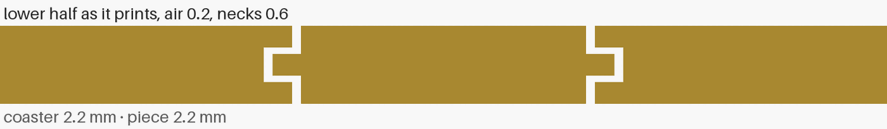

### [2026-10-07-sld-1](prints/2026-10-07-sld-1/index.md)

- **Plate:** [sld-1](design/plates/sld-1.md) — the dovetail coupon: three rail and slot pairs at 0.10, 0.15 and 0.20 mm a side
- **Lesson:** All three dovetail gaps, 0.10, 0.15 and 0.20 mm a side, worked (0.4 mm nozzle, 0.42 mm outer and 0.45 mm inner wall lines, 0.20 mm layers); which felt best is not said yet. On the glacier plate the printer stopped twice before the first layer, and ran on the gold plate.
- **Nozzle:** 0.4 mm, left nozzle, type not recorded
- **Pieces:** 6 (6 keep)
- **What it changed:** Which of the three gaps felt best is still Omar's to say; the kite pair the joining note adds waits on that gap.
- **Photos of the print:** none. Rendered pictures from the plate page: [side-cut](design/plates/sld-1-media/side-cut.png), [slice](design/plates/sld-1-media/slice.png), [bed](design/plates/sld-1-media/bed.png)

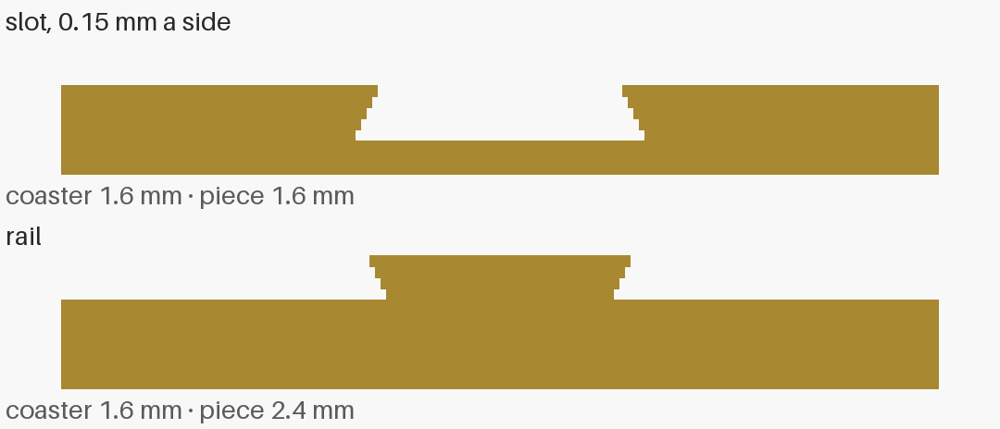

### [2026-10-04-sheets-04g](prints/2026-10-04-sheets-04g/index.md)

- **Plate:** [sheets-04g](design/plates/sheets-04g.md) — the gBV minimal coaster at 1.25 times wide and every one of its 41 pieces, one bed, one color
- **Lesson:** A piece cut with sharp inward corners rattles where the strap rounds its hole, and the thinnest, sharpest pieces (the kites) bind first (0.4 mm nozzle, 0.42 mm outer and 0.45 mm inner wall lines, 0.20 mm layers).
- **Nozzle:** 0.4 mm, left nozzle, type not recorded
- **Pieces:** 6 (2 adjust, 4 not-judged)
- **What happened:** The ten kites were too tight to go into their holes, and the middle piece was loose in its hole; nothing said yet about the hexes, the stars, the outer pieces or the coaster.
- **Why:** Two causes, one per symptom. The middle piece was cut with sharp inward corners, but the coaster's strap rounds those corners off, so at each of its ten inward corners the piece stood 0.45 mm short of the wall: play the piece could rattle in. The kites had no play anywhere, and a kite is the thinnest piece on the plate, with 3.8 times as much edge for its size as the middle piece and a 36 degree point, so any width the printer adds to a piece, or takes from a hole, binds it first. Measured on bikar's own geometry and the slice; the printer's own widening was not measured.
- **What it changed:** bikar now cuts every piece along the strap's real, rounded edge (no more corner play), and a fit plate, sheets-04g-fit, tries kites at five gaps and middle pieces at four in this same coaster.
- **Photos of the print:** none. Rendered pictures from the plate page: [coaster](design/plates/sheets-04g-media/coaster.png), [pieces](design/plates/sheets-04g-media/pieces.png), [bed](design/plates/sheets-04g-media/bed.png)

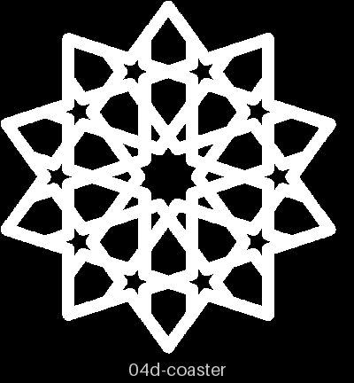

### [2026-10-04-phones-02](prints/2026-10-04-phones-02/index.md)

- **Plate:** [phones-02](design/plates/phones-02.md) — phones-01 in pink only, with the small phones 1.25 times wider and longer and twice as thick
- **Lesson:** One color per plate: the same phones took about 13 minutes in one color against phones-01's 62 in two, and the plate became the first production plate.
- **Nozzle:** 0.4 mm, left nozzle, type not recorded
- **Pieces:** 2 (2 keep)
- **What it changed:** Omar asked to save it as production ready; the plate is promoted, and a reprint goes out on its standing approval.
- **Decided from it:** [D-098](working-model/decisions-log.md#d-098--production-is-one-good-run-as-laid-out-with-no-fill-bar) (Production is one good run as laid out, with no fill bar)
- **Photos of the print:** none. Rendered pictures from the plate page: [bed](design/plates/phones-02-media/bed.png)

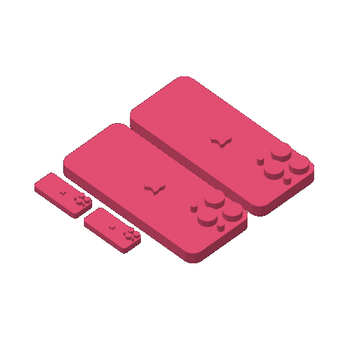

### [2026-10-02-sheets-04](prints/2026-10-02-sheets-04/index.md)

- **Plate:** [sheets-04](design/plates/sheets-04.md) — the gBV fit: loose pieces at four gaps, set into the baseless minimal coaster
- **Lesson:** A coaster with no floor holds a loose piece only by friction, so every piece smaller than its hole fell through, at every gap from 0.05 to 0.20 mm (0.4 mm nozzle, 0.42 mm outer and 0.45 mm inner wall lines, 0.20 mm layers).
- **Nozzle:** 0.4 mm, left nozzle, type not recorded
- **Pieces:** 7 (1 keep, 6 adjust)
- **What happened:** All the small pieces fell right through the coaster's holes, at every gap from 0.05 to 0.20 mm.
- **Why:** The minimal coaster has no floor (frame F3 in the loose-pieces design), so only friction holds a piece, and every gap on the plate was positive: each piece was smaller than its hole. The loose-pieces design said as much for F3 (pieces drop unless the fit is tight). The pieces were also 1.2 mm thin, so most of each wall was first layers, where elephant-foot compensation (0.15 on this preset) narrows the piece further. Not measured.
- **What it changed:** A pieces-only plate (sheets-05) with flat pieces 4 mm tall, flush with the coaster, at gaps from 0.05 down through 0 into a press fit, set into this same coaster.
- **Photos of the print:** none. Rendered pictures from the plate page: [bed-map](design/plates/sheets-04-media/bed-map.png), [fit-in-coaster](design/plates/sheets-04-media/fit-in-coaster.png), [flat-and-peaked](design/plates/sheets-04-media/flat-and-peaked.png), [gbv-frame-and-pieces](design/plates/sheets-04-media/gbv-frame-and-pieces.png)

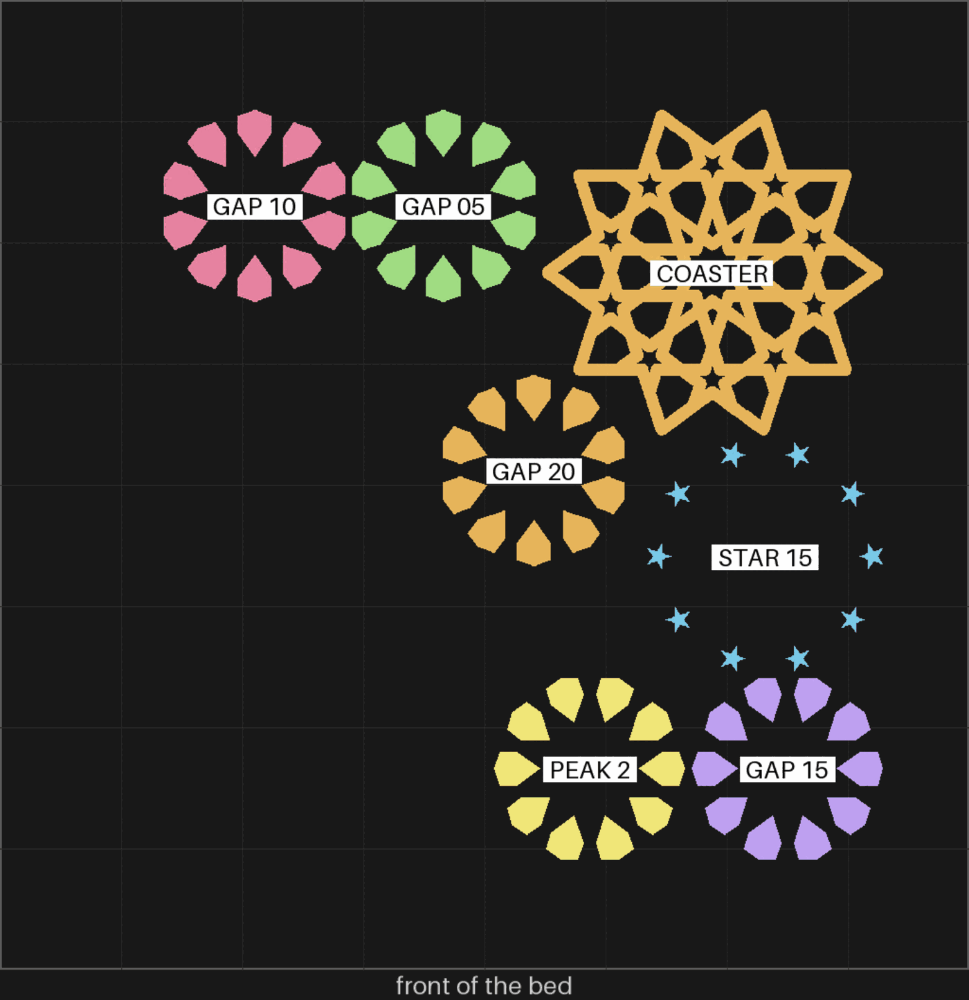

### [2026-09-26-minis-04](prints/2026-09-26-minis-04/index.md)

- **Plate:** [minis-04](design/plates/minis-04.md) — minis-03 at 80 mm and half the height, plus the twist
- **Lesson:** A slice must carry the whole X2D preset: Studio's command line ignores `inherits`, and its built-in settings fit the tiny holes and the tight pegs.
- **Nozzle:** 0.4 mm, which nozzle not recorded, type not recorded
- **Pieces:** 5 (5 adjust)
- **What happened:** Tiny holes in the print; the pegs pair's border is too big and the pegs fit too tight.
- **Why:** The slice ran on Studio's built-in defaults, not the X2D preset: our slicer passed only the top preset file and Studio's command line does not follow `inherits`, so elephant-foot compensation was 0 (preset 0.15), the top was 4 layers / 0.6 mm (preset 5 / 1.0), walls were Arachne and the top zig-zag. The holes fit those settings; the tight pegs fit compensation 0 plus the slot shape; the border is the dovetail frame rule by design. Causes ranked in docs/design/printing/print-quality-design.md; none measured.
- **What it changed:** Flatten the preset chain and re-slice minis-04 to compare previews; fix the slot offset in bikar; then a clearance ladder at 1.4 mm (T1) before CAL-FIT-01 moves; the narrower joins are on minis-05 and minis-06.
- **Photos of the print:** none, and the plate page has no rendered pictures.

### [2026-09-26-minis-03](prints/2026-09-26-minis-03/index.md)

- **Plate:** [minis-03](design/plates/minis-03.md) — openwork minis at 40 mm
- **Lesson:** At 40 mm a mini is too small to show its pattern, and the dovetail's fixed 5.7 mm frame takes over a quarter of the piece.
- **Nozzle:** 0.4 mm, which nozzle not recorded, type not recorded
- **Pieces:** 4 (4 adjust)
- **What happened:** Minis too small; the mated pegs pair has a wide solid band at the join and fits a bit loose.
- **Why:** Size 40 is too small to show the pattern; the pegs frame is a fixed 5.7 mm per side, so the band is over a quarter of a 40 mm piece; clearance 0.15 mm is loose on this machine by feel.
- **What it changed:** Next sample plate at 70 mm; pegs pairs at clearance 0.10 and 0.05; try a shallower dovetail (depth 2) for a narrower frame.
- **Photos of the print:** [all five pieces, the pegs pair pushed together at the top](prints/2026-09-26-minis-03/photos/plate-overview.jpg), [the CS-1 minimal-frame close up, the mated pegs pair behind it](prints/2026-09-26-minis-03/photos/pegs-pair-and-cs1.jpg)

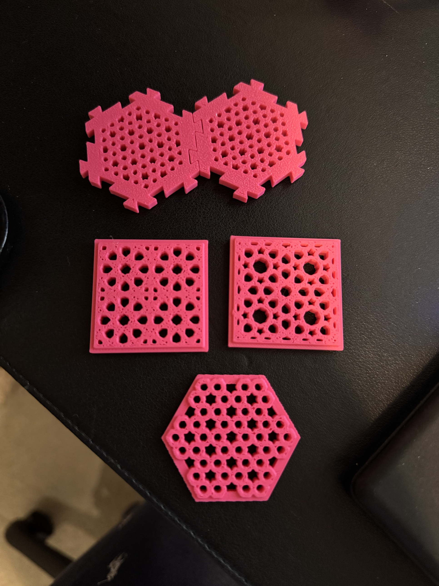

17 records; 0 measured with a tool, so no bet has moved yet.

<!-- records:end -->

## Queue — what to print next

The order lives on [the plates page](design/plates/README.md), computed from each plate's review page
and the weights in the
[prioritize-prints skill](../.claude/skills/prioritize-prints/scoring.md). This page stores no
rank of its own, because a second scheduler is the one thing the design forbids
([design doc](design/printing/prints-tab-design.md) §6). A plate page also records whether
Omar approved it and how many times it printed, counted from the records above.

The calibration plates the [print register](tasks/coaster-pipeline/backlog.md) §2 sequences —
Plate 1, the machine card, then Plate 4, the star orb — have no plate page yet, so they are not
in that queue. Plate 4 settles no calibration bet at all, which is why the queue's value and
"bets it would settle" are never the same number.

## What a record holds

A record pins the two identities that together decide what a plate can teach
(design doc §3):

- **Geometry** — the `.bkr` source, the blob's `sha256`, the bikar commit it was
  read at, and the piece selected. The same file at two commits is two versions.
- **Process** — the ten-field profile header the print protocol already defines
  ([`protocol.md`](../.claude/skills/calibrate/protocol.md)): machine, material,
  spool, nozzle (its size, its type, and which of the two), layer height, slicer profile,
  ambient, instrument. The same
  geometry at two layer heights is two versions.

On top of that pair: the outcome, the readings (each linked to the bet it moves),
and the photos of the plate. The prose body is the operator's account, and is
ungated on purpose — a plate may measure a number a later audit kills (design doc
§4.2).

## Consumes (read-only)

This page owns none of these; it points at them:

- [`bets.md`](../.claude/skills/calibrate/bets.md) — the calibration bets a
  reading settles.
- [`protocol.md`](../.claude/skills/calibrate/protocol.md) — the measurement
  ceremony and the profile header a reading must carry.
- [`design/printing/calibration-design.md`](design/printing/calibration-design.md) — the machine-card
  expectations a Plate 1 reading is checked against.
- [the prototype catalog](../.claude/skills/prototype/catalog.md) — the backlog of
  prototypes to print, and where a learning lands when it propagates.
