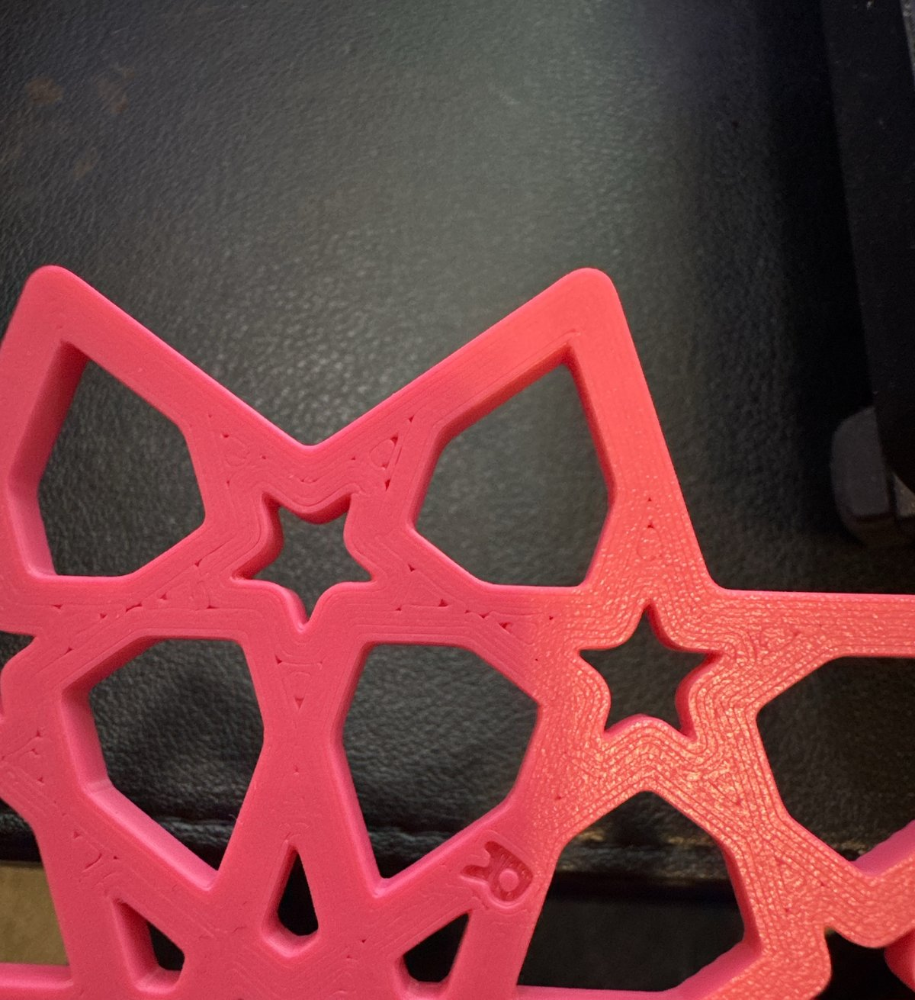

Omar judged this plate by hand on 2026-10-12 and sent one photo of each coaster's bottom. The rows
of the page's [After the print](../../design/plates/bedface-2.md#after-the-print) table were asked
in turn.

- **`R` against `S`: about the same, in different places.** Asked whether `R` has fewer slits than
  `S`: "About the same", and then "both have slits, byt in different places". The photos show
  where. On `S` the slits run along each strap, a line or two in from the edge, where the diagonal
  fill turns short of the wall. On `R` the edges are closed, and the specks and small triangles sit
  down the middle of the straps and where straps meet, where the rings from the two sides come
  together: the same places bedface-1's `F` showed them, now at the stock line width.
- **`R` against bedface-1's `F`:** not judged yet.
- **`FC1 1E` in `S` and in `R`:** not judged yet.

Both photos were re-saved with no metadata, so they carry no location, and the `R` photo was cut
off just below the coaster's carved letter to leave out the hand holding it.

**What the answer means, as the page set it out before the print.** "The same or more: the rings'
meeting lines open in print at either width. Rings are dropped for good and the coaster stays on
stock." So the narrower first line was not what made bedface-1's dashes; where the rings meet is.
And the slicer's plan ranked the ring bottom cleaner than stock for the second plate running (0.41%
bare against 0.93%), where the print found them about even. What is left open, and Omar's to pick,
is in [the issue](../../issues/bed-face-preset-failed-in-print.md#2026-10-12-bedface-2-rings-move-the-slits-they-do-not-close-them).

**Two prints, one record.** The plate printed twice, from the same slice, in the same pink, on the
same glacier plate: first sent at 21:33 UTC on 2026-10-11 and FINISH at 23:33, then, on Omar's
"reprint", sent at 02:59 on 2026-10-12 and FINISH at 04:59. Each took 120 minutes against the
slicer's 107, with all 22 layers done (the [print log](../../design/plates/print-logs/bedface-2.md)),
and each has its own timelapse on [the page](../../design/plates/bedface-2.md#the-print). Why he
asked for the reprint was not said in chat, and which print's pair the photos show was not said
either, so this one record holds the pair he judged. The other pair is not judged.

The source hashes and iteration ids are the ones `bambu slice compose` recorded when the plate was
built, at bikar `c0e6563a`. The sends ran from an older bikar checkout (`951995ab`), which does not
change what printed: the printer got the sliced file made at `c0e6563a`. Nothing was measured
with a tool, so there are no readings and no bet moves.
