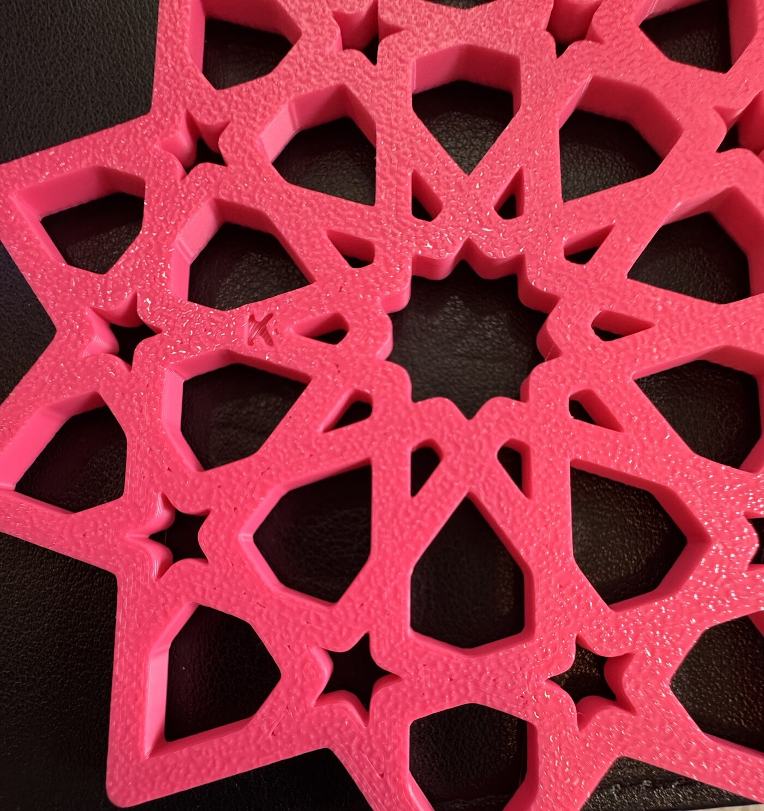
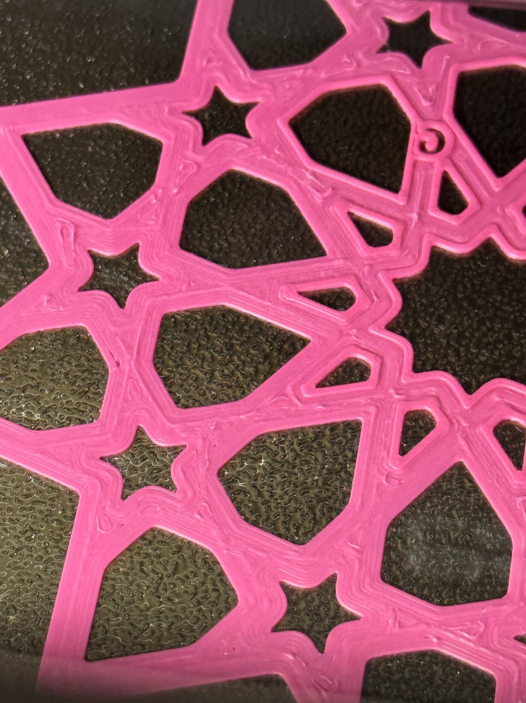
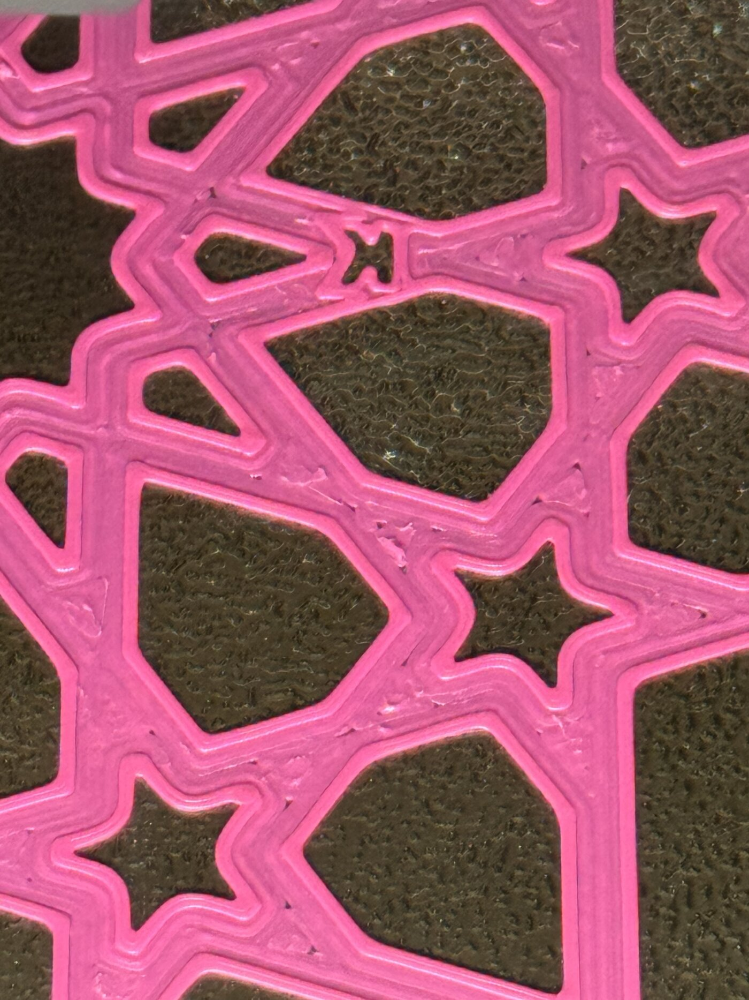

Omar judged this plate by hand on 2026-10-12 and sent one photo of each coaster's bottom. The rows
of the page's [After the print](../../design/plates/bedface-3.md#after-the-print) table were asked
one at a time.

- **`G` against bedface-2's `S`: fewer.** With the photo: "this is g, its better, but one corner
  had skits". The photo is that corner: short dark slits along the inside of the outer edge, in
  one star point. The rest of the bottom is the gold plate's grain.
- **`K` against bedface-2's `R`: fewer.** With the photo: "this is k, it had a good amount of
  slit". The dashes sit where `R`'s did: down the middle of the straps and where straps meet,
  where the rings from the two sides come together.
- **`G`'s grain: not fine.** The gold plate is out, even though it closes slits.

Omar also sent two photos during the print, of each coaster's top after the first layers:

All four photos were re-saved with no metadata, so they carry no location. The `G` bottom photo
was cut down to the one star point, which leaves out the hand holding the coaster. The `K` photo
was cut off just below the coaster.

**What the answers mean, as the page set them out before the print.**

- Row 1, "Fewer": "the plate was part of the cause, and coasters print on the gold plate."
- Row 2, "Fewer": "rings might come back, on the gold plate only."
- Row 3, "Not fine": "the gold plate is out even if it closes the slits."

Row 3 overrules the second half of row 1 and all of row 2. So the plate is out and rings stay
dropped. What stands is the first half of row 1: the 0.02 mm the glacier plate misses is part of
the cause. It is not all of it, since `G` still has a slit corner. Changing the plate also changed
the surface the first layer lands on, so this print does not tell the closer nozzle apart from the
texture. What to try next, and whether to, is Omar's call, set out in
[the issue](../../issues/bed-face-preset-failed-in-print.md#2026-10-12-bedface-3-fewer-slits-on-the-gold-plate-but-the-plate-is-out).

**The print.** Sent at 15:41 UTC, FINISH at 17:42: 120 minutes against the slicer's 107, all 22
layers, no pause or error (the [print log](../../design/plates/print-logs/bedface-3.md)). The
timelapse is on [the page](../../design/plates/bedface-3.md#the-print).

The source hashes and iteration ids are the ones `bambu slice compose` recorded when the plate was
built, at bikar `c0e6563a`. The send ran from an older bikar checkout (`951995ab`), which does not
change what printed: the printer got the sliced file made at `c0e6563a`. Nothing was measured with
a tool, so there are no readings and no bet moves.
