Omar judged this plate by hand on 2026-10-13, turning the pieces over side by side, and sent a
photo of each piece's bottom. The rows of the page's
[After the print](../../design/plates/bedface-4.md#after-the-print) table were asked one at a
time, with one follow-up round for rows 1 and 5.

- **Row 1, `H` and `J` (stock) against bedface-2's `S`:** "they have less than s, but they both
  have slits". Asked how much less: "A little less". So the pieces stand in for the whole
  coaster, and the rows below can rank the settings.
- **Row 2, `L` and `P` (30% overlap):** "P has fewer, l has more". The pair split.
- **Row 3, `2` and `T` (55% overlap):** "Fewer, no ridge", then "2 is better than T". `2` is the
  best piece on the plate.
- **Row 4, the flow pieces:** "W is almost identical to J. U is a bit better", and "thye still
  have slits but Y has less than J and X has less than Y". The page expected flow to do nothing;
  10% more plastic helped a little.
- **Row 5, `4` and `7` (monotonicline):** "both have slits but in different places". Asked to
  count them against stock: "About the same". The pattern is dropped.

| Setting | Pieces | In Omar's words | What the page set that answer to mean |
|---|---|---|---|
| stock | `H`, `J` | a little less than `S`, still slits | the pieces stand for the coaster |
| overlap 30% | `L`, `P` | `P` fewer, `L` more | split, no verdict on 30% alone |
| overlap 55% | `2`, `T` | fewer than 30%, no ridge; `2` better than `T` | 55% beats 30% |
| flow 1.05 | `U`, `W` | `U` a bit better than `J`, `W` the same | weak |
| flow 1.10 | `X`, `Y` | both fewer than `J`, `X` fewest; still slits | fewer: flow goes with the overlap on one plate |
| monotonicline | `4`, `7` | about the same, in different places | dropped |

The photos, each piece's bottom, carved id up:

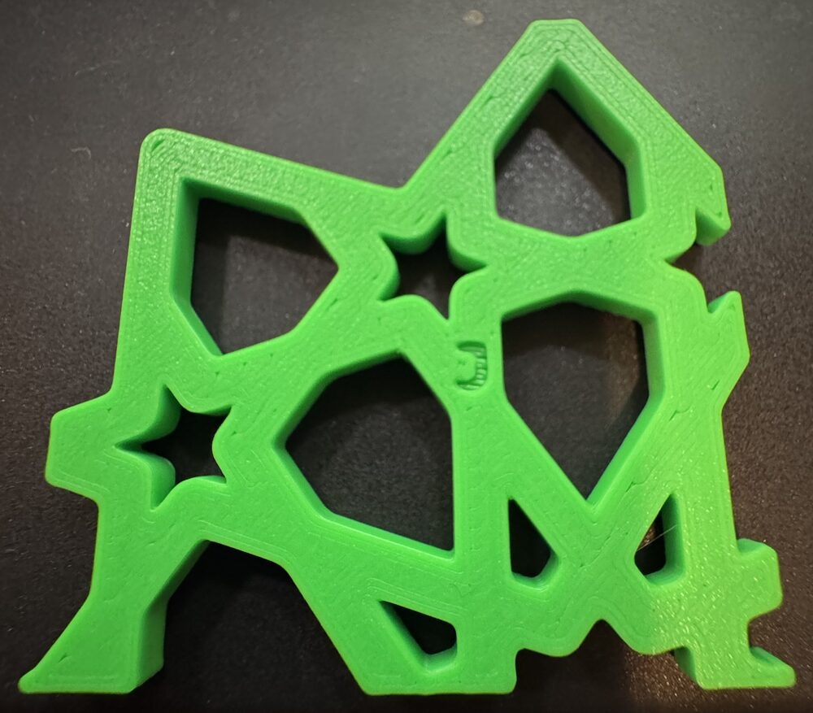

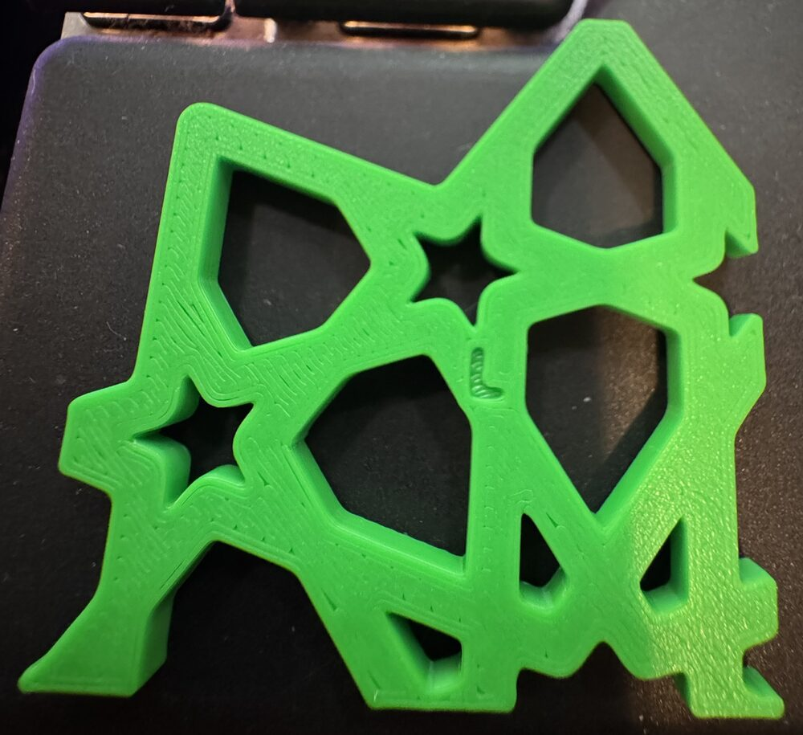

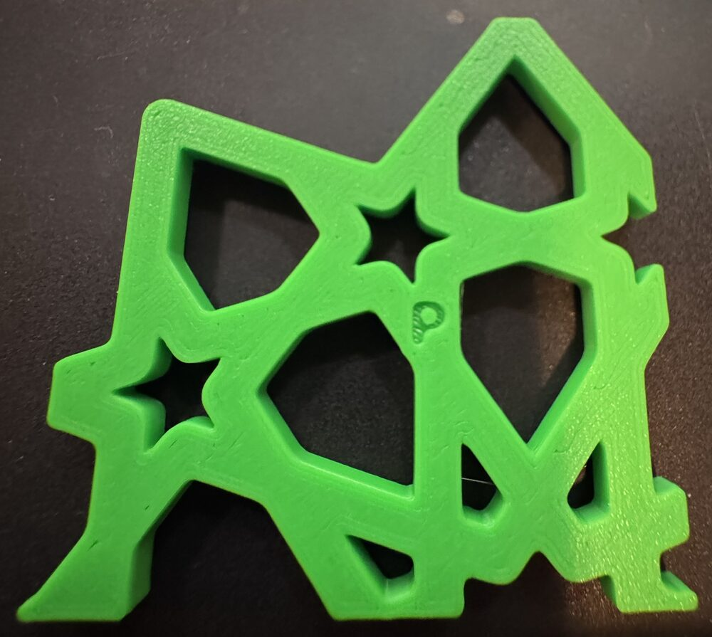

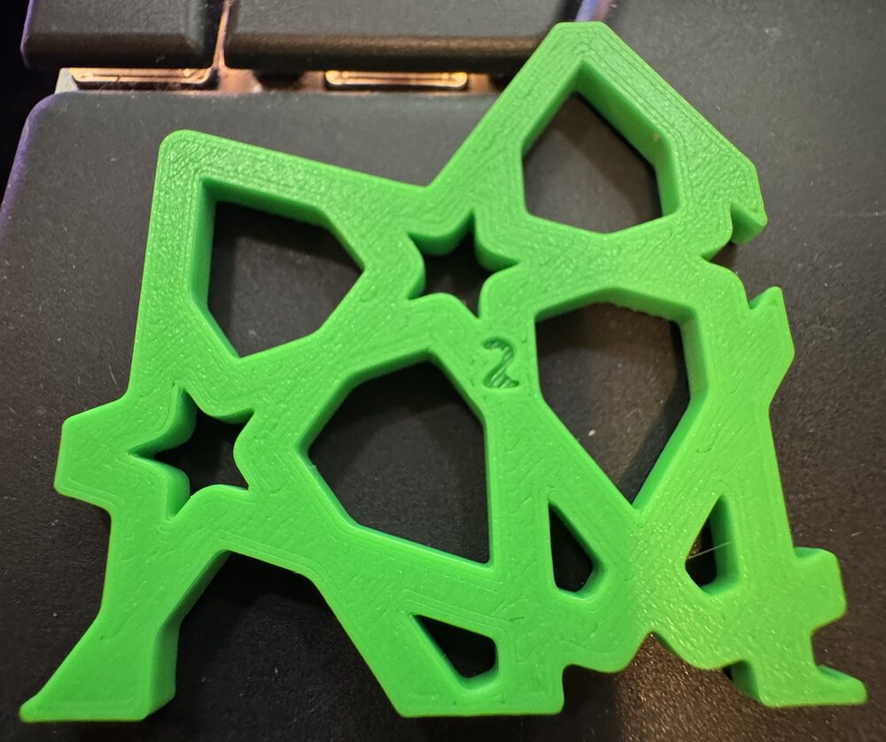

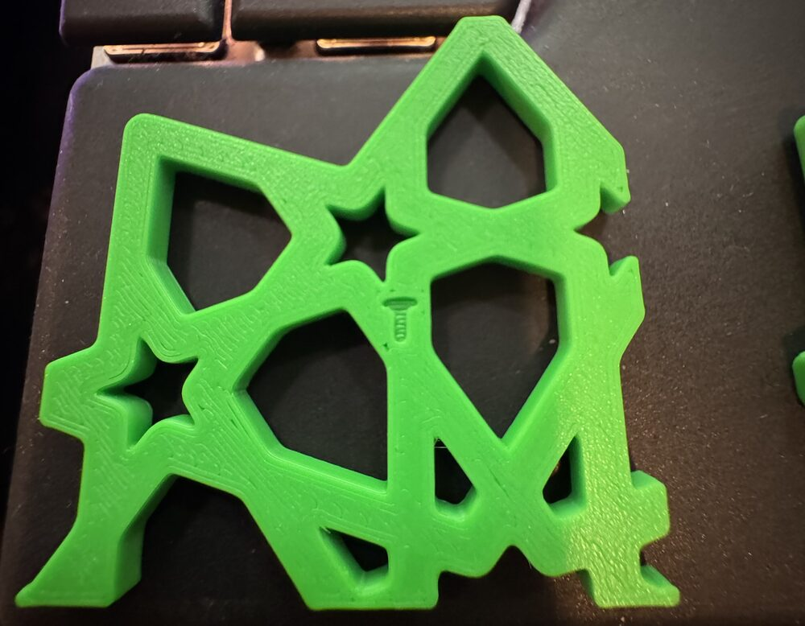

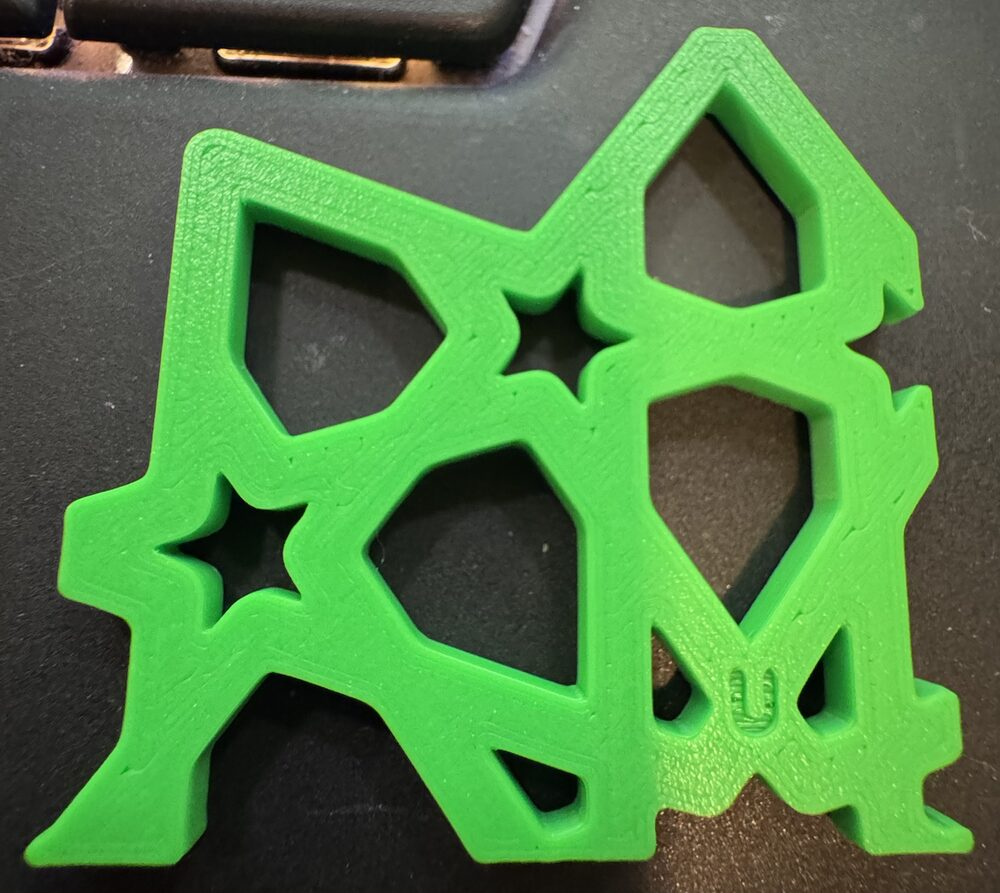

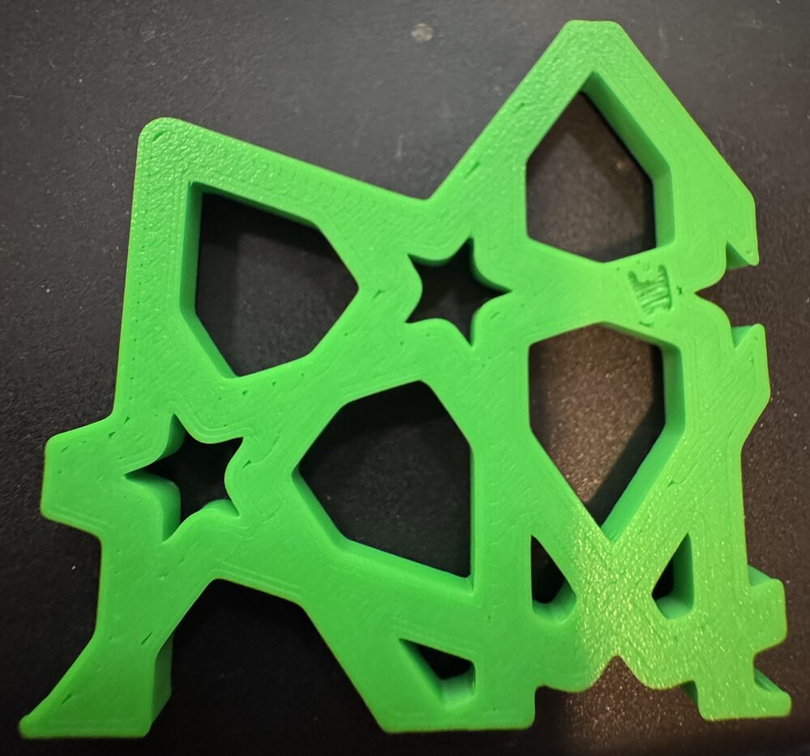

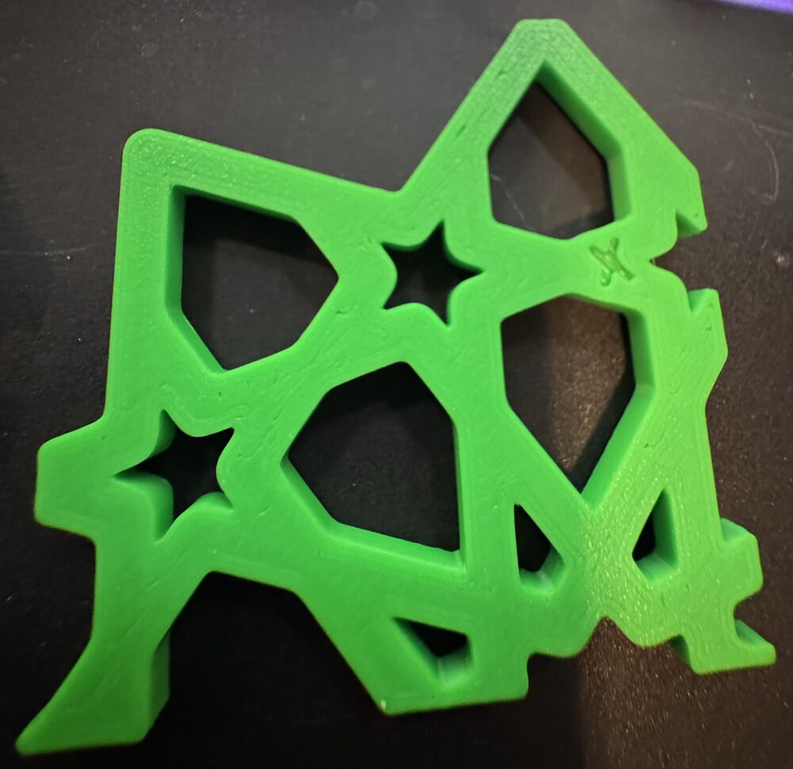

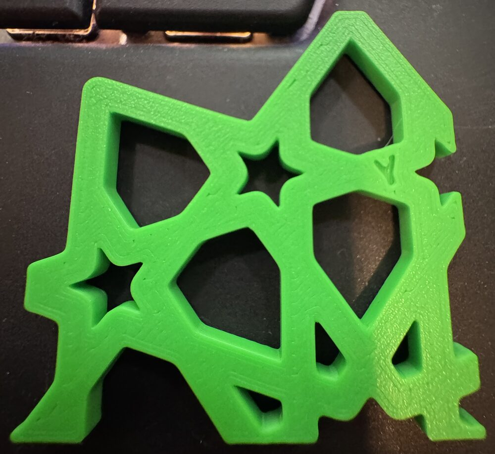

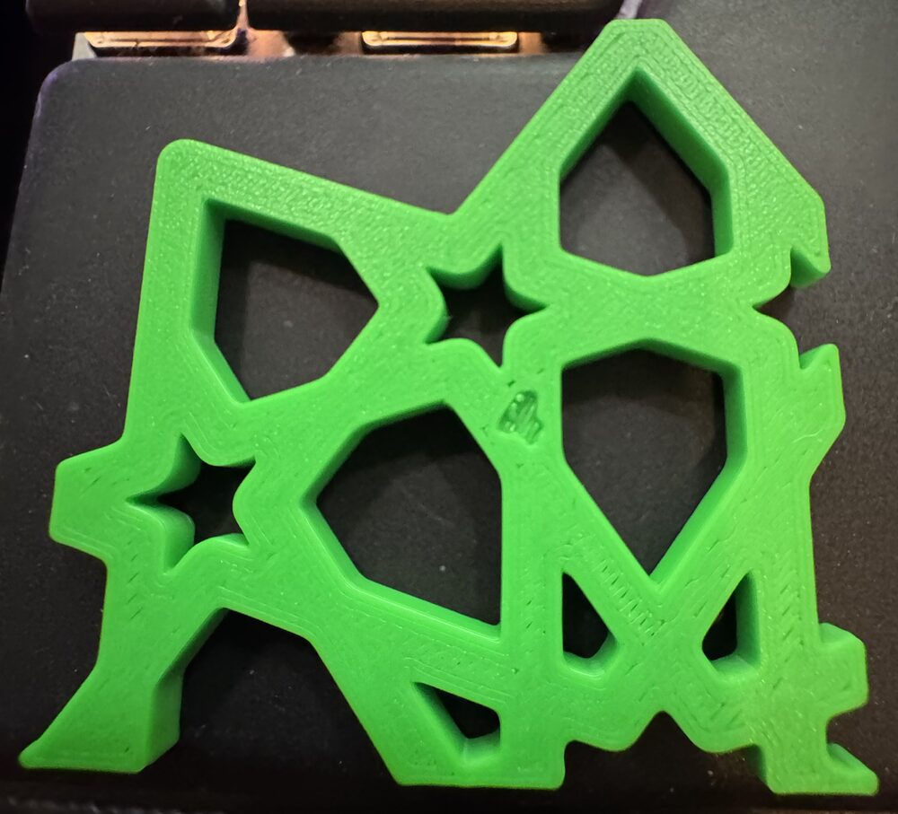

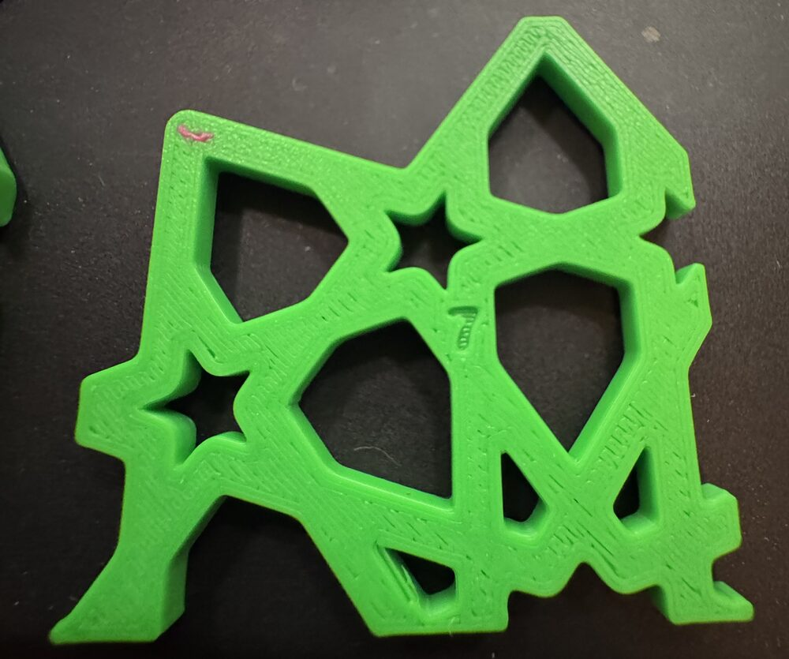

All twelve photos were re-saved with no metadata; none carried a location. Each was cut down to
the piece, which leaves out the lap at the bottom edge of several. The carved ids on `W`, `X`
and `4` are hard to read in the photos. `W` is named by elimination: Omar sent it with `U`'s
photo, while the flow 1.05 row was being asked.

**What the answers mean, as the page set them out before the print.**

- Row 1, "a little less": the pieces slit like the coaster, so every row below can be trusted.
- Row 3, "Fewer and no ridge": "55% beats 30%".
- Row 4, fewer on 1.10: "the first-layer flow goes on the next coaster, and the overlap and flow
  get one plate together".
- Row 5, "About the same": "the pattern is dropped".

Row 2 split, so 30% on its own has no answer; row 3 supersedes it anyway. What stands: 55%
overlap is the strongest setting here, and 10% more first-layer plastic helps a little. Neither
alone left a piece with no slits. What prints next, and how, is Omar's call. The open history is
in [the issue](../../issues/bed-face-preset-failed-in-print.md).

One thing I (Claude) noticed, not Omar: in both overlap pairs the turned piece did better (`P`
over `L`, `2` over `T`), and the slice ranked them the same way. Two pairs are too few to call it.

**The print.** Sent at 23:12 UTC on 2026-10-12, finished at 02:26 UTC on 2026-10-13: 194 minutes
against the slicer's 173, all 22 layers, no pause or error (the
[print log](../../design/plates/print-logs/bedface-4.md)). Green PLA Basic from AMS slot 3. The
timelapse is on [the page](../../design/plates/bedface-4.md#the-print).

The source hashes and iteration ids are the ones `bambu slice compose` recorded when the plate was
built, at bikar `11ea0fd0`. Nothing was measured with a tool, so there are no readings and no bet
moves.
