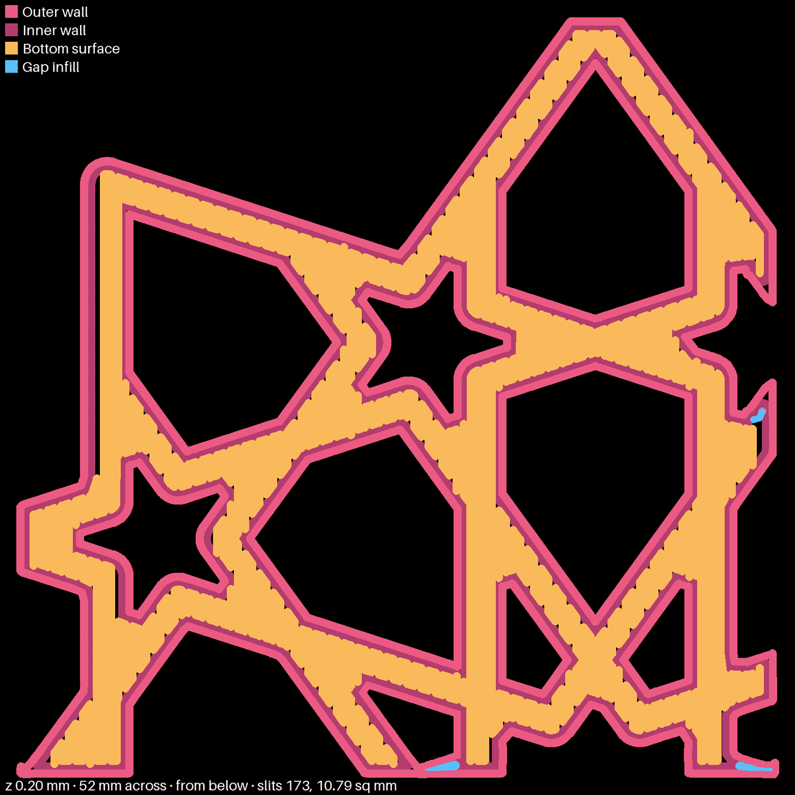

# The fill angle: which way the straps run, and what turning the fill does in the plan

Kept as the record the no-slits design's fill-angle line comes from. The slices and full-size pictures were made in the session scratchpad and are not kept. The commands below make them again. The three shrunk pictures are in `docs/research/2026-10-14-fill-angle-sweep-media/`.

**Labels.** As in the no-slits design: **Measured** is read from a slice's settings or G-code, or from Omar's words on a print. **Plan** is the slicer's drawing of the first layer; a plan is not a print. **Theory** is my own reasoning, not tested by a slice or a print.

## The short answer

- **The straps run in five directions, not ten.** On the bed, as composed, they run at 18°, 54°, 90°, 126° and 162°: 36° apart. **Measured** from the slice's first-layer outer wall. Research pass A assumed ten directions 18° apart and did not measure it.
- **No fill angle is clearly better than stock's 45° in the plan.** Laying the fill along a strap direction is clearly worse: it leaves one long gap down the side of each strap that runs that way, a pocket of about 6 sq mm. Laying it halfway between two strap directions (0° or 36°) gives the smallest pockets, but its bare share sits inside the plan's own noise. **Plan.**
- **The angle does not explain why the turned pieces on bedface-4 looked cleaner.** A quarter turn leaves the fill meeting the straps at the same five angles, only mirrored. **Theory**, checked against the measured strap directions. What the turn does change, the plan cannot separate from noise.
- **The drawing tool had a defect, fixed here.** It drew some fill angles with hairlines that are not in the plan, and counted thousands of false slits. It also drew stock slightly worse than it is, so earlier plan numbers in the docs run high.

## What was sliced

Two scratch recipes, both `bikar:patterns/Constructions/gBV_JTt3Kxk-minimal-coaster.bkr`, params `{ size: 112.5, strap: 3.75, height: 4.4, round: 1.25 }`, `no_id: "scratch slice, not printed"`, on `bed: x2d`, profile `Bambu Lab X2D 0.4 nozzle;0.20mm Standard @BBL X2D`, filament `Bambu PLA Basic @BBL X2D 0.4 nozzle`. The piece recipe adds `window: 50@13,30`, the same piece as bedface-4 and bedface-5. The whole recipe leaves the window out.

Each fill angle is a process file with `"type": "process"`, `"from": "User"`, `"inherits": "0.20mm Standard @BBL X2D"` and one key, `infill_direction`, passed with `-s`. That sets the angle for the whole plate. Compose takes no per-piece `infill_direction` today, and none was added. `infill_direction` is the only fill-direction key in the slice's settings; `infill_rotate_step` is "0" and `ironing_direction` is for ironing only.

Every slice printed `preset check: PASS` and `slicer warnings: none`, and `infill_direction` was read back from each slice's `Metadata/project_settings.config`.

The piece was sliced at every 4.5° from 0° to 175.5°: 40 angles, which covers 0, 45 and 90 and five strap periods of 36°. The whole coaster was sliced at 0, 4.5, 9, 13.5, 18, 27, 36, 45, 90, 126 and 135°.

## Commands

Slice: `bambu slice compose <recipe.yaml> -s "Bambu Lab X2D 0.4 nozzle;<angle.json>" -d <dir> -o <name>.3mf --no-record --plate-type hot_plate`.

Draw and measure the piece: `python3 tools/print_review.py paths <out.png> <slice.3mf> 0.2 138.2,128,52 --below --check --px 1560`, 30 px a millimeter. The whole coaster: the same with `138.2,128,116 --px 3480`, also 30 px a millimeter.

Strap directions: a scratch script read the first layer's outer-wall moves from the G-code, kept straight runs of 0.5 mm or more (the round corners are shorter chords), and added up their length by direction, modulo 180°.

Line ends at a shallow angle: the same script took the bottom-fill lines (moves of 0.3 mm or more within 2° of the fill direction), and for each line end within 1 mm of an inner wall, measured the angle the line meets that wall at. It counts the ends that meet the wall under 19.5°, the angle below which [research pass A](2026-10-13-bed-face-next-a.md) says the slicer joins a line to the wall rather than ending it.

## The strap directions

| Direction on the bed | Wall length (mm) | Share |
|---|---|---|
| 18.0° | 363.3 | 20.1% |
| 54.0° | 355.8 | 19.7% |
| 90.0° | 362.1 | 20.1% |
| 126.0° | 359.0 | 19.9% |
| 162.0° | 359.3 | 19.9% |

**Measured**, from the whole coaster's first-layer outer wall: 1805.9 mm of straight wall, 99.6% of it in these five directions. The pattern repeats every 36°, not every 18°.

On the piece, the same five directions show, plus the window's cut edges at 0° (18.5 mm) and 90° (the 130.1 mm at 90° there includes the vertical cut edges).

bedface-4's turned piece `J` (turned −90° on the plate) has its straps at 0°, 36°, 72°, 108° and 144°. **Measured** from bedface-4's own slice. A quarter turn moves the straps by half a period, 18°, so it does not lay the straps onto themselves. This corrects research pass A, which said a quarter turn maps straps onto straps.

## The fill angle against the straps

With stock's 45° fill, the unturned straps meet the fill at 27°, 9°, 45°, 81° and 63°. The turned straps meet it at 45°, 9°, 27°, 63° and 81°. That is the same set of five angles. The turned piece is the mirror image of the unturned one about the fill direction. **Theory** (arithmetic on the measured directions).

The same arithmetic sorts every fill angle into a few groups. Angles in one group meet the five strap directions at the same set of angles, so if the angle alone set the bare area, every angle in a group would score the same:

- **Stock's group:** 9°, 27°, 45°, 135° (and every angle 36° from one of them). The fill meets the straps at 9, 27, 45, 63 and 81°.
- **Halfway between two straps:** 0°, 36°, 72°, 108°, 144°. The fill meets the straps at 18, 18, 54, 54 and 90°.
- **Along a strap:** 18°, 54°, 90°, 126°, 162°. The fill runs along one strap direction and meets the others at 36, 36, 72 and 72°.

The line-end counts below agree with this: within a group, the number of line ends in each 10° band of angle to the wall matches to within a few ends (45°: 121, 1, 426, 8, 632, 14, 856, 9, 915; 9°: 119, 0, 427, 6, 631, 18, 849, 14, 916). **Measured** (plan).

## The whole coaster at each angle

Ranked by bare share and largest pocket, not by slit count, as the no-slits design does. Every row fails the check's bar (under 0.6% bare and no pocket of 0.2 sq mm or more). **Plan.**

| Fill angle | Group | Slits | Bare (sq mm) | Bare share | Largest pocket (sq mm) | Line ends under 19.5° |
|---|---|---|---|---|---|---|
| 45 (stock) | stock's | 1331 | 28.437 | 0.69% | 0.357 | 122 |
| 135 | stock's | 1295 | 28.861 | 0.70% | 0.358 | 155 |
| 27 | stock's | 1215 | 30.946 | 0.75% | 0.392 | 155 |
| 9 | stock's | 1093 | 33.718 | 0.82% | 0.404 | 119 |
| 0 | halfway | 1079 | 27.337 | 0.66% | 0.132 | 571 |
| 36 | halfway | 1437 | 27.411 | 0.67% | 0.262 | 575 |
| 18 | along a strap | 1029 | 37.109 | 0.90% | 6.612 | 36 |
| 90 | along a strap | 657 | 30.361 | 0.74% | 5.808 | 41 |
| 126 | along a strap | 743 | 32.381 | 0.79% | 6.039 | 34 |
| 4.5 | none | 1150 | 31.957 | 0.78% | 0.396 | 197 |
| 13.5 | none | 1025 | 33.871 | 0.82% | 0.829 | 61 |

The printed area is about 4080 sq mm in every row.

**The plan's own noise.** The four angles in stock's group should score the same, and they span 0.69% to 0.82% bare, and 1093 to 1331 slits. So two setups the angle cannot tell apart differ in the plan by about 0.13% bare share and about 20% in slit count. Only where a fill line happens to fall against the walls changes between them. Any difference smaller than that is not a difference. **Plan.**

What stands out against that noise:

- **Along a strap is clearly worse.** All three leave a pocket of about 6 sq mm, fifteen times stock's largest. The fill runs parallel to those straps, so the leftover part of a line spacing that does not fit is left as one long gap beside the wall instead of many notches. This is the leftover-fraction source of bare bed in no-slits design §3.3, here drawn on its own. The slit count falls because one long gap counts as one slit.
- **Halfway is slightly better, and only in the pocket size.** 0° and 36° agree with each other (0.66% and 0.67%), and their largest pockets (0.13 and 0.26 sq mm) are the smallest here. Their bare share is inside the noise of stock's group.
- **Halfway is the angle the joining theory calls worst.** At 0° or 36° the fill meets four of the five strap directions at 18°, just under research pass A's 19.5°, so about 570 line ends meet a wall that shallowly, against stock's 122. If the joining rule mattered in the plan, halfway should be worse; the plan draws it a little better. Only a print can say which is right.

## The piece at each angle

The piece shows the same pattern with more noise, and its cut edges add two more directions (0° and 90°) that the whole coaster does not have. **Plan.**

| Fill angle | Slits | Bare (sq mm) | Bare share | Largest pocket (sq mm) |
|---|---|---|---|---|
| 0 | 265 | 5.679 | 0.52% | 0.132 |
| 4.5 | 272 | 9.117 | 0.83% | 0.603 |
| 9 | 274 | 7.960 | 0.73% | 0.483 |
| 13.5 | 262 | 8.420 | 0.77% | 0.701 |
| 18 | 267 | 7.893 | 0.72% | 3.270 |
| 22.5 | 297 | 7.728 | 0.71% | 0.679 |
| 27 | 300 | 8.869 | 0.81% | 0.406 |
| 31.5 | 331 | 8.049 | 0.74% | 0.304 |
| 36 | 389 | 8.037 | 0.74% | 0.303 |
| 40.5 | 371 | 7.790 | 0.71% | 0.262 |
| 45 (stock) | 328 | 7.617 | 0.70% | 0.397 |
| 49.5 | 327 | 8.681 | 0.79% | 0.722 |
| 54 | 220 | 5.420 | 0.50% | 0.937 |
| 58.5 | 303 | 6.974 | 0.64% | 0.580 |
| 63 | 313 | 8.190 | 0.75% | 0.434 |
| 67.5 | 324 | 8.772 | 0.80% | 0.334 |
| 72 | 390 | 8.231 | 0.75% | 0.292 |
| 76.5 | 375 | 8.670 | 0.79% | 0.333 |
| 81 | 293 | 8.588 | 0.79% | 0.593 |
| 85.5 | 246 | 9.043 | 0.83% | 0.758 |
| 90 | 173 | 10.787 | 0.99% | 5.819 |
| 94.5 | 226 | 7.109 | 0.65% | 0.637 |
| 99 | 281 | 7.859 | 0.72% | 0.353 |
| 103.5 | 309 | 8.267 | 0.76% | 0.376 |
| 108 | 343 | 7.920 | 0.72% | 0.254 |
| 112.5 | 291 | 7.752 | 0.71% | 0.287 |
| 117 | 277 | 7.654 | 0.70% | 0.337 |
| 121.5 | 255 | 7.797 | 0.71% | 0.607 |
| 126 | 188 | 4.356 | 0.40% | 0.598 |
| 130.5 | 271 | 5.777 | 0.53% | 0.546 |
| 135 | 342 | 6.564 | 0.60% | 0.400 |
| 139.5 | 358 | 6.376 | 0.58% | 0.271 |
| 144 | 365 | 6.157 | 0.56% | 0.261 |
| 148.5 | 309 | 6.043 | 0.55% | 0.246 |
| 153 | 311 | 5.747 | 0.53% | 0.400 |
| 157.5 | 309 | 6.109 | 0.56% | 0.742 |
| 162 | 259 | 6.517 | 0.60% | 0.744 |
| 166.5 | 245 | 7.142 | 0.65% | 0.576 |
| 171 | 259 | 7.107 | 0.65% | 0.382 |
| 175.5 | 284 | 8.183 | 0.75% | 0.608 |

Printed area about 1078 sq mm in every row. Only 0° passes the check. Its line ends: 107 meet a wall under 19.5°, against stock's 35.

The piece's lowest bare share, 126°, is along a strap, and on the whole coaster 126° is among the worst (0.79%, a 6 sq mm pocket). The piece's 0° pass also does not carry: the whole coaster at 0° is 0.66%, inside the noise of stock. A piece is cut from the coaster at an arbitrary place, so where its edges fall decides part of its score. The whole coaster is the number to trust here.

## Does the angle explain the turned pieces on bedface-4?

**No.** On bedface-4, the turned piece looked cleaner in both overlap pairs: "P has fewer, l has more", and "2 is better than T" ([the record](../prints/2026-10-13-bedface-4/index.md)). **Measured** (Omar's words on the print). But a quarter turn leaves the fill meeting the straps at the same five angles, mirrored (above). So the fill angle against the straps is the same on both pieces of each pair. **Theory**, on measured directions.

bedface-4's own slice, re-measured with the fixed tool (**plan**):

| Piece | Setting | Turned | Slits | Bare (sq mm) | Bare share | Largest pocket (sq mm) |
|---|---|---|---|---|---|---|
| `H` | stock | no | 318 | 7.660 | 0.71% | 0.342 |
| `J` | stock | yes | 311 | 7.729 | 0.71% | 0.374 |
| `L` | overlap 30% | no | 251 | 3.630 | 0.33% | 0.202 |
| `P` | overlap 30% | yes | 229 | 3.624 | 0.33% | 0.184 |
| `T` | overlap 55% | no | 128 | 1.140 | 0.10% | 0.151 |
| `2` | overlap 55% | yes | 78 | 0.910 | 0.08% | 0.149 |
| `7` | monotonic line | no | 184 | 1.947 | 0.18% | 0.363 |
| `4` | monotonic line | yes | 132 | 1.819 | 0.17% | not read |

In every pair the turned piece has the same bare area to within 0.23 sq mm, and fewer slits (`P` fewer than `L`, `2` fewer than `T`, `4` fewer than `7`). That matches the print in the two pairs Omar called. But the swing in slit count is about the size of the noise between equivalent fill angles above, and the turn changes more than one thing: which side of each strap the fill meets first, the order the lines are laid, where the walls start and end. The plan cannot say which of those, if any, the print saw. **Can't tell** beyond "not the angle."

The flow pairs (`U`, `W`, `X`, `Y`) were all turned, so they say nothing about the turn.

## bedface-4's photos

The photos are about 20 px a millimeter, taken at a slant, and the right side is washed out by the lamp's glare. Rows of dots show along `H`'s straps, and `J` looks smoother, but the light on the two differs. They are not sharp enough to count slits by strap direction, so they were not sorted. **Measured** (looked at, not counted).

## A defect in the drawing tool, fixed

`paths` drew each bead as a wide line through Pillow. At some angles those come out about a pixel thin. The first layer's fill is laid 0.501 mm wide and 0.458 mm apart (**measured** from the G-code), so the beads overlap and leave no bed between them. The drawing still opened a hairline between neighbors at some angles, and counted 2849 slits at 22.5° and 2740 at 27° on the piece. Each bead is now drawn as its own rectangle plus round ends.

The tool's self-test now lays overlapping fill across the test square at 22.5°, 27° and 45°, and expects no slit. The old drawing found 1117 and 891 slits at the first two, and none at 45°. The fixed drawing finds none at all three.

The fix also changes stock, so earlier plan numbers ran high. On the piece at 45°, stock was 355 slits, 9.511 sq mm, 0.87% bare and a 0.453 sq mm largest pocket with the old drawing; it is 328 slits, 7.617 sq mm, 0.70% and 0.397 sq mm now. The check's bar (under 0.6% bare and no pocket of 0.2 sq mm or more) was set against the old drawing's numbers, so with the fixed drawing the same bar is a little easier to meet. The bar is not changed here.

## Is a plate that tests angles worth printing?

**Not on its own.** No angle is clearly better in the plan. The one clear finding, that along a strap is worse, needs no print to act on: just do not use those angles. The plan has also misranked the print three times ([no-slits design §2](../design/printing/no-slits-design.md#2-why-the-plan-is-not-the-print)), and the difference between halfway and stock is inside the plan's noise.

What a print could settle that the plan cannot: whether the 19.5° joining rule matters. Halfway (0°) has about four times as many shallow line ends as stock, and the plan draws it a little better. One 0° pair beside a stock pair, riding on a plate that is printing anyway, would test that. Two catches: compose sets the angle only for the whole plate today, so a 0° pair beside stock needs a per-piece `infill_direction` key first; and the pair would have to be turned the same way as its stock pair, so the turn does not ride along.

## An infill_direction compose key

No angle is clearly better, so this file does not recommend adding the key for its own sake. If it is added for the test above, the one rule the plan supports is: never lay the fill along one of the five strap directions (18°, 54°, 90°, 126°, 162° on the bed, as composed). Those angles change with the piece's turn on the bed, so the key's value would have to follow the turn.

## An idea, mine and untested: edit only the line ends in the G-code

A small script could read the sliced G-code and change only the bottom-fill lines that end at a strap wall: stretch each end a little into the wall, or add a short dab of plastic there. Everything else stays as the slicer planned it. It attacks the notch at each line end directly, without changing the walls, the fill angle or the whole layer's flow. It is not built. Nothing here tests it, and the slicer's checks would no longer cover the edited file, so the first test would have to be a print of pieces beside an unedited stock pair. **Theory, not yet tested.**

## What this does not settle

- None of this is printed. Every bare number is a plan.
- The noise estimate comes from one group of four angles on one coaster. Another coaster, or another window, may be noisier.
- Why the turned pieces looked cleaner. The angle is ruled out; the rest is open.
- The earlier docs' plan numbers drawn with the old tool (stock 355 slits, 0.87% bare) are not rewritten here.
