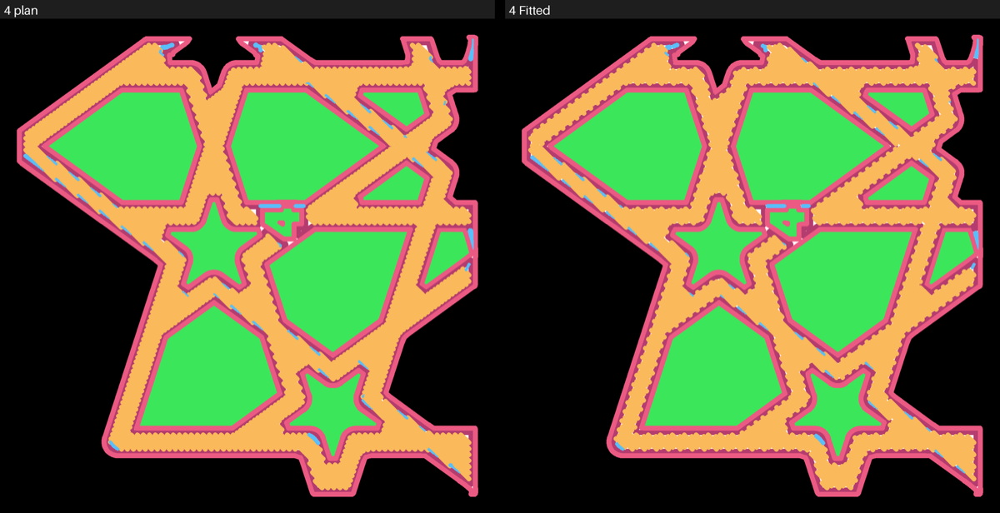
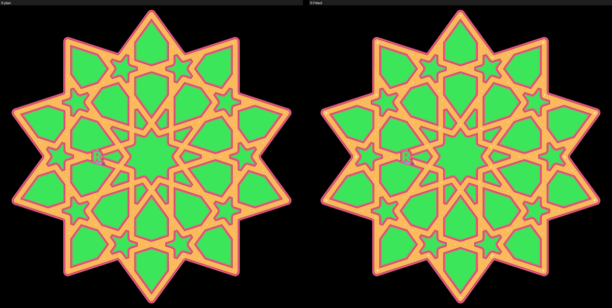
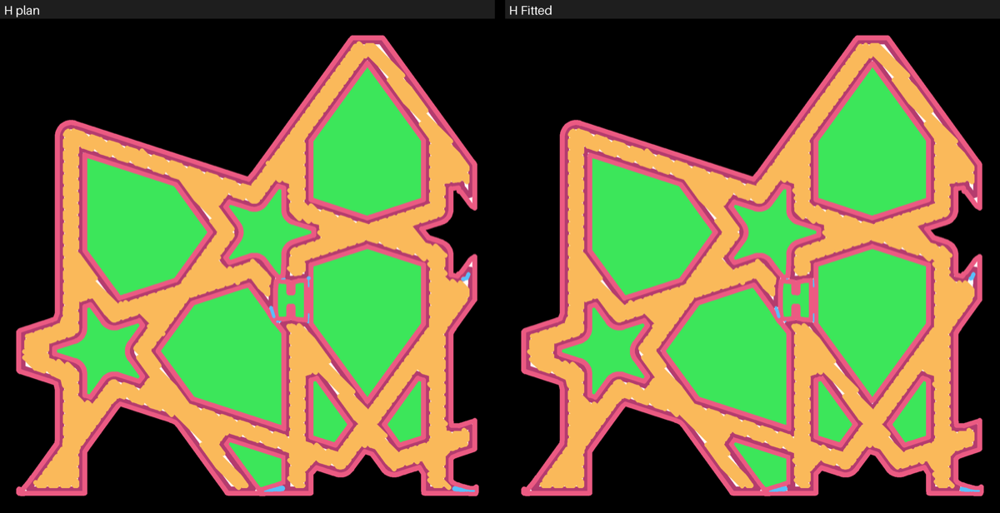

# Teaching the simulator one setup: the marks, the fit, and a prediction for bedface-5

Kept as the record the glacier profile and the teach-simulator skill come from. The commands at the
end make every number again.

**Labels.** **Measured** is read from a slice or from Omar's words on a print. **Plan** is the
slicer's drawing of the first layer. **Theory** is the spread model by hand. **Fitted** is the reading
taught here: its numbers were chosen because they rank Omar's judged pairs the way he did. No bead
was measured, so nothing here is Measured but the slices and his words. The marks are Claude's
reading of the photos, not Omar's.

## The short answer

- **The marks do separate the layouts.** Stock and 30% overlap slit along the walls; monotonicline
  slits across the middle of the straps; rings slit where the rings close. The mark totals order 6
  of the 8 marked pairs that are not ties as Omar did.
- **The fit beats the plain plan on the pairs it was taught on, and not on a plate it has not
  seen.** Taught on all 13 glacier pairs, Fitted ranks 7 as Omar did; the plain plan ranks 4. Held
  out one plate at a time it ranks 4 of 13, no better than the plan, and none of the 4 ties.
- **So it does not meet the iterate bar,** and iterate-first-layer will stop at its first step on
  this setup. Shipping the fit anyway is a judgment call, explained below. Its first real test is
  bedface-5, predicted here before it prints.

## The setups

Every judged piece is tagged with the setup it printed on. Two setups have pieces:

| Setup | Plates | Pieces | Profile |
|---|---|---|---|
| X2D, 0.4 mm nozzle, glacier plate, PLA Basic | bedface-1, bedface-2, bedface-4, sheets-04g-fit2 | 16 | taught here |
| X2D, 0.4 mm nozzle, textured PEI plate, PLA Basic | bedface-3 | 2 (G, K) | `can_fit: false` |

The textured plate is not taught. Its two pieces were each judged only against a glacier piece (G
against S, K against R), so no pair has both pieces on it, and the plate's grain is pressed into the
whole face and hides the slits in the photos. Those two pairs are left out of the fit rather than
pooled: what the glacier plate teaches about spread and line starts does not carry to a textured
surface unless a held-out score there says so.

The slicer has no type for the glacier plate; it is sliced as the High Temp plate. So the glacier
profile also matches a slice for Bambu's own High Temp plate, and nothing here says the fit carries
to that plate.

## The marks

Each piece's bed-face photo was marked at four places, 0 (none) to 3 (many): along the walls, in the
middle of a strap, at a ring seam (rings only) and by the carved id. The rubric is
[marking-rubric.md](../../.claude/skills/teach-simulator/marking-rubric.md); the marks are in
[marked-slits.yaml](../../.claude/skills/simulate-first-layer/marked-slits.yaml). Z has no photo
(sheets-04g-fit2 was judged by hand), and G and K are unmarked for the grain.

| Layout | Pieces | Wall | Middle | Ring seam | Id |
|---|---|---|---|---|---|
| stock | 7 | 2.0 | 1.1 | - | 0.0 |
| overlap 30% | 2 | 2.0 | 1.5 | - | 0.0 |
| overlap 55% | 2 | 1.5 | 1.5 | - | 0.5 |
| monotonicline | 2 | 1.0 | 3.0 | - | 0.0 |
| rings | 2 | 1.0 | 1.5 | 3.0 | 0.0 |

Mean level, Claude's reading. The wall and middle columns each span a full step or more across
layouts, so the slits do sit in different places by layout.

Ordering pairs by mark totals agrees with Omar on 6 of the 8 marked pairs that are not ties, and 8 of
12 in all. Where it misses: 2 against P and X against Y read the same (he found the first better);
W against J reads better (he found them "almost identical"); R against S reads worse (he found them
about the same).

**The photos limit all of this.** Most were taken at an angle with glare on the right third, so only
the left two-thirds of each piece was read. P's light is flatter and may hide fine dots. X and Y
could not be told apart at the photo's size.

**The stop rule's first half passes:** the marks separate the verdicts, so a fit may go on.

## The model

The fewest numbers that can put bare bed where the photos have it:

| Number | What it stands for | Tried |
|---|---|---|
| spread | every bead `spread × flow × h / (h − lower)` times its planned width | 1.0, 1.05, 1.1 |
| pull_mm | the first this-many mm of every stroke laid thin, where a line starts and the pressure lags | 0, 0.25, 0.5, 1.0 |
| thin | how thin that start is: 1 not laid at all, 0.5 half its width | 0.5, 1.0 |
| at_turns | a turn sharper than 60° starts the thin stretch again | no, yes |

A stroke is what the nozzle lays from one travel to the next. That is 39 models (pull 0 is tried once
per spread). The pick is the model that ranks the most training pairs as Omar did; a tie goes to the
one with fewer free numbers, then the shorter thin start, then the spread nearest 1.

**The pick: spread 1.0, the first 0.25 mm of every stroke not laid, no restart at turns.** Two free
numbers. Four of the 39 models rank 7 of 13 alike:

- spread 1.0, 0.25 mm not laid (the pick);
- spread 1.1, 1.0 mm laid at half width;
- spread 1.0, 0.5 mm at half width, restarted at turns;
- spread 1.05, 0.5 mm at half width, restarted at turns.

So the fit is not unique. The data choose "line starts thin" over "no line starts", but not how long
or how thin.

## How far it agrees

13 pairs on the glacier setup, 4 of them ties (Omar found the two the same). A tie counts as agreed
only when both pieces fall within 0.13 points of bare share of each other; that band was measured
for the plan, and is carried over here unmeasured.

| Reading | All | Not ties | Ties | Held out, all | Held out, not ties | Held out, ties |
|---|---|---|---|---|---|---|
| Plan | 4 of 13 | 3 of 9 | 1 of 4 | 4 of 13 | 3 of 9 | 1 of 4 |
| Theory, spread 1.0 alone | 5 of 13 | 5 of 9 | 0 of 4 | 5 of 13 | 5 of 9 | 0 of 4 |
| Fitted | 7 of 13 | 5 of 9 | 2 of 4 | 4 of 13 | 4 of 9 | 0 of 4 |

"Held out" here means one plate at a time: the model is chosen on every other plate's pairs and
scored on that plate's. Plates judged against each other go out together, so there are three folds:
bedface-4 (11 pairs), bedface-1 with sheets-04g-fit2 (F against Z), and bedface-2 (R against S). The
plain plan and spread 1.0 fit nothing per fold, so their held-out score is their score. One pair out
at a time, as a second look, Fitted ranks 5 of 13 (5 of 9 not ties, 0 of 4 ties).

The pair rows, bare share in the Plan and Fitted readings:

| A | B | Omar | Plan A | Plan B | Fitted A | Fitted B | Fitted says | Agrees | Held out agrees |
|---|---|---|---|---|---|---|---|---|---|
| P | J | better | 0.33% | 0.72% | 0.35% | 0.75% | better | yes | yes |
| L | H | worse | 0.34% | 0.71% | 0.35% | 0.76% | better | no | no |
| T | L | better | 0.11% | 0.34% | 0.12% | 0.35% | better | yes | no |
| 2 | P | better | 0.08% | 0.33% | 0.09% | 0.35% | better | yes | yes |
| 2 | T | better | 0.08% | 0.11% | 0.09% | 0.12% | same | no | no |
| W | J | same | 0.62% | 0.72% | 0.49% | 0.75% | better | no | no |
| U | J | better | 0.69% | 0.72% | 0.52% | 0.75% | better | yes | yes |
| Y | J | better | 0.64% | 0.72% | 0.34% | 0.75% | better | yes | yes |
| X | Y | better | 0.62% | 0.64% | 0.33% | 0.34% | same | no | no |
| 4 | J | same | 0.16% | 0.72% | 0.63% | 0.75% | same | yes | no |
| 7 | H | same | 0.18% | 0.71% | 0.71% | 0.76% | same | yes | no |
| F | Z | not_better | 0.20% | 0.71% | 0.49% | 0.74% | better | no | no |
| R | S | same | 0.34% | 0.74% | 0.52% | 0.77% | better | no | no |

What Fitted gets right that the plan does not: the two monotonicline ties. Laying no line start
lifts 4 and 7 to stock's level, as Omar saw. What it still gets wrong: 30% overlap worse than stock
(L against H), the rings pair (R against S) and F against Z, where it still reads the change cleaner
than stock; and it cannot see what made X better than Y.

**Why the held-out score drops.** Bedface-4 holds 11 of the 13 pairs. Held out, its fold is chosen on
only two pairs (F against Z and R against S), which picked spread 1.1. That fold loses the
monotonicline ties. The other two folds each test one pair, which Fitted gets wrong either way. With
three plates, one of them holding most of the pairs, a held-out score this low says more about how
little there is to hold out than about the model, and also cannot show the model is right.

## The judgment call

The stop rule says: if marking does not separate the verdicts, ship the marks without a model. The
marks do separate them. Its second sign, a held-out score at half or below, does show (4 of 13). So
the fit is shipped, with that score as its line, because:

- the fit is honest about itself: the glacier profile's line, printed beside every Fitted number,
  says the held-out score and that it does not meet the iterate bar;
- the iterate bar reads the held-out score, so no round of ideas runs on it;
- a prediction written before bedface-5 prints is a test the fit did not choose, which the folds
  cannot give.

The other way, shipping the marks and no model, was open too. It is a judgment call, and Omar may
prefer it.

## Where Fitted puts the bare bed

Plan on the left, Fitted on the right; blue is a pocket the beads leave bare, white a hairline.







**What the pictures show:** on stock (H) Fitted keeps the bare bed along the walls, where the photo
has it; on rings (R) its new flecks sit at the star tips and crossings, near where the rings close,
where the photo has its teardrop gaps; but on monotonicline (4) its new bare bed is flecks along the
strap edges, where each line starts, not the rows of dashes across the strap middles the photo
shows, so it lifts 4 to stock's level for a reason the photo does not support.

## The prediction for bedface-5, written 2026-10-14, before it prints

bedface-5 is six pairs on the bedface-4 piece at normal height: stock, wall overlap at 55%, 75% and
100%, and 55% and 75% with first-layer flow 1.1. Fitted, fewest bare first, by the ids cut into the
pieces (these are bedface-5's own ids; some letters repeat earlier plates'):

| Rank | Piece | Settings | Fitted bare | Plan bare | Within 0.13 points of the one above |
|---|---|---|---|---|---|
| 1 | R | overlap 75%, flow 1.1 | 0.03% | 0.04% | |
| 2 | S | overlap 75%, flow 1.1 | 0.04% | 0.05% | yes |
| 3 | E | overlap 100% | 0.04% | 0.04% | yes |
| 4 | K | overlap 55%, flow 1.1 | 0.04% | 0.09% | yes |
| 5 | A | overlap 75% | 0.05% | 0.04% | yes |
| 6 | G | overlap 55%, flow 1.1 | 0.05% | 0.11% | yes |
| 7 | F | overlap 100% | 0.08% | 0.07% | yes |
| 8 | 9 | overlap 55% | 0.09% | 0.07% | yes |
| 9 | C | overlap 75% | 0.10% | 0.10% | yes |
| 10 | 8 | overlap 55% | 0.12% | 0.11% | yes |
| 11 | 5 | stock | 0.72% | 0.69% | |
| 12 | 3 | stock | 0.75% | 0.71% | yes |

Order: R, S, E, K, A, G, F, 9, C, 8, 5, 3. It is also written, dated, in the glacier profile.

Read inside the band, this is two groups, not twelve places: **the ten changed pieces about alike,
and the two stock pieces clearly barer.** That is the claim to test. It is a hard one for this fit:
it got 30% overlap against stock wrong on bedface-4 (Omar found L worse than H), and every changed
piece here is an overlap. If Omar finds the overlap pieces no cleaner than stock, the fit has failed
its first real test.

## What Fitted cannot see

- **Anything the judged pieces did not vary.** Speed, temperature, a new fill pattern, a larger shape
  are read by the same two numbers, which nothing has checked there.
- **Pressure as a nozzle has it.** The bare line start is a stand-in fitted to the verdicts, not a
  model of the extruder.
- **The bed's height spot to spot, and its surface.** A slit from a low spot is not in the model.
- **Whether a gap closes after the second layer.**
- **Its own noise.** The 0.13-point band is the plan's.

## What a better photo would add

Every photo was taken at an angle, and most have glare on the right third. A flatbed scan, or a shot
straight down with light from one low side, would show the whole face, make the fine dots countable
and let X be told from Y. Those are Omar's to take. With them the marks could be counted rather than
leveled 0 to 3, and the fit could be checked against where the slits are, not only against which
piece is better.

## Commands

```
python3 .claude/skills/teach-simulator/scripts/marks.py
python3 .claude/skills/teach-simulator/scripts/fit.py fit --setup x2d-0.4-glacier-pla-basic --pictures <dir>
python3 .claude/skills/teach-simulator/scripts/fit.py predict bedface-5 --setup x2d-0.4-glacier-pla-basic
python3 .claude/skills/simulate-first-layer/scripts/simulate.py plate <bedface-5 slice>
```

The scores are cached in the gitignored build folder; a first run slices nothing but scores each
piece at all 39 models, a few minutes on 16 cores.
