# Print vocabulary

<!-- Written by vocabulary.py from vocabulary.yaml. Edit the YAML, then run:
     python3 .claude/skills/maintain-vocabulary/scripts/vocabulary.py render -->

The words we use for printing coasters, each with a picture of the real thing and where it
shows up on our coasters. Look-alikes sit next to each other: a skirt beside a brim, a pin
beside a stud, a flange beside a lip. The same page is on the hub, under Vocabulary.

A picture marked *drawing* is a diagram; every other one is a slice, a render or a photo of
ours. To add a term, see the [maintain-vocabulary skill](../../.claude/skills/maintain-vocabulary/SKILL.md).

- **What the slicer adds round or under a piece:** [Skirt](#skirt), [Brim](#brim), [Raft](#raft), [Supports, grid and tree](#supports-grid-and-tree)
- **What holds two parts together:** [Pin](#pin), [Stud](#stud), [Rail and slot (a slide)](#rail-and-slot-a-slide), [Dovetail](#dovetail), [Halves (a split piece)](#halves-a-split-piece), [Printed in place](#printed-in-place)
- **Shapes we cut into a piece:** [Flange (a step)](#flange-a-step), [Lip](#lip), [Slope (stairs under the flange)](#slope-stairs-under-the-flange), [Wedge (a slice of the ring)](#wedge-a-slice-of-the-ring)
- **Telling pieces apart:** [Dots](#dots), [Carved id](#carved-id)
- **Fit and the bottom face:** [Gap (the fit)](#gap-the-fit), [First layer](#first-layer), [Bed face](#bed-face)

## What the slicer adds round or under a piece

### Skirt

*Also: brim (the look-alike).*

A loop or two of plastic that the printer lays on the bed round everything, a few millimetres away from the pieces, before it prints them. It touches nothing. It is there to get the plastic flowing cleanly, and it is thrown away after.

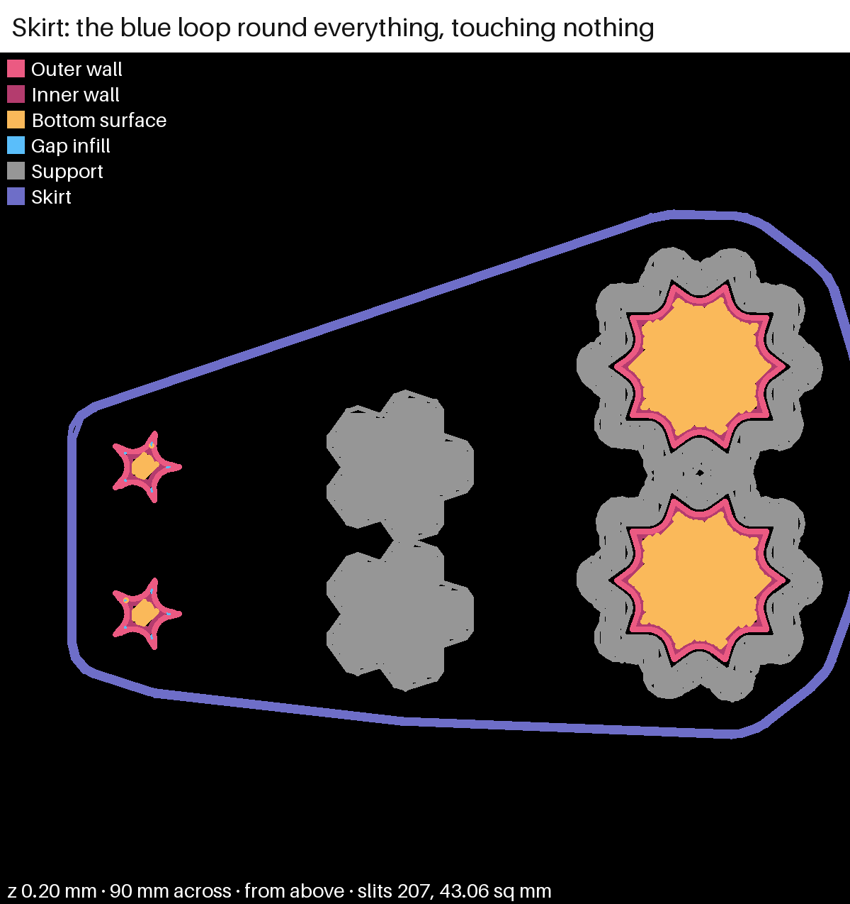

*First layer of the demo slice, seen from above. A blue loop runs round all the pieces, well away from them. (made for this page, from the demo slice media/bases-demo.yaml.)*

**On our coasters.** Our printer's stock settings print no skirt, and no plate of ours has asked for one. On closeout-1 you asked "do we have stars with skirts in this?": the star you meant, STAR-GRID, stands on grid supports, which are a base under it, not a skirt. The picture is a demo slice made for this page, with a two-loop skirt turned on: the blue loop runs round the whole bed.

```json
{"inherits": "0.20mm Standard @BBL X2D",
 "skirt_loops": "2", "skirt_distance": "3"}
```

Plates: [closeout-1](../design/plates/closeout-1.md) · See also: [Brim](#brim), [Raft](#raft), [Supports, grid and tree](#supports-grid-and-tree)

### Brim

*Also: mouse ears, skirt (the look-alike).*

A flat band of plastic, one layer thick, printed joined onto the piece's outside edge on the first layer. It gives the piece more grip on the bed so its edges do not lift. You peel or cut it off after.

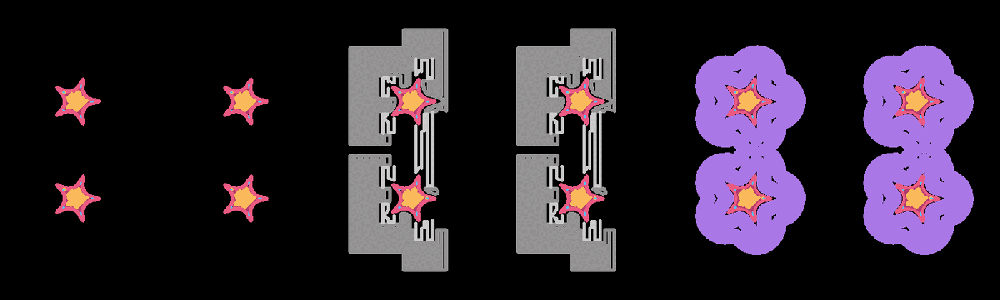

*star-1's first layer. The stars on the right sit in a purple band joined to their edge; that band is the brim. (star-1's slice.)*

**On our coasters.** star-1 put a 5 mm brim round one sloped star (SLOPE-BRIM), to see if a base helps the star's bottom. A brim only touches the edge, so the bottom face stays the piece's own.

```yaml
object_settings: { brim_type: "outer_only", brim_width: "5" }
```

Plates: [star-1](../design/plates/star-1.md) · See also: [Skirt](#skirt), [Raft](#raft)

### Raft

A few thick layers of plastic printed under the whole piece, and the piece is printed on top of them. The piece never touches the bed. You break the raft off after.

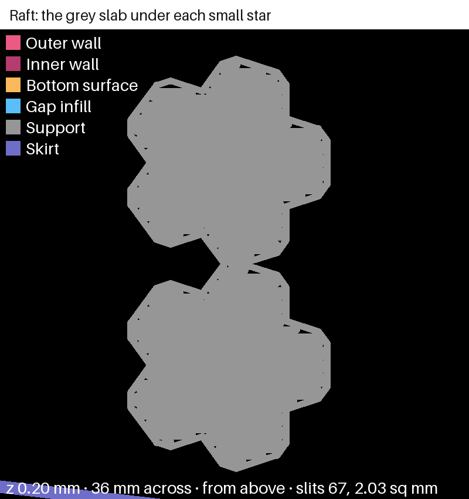

*First layer of the demo slice, close up. Two solid grey star shapes, wider than the pieces; the pieces print on top of them. (made for this page, from the demo slice media/bases-demo.yaml.)*

**On our coasters.** We have not printed one. star-1 left it out on purpose: under a raft the piece's bottom is the raft's top, so it is rough, and the bottom face was the face being judged. The picture is the demo slice: two grey stars of raft where two small stars will sit.

```yaml
object_settings: { raft_layers: "2" }
```

Plates: [star-1](../design/plates/star-1.md) · See also: [Brim](#brim), [Supports, grid and tree](#supports-grid-and-tree), [Bed face](#bed-face)

### Supports, grid and tree

*Also: normal supports, tree supports, a base.*

Plastic the slicer builds under a part that would otherwise be printed over air, such as the underside of a flange. Grid supports (Bambu calls them "normal") are blocks of straight lines straight down under every overhang. Tree supports are thin branches that grow from a few spots on the bed and reach up to the overhang. Both snap off after.


*star-1's first layer. The middle stars stand in grey blocks of straight lines; those are grid supports. (star-1's slice.)*

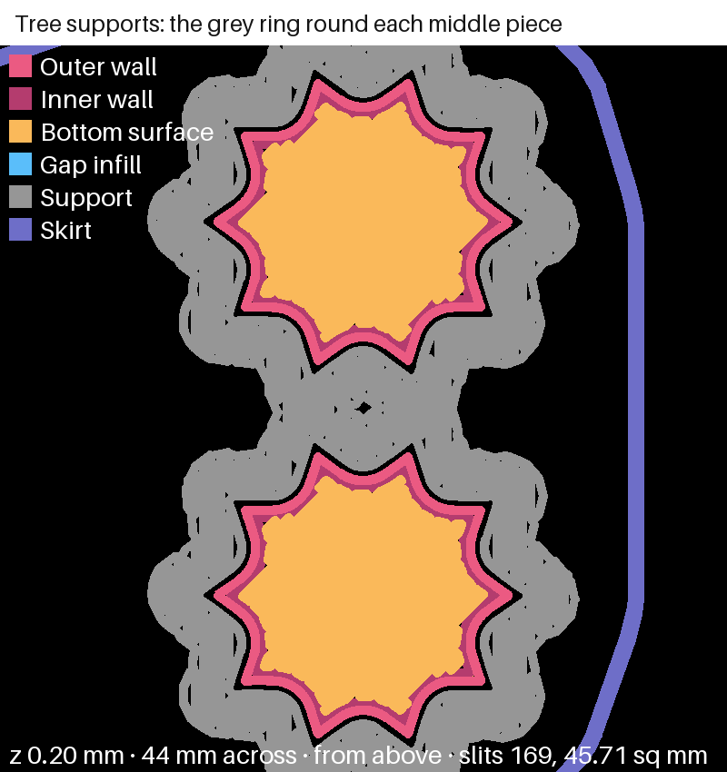

*First layer of the demo slice. Grey rings, a few mm wide, round two middle pieces; tree supports grow up from them. (made for this page, from the demo slice media/bases-demo.yaml.)*

**On our coasters.** On split-10 the stock tree supports met the middle piece's wide flange and laid a ring a few millimetres wide on the bed round it. A star's step out is narrow, so tree supports gave it only a few twigs. star-1 tried grid supports under a sloped star instead (SLOPE-GRID), and star-2 and closeout-1 kept that star. The first picture is star-1's first layer: the grey blocks are grid supports. The second is the demo slice: the grey rings round the two big middle pieces are where tree supports stand on the bed.

```yaml
object_settings: { enable_support: "1", support_type: "normal(auto)" }   # grid
object_settings: { enable_support: "1", support_type: "tree(auto)" }     # tree
```

Plates: [split-10](../design/plates/split-10.md), [star-1](../design/plates/star-1.md), [star-2](../design/plates/star-2.md), [closeout-1](../design/plates/closeout-1.md) · See also: [Flange (a step)](#flange-a-step), [Slope (stairs under the flange)](#slope-stairs-under-the-flange), [Raft](#raft)

## What holds two parts together

### Pin

*Also: peg (the look-alike).*

A short round post standing on one half of a piece that goes into a hole in the other half, so the two halves line up and stay together.

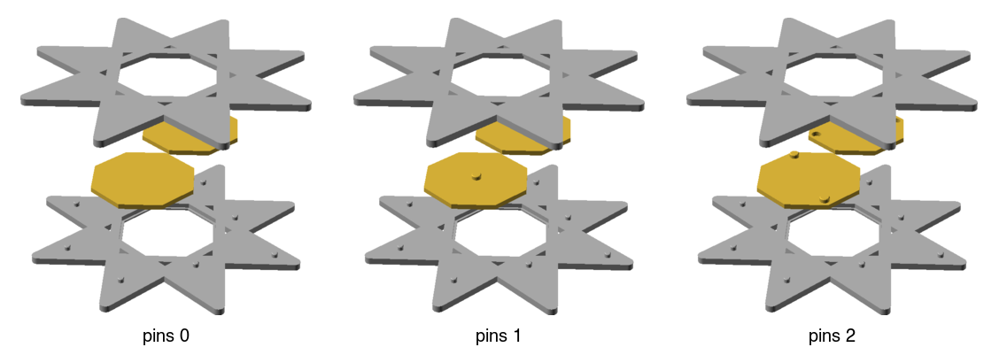

*A piece cut in two, with the lower half's pins standing up and the matching holes in the upper half. (the cookbook's picture.)*

**On our coasters.** Pins join the two halves of a loose piece (a star, a kite, the middle). The middle takes a pin in the centre and six round it; a star takes three on a triangle. split-03 first tried them; star-2 tried three pin sizes on the star. A pin joins a piece's halves; a stud joins the coaster's halves.

```naqsh
halves 1
pin 1.2          # pin diameter, mm
pin_gap 0.25     # how much wider the hole is
pins_middle 7    # the centre and six round it
pins_star 3
pins_star_ring 1 # the star's three on a ring, none in the middle
```

Plates: [split-03](../design/plates/split-03.md), [split-05](../design/plates/split-05.md), [split-08](../design/plates/split-08.md), [star-2](../design/plates/star-2.md), [star-3](../design/plates/star-3.md) · [Cookbook recipe](../cookbook/coaster-knobs.md#pins-that-close-a-cut-piece) · See also: [Halves (a split piece)](#halves-a-split-piece), [Stud](#stud), [Rail and slot (a slide)](#rail-and-slot-a-slide)

### Stud

*Also: peg, alignment peg, pin (the look-alike).*

A short peg on one half of the coaster that goes into a socket in the other half, so the two big halves of a split coaster line up when you close them.

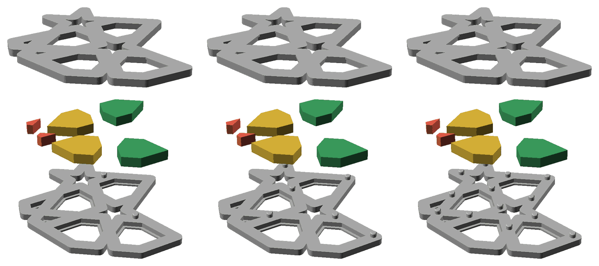

*stud-1's coasters opened up. The lower halves carry small round pegs at strap crossings; the upper halves have the sockets. (stud-1's photo.)*

**On our coasters.** Studs stand on the coaster's lower half at the spots where straps meet, since only there is there room for a socket. spl-1 and spl-2 found how tight a stud can be and still go in by hand; stud-1 tried how far apart they go. Same idea as a pin, but on the coaster, not on a piece.

```naqsh
stud 1.2        # peg diameter, mm
stud_gap 0.25   # how much wider the socket is
stud_spacing 6  # the least distance between two pegs
```

Plates: [spl-1](../design/plates/spl-1.md), [spl-2](../design/plates/spl-2.md), [stud-1](../design/plates/stud-1.md), [split-07](../design/plates/split-07.md) · See also: [Pin](#pin), [Halves (a split piece)](#halves-a-split-piece)

### Rail and slot (a slide)

*Also: slide, rail.*

A ridge on one half (the rail) that slides sideways into a groove in the other half (the slot). Once slid in, the halves cannot pull straight apart.

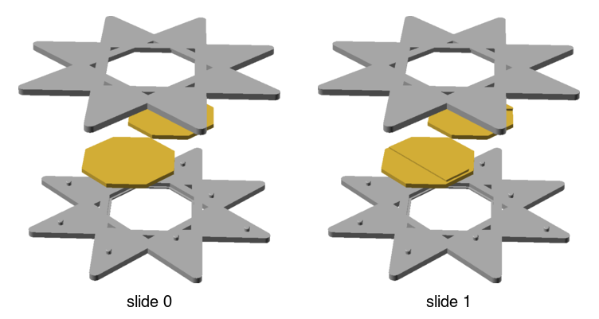

*A cut piece with a rail running across the lower half's face and a matching slot in the upper half. (the cookbook's picture.)*

**On our coasters.** We use a slide on the hexagons and the outer pieces, where the cut face is long and narrow. sld-1 showed a small slide can join two piece halves. hexfit-1 tried how tight; hexfit-2 found what stops the hexagon halves rocking: they keep their rail.

```naqsh
halves 1
slide 4           # the rail's width at its root, mm
slide_gap 0.15    # room each side between rail and slot
slide_height 0.8  # the rail's height, whole 0.2 mm layers
slide_hex 1       # put a slide on the hexagons
```

Plates: [sld-1](../design/plates/sld-1.md), [hexfit-1](../design/plates/hexfit-1.md), [hexfit-2](../design/plates/hexfit-2.md), [split-10](../design/plates/split-10.md) · [Cookbook recipe](../cookbook/coaster-knobs.md#a-slide-that-closes-a-cut-piece) · See also: [Dovetail](#dovetail), [Pin](#pin), [Halves (a split piece)](#halves-a-split-piece)

### Dovetail

*Also: rail (its shape).*

The shape of a rail that is wider at the top than at its root, like a bird's tail. Because it flares out, the slot holds it in: it can only slide out the end. Our slide's rail is a dovetail.

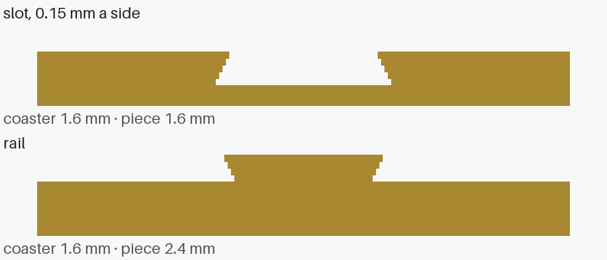

*sld-1 cut through. The rail on the lower half widens in steps as it goes up, inside a slot of the same shape. (sld-1's side cut.)*

**On our coasters.** Our printed dovetail flares in steps, one per 0.2 mm layer, because a printer builds in layers. sld-1's cut through shows the steps. minis-03 and minis-06 used bigger dovetails to join two mini coasters edge to edge.

```naqsh
neck 3   # mm, the dovetail's narrow root where it leaves the edge (minis-06)
```

Plates: [sld-1](../design/plates/sld-1.md), [minis-03](../design/plates/minis-03.md), [minis-06](../design/plates/minis-06.md), [hexfit-1](../design/plates/hexfit-1.md) · See also: [Rail and slot (a slide)](#rail-and-slot-a-slide)

### Halves (a split piece)

*Also: cut piece, split coaster (the coaster's halves).*

A piece printed as two halves cut across its middle, each lying on one of its own faces. Both the top and the bottom then print flat on the bed, so both come out smooth. Pins or a slide put the halves back together.

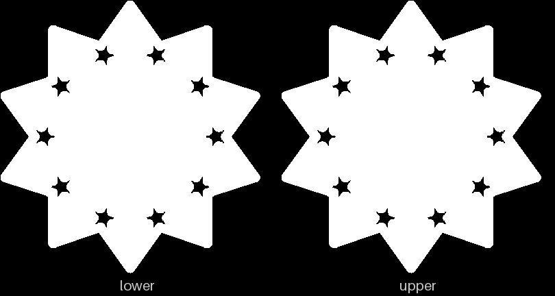

*The two halves of a middle piece side by side, each lying on the face that printed on the bed. (pkt-2's picture.)*

**On our coasters.** Every loose piece on the flange coaster can be printed in halves since split-07. The coaster itself is also split in two, so the pieces are trapped between its halves; that is the split coaster, a different cut.

```naqsh
halves 1   # 1 prints each loose piece as two halves
```

Plates: [split-07](../design/plates/split-07.md), [split-10](../design/plates/split-10.md), [pkt-2](../design/plates/pkt-2.md) · [Cookbook recipe](../cookbook/coaster-knobs.md#split-coasters-two-halves-that-trap-the-pieces) · See also: [Pin](#pin), [Rail and slot (a slide)](#rail-and-slot-a-slide), [Stud](#stud)

### Printed in place

*Also: captive piece, air gap.*

A piece printed already inside its closed pocket, in one go, with a layer or two of air left between them. If the air is enough, the piece comes off the bed loose but cannot get out.

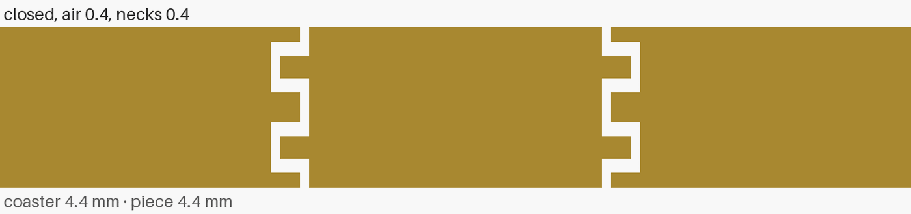

*A cut through pkt-1's closed pocket. The piece in the middle has a band that sits in a wider room of the pocket; the white lines are the air round it. (pkt-1's side cut.)*

**On our coasters.** pkt-1 tried it on a hexagon: the pocket narrows to a neck at the face and at the cut, and the piece has a band in the room between, with air above and below. One layer of air (0.2 mm) and two (0.4 mm) were tried, two copies each. pkt-2 then printed a split coaster's pieces in their pockets.

```naqsh
air 0.4     # mm of air above and below the band: two 0.2 mm layers
thick 0.4   # mm, each neck's thickness
```

Plates: [pkt-1](../design/plates/pkt-1.md), [pkt-2](../design/plates/pkt-2.md) · See also: [Gap (the fit)](#gap-the-fit), [Flange (a step)](#flange-a-step)

## Shapes we cut into a piece

### Flange (a step)

*Also: step, lip (the look-alike).*

A thin rim that sticks out round the bottom of a piece, like the brim of a hat. It reaches under the coaster's strap, so the piece cannot fall out of the top.

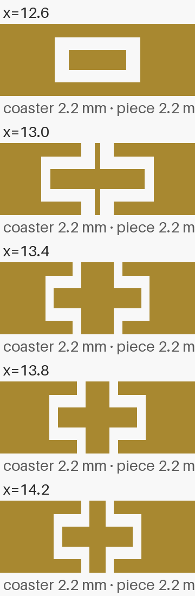

*A cut through a kite in its pocket. The kite's rim reaches out under the strap; the white lines are the gaps round it. (pkt-2's side cut.)*

**On our coasters.** The flange coaster is named for it (split-02 was the first). Its pieces carry a flange that sits in an undercut in the coaster's lower half. The flange's underside hangs over air when it prints, which is why we tried supports and then the slope.

```naqsh
flange 0.8   # how far the undercut reaches under the strap, mm
```

Plates: [split-02](../design/plates/split-02.md), [pkt-1](../design/plates/pkt-1.md), [pkt-2](../design/plates/pkt-2.md), [split-07](../design/plates/split-07.md) · See also: [Lip](#lip), [Slope (stairs under the flange)](#slope-stairs-under-the-flange), [Supports, grid and tree](#supports-grid-and-tree), [Gap (the fit)](#gap-the-fit)

### Lip

*Also: flange (the look-alike).*

A rim on the coaster, not the piece, that leans in over the edge of a pocket and holds the piece down from above.

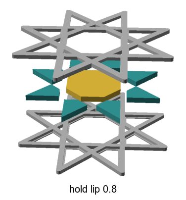

*split-01's side view. The coaster's edge leans in over the piece; that lip is 0.8 mm. (drawing, split-01's side view.)*

**On our coasters.** split-01 held its pieces under a lip (option A); split-02 moved to a flange on each piece instead (option C). A lip is on the frame and holds from above; a flange is on the piece and holds from below.

Plates: [split-01](../design/plates/split-01.md), [spl-1](../design/plates/spl-1.md) · See also: [Flange (a step)](#flange-a-step)

### Slope (stairs under the flange)

*Also: chamfer, 45° overhang.*

Instead of a flat ledge sticking straight out over air, the underside steps out a little each layer, so it prints as a 45° slope. Each layer then sits mostly on the one below it and needs no supports.

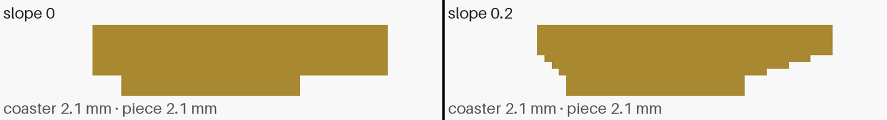

*Two cuts through a star half. Left, slope 0, the flange's underside is a flat ledge. Right, slope 0.2, it steps out like stairs. (made for this page, from the flange coaster's star rendered at slope 0 and 0.2.)*

**On our coasters.** Up to split-07 the flange's underside was a flat ledge printed over air. slope 0.2 makes it a 45° slope at our 0.2 mm layers. split-10 first tried it; star-1 to star-3 printed sloped stars. The picture cuts a star half through, without and with the slope.

```naqsh
slope 0.2   # mm out per 0.2 mm layer up: a 45° slope
```

Plates: [split-10](../design/plates/split-10.md), [star-1](../design/plates/star-1.md), [star-2](../design/plates/star-2.md), [star-3](../design/plates/star-3.md) · See also: [Flange (a step)](#flange-a-step), [Supports, grid and tree](#supports-grid-and-tree)

### Wedge (a slice of the ring)

*Also: test slice.*

A pie slice of the whole coaster, both halves, with whole pegs and sockets, so a fit can be tried in a few grams instead of a whole coaster.

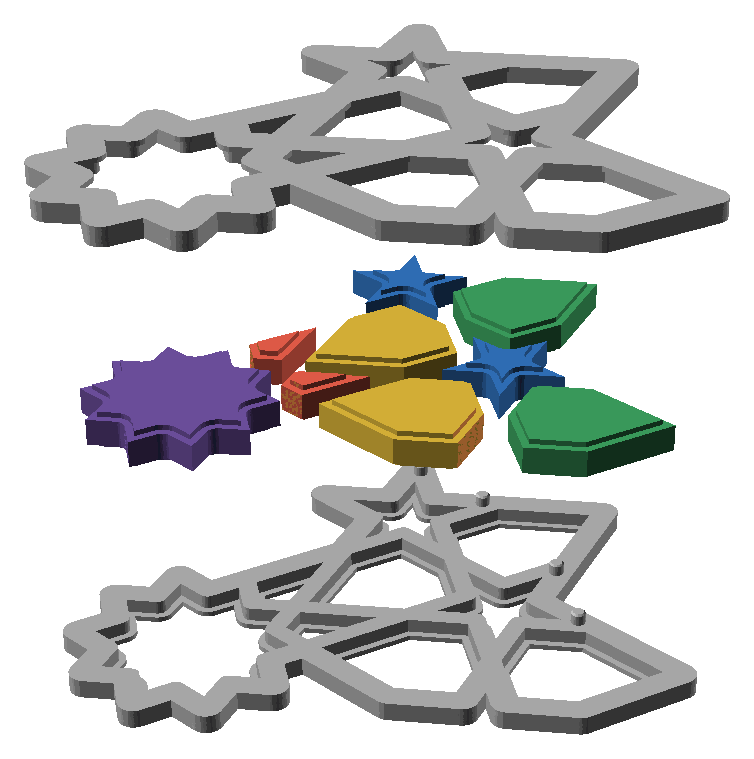

*split-04's wedges opened up, pie slices of the coaster with flange pieces sitting in their pockets. (split-04's photo.)*

**On our coasters.** wedge 36 prints a 36° slice, two faces' worth. split-04 used wedges to try every piece kind at three gaps; wedge_center 1 keeps the middle piece in too. closeout-1 cut its frame slice with the same wedge the kites came from, so each kite has its own pocket.

```naqsh
wedge 36        # degrees of the ring to print
wedge_from 9    # where the slice starts
wedge_center 1  # keep the middle piece too
```

Plates: [split-04](../design/plates/split-04.md), [stud-1](../design/plates/stud-1.md), [closeout-1](../design/plates/closeout-1.md) · See also: [Gap (the fit)](#gap-the-fit), [Stud](#stud)

## Telling pieces apart

### Dots

*Also: tally dots.*

Little round dents sunk into a face to tell versions apart: one dot, two dots, three dots. They fit where a carved id has no room.

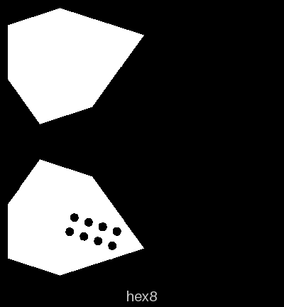

*The bottom of a hexagon half with eight small round dents in it. (hexfit-1's picture.)*

**On our coasters.** Dots go on a hidden face, either the cut face between two halves or, with dots_bottom 1, the bed face, so they leave the cut face free for a slide. A star half has room for at most three.

```naqsh
dots_star 2     # two dots on each star
dots_bottom 1   # on the bed face, not the cut face
```

Plates: [split-10](../design/plates/split-10.md), [hexfit-1](../design/plates/hexfit-1.md), [star-1](../design/plates/star-1.md), [closeout-1](../design/plates/closeout-1.md) · [Cookbook recipe](../cookbook/coaster-knobs.md#dots-on-loose-pieces) · See also: [Carved id](#carved-id)

### Carved id

*Also: id, mark.*

Letters and numbers cut into a face of a piece, so you can tell which print and which version it is once it is off the bed. A question after a print names the piece by its id.

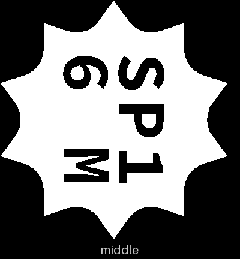

*A middle piece with "SP1 6 M" cut into it. (split-01's picture.)*

**On our coasters.** Ids go on the bottom so the top stays clean. They are 2.5 mm tall, too small to tell B from D or M from N, so we skip those letters. A piece too small for an id gets dots.

```naqsh
id 1   # the prototype's id, cut into the lower half's bottom
```

Plates: [split-01](../design/plates/split-01.md), [split-05](../design/plates/split-05.md), [split-06](../design/plates/split-06.md), [bedface-1](../design/plates/bedface-1.md) · [Cookbook recipe](../cookbook/coaster-knobs.md#an-id-on-each-half-of-a-split-coaster) · See also: [Dots](#dots)

## Fit and the bottom face

### Gap (the fit)

*Also: clearance, fit, play.*

The space left between two parts that go together, on each face. Too small and they will not go in; too big and they rattle. Every join has its own gap: a piece in its pocket, a pin in its hole, a rail in its slot.


*A cut through a kite in its pocket. The thin white lines round the kite are the gap. (pkt-2's side cut.)*

**On our coasters.** gap is a piece in its pocket, pin_gap a pin in its hole, stud_gap a stud in its socket, slide_gap a rail in its slot. room makes each piece a little shorter than the closed coaster, so the halves meet each other and not the piece. The sheets-04g-fit plates tried a ladder of piece gaps.

```naqsh
gap 0.1        # piece in its pocket, mm a face
pin_gap 0.25   # pin in its hole, across
slide_gap 0.15 # rail in its slot, a side
room 0.2       # each piece this much shorter than the closed coaster
```

Plates: [sheets-04g-fit](../design/plates/sheets-04g-fit.md), [sheets-04g-fit2](../design/plates/sheets-04g-fit2.md), [sheets-04g-fit3](../design/plates/sheets-04g-fit3.md), [split-03](../design/plates/split-03.md), [split-10](../design/plates/split-10.md) · See also: [Pin](#pin), [Rail and slot (a slide)](#rail-and-slot-a-slide), [Stud](#stud), [Wedge (a slice of the ring)](#wedge-a-slice-of-the-ring)

### First layer

*Also: initial layer.*

The very first layer the printer lays on the bed. Everything else stands on it, so if it does not stick or is laid too thin, the print fails or the bottom is rough.

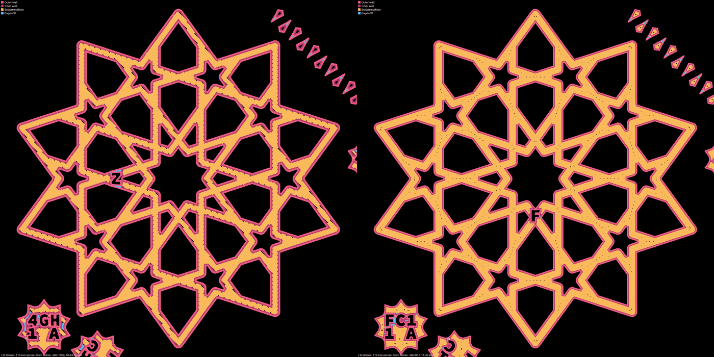

*The slicer's lines for a coaster's first layer, colored by kind, with a key and the carved ids. (bedface-1's slice.)*

**On our coasters.** Our first layer is the bottom face of every piece, so its lines are what you see when you turn a coaster over. The bedface plates tried settings for it, beside stock, to close the little slits between its lines.

```yaml
object_settings: { initial_layer_flow_ratio: "1.1" }
```

Plates: [bedface-1](../design/plates/bedface-1.md), [bedface-2](../design/plates/bedface-2.md), [bedface-4](../design/plates/bedface-4.md), [bedface-5](../design/plates/bedface-5.md) · See also: [Bed face](#bed-face)

### Bed face

*Also: bottom face, bottom.*

The face of a piece that printed lying on the bed. It takes the bed's texture, and the first layer's lines show in it. It is the coaster's bottom, or with halves, both its top and bottom.

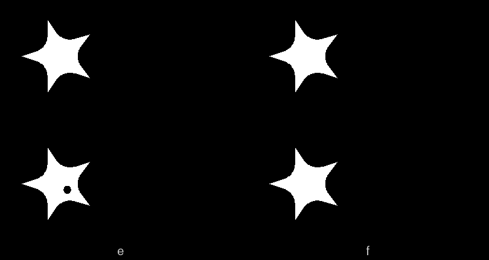

*Star pieces turned over, showing their bed faces. (star-3's photo.)*

**On our coasters.** On our textured plate the bed face comes out matte and even, which is why halves print both faces on the bed. Little bare slits between the first layer's lines were the bedface plates' question; infill_wall_overlap 55% is what we print with now.

```yaml
object_settings: { infill_wall_overlap: "55%" }
```

Plates: [bedface-1](../design/plates/bedface-1.md), [bedface-4](../design/plates/bedface-4.md), [bedface-5](../design/plates/bedface-5.md), [star-3](../design/plates/star-3.md) · See also: [First layer](#first-layer), [Halves (a split piece)](#halves-a-split-piece), [Raft](#raft)
