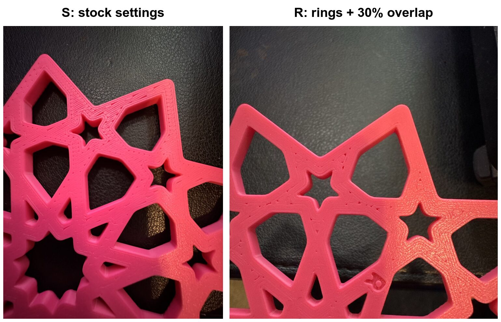
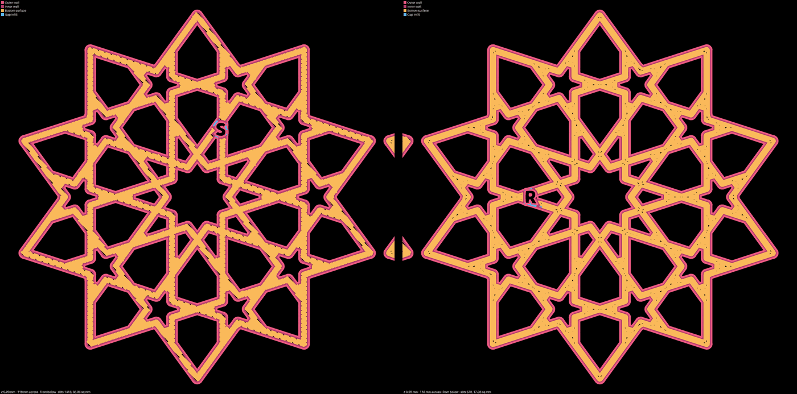

# Open calls — 2026-10-12: the slits on the coaster's bottom

One call: what to try next about the thin slits on the side of the coaster that touches the bed.
Tick one box, or comment on a line. The next session writes your answer into the decisions log and
starts the print it picks. With no tick it stays open, and nobody picks for you from "My pick".

| # | Call | My pick | Why, in one line |
|---|---|---|---|
| 1 | What to try next about the slits | The overlap alone, beside stock | One plate, aimed at where the slits are on the stock coaster |

## What the last print showed

You asked on 2026-10-10 why the bottom of the coaster has slits. We tried two changes to the
first layer, the one printed straight onto the bed:

- **Rings:** the first layer is laid as rings that follow the walls, in place of straight diagonal
  lines.
- **A 30% overlap:** the first layer's fill is pushed further into the wall around it (stock pushes
  it 15%).

The last plate printed the same coaster twice, side by side: `S` on the printer's normal settings,
and `R` with both changes. You found them **"about the same"**, and **"both have slits, but in
different places"**:

*Your two photos, side by side. On `S` (left) the slits run along each strap, a line or two in from
the edge. On `R` (right) the edges are clean, and small specks and triangles sit down the middle of
the straps and where straps cross: the spots where the rings from the two sides meet.*

So rings move the slits rather than close them, and they are dropped. Every plate stays on the
normal settings. The full write-up is in [the record](../../prints/2026-10-12-bedface-2/index.md)
and [the issue](../../issues/bed-face-preset-failed-in-print.md).

Before the print, the slicer's own drawing said `R` would be much cleaner. The print did not bear
that out, for the second plate in a row, so the drawing below shows *where* gaps can open, not how
the bottom will look:

*Drawn from the slicer's file, not a photo. Orange is the first layer's fill, pink the walls, black
is bed nothing covers. The letters read backwards, as from below.*

## 1. What to try next about the slits

**In short.** The stock coaster's slits sit along the strap edges, and on `R` those edges came out
clean. But `R` changed two things at once, rings and the overlap, so we can't tell which one cleaned
the edges. Rings are out, which leaves the overlap as the one change still worth testing. The other
thing never tested is the bed itself. All four coasters so far printed on the light-blue glacier
plate. The gold textured plate gets a slightly harder squash on the first layer (the printer lowers
the nozzle 0.02 mm for it), and the glacier does not.

| Option | Pros | Cons | What it leads to |
|---|---|---|---|
| **The overlap alone, beside stock** (my pick) | Aims straight at where stock leaves its slits, the strap edges. One plate, two coasters, the same setup as the last print with rings taken off. About 107 minutes and 32 g, worked out from the last plate, not sliced yet | The edges may have closed because of the rings, not the overlap, and then this shows nothing new. The overlap may change how a loose piece fits in its hole, which nobody has checked yet | A cleaner bottom: the overlap goes on the coasters, and fits get checked again before it goes on a plate with loose pieces. The same: the overlap is dropped too |
| **Stock on the gold plate, beside stock on the glacier** | Tests the one cause never tried, and changes nothing in the coaster or its settings | Two prints, since one bed takes one plate. Every fit we have judged was on the glacier, so this mixes the plate into those | A cleaner bottom on gold: coasters print on the gold plate. The same: the bed is ruled out too |
| **Stop: stay on stock** | No more prints spent on this; every fit stays as judged | The slits you asked about stay | The slit question closes as not fixed |

**Your answer:**

- [ ] The overlap alone, beside stock
- [ ] Stock on the gold plate, beside stock on the glacier
- [ ] Stop: stay on stock
- Notes:

## Things only you can do (not decisions)

- **Two questions about the last plate are not answered yet.** Hold `R` beside `F`, the coaster from
  the plate before. Are the specks and triangles on `F` only, on both, or on neither? Then push the
  small middle piece carved `FC1 1E` into the middle hole of `S`, then of `R`. Does it feel the same
  in both, or tighter in one? Both questions are on
  [the plate's page](../../design/plates/bedface-2.md#after-the-print).
