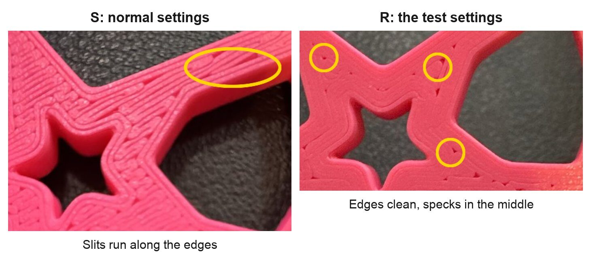
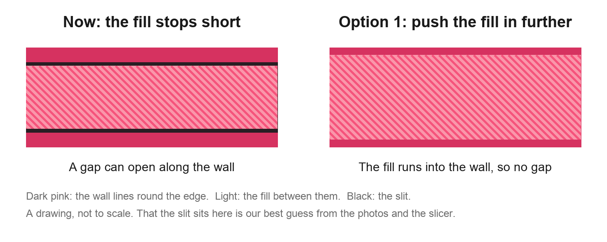
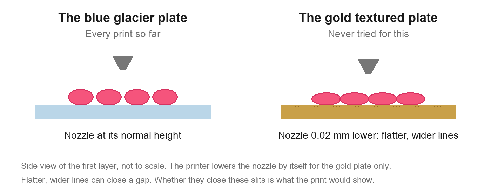
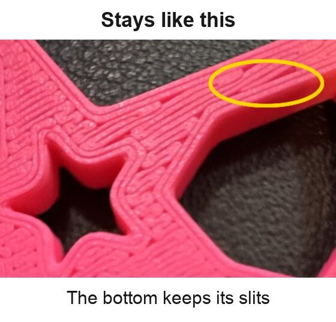

# What should we try next about the slits on the coaster's bottom?

Look at the pictures, then tick one box at the bottom. The next session records your pick and
builds that print.

*Close-ups of your two photos. The yellow marks show where the gaps are on each.*

## What we learned

- Both coasters have gaps. They are just in different places.
- `R` had two changes: rings, and the fill pushed further into the wall. Rings are now dropped.
- Its edges came out clean, but we can't tell which of the two changes did that.

## Pick one

### 1. Push the fill further into the wall, nothing else (my pick)

The slits on the normal coaster sit along the edges. This setting aims right at that spot. One
plate: a normal coaster beside one with only this change. About 107 minutes and 32 g, judged
from the last plate. It is not sliced yet.

### 2. Try the gold plate

Every coaster so far printed on the blue plate. On the gold plate, the printer presses the first
layer a little flatter by itself. Two prints, same coaster and same settings, one on each plate.

### 3. Stop here

Keep the normal settings. The slits stay.

### Side by side

| | Pros | Cons | What it leads to |
|---|---|---|---|
| **1. Fill further in** | Aims at the exact spot. One plate. Only one thing changes | The clean edges may have come from the rings, so this may show nothing new. Loose pieces might fit tighter; nobody has checked | Better: it goes on the coasters, after we check the loose pieces still fit. Same: it is dropped too |
| **2. Gold plate** | Tests something never tried. The coaster and its settings stay the same | Two prints. Every fit so far was judged on the blue plate, so fits would need checking again | Better: coasters print on the gold plate. Same: the plate is ruled out |
| **3. Stop** | No more prints spent. Every fit stays as judged | The slits you asked about stay | The question closes, not fixed |

**Your answer:**

- [ ] 1. Push the fill further into the wall, nothing else
- [ ] 2. Try the gold plate
- [ ] 3. Stop here
- Notes:

The full story is in [the print record](../../prints/2026-10-12-bedface-2/index.md) and
[the issue](../../issues/bed-face-preset-failed-in-print.md).

## Things only you can do (not decisions)

- **Two questions about the last print are still open.** Hold `R` beside `F`, the coaster from the
  print before: are the specks on `F` only, on both, or on neither? Then push the small piece
  carved `FC1 1E` into the middle hole of `S`, then of `R`: same feel, or tighter in one? Both are
  on [the plate's page](../../design/plates/bedface-2.md#after-the-print).
