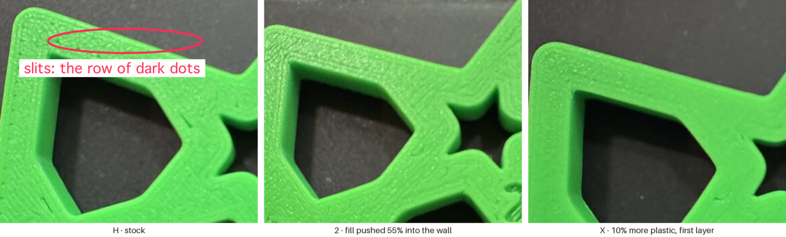
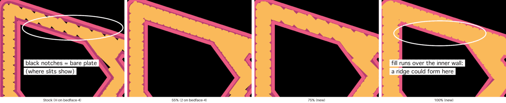
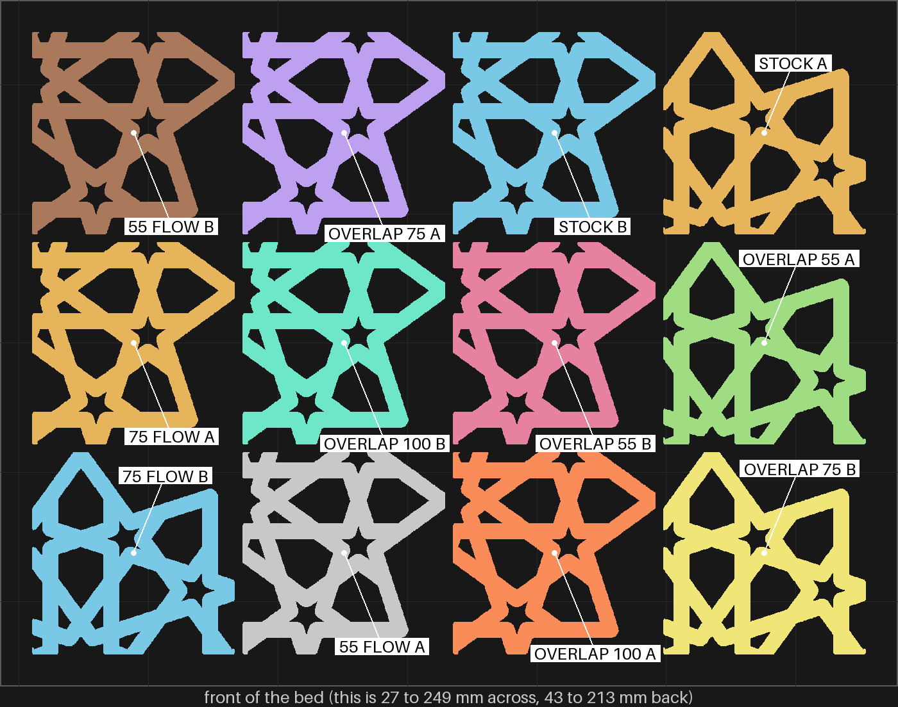
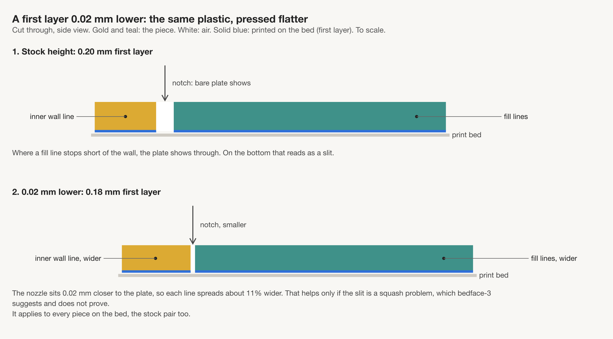
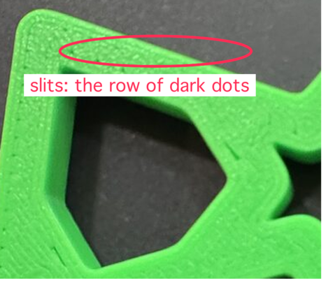
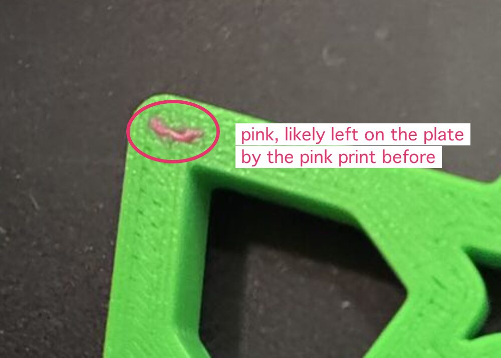

# The slits on the coaster's bottom: what to print next

Two calls: tick one box under each. The next session writes your answers into the decisions log
and builds the plate you pick. With no tick a call stays open, and nobody picks for you.

*Your photos of three bedface-4 pieces, cropped to the same corner. The slits are the row of dark
dots along the strap edge on `H`, circled. To me (Claude), `2` and `X` both look smoother. You never
set those two side by side.*

| # | Call | My pick | Why, in one line |
|---|---|---|---|
| 1 | What the next plate tests | Six pairs at the normal height | Every setting keeps the stock pair beside it on the same bed |
| 2 | Wash the plate before each test plate | Yes, from now on | No machine risk, and one piece came off the last bed with pink on it |

## What we learned

- Pushing the fill 55% into the wall left fewer slits than 30%, with no ridge. In your words, "2 is better than T".
- 10% more plastic on the first layer helped a little: "Y has less than J and X has less than Y". Every flow piece still slit.
- The slicer's drawing is not the print. It showed 55% almost clean, and the pieces still slit.

The research behind this page: [the combined plan](../../research/2026-10-13-bed-face-next-consolidated.md).
The last print: [the bedface-4 record](../../prints/2026-10-13-bedface-4/index.md).

## Call 1: what the next plate tests

The next step is to push the fill further: 75% and 100%. Then add the 10% extra plastic on top of
55% and 75%, to see whether the two together beat either alone.

*Drawn from the slicer's file, not a photo. Orange is the first layer's fill, pink the walls, black
is bare plate. Stock leaves notches where the slits show. At 100% the fill runs over the inner
wall, where a ridge could form. The drawing cannot show the extra plastic, and it showed 55% near
clean when the print was not.*

### 1. Six pairs at the normal height (my pick)

*Drawn from a trial slice, without the carved ids yet. "Flow" means 10% more plastic on the first
layer.*

Twelve pieces of the coaster, two of each: stock, 55%, 75%, 100%, 55% with flow, 75% with flow.
Each is read against the stock pair on the same bed. About three hours and 52 g on the slicer's
count; bedface-4 took 194 minutes against its 173.

### 2. The same twelve, all printed 0.02 mm lower

*A drawing, not a measurement. The same plastic, pressed flatter, spreads each line about 11%.*

The same bed, with the nozzle 0.02 mm closer to the plate for the first layer. It tests the height
and the settings in one print. But the stock pair is lowered too, so the height can only be read
against bedface-4's photos, across two prints. One research pass wanted one pair to try a setting
the plate tool cannot set yet.

### 3. Stop: stay on stock

*`H`, stock: this is the bottom every coaster keeps if we stop.*

No more test plates on this. 55% with 10% extra flow could still go on the next coaster without a
test of the two together.

| | Pros | Cons | What it leads to |
|---|---|---|---|
| **1. Six pairs, normal height** (my pick) | Every setting sits beside stock on the same bed, so each read is fair. All six settings can be set per piece today. Repeats 55% as a link back to bedface-4 | Does not test the lower height, which stays the strongest step for the whole plate. 100% may raise a ridge on the bottom or the top face | The best pair goes on a whole coaster. If slits remain, a plate of stock pieces only, 0.02 mm lower, next |
| **2. All twelve 0.02 mm lower** | Tests the height and the settings in one print, so one plate sooner | No stock piece at normal height on the bed, so the height is judged across two prints. If the pieces come out better, we cannot tell how much was the height | A clean bed: lower height plus the best setting goes on a coaster. Still slits: 0.04 mm lower, then the weaker leads |
| **3. Stop** | No more prints or filament spent on this | The slits stay. The flow and overlap together were never tested in print | The slit question closes as not fixed. The coaster keeps stock, or takes 55% untested with flow |

**Your answer:**

- [ ] 1. Six pairs at the normal height
- [ ] 2. The same twelve, all 0.02 mm lower
- [ ] 3. Stop: stay on stock
- Notes:

## Call 2: wash the plate before each test plate

*Piece `7` from bedface-4, printed in green. The pink is most likely left on the plate by the pink
print before it.*

The research suggests washing the glacier plate with dish soap and running bed leveling before every
test plate. Only a weak source backs it, about parts not sticking, not about slits. It risks
nothing, but a washed plate makes the new stock pair less like bedface-4's. Every read then stays
within the one plate.

| | Pros | Cons | What it leads to |
|---|---|---|---|
| **Yes, from now on** (my pick) | No machine risk and no filament. Rules out oil and leftover plastic as a cause | Your time at the printer before each plate. The stock pair is no longer like-for-like with bedface-4's | A wash and leveling step before every test plate, on its page |
| **No, leave it as it is** | Nothing new to do; the stock pair matches bedface-4's plate | A dirty plate stays a possible cause nobody has ruled out | Nothing changes; the wash stays on the list of weak leads |

**Your answer:**

- [ ] Yes, wash and level before each test plate
- [ ] No, leave the plate as it is
- Notes:

## Things only you can do (not decisions)

- **Do `H` and `J` look alike?** Turn both over and hold them side by side under a lamp. `J` was
  turned a quarter turn on the bed and `H` was not. If they differ, the turn matters, and each
  piece on the next plate gets read against the stock piece turned its way.
- **If you tick yes on call 2:** wash the glacier plate with dish soap, dry it, and run bed
  leveling before the plate goes out.
