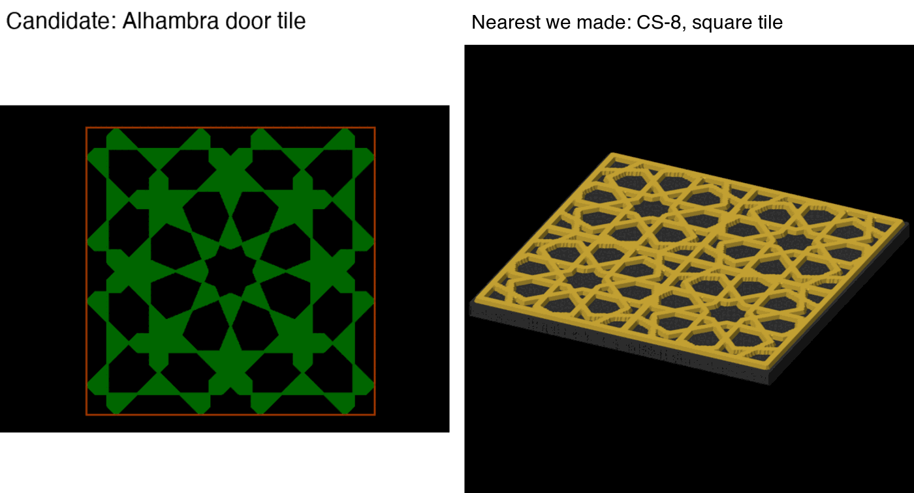
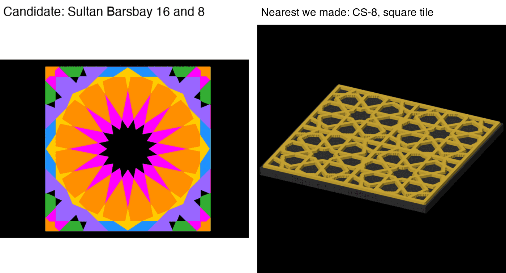
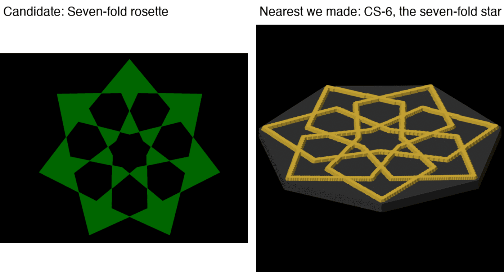
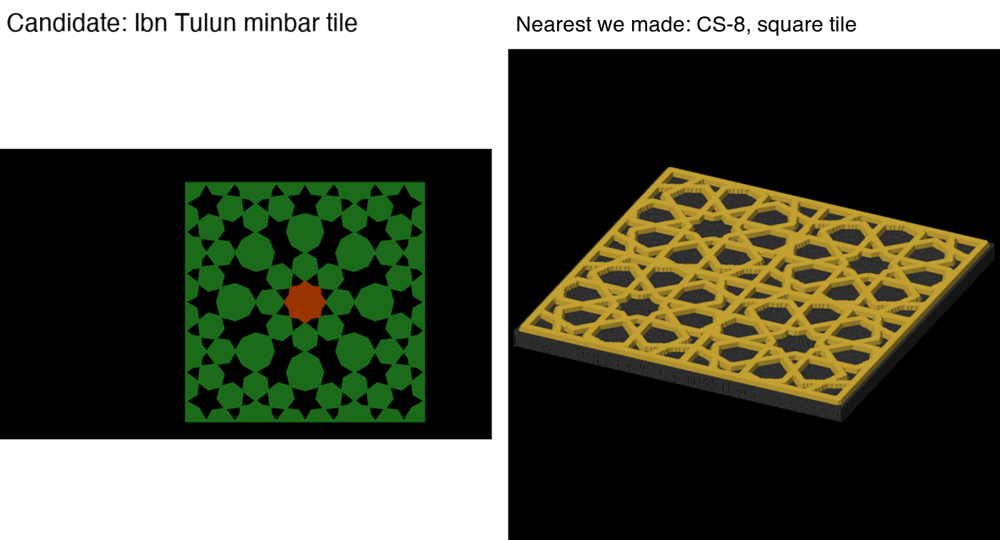
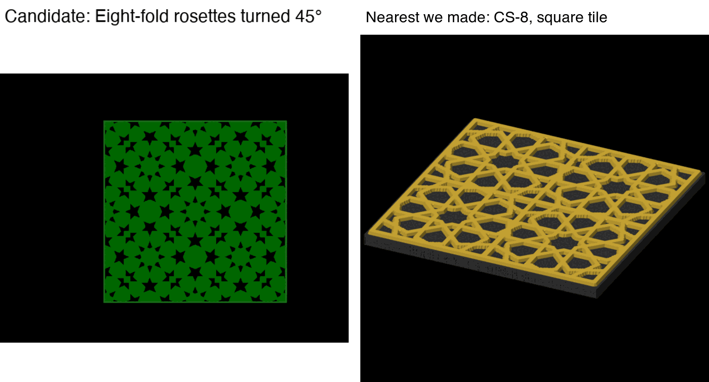
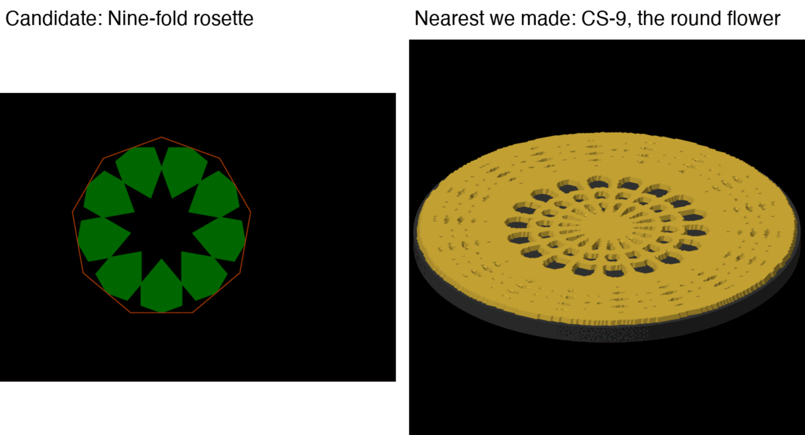
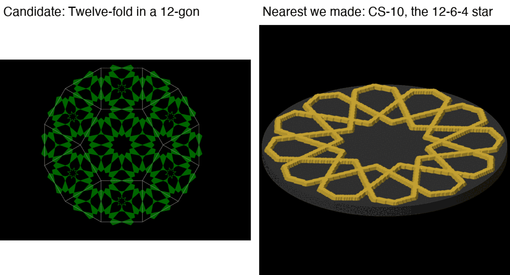
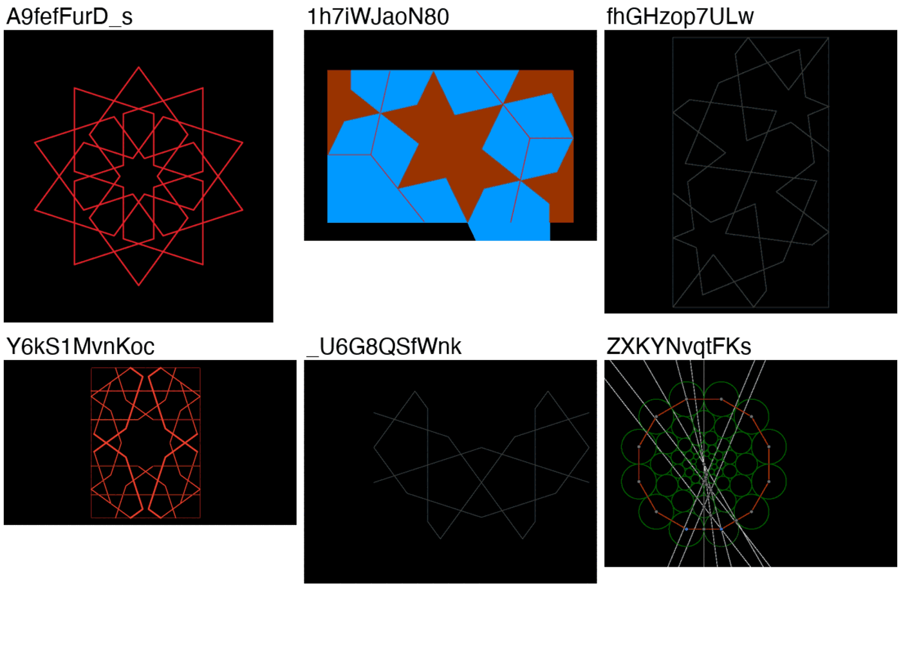

# Which pattern becomes the next coaster?

Tick one box under "Make this first", and the others if they apply. The pick then starts as a
coaster through the import-construction skill.

*Left: my pick, the door tile from the Hall of the Two Sisters, Alhambra, as the rebuild drew it.
Right: CS-8, the made coaster it is nearest to. Green is the strap, black the holes.*

## What we learned

- 16 patterns are rebuilt and have no coaster yet. 7 are ranked here and 9 are held.
- Three of the held ones drew an empty picture, so they could not be judged at all.
- Four square tiles share all four facts with CS-8. The difference score cannot tell them
  apart, so the picture has to.

How the scores work: appeal (0 to 8) and unusual (0 to 2) are my reading of each picture, not
measured. Difference (0 to 1) is worked out by a tool from four facts per design. The total is
appeal + 5 × difference + unusual ÷ 2. "Ready" means bikar can make its outline and lines and the
rebuild scored 0.90 or more. The rules are in the
[scoring file](../../../.claude/skills/prioritize-design/scoring.md).

## Make this first

### 1. The Alhambra door tile (my pick)

Total **11.10**. Appeal 7 of 8: whole, fills its square, reads at 90 mm; the repeated 8-point
stars compete a little for the eye. Unusual 2: a star set in a square tile. Difference 0.62.
Not ready: the rebuild scored 0.881, just under 0.90. Sell: credit the video.

### 2. Sultan Barsbay's 16- and 8-point tile

Total **11.10**, tied with 1. Appeal 7: one clear 16-point centre that fills the square, but its
long thin spikes and tight centre crossings may not read at 90 mm. Unusual 2. Difference 0.62.
Not ready: rebuild 0.837. It loses the tie on the rebuild score. Sell: credit.

### 3. The seven-point rosette

Total **10.35**. Appeal 7: one clear rosette that reads well, but a seven-sided frame would leave
wedges at its points. Unusual 1: a star medallion like several we have. Difference 0.57; nearest
is CS-6, the same kind of rosette. Ready: rebuild 0.949, the best here. Sell: credit.

### 4. The Ibn Tulun minbar tile

Total **10.10**. Appeal 6: fills its square, but small stars mixed with big ten-sided shapes
blur at 90 mm, and no one motif leads. Unusual 2. Difference 0.62. Ready: rebuild 0.920.
Sell: credit.

### 5. Eight-point rosettes on a turned lattice

Total **10.10**. Appeal 6: fills its square, but dense small holes and thin lines at 90 mm, and
no one motif leads. Unusual 2. Difference 0.62. Not ready: rebuild 0.883. Sell: credit.

### 6. The nine-point rosette

Total **8.85**. Appeal 6: one clear rosette, but gaps between it and the rim, and the centre
hole is bigger than the petals. Unusual 1. Difference 0.47; nearest is CS-9 at 0.75. Ready:
rebuild 0.931. Sell: credit.

### 7. The twelve-sided star field

Total **8.60**. Appeal 6: fills its outline, but reads as a mesh of thin lines and small holes,
with no one motif. Unusual 1. Difference 0.42; nearest is CS-10. Not ready: rebuild 0.894.
Sell: credit.

| | Pros | Cons | What it leads to |
|---|---|---|---|
| **1. Alhambra door tile** | Top total; famous source; a square tile bikar can cut | Rebuild 0.881, so a line or two may be off | A check of its rebuild against the video, then the import |
| **2. Sultan Barsbay tile** | One strong centre, the clearest single motif of the tiles | Thin spikes may not print or read; weakest rebuild (0.837) | Fix the rebuild first, then a test piece of the spikes |
| **3. Seven-point rosette** | Readiest (0.949); a clear rosette | Close to CS-6, so less new; frame wedges | Import now; choose a frame that follows the star |
| **4. Ibn Tulun tile** | Ready (0.920); a well-known mosque | Busy at 90 mm; no lead motif | Import now; may need a larger size to read |
| **5. Turned lattice** | Fills well | Busy at 90 mm; not ready (0.883) | Fix the rebuild first |
| **6. Nine-point rosette** | Ready (0.931); unusual nine-fold | Gaps to the rim; centre hole too big | Import with a fill between rosette and rim |
| **7. Star field** | Fills its 12-gon | Reads as mesh; close to CS-10 | Low value next; keep for later |

Why my pick: it has the top total and the same score as 2, and its rebuild is better than 2's.
If you would rather build something ready today, 3 or 4 can start at once.

**Your answer — make this first:**

- [ ] 1. Alhambra door tile
- [ ] 2. Sultan Barsbay tile
- [ ] 3. Seven-point rosette
- [ ] 4. Ibn Tulun tile
- [ ] 5. Turned lattice
- [ ] 6. Nine-point rosette
- [ ] 7. Star field
- Notes:

**Most unusual to me** (tick any):

- [ ] 1
- [ ] 2
- [ ] 3
- [ ] 4
- [ ] 5
- [ ] 6
- [ ] 7
- Notes:

**I disagree with this part** (tick any, and say why):

- [ ] An appeal score
- [ ] An unusual score
- [ ] The weights in the total
- [ ] A held pattern should be ranked
- Notes:

## Held, with the fix each needs

*These fail "reads as a coaster", judged from the picture, not measured.*

- **A9fefFurD_s, a ten-point line star:** in a round frame it leaves bare wedges. Fix: a frame
  that follows the star, or a fill. Sell: check first, it comes from Broug's book.
- **1h7iWJaoN80, Persian compendium tile:** a fragment with cut pieces; the blue runs past the
  rectangle. Fix: rebuild one whole repeat.
- **fhGHzop7ULw, rectangle of a repeat:** the stars are cut at the edges. Fix: crop to a whole
  star.
- **Y6kS1MvnKoc, Broug field:** a rectangle cut at its edges. Fix: render the pattern alone.
- **_U6G8QSfWnk, quarter tile:** a quarter of a tile. Fix: mirror it to a whole tile.
- **ZXKYNvqtFKs, circles-only rosette:** the picture shows the construction guide lines, so it
  cannot be judged. Fix: a render without the guides.
- **itZftnqJ3tI, kpFgs2e8YGw, xtox61vADMA:** the picture is empty. The rebuild finished at the
  right size, but the construction hides every shape by its end. Fix: draw the pattern layer in
  youtube, then judge them in the next round.

## Things only you can do (not decisions)

- None this round.
