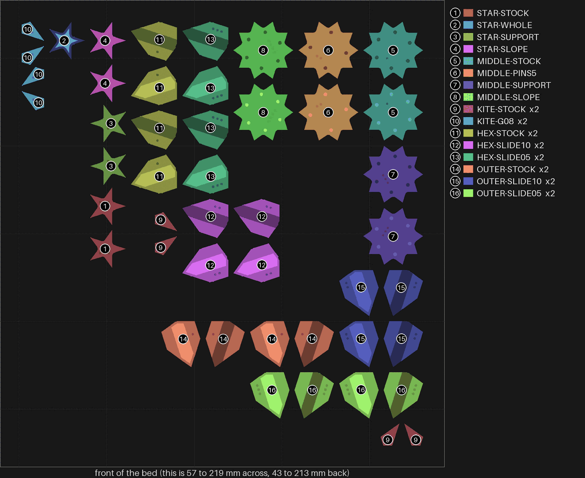
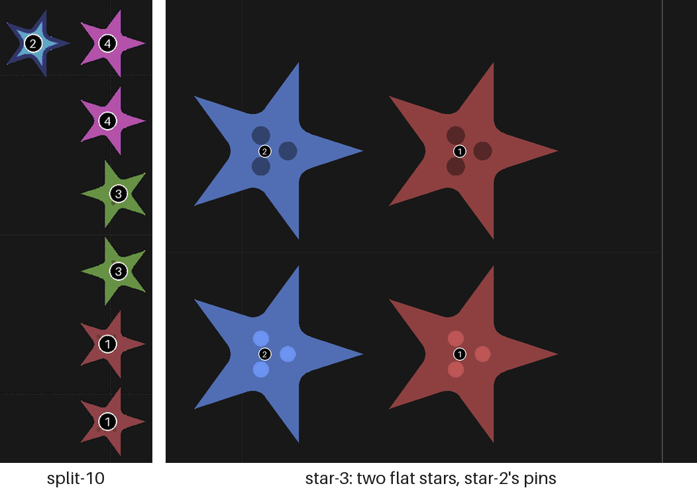
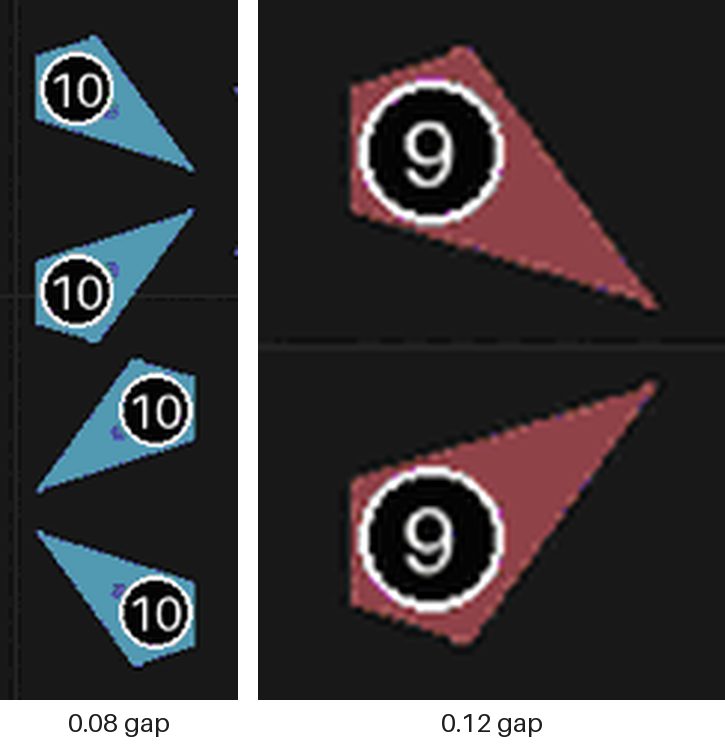
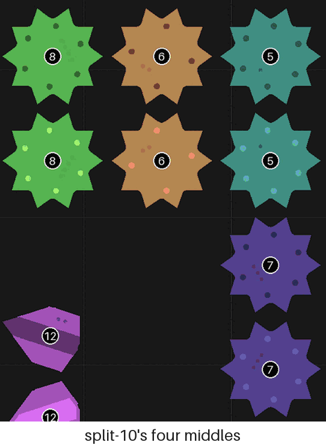
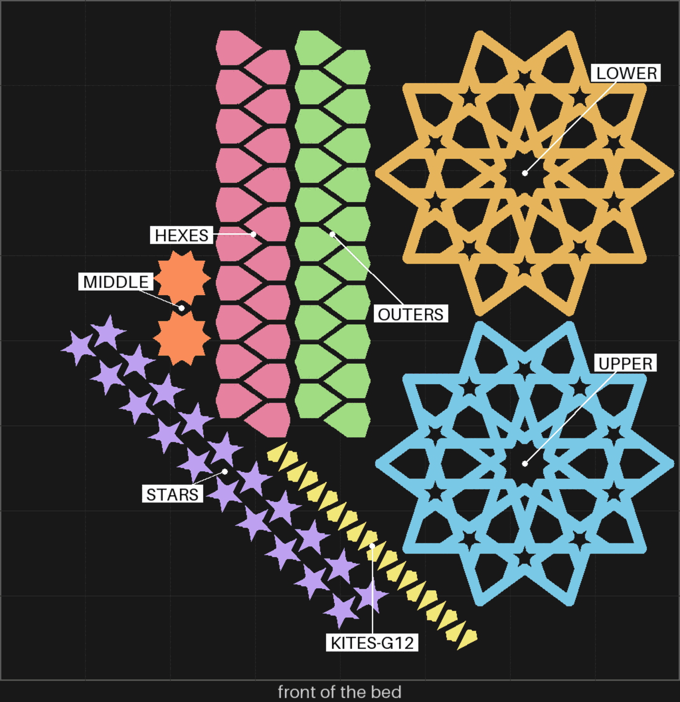
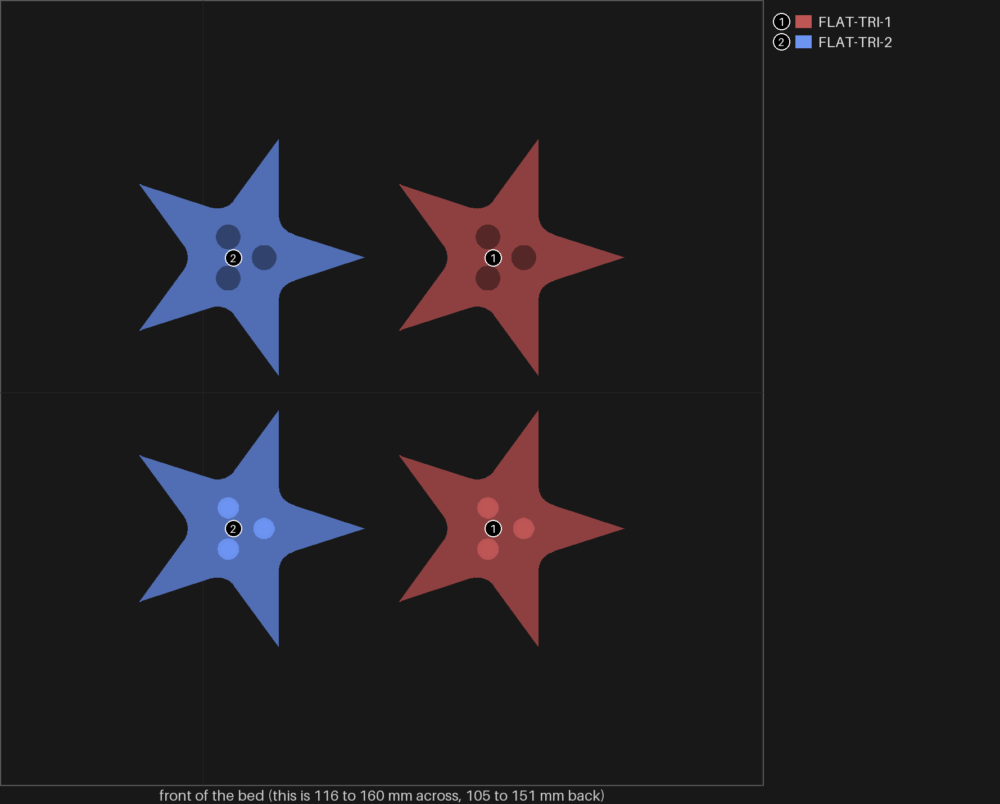

# Which plate questions still need an answer?

Tick one box per call. I then close the questions you agree are overtaken, and you answer the
rest on the hub's judging page as before.

*split-10 (printed Oct 27). Three of the four questions still worth asking are about its pieces:
the stars (1 to 4), the middles (5 to 8) and the kites (9, 10).*

## What we learned

- 24 questions are open across five plates. 18 of them were overtaken by a later plate.
- The other 6 come down to 5 calls. Only three need you to pick up a piece, and you likely still have every one.
- So the smallest plate that answers them is no plate: 0 g. A reprint of just those pieces is
  about 4.4 g.

| # | Call | My pick | Why, in one line |
|---|---|---|---|
| 1 | Close the 18 overtaken questions | Close all 18 | A later plate asked each one again, or answered it |
| 2 | Which star face is flattest | Answer from the pieces you have | It decides whether star-3 matters at all |
| 3 | The kite gap | Answer from the pieces you have | Kites are 0.11 g each; nothing else settles it |
| 4 | What "pins of 6" means | Six round the centre, as now | That is the middle you called best |
| 5 | The lopsided bigger kites | A photo, side marked | Seen on three plates and still not explained |
| 6 | star-3's two questions | Wait for call 2 | If the sloped star wins, both close with no look |
| 7 | A plate for the leftovers | No plate | Every open question has its pieces already printed |

How I counted grams: `tools/print_review.py grams` splits each slice's own grams by the filament
each piece's part of the G-code pushes. The slice's grams leave out the prime line and the color
flush, so a real plate costs a little more.

## Call 1: close the 18 overtaken questions

Each row below names the later plate that asked the question again or answered it, and the line
that says so.

| Plate, question | What it asked | Overtaken by | The line that says so |
|---|---|---|---|
| split-06, all 8 | The whole coaster: keep it, faces, pins, slide, snug, kites, sockets | split-07, the same coaster with the 0.7 mm socket wall | split-06's record: "The page's eight questions on the whole coaster were never asked", and split-07 took the new wall |
| split-07, 1 | Would you keep the coaster as it is? | split-10 | You said in chat its frame "came out well" and named four things wrong with its loose pieces; split-10 tries each one |
| split-07, 2 | Both faces smooth, no step at the edge? | split-10, question 1 | The stars' faces curve at the edges, which split-10's four stars test |
| split-07, 3 | Do the pinned halves hold, any pin broken? | split-10, question 3, and star-3, question 1 | The middle got an even ring of pins and the star got star-2's three 1.2 mm pins, so the old pins are gone |
| split-07, 4 | Do the hexagons and outers slide on and hold? | hexfit-1 | You said the "dovetail kites are really loose"; hexfit-1 tried the dovetail gap and settled it at 0.01 mm a side, now bikar's default |
| split-07, 5 | Are the joined pieces snug in the coaster? | split-10 and hexfit-1 | The fits it asked about are the kite gap and the dovetail, each tried on its own plate |
| split-07, 7 | Do the sockets hold when pressed, any crack? | split-10, question 3, and star-3, question 1 | Both ask whether the new pins hold. Neither asks about a cracked wall, so I add "look for a crack" to both |
| split-07, 8 | Kites at 0.12 mm: snug, tight or wiggling? | split-10, question 4 | split-10 has the 0.12 kite beside a 0.08 one |
| split-10, 2 | Does a slope or supports lose the middle's "webbed duck feel"? | Your comment on MIDDLE-SUPPORT | "this was best": supports under the step it is |
| split-10, 5 | Which dovetail gap slides and holds? | hexfit-1 | hexfit-1's record: 0.01 mm a side "held best". The up-and-down rock is still open, with no fix built to try |
| star-1, 1 | No base, grid supports or a brim under the star? | star-2 | star-2 printed on grid supports and its bottoms came out "As clean". It had no bare or brim star beside it, so grid is kept for not being worse, not shown to be best |

Caveats:

- split-07 questions 1 and 5 were never asked as written. Your chat answer on Oct 27 is what
  moved them on.
- hexfit-1 tried the dovetail on the hexagon piece only. The outer pieces take the same default
  without a print of their own.

**Your answer:**

- [ ] 1. Close all 18, with the line above as the reason (my pick)
- [ ] 2. Close them, but keep some open: name them in the notes
- [ ] 3. Keep them all open
- Notes:

| | Pros | Cons | What it leads to |
|---|---|---|---|
| **1. Close all 18** | Your list drops to 6 questions | A question closed by mistake stays closed until someone notices | Each plate's record says which plate overtook each question |
| **2. Keep some open** | You keep what you still doubt | You have to name them | Those stay on the judging page |
| **3. Keep all** | Nothing is lost | 24 questions, most about pieces already superseded | The judging page stays as it is |

## Call 2: which star face is flattest (split-10, question 1)

*Left: split-10's four stars, numbered by kind. 1 is the flat star as split-07 printed it. Right:
star-3, two more flat stars, which only matter if a flat star wins here.*

The question: which star's face stays flat out to its points, with no curve at the edges?
star-1 and star-2 already moved on with the sloped star (4). star-3 went back to the flat one
(1). This answer says which of the two lines the coaster keeps.

**Your answer:**

- [ ] 1. I'll answer it from the split-10 stars I have, on the judging page (my pick)
- [ ] 2. Reprint the four stars: 0.94 g by split-10's slice
- [ ] 3. Close it: the sloped star is the star from now on
- Notes:

| | Pros | Cons | What it leads to |
|---|---|---|---|
| **1. From the pieces** | 0 g, and a real look | Only if you still have all four | Settles star-3 too (call 6) |
| **2. Reprint** | Fresh pieces, no hunting | 0.94 g and a print; the pieces may print a little differently | The same answer, a few days later |
| **3. Close** | Nothing to look at | Picks the slope without comparing it | star-3 closes too, and the flat star is dropped |

## Call 3: the kite gap (split-10, question 4)

*Two of each kite. Left: the 0.08 mm gap a face, one dot on its cut face. Right: split-07's
0.12 mm, no dots. The two cuts are drawn at one height, so they are not to the same scale.*

The question: which kites go into split-07's kite holes without forcing, and do not rattle? You
said the "dovetail kites are really loose" on split-07; if that meant these kites too, the 0.08 should be snugger.

**Your answer:**

- [ ] 1. I'll answer it from the split-10 kites and the split-07 frame (my pick)
- [ ] 2. Reprint the four kites: 0.44 g by split-10's slice (it still needs the split-07 frame)
- [ ] 3. Close it: kites go to 0.08 mm without a check
- Notes:

| | Pros | Cons | What it leads to |
|---|---|---|---|
| **1. From the pieces** | 0 g | Needs the split-07 frame and four small kites | The kite gap for the next whole coaster |
| **2. Reprint** | Fresh kites | A print for 0.44 g | The same answer, later |
| **3. Close at 0.08** | No look | 0.08 might bind; nothing has tried it in the frame | The next whole coaster finds out instead |

## Call 4: what "pins of 6" means (split-10, question 3)

*Each middle is shown as its two halves. 5 (stock) has a centre pin and six round it. 6 (PINS5)
has a centre pin and four. 7 is the one with supports you called best.*

On MIDDLE-SUPPORT (7) you wrote "this was best but want pins of 6". That piece already has a
centre pin and six round it, like 5. I read it as six round the centre, so four is out. This is
my reading of your words, not something you confirmed.

**Your answer:**

- [ ] 1. Six round the centre, as 5 and 7 have now; four is out (my pick)
- [ ] 2. Six pins in all: say which, five round plus the centre or six round with no centre
- [ ] 3. Try both in print: reprint the two middles, 2.52 g by split-10's slice
- Notes:

| | Pros | Cons | What it leads to |
|---|---|---|---|
| **1. Six round** | Nothing to print; it is what the best piece has | Rests on my reading of four words | The middle is settled: supports, six round the centre |
| **2. Six in all** | Fewer holes | A new ring nobody has printed | A new middle to print and judge |
| **3. Try both** | You decide from the pieces in hand | 2.52 g, the costliest question here | One more look before the middle is settled |

## Call 5: the lopsided bigger kites (split-07, question 6)

*split-07 as sliced. The bigger kites in the coaster are where a hexagon piece and an outer piece
meet. That is how split-06's record reads it: same face, a different ledge underneath.*

You saw it on split-06 ("one of the two bigger kites has a sharper point than the other") and on
split-08 ("the bigger kites are still not eymetric"). The drawn pieces are mirror images, so the
difference comes from the print or the ledge. Nobody has measured it yet. A photo with the side
marked is the one thing that starts the search.

**Your answer:**

- [ ] 1. I'll take a photo of the split-07 coaster with the sharper side marked (my pick)
- [ ] 2. Close it: it does not bother me in the hand
- Notes:

| | Pros | Cons | What it leads to |
|---|---|---|---|
| **1. A photo** | 0 g; the first evidence of where it differs | A minute of yours | I compare the photo with the slice and say what differs |
| **2. Close** | Nothing to do | It came back on three plates, so it will come back on the next | The next whole coaster shows it again |

## Call 6: star-3's two questions

*star-3 (printed Nov 3): two flat stars with star-2's three 1.2 mm pins. Copy 1 has one dot on
its bottom, copy 2 has none.*

star-3 asks whether the flat star's halves hold on star-2's pins, and whether its bottom stays as
clean as before. You asked "is this even relevant". It is only if a flat star wins call 2.

**Your answer:**

- [ ] 1. Wait for call 2: close both if the sloped star wins, answer them if the flat one does (my pick)
- [ ] 2. Answer both now from the star-3 pieces
- [ ] 3. Close both now
- Notes:

| | Pros | Cons | What it leads to |
|---|---|---|---|
| **1. Wait** | No look that turns out wasted | Two questions stay open a little longer | Settled the day call 2 is |
| **2. Answer now** | Done either way; 0 g | Maybe a look at a star we drop | A record for star-3 now |
| **3. Close now** | Nothing to do | If the flat star wins, its pins were never checked | A reprint of star-3 (0.51 g by its slice) if it is needed later |

## Call 7: a plate for the leftovers

If every pick above stands, no question needs a new piece: you have all of them. Only if the
pieces are gone does a small plate make sense:

| On it | Answers | Grams, by split-10's or star-3's slice |
|---|---|---|
| The four stars (1 to 4) | Call 2 | 0.94 |
| The four kites (9, 10) | Call 3 | 0.44 |
| The two middles (5, 6) | Call 4, only if option 3 | 2.52 |
| The two flat stars of star-3 | Call 6, only if a flat star wins | 0.51 |
| **All of it** | | **4.41** |

Each piece goes on as it printed, with the same dots on its cut face. Each fit sits beside its
stock piece, as split-10 had. One color.

**Your answer:**

- [ ] 1. No plate: I'll answer from the pieces I have (my pick)
- [ ] 2. Build the small plate above, only the rows I ticked a reprint for
- [ ] 3. Fold the leftovers into the next whole coaster instead
- Notes:

| | Pros | Cons | What it leads to |
|---|---|---|---|
| **1. No plate** | 0 g, no print time, answers this week | Only works if the pieces are still to hand | Records written as you answer on the hub |
| **2. Small plate** | Fresh pieces with dots, side by side | Up to 4.41 g and a print, then a judging round | A plate page that names which questions it overtakes |
| **3. Next whole coaster** | One print does both | Each fit is then judged inside a full coaster, harder to tell apart | The next coaster waits on nothing, but its answers mix |

## Things only you can do (not decisions)

- Find the split-07 coaster and the split-10 stars, middles and kites, if they are still around.
- Answer the questions you keep on the hub's judging page.
- Take the star-1 halves off the bed, if they are still on it.
