# Spinner coaster: five choices before the first test piece

Tick one box per call. Nothing gets printed until you've answered. The first test pieces go to the
plates session only after you say yes, and none of them risks the printer.

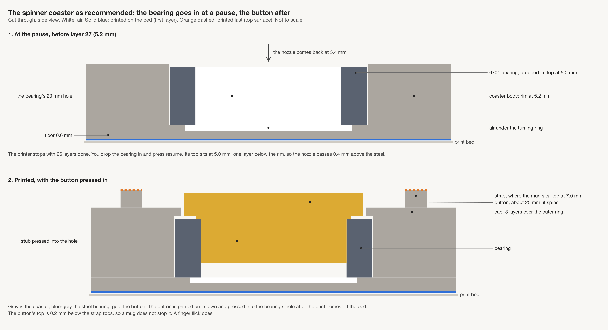

*The plan as recommended. The printer stops before layer 27 (5.2 mm), you drop a 6704 bearing into
the pocket, and the print goes on to cap the outer ring. A button pressed into the bearing after the
print is what spins. Full design: [spinner coaster design](../../design/pieces/spinner-coaster-design.md).*

## What we learned

- Two research passes and a checker agree on the bearing size, 6704 (20 × 27 × 4 mm), and on the
  pause-and-cap way of holding it.
- The coaster gets 1.8 mm thicker: 7.0 mm at a strap against today's 5.2.
- Bambu Studio's command line can take a pause, but nobody has tried it yet.
- Split halves are the fallback if the pause or the cap fails, and they need no pause at all.

| # | Call | My pick | Why, in one line |
|---|---|---|---|
| 1 | What spins | A button pressed in after the print | It works in the straps coaster we already make, and the steel touches nothing printed |
| 2 | How thick | 7.0 mm at a strap | The thinnest stack that holds a 4 mm bearing |
| 3 | Which bearing | Sealed chrome steel 6704 for the test pieces | The only sealed one with a shop page we read; the seals keep sagging plastic off the balls |
| 4 | How the pause gets into the file | Our slicing passes it to Bambu Studio | Approvals, the warnings check and the print log all stay in place |
| 5 | Pause or split halves | Pause and cap first, through two test pieces | It's what you asked for, and split halves stay ready if it fails |

## Call 1: what spins, and in which coaster?

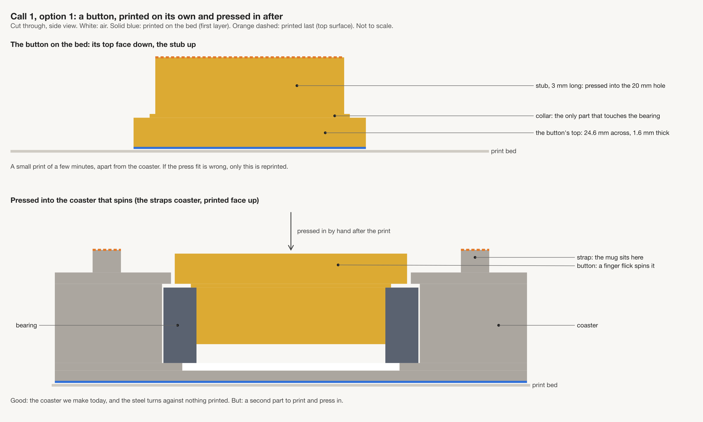

*Option 1 (my pick). A small button is printed apart and pressed into the bearing after the print.
A finger flick spins it.*

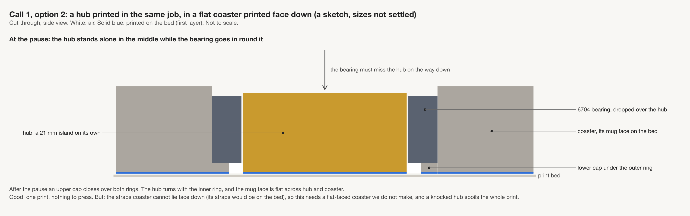

*Option 2. The hub is printed in the same job, so nothing gets pressed in. But the coaster has to
print face down, and the hub stands alone through the pause.*

**Your answer:**

- [ ] 1. A button pressed in, in the straps coaster printed face up (my pick)
- [ ] 2. A hub printed in the same job, in a flat-faced coaster printed face down
- Notes:

| | Pros | Cons | What it leads to |
|---|---|---|---|
| **1. Button** | Uses the coaster we already make. The button is 1.6 mm thick, and the inner ring touches nothing printed | A second small part to print and press in. The button is about 25 mm across | A bearing pocket in bikar for the one-piece coaster |
| **2. Hub** | One print, nothing pressed in. The mug face is flat across hub and body | Only works for a coaster whose pattern face can lie on the bed. The hub stands alone through the pause. Both ring faces must come out exact inside the print | A flat-faced coaster, which we don't make today |

## Call 2: how thick?

Today's straps coaster is 5.2 mm at a strap and 4.0 between straps.

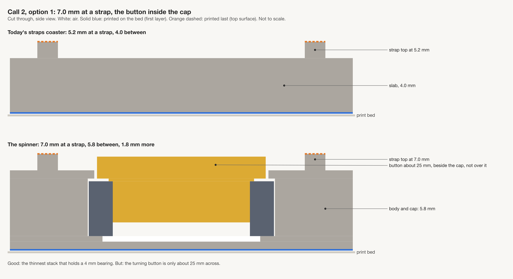

*Option 1 (my pick). 7.0 mm at a strap, 5.8 between. The button sits inside the cap.*

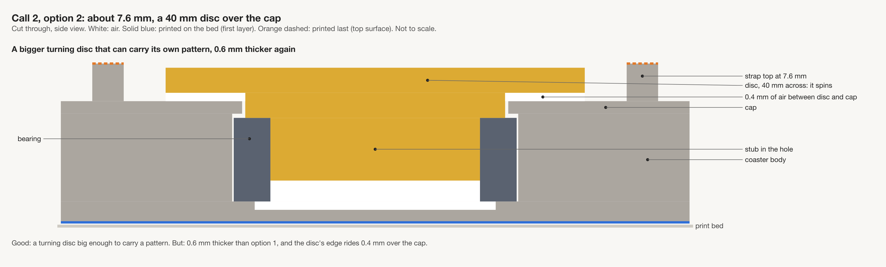

*Option 2. About 7.6 mm, with a 40 mm disc riding over the cap.*

**Your answer:**

- [ ] 1. 7.0 mm, the button inside the cap (my pick)
- [ ] 2. About 7.6 mm, a 40 mm disc over the cap
- Notes:

| | Pros | Cons | What it leads to |
|---|---|---|---|
| **1. 7.0 mm** | The thinnest stack that holds a 4 mm bearing | The button is only 25 mm across | The stack in the picture at the top |
| **2. 7.6 mm** | A turning disc big enough to carry its own pattern | 0.6 mm thicker again. The disc rides over the cap with only 0.4 mm of air | A thicker product |

## Call 3: which bearing to buy?

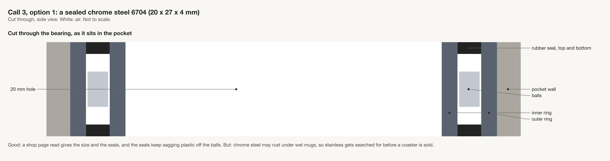

*Option 1 (my pick, for the test pieces). Sealed chrome steel. We read a shop page for it.*

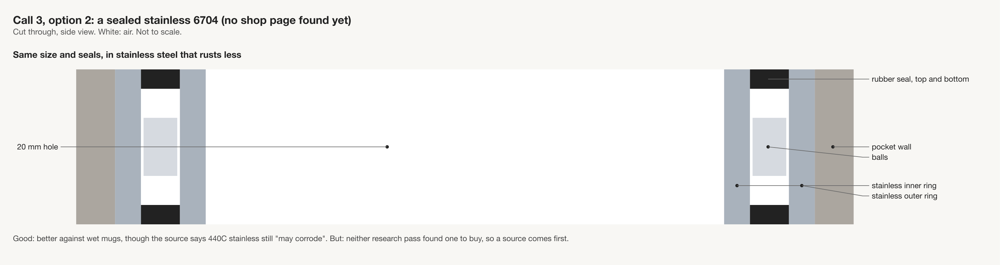

*Option 2. Sealed stainless. Neither research pass found one for sale.*

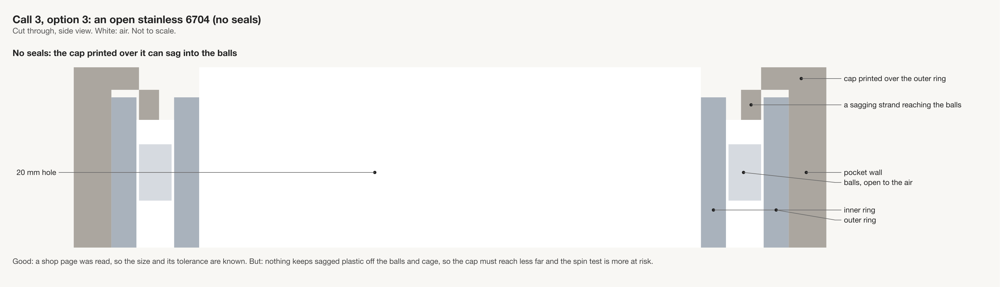

*Option 3. Open stainless. We read a shop page for it, but it has no seals.*

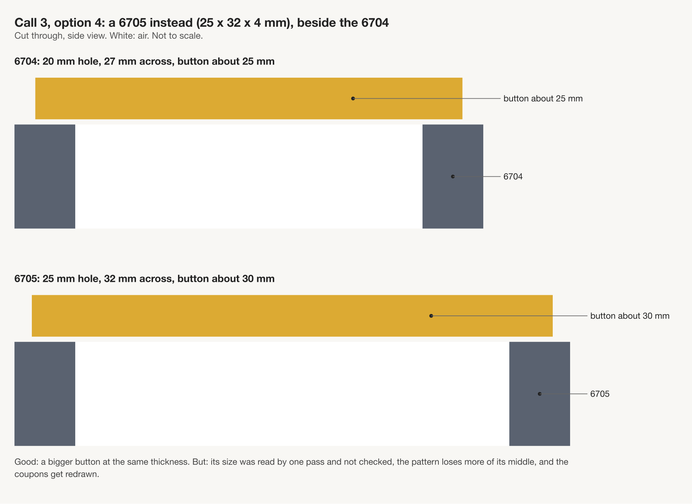

*Option 4. A 6705 (25 × 32 × 4 mm). It's the same thickness and takes a bigger button.*

**Your answer:**

- [ ] 1. Sealed chrome steel 6704 for the test pieces (my pick)
- [ ] 2. Sealed stainless 6704, once a source is found
- [ ] 3. Open stainless 6704
- [ ] 4. A 6705 instead
- Notes:

| | Pros | Cons | What it leads to |
|---|---|---|---|
| **1. Sealed chrome** | We read its shop page, so the size and seals are known. The seals keep sagging plastic off the balls | Chrome steel may rust under wet mugs | A search for a stainless one before any coaster is sold |
| **2. Sealed stainless** | Better against rust, though the source says even 440C stainless "may corrode" | Neither research pass found one to buy | Finding a source first |
| **3. Open stainless** | We read its shop page, so the size and its tolerance are known | Sagging plastic can reach the balls and the cage | A narrower cap, and more risk that the spin test fails |
| **4. 6705** | A bigger button at the same thickness | Only one research pass read its size, and the checker didn't re-open that page. The pattern loses more of its middle | The test pieces redrawn |

## Call 4: how does the pause get into the file we send?

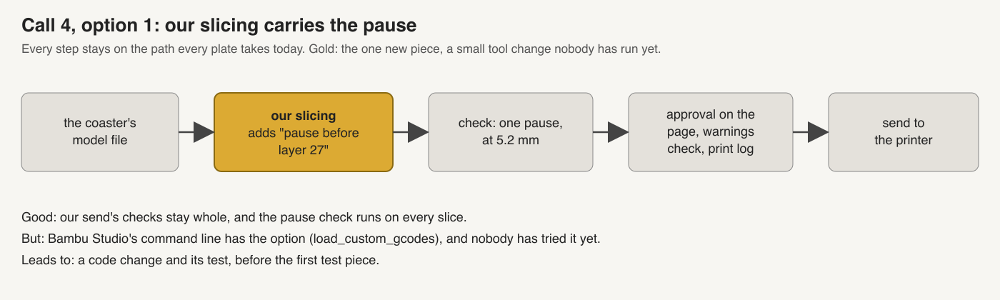

*Option 1 (my pick). Our slicing adds "pause before layer 27". Every check our sends have today
stays in place.*

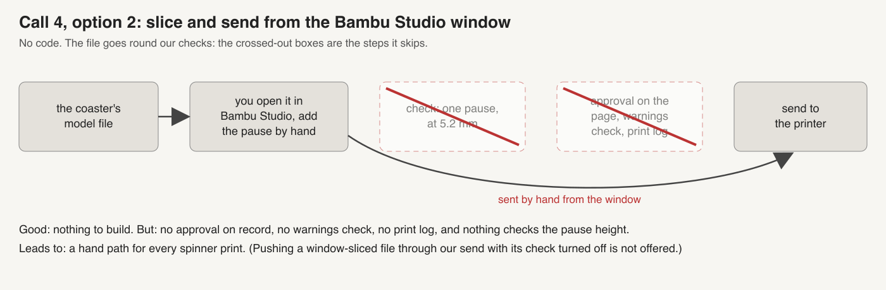

*Option 2. You add the pause by hand in the Bambu Studio window and send from there. The
crossed-out checks don't run.*

**Your answer:**

- [ ] 1. Teach our slicing to pass the pause to Bambu Studio's command line (my pick)
- [ ] 2. Slice and send from the Bambu Studio window by hand
- Notes:

| | Pros | Cons | What it leads to |
|---|---|---|---|
| **1. Our slicing** | Our send's checks stay whole, and the pause height is checked on every slice | A small tool change that nobody has run: the command-line option exists but is untried | A code change and its test before the first test piece |
| **2. The window** | No code | Outside our approvals, the warnings check and the print log, and nothing checks the pause height | A hand path for every spinner print |

There's a third way that I'm not offering: slice in the window and push the file through our send
with its check turned off. That skips a gate.

## Call 5: pause and cap, or split halves?

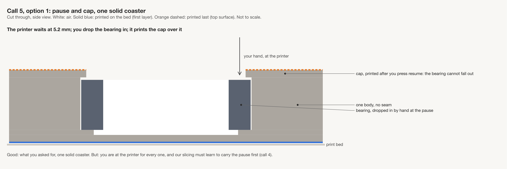

*Option 1 (my pick). One printed body with no seam, and the bearing can't fall out. You have to be
at the printer for the pause.*

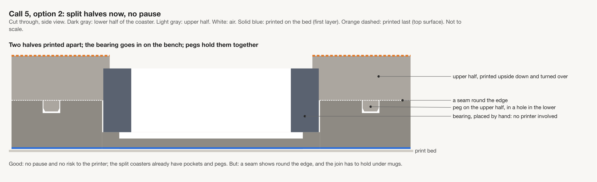

*Option 2. No pause and no hand in the printer. A seam shows round the edge.*

**Your answer:**

- [ ] 1. Pause and cap first, through the two test pieces (my pick)
- [ ] 2. Split halves now
- Notes:

| | Pros | Cons | What it leads to |
|---|---|---|---|
| **1. Pause and cap** | What you asked for: one solid coaster, and the bearing can't fall out | You at the printer for every one, so no unattended batches | The tool change in call 4. Split halves stay the fallback if a test piece fails |
| **2. Split halves** | No pause and no risk to the printer. Our split coasters already have the pocket and pegs | A seam round the edge, and a join that has to hold under mugs | The split coaster family, its joins and its tests |

The two test pieces, if you pick option 1: first a pocket test with no bearing, which checks that
the pause is clean. Then two small blocks with real bearings dropped in, which check that the cap
holds and the button spins. A whole coaster gets a pocket only after both pass.

## Things only you can do

- Buy the bearings, once call 3 is picked. The second test piece needs two.
- Before any bearing goes into a print: with the printer off and cold, hold a bearing against the
  underside of the toolhead, round the nozzle. If the head pulls it, pause and cap is dropped for
  split halves. If not, that risk is settled.
- Be at the printer during each pause, to drop the bearing in and press resume.
